# Isaac Sim 에서의 LIBERO-Spatial VLA 제로샷 평가 — 어댑터 · 하네스 수정과 실패 원인 분석 (v2)

MuJoCo(LIBERO)에서 학습된 VLA 정책(OpenVLA, OpenVLA-OFT)을 Isaac Sim 6.0.1 의 LIBERO-Spatial 재현 장면에서 평가하는 파이프라인을 점검하고 고친 기록이다. 평가 하네스와 어댑터(정책 액션 → 로봇 동작)의 결함을 찾아 고쳤고, 어댑터의 실행 배율을 MuJoCo 와 개루프로 맞춘 뒤 남은 실패의 원인을 물리 엔진의 접촉 차이로 좁혔다.

작성 2026-09-28 (v1) · 갱신 2026-10-01 (v2). v1 은 `README_v1_2026-09-28.md` 로 보존했다. v1 이후 바뀐 결론은 [부록 A](#부록-a-v1--v2-정정-목록)에 모았다.

## 핵심 결과

| 정책 | 실행 설정 | 배치 | 성공 / 판 | 성공률 |
|---|---|---|---|---|
| OpenVLA | 옛 하네스 | 고정 s00 | 84 / 500 | 16.8 % (쥐지 않은 성공 21 판 포함, 실제 12.6 %) |
| OpenVLA | 빠른 실행 (S=10 · gain 1.0) | 고정 s00 | **114 / 500** | **22.8 %** |
| OpenVLA-OFT | 빠른 실행 | 고정 s00 | 55 / 500 | 11.0 % |
| OpenVLA | **보정 실행 (S=3 · gain 0.65, MuJoCo 와 개루프 일치)** | LIBERO 초기 상태 50 개 | 69 / 499 | 13.8 % (09-27, 재측정 진행 중) |
| OpenVLA-OFT | **보정 실행** | LIBERO 초기 상태 50 개 | **232 / 499** | **46.5 %** |

고친 하네스의 모든 조건에서 **쥐지 않은 성공은 0 판**이다. 220 스텝, D405 카메라, S9 판정.

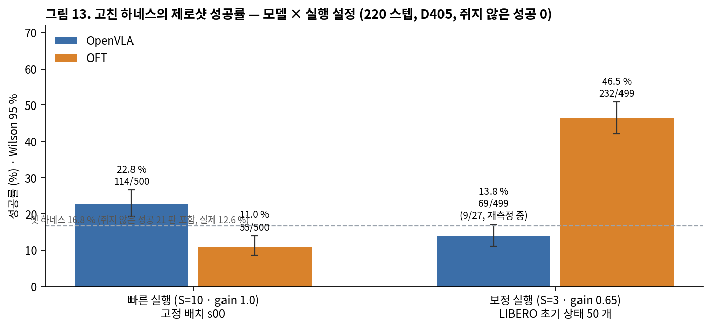

**요약.** (1) 하네스 결함만 고쳐도 같은 정책 · 같은 배치에서 실제 성공률이 12.6 % → 22.8 % 가 됐다. (2) 어댑터의 실행 배율을 MuJoCo 와 맞추자 청크를 실행하는 OFT 는 11.0 % → 46.5 % 가 됐고(배치도 함께 바뀜), 「허공에서 닫는」 실패가 94 판 → 0 판으로 사라졌다. 매 스텝 다시 보는 OpenVLA 는 반대로 빠른 실행에서 더 높았다. (3) 남은 실패의 97 % 는 「테두리를 물었는데 그릇이 안 들림」 이고, 정책 없는 파지 시험으로 **Isaac 에서 한쪽 테두리를 쥐면 그릇이 쥔 곳을 축으로 크게 기우는** 접촉 차이가 원인임을 확인했다.

---

## 목차

1. [배경](#1-배경)
2. [무엇이 문제였고 어떻게 고쳤나](#2-무엇이-문제였고-어떻게-고쳤나)
3. [제로샷 결과와 단계별 변화](#3-제로샷-결과와-단계별-변화)
4. [실패 원인 분석](#4-실패-원인-분석)
5. [시스템 구조 · 흐름도 · 수식 · Isaac 화면](#5-시스템-구조--흐름도--수식--isaac-화면)
6. [어댑터: 기존과 지금](#6-어댑터-기존과-지금)
7. [어댑터 외 설정과 그에 따른 양상](#7-어댑터-외-설정과-그에-따른-양상)
8. [학습 데이터와 재학습](#8-학습-데이터와-재학습)
9. [GR00T 평가와의 관계](#9-gr00t-평가와의-관계)
10. [그림 목록](#10-그림-목록)
11. [한계 · 앞으로 할 일](#11-한계--앞으로-할-일)
12. [재현](#12-재현)
- [부록 A. v1 → v2 정정 목록](#부록-a-v1--v2-정정-목록)

---

## 1. 배경

LIBERO-Spatial 은 10 개 태스크의 픽앤플레이스 벤치마크다. 모든 태스크가 「특정 위치의 검은 그릇을 접시 위에 놓기」 이고, 그릇의 위치(쿠키 상자 옆, 라메킨 위, 서랍 안 등)가 태스크를 가른다. 공개 VLA 체크포인트는 모두 이 벤치마크의 MuJoCo 사람 시연 500 개로 미세조정되어 있다.

이 작업은 그 정책들을 Isaac Sim 으로 옮겼을 때 성공률이 얼마나, 왜 떨어지는지 재고, Isaac 화면으로 다시 학습시켜 회복시키는 연구의 평가 · 데이터 파트다. 정책은 HTTP 서버로 띄우고, 브리지(`run_openvla_isaac_bridge.py`)가 관측을 보내고 받은 액션을 어댑터 · Lula IK · PhysX 로 실행한다 (5 절).

- **하네스**: 정책 출력을 로봇 동작으로 바꾸고, 판을 진행 · 종료 · 판정하는 평가 코드 전체.
- **어댑터**: 그중 「LIBERO 액션 → Isaac 손 목표 → 관절 동작」 으로 바꾸는 부분 (6 절).
- **제로샷**: Isaac 데이터로 추가 학습 없이 그대로 평가하는 것.

---

## 2. 무엇이 문제였고 어떻게 고쳤나

### 2.1 평가 하네스 · 어댑터

| 문제 | 증상 · 근거 | 해결 | 효과 |
|---|---|---|---|
| 조기 종료 관문 (닫기 6 회 제한, IK 연속 실패 중단, 온라인 닫기 재시도 3 회) | 500 판 중 **395 판**이 220 스텝 전에 끊김 | 관문 해제 (`1000 / observe / 1000`), 실패는 220 스텝 소진으로만 | 조기 종료 395 → **0** |
| 집게 즉시 닫힘 | 닫기 명령에 팔을 멈추고 0.35 초에 닫음. MuJoCo 는 약 0.7 초 동안 팔이 계속 내려감 | 위치 목표만 주고 PD 로 자연스럽게 닫힘 (`--close-approach-settle-steps 0 --gripper-settle-steps 1`) | 닫힘 타이밍을 MuJoCo 와 맞춤 |
| 방향 제약을 푼 IK 대체 | 평가에서 손이 임의 방향으로 틀어져 한 배치 0/69 | 평가에서 끔 (`--no-ik-position-fallback`), IK 실패 시 현재 자세 유지 | |
| 실행 배율 미검증 | v1 은 성공률이 높은 S=10 · gain 1.0 을 채택. 같은 명령에 MuJoCo 와 다른 거리를 움직임 | **사람 시연 명령 개루프 재생으로 검증**, MuJoCo 와 일치하는 S=3 · gain 0.65 를 공통 조건으로 (6 절) | 접근 구간 이동비 1.26 → **1.02** |
| 렌더 비용 | 물리 서브스텝마다 렌더 | 마지막 서브스텝만 렌더 | 판당 3–5 분 → 1–2 분 |
| 무응답 판 | 7 시간 멈춘 판 발생 | 감시자: 로그 5 분 정지 시 끊고 재시도 (`watchdog_v2.sh`, v1 은 15 분) | |

### 2.2 성공 판정

| 문제 | 해결 |
|---|---|
| 접시 반경 판정이 **쥐지 않고 밀어 올린 21 판**을 성공으로 셈 (16.8 % → 실제 12.6 %) | **S9** 판정 (발자국 · 높이 · 정지 · 30 mm 위에서 하강) + 모든 성공 판의 **파지 감사** (손가락 폭 · `gripper_holding_ok`) |
| 기운 그릇(48.4°)이 배치 판정을 통과한 사례 | S9 의 높이 · 정지 조건 |
| 도달 단계 `stage_level` 의 S4 이후가 부정확 (성공 114 판 중 92 판이 S3 으로 기록) | 실패 분석은 **물리 신호 5 부류**로 (3.3 절) |

### 2.3 재생 · 학습 데이터

| 문제 | 증상 · 근거 | 해결 |
|---|---|---|
| 손 방향 쿼터니언 순서 | LIBERO `eef_quat` 은 xyzw, 브리지 기본 wxyz → 목표 방향 최대 50° 오차, 먼 태스크 IK 실패 판당 1,522 · 1,594 회 | `--libero-eef-quat-order xyzw` → IK 실패 0, 추종 오차 0.5–0.6° (그림 4, 5) |
| 재생 스텝 100 | 긴 궤적이 놓기 전에 잘림 (118 판) | 220 |
| 서브스텝 IK 예외 | 브리지가 통째로 종료 (170 판) | 그 서브스텝만 현재 자세 유지 |
| task 5 높이 | 라메킨 높이를 낙하 전 공중에서 재서 그릇이 22 cm 위에서 떨어짐 | 받침 정렬을 끈 전용 설정 |
| 재생 z +15 mm | 테두리 위 허공에서 닫힘 | 0, 수집 기본 −6 mm (task 0 실패 14 판 중 6 판 회복). 모자란 궤적은 −10 mm 로 재시도해 9 개 추가 |
| 채택 기준 | 파지(S4)만 성립해도 채택 | 과제 성공(S9) 만 |
| **화면 시간 정렬 (v2 에서 발견)** | 재생 모드는 스텝 k 동안 로봇을 시연 k 번째 자세로 옮기고 화면은 스텝 시작에 찍어, 화면 k 가 k−1 번째 자세 | 학습셋에서 **스텝 k 에 화면 k+1** 사용 (8 절, 그림 19). 정책 평가에는 영향 없음 |

---

## 3. 제로샷 결과와 단계별 변화

### 3.1 태스크별 성공률 (%)

| 태스크 | 그릇 위치 | OpenVLA 빠른 · s00 | OFT 빠른 · s00 | OpenVLA 보정 · 50 배치 (09-27) | OFT 보정 · 50 배치 |
|---|---|---|---|---|---|
| T0 | 접시와 라메킨 사이 | 20 | 0 | 4 | 38 |
| T1 | 라메킨 옆 | 26 | 0 | 12 | 12 |
| T2 | 테이블 가운데 | 56 | 0 | 59 | 84 |
| T3 | 쿠키 상자 위 | 18 | 0 | 12 | 98 |
| T4 | 캐비닛 위 서랍 안 | 4 | 2 | 2 | 44 |
| T5 | 라메킨 위 | 0 | 4 | 2 | 0 |
| T6 | 쿠키 상자 옆 | 80 | 96 | 28 | 44 |
| T7 | 스토브 위 | 6 | 0 | 18 | 8 |
| T8 | 접시 옆 | 14 | 0 | 0 | 64 |
| T9 | 나무 캐비닛 위 | 4 | 8 | 2 | 72 |
| **전체** | | **22.8** | **11.0** | **13.8** | **46.5** |

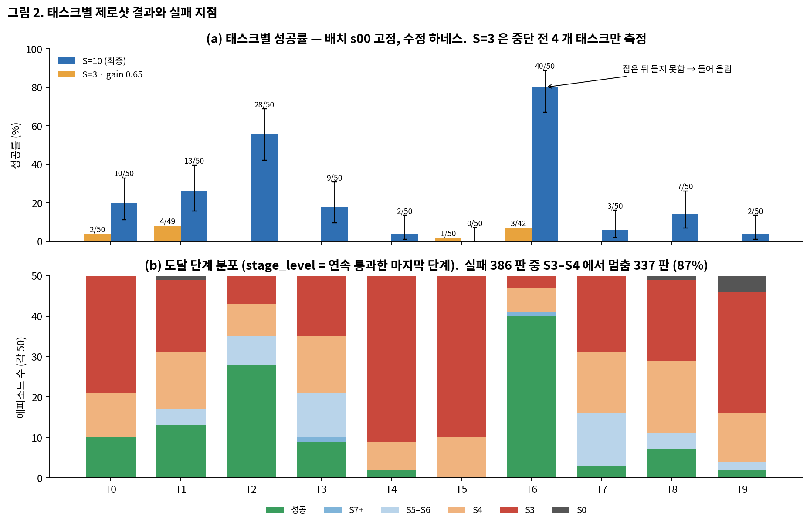

### 3.2 단계(S0–S9)로 본 변화

옛 하네스는 500 판 중 395 판을 중간에 끊었기 때문에, 옛 하네스의 단계 분포는 「정책이 어디서 멈췄나」 가 아니라 「관문이 어디서 끊었나」 를 보여 줘 직접 비교할 수 없다. 고친 하네스에서 보이는 변화는 이렇다.

| 단계 | 옛 하네스 | 고친 하네스 (OpenVLA 빠른 · s00) |
|---|---|---|
| 끝까지 진행 | 105 / 500 판 | **500 / 500 판** |
| S9 성공 중 쥐지 않은 성공 | 21 / 84 | **0 / 114** |
| 실패가 멈춘 단계 | 비교 불가 (관문 종료) | S0 6 · **S3 222 · S4 115** · S5 25 · S6 16 · S7 2 (실패 386 판) |

실패 386 판 중 337 판(87 %)이 S3–S4 (그릇 위로 손을 맞추고 테두리를 무는 구간)에서 멈췄다. 다만 성공 판의 다수도 S3 으로 기록될 만큼 S4 이후 기록이 부정확해, 아래 물리 신호 분류로 다시 봤다.

### 3.3 물리 신호 5 부류

| 부류 | 정의 (5.4 절 식 10) | OpenVLA 빠른 | OFT 빠른 | OFT 보정 |
|---|---|---|---|---|
| A 성공 | S9 | 114 | 55 | 232 |
| B 물었는데 못 듦 | 손가락 2.5–12 mm 를 3 샘플 이상, 그릇 상승 < 40 mm | 164 (실패의 42 %) | 264 (59 %) | **258 (97 %)** |
| C 허공에서 닫음 | 위 「문 상태」 없이 상승 < 40 mm | 105 (27 %) | 94 (21 %) | **0** |
| D 들고 가다 실패 | 상승 ≥ 40 mm, 끝에서 접시와 ≥ 100 mm | 110 (28 %) | 84 (19 %) | 9 (3 %) |
| E 접시 근처 실패 | 상승 ≥ 40 mm, 끝에서 < 100 mm | 7 | 3 | 0 |

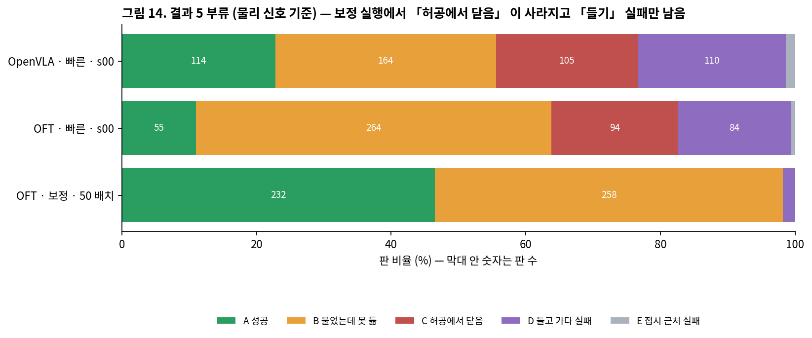

- **정렬 (C)**: 빠른 실행에서 두 모델 모두 컸고, 보정 실행에서 OFT 는 0 이 됐다. 성공 판은 그릇 중심에서 42–45 mm (테두리 위), B · C 는 67–123 mm (테두리 바깥)에서 닫았다.
- **들기 (B)**: 보정 실행 OFT 의 거의 유일한 실패 유형. 4 절의 접촉 문제.
- **목적지 (D)**: OpenVLA 는 들고 난 뒤 실패 117 판 중 92 % 가 접시 60 mm 안에 한 번도 못 감. OFT 는 72 % 가 접시 60 mm 안까지 가서 놓았는데 그릇이 남지 않음.

---

## 4. 실패 원인 분석

### 4.1 가설과 판정

| 가설 | 그렇게 본 이유 | 확인 방법 · 결과 | 상태 |
|---|---|---|---|
| ① 렌더링 외관 차이로 정책이 그릇 위치를 잘못 읽음 (v1 의 주가설) | 첫 스텝 명령이 MuJoCo 와 다름 (x 0.54 → 0.89) | 사람 시연을 Isaac 에서 재생해 같은 로봇 자세를 만든 뒤 두 화면에 대한 OFT 명령 비교: 크기비 0.99 · 코사인 0.98 · 진행비 0.97 (43 샘플). 카메라 화각 실험도 차이 없음 (7 절) | **OFT 에 대해 기각** (OpenVLA 는 미확인) |
| ② 실행 속도가 MuJoCo 와 달라 청크가 빗나감 | OFT 가 빠른 실행에서 첫 청크(8 액션)에 24 cm 이동, 그릇을 지나쳐 접시 근처에서 닫음 (T0 49/50) | 개루프 검증 후 보정 실행: 「허공에서 닫음」 94 → **0**, OFT 46.5 % | **확인** |
| ③ 접촉: 한쪽 테두리를 쥐면 Isaac 그릇이 기움 | 보정 OFT 실패의 97 % 가 B. 정책은 들라고 명령(문 뒤 손 +21 mm)하는데 그릇은 0 mm, 600 스텝 동안 17 번 다시 집음 | **정책 없는 파지 시험**: 같은 동작에서 MuJoCo 는 바닥 65–77 mm · 기울기 2–15°, Isaac 은 쥔 쪽 79–81 mm 올라가지만 바닥 35–43 mm · 세로 89–98 mm (크게 기움) | **확인** |
| ③-1 원인 세부 | 질량 (MuJoCo 6 g 대 Isaac 85 g) · 마찰 · 접촉 계산 | 그릇 쪽 PhysX 설정 5 가지(반복 계산 · 재질 · 결합 방식 · 접촉 여유 · 비틀림 마찰) 효과 없음. 질량 6 g 은 얕은 파지에서만 일부 개선 | **진행 중** (손가락 쪽 미시험, 조정은 중단) |
| ④ OpenVLA 가 접시를 목적지로 찾지 못함 | D 부류 92 % 가 접시에 접근 못 함 | OpenVLA 같은 자세 탐침 미실시 | **미확인** |
| ⑤ Isaac 접시가 평평한 원반이라 놓은 그릇이 미끄러짐 | 접시 충돌 모양: MuJoCo 오목한 접시(상자 10 개) 대 Isaac `convexHull` | 볼록 분해 사본 미시험 | **가설** |
| ⑥ 시간(220 스텝) 부족 | 보정 실행에서 220 스텝 소진 | 600 스텝에서도 나아지지 않음 (두 모델, task 0 · 6) | **기각** |
| ⑦ 그릇 질량이 성공률의 주원인 | 질량 14 배 차이 | 85 g 으로 성공한 판 다수, 6 g 평가에서 개선 없음 (5/20) | **기각** (기울기에는 일부 기여) |
| ⑧ 물체 크기 차이 | 사진상 차이 | 보이는 모양 · 충돌 모양(그릇 상자 40 개) 동일 | **기각** |

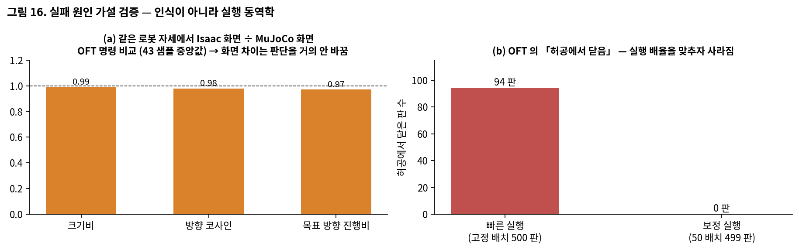

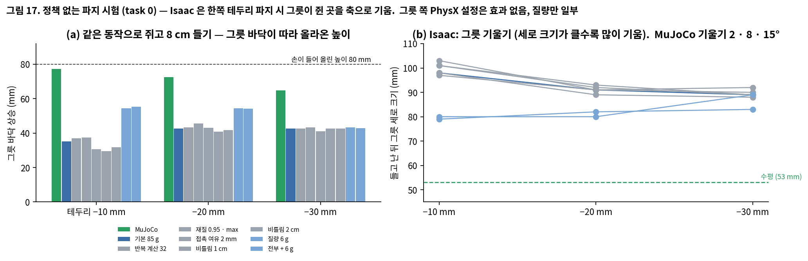

### 4.2 결론

실패는 단계별로 다른 원인을 가진다. **정렬 단계**의 실패는 주로 실행 동역학(배율 · 청크) 문제였고 보정으로 해결됐다. **들기 단계**의 실패는 Isaac 의 접촉 모델이 한쪽 파지에서 그릇의 회전을 막지 못하는 물리 차이이며, 그릇 쪽 설정으로는 고쳐지지 않는다. 이 접촉 차이는 Isaac 에서 실제로 성공한 파지만 담은 데이터로 재학습해 정책 쪽에서 우회하는 것이 다음 단계다 (8 절).

| 실제 Isaac 실행 | | |
|---|---|---|
| 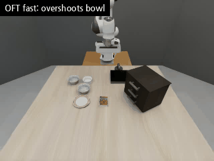 | 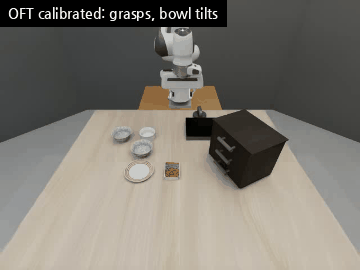 | 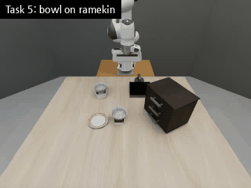 |
| 빠른 실행 OFT: 그릇을 지나침 | 보정 실행 OFT: 물었지만 그릇이 기움 | task 5: 라메킨 위에서 안 들림 |

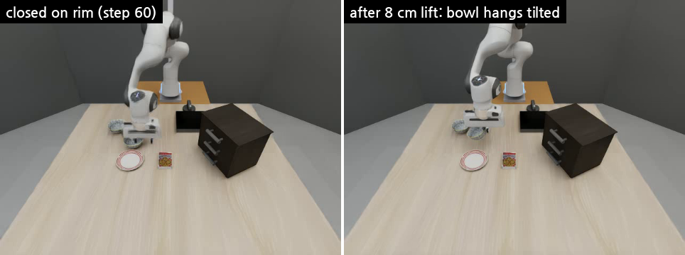

---

## 5. 시스템 구조 · 흐름도 · 수식 · Isaac 화면

### 5.1 Isaac 화면

**정책 입력 화면 (태스크 0–9, MuJoCo · Isaac · 겹침)**

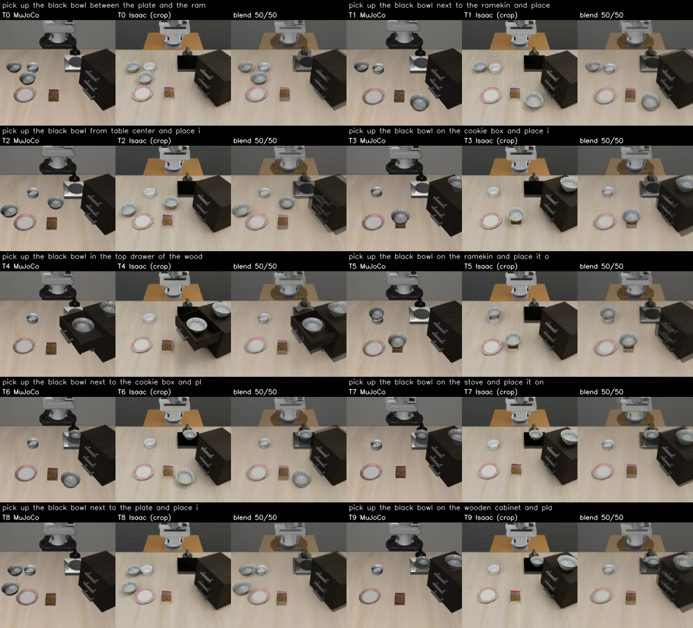

**실행 중 장면 — 태스크별 초기 · 파지 · 놓기 (실제 Isaac Sim)**

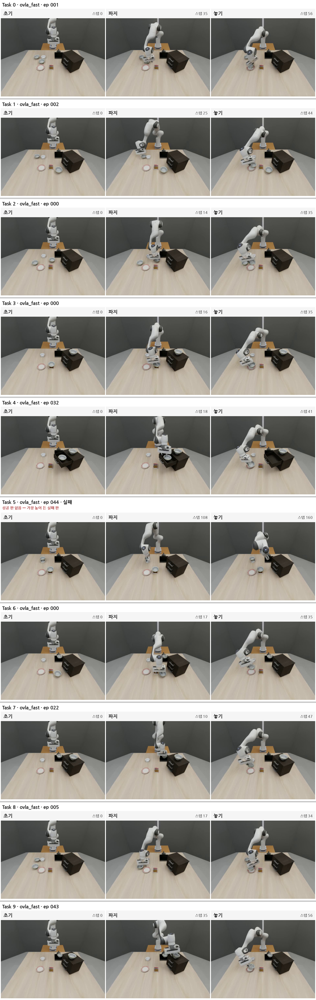

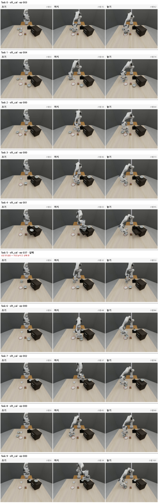

**한 판을 처음부터 성공까지**

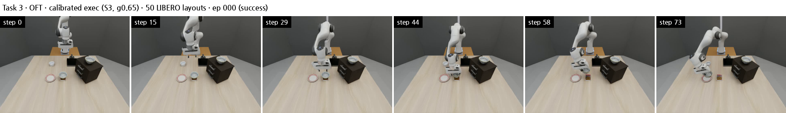

| | | | | |
|---|---|---|---|---|
| 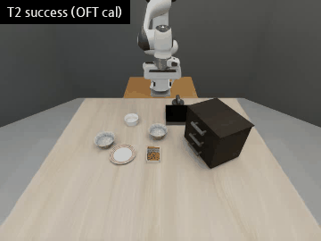 | 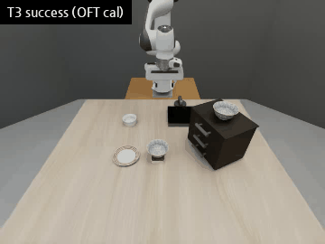 | 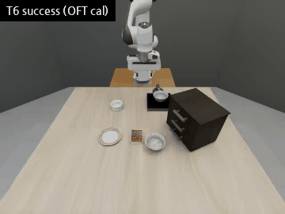 | 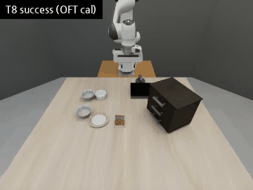 | 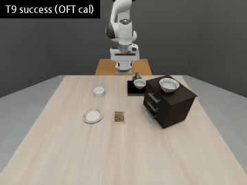 |
| T2 | T3 | T6 | T8 | T9 |

**카메라 — D405 원본 위 모델 입력 영역, 모델이 받는 화면, 손목 카메라**

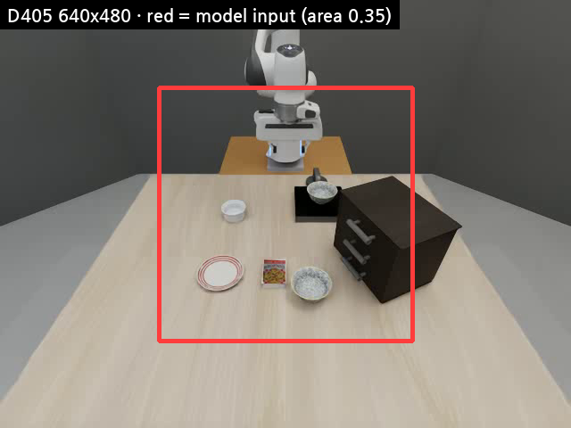 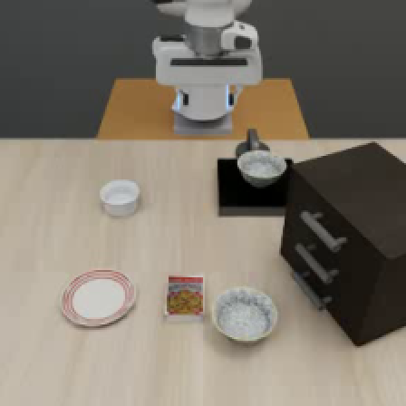

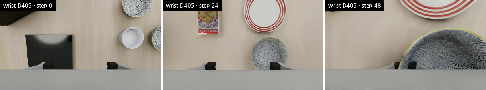

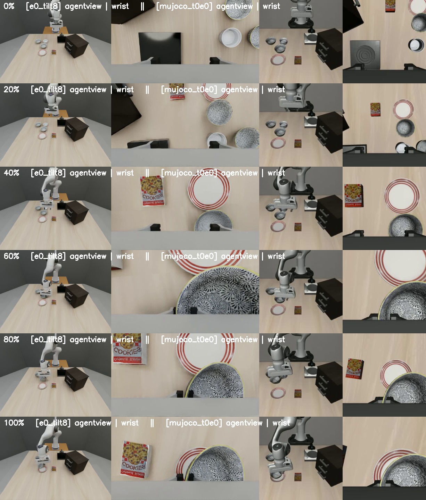

`figures/isaac/` 의 그림은 `bash code/report/collect_isaac_figures.sh` 로 실제 실행 기록에서 뽑는다.

### 5.2 구조

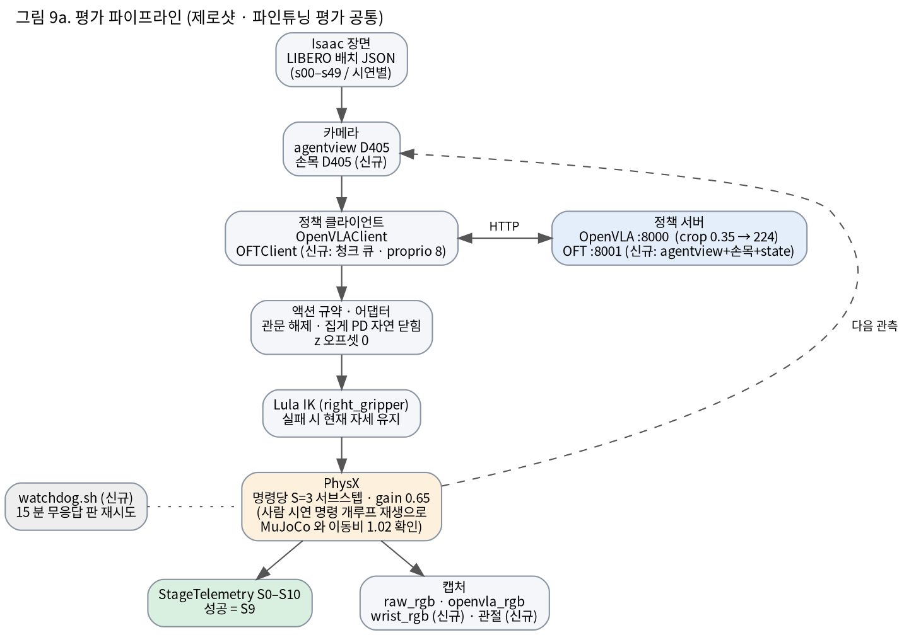

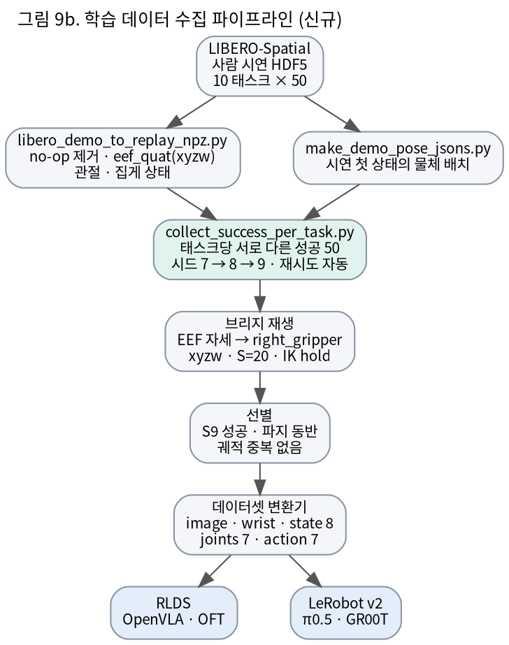

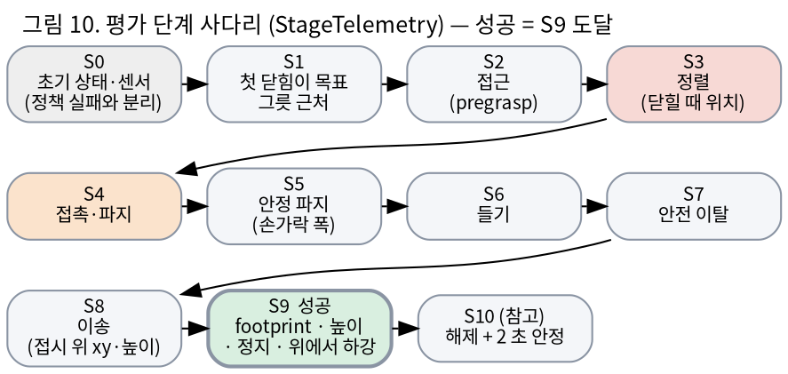

### 5.3 SW 흐름도 — 한 정책 스텝

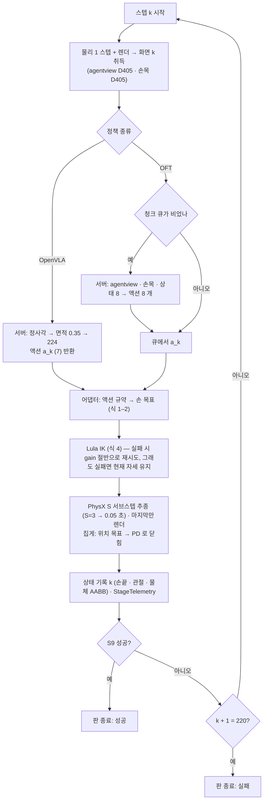

재생 모드는 정책 대신 시연을 따라간다. 스텝 k 에 손 목표를 **시연의 k 번째 자세**로 두므로, 화면 k (스텝 시작)는 k−1 번째 자세, 상태 k (스텝 끝)는 k 번째 자세가 된다. 그래서 재생 기록으로 학습셋을 만들 때는 화면을 한 칸 옮긴다 (8 절).

### 5.4 수식

**(1) LIBERO 액션 규약.** 액션 $a = (a_x, a_y, a_z, a_{rx}, a_{ry}, a_{rz}, a_g) \in [-1, 1]^7$.

$$\Delta p = 0.05\,[a_x, a_y, a_z]^\top \ \text{m}, \qquad \Delta\theta = 0.5\,[a_{rx}, a_{ry}, a_{rz}]^\top \ \text{rad}, \qquad a_g = -1\ \text{(열림)},\ +1\ \text{(닫힘)}$$

**(2) 어댑터 손 목표.** 현재 손끝 $p_t, R_t$, 실행 배율 $g$:

$$p^\ast = p_t + g\,\Delta p, \qquad R^\ast = \exp\!\big([g\,\Delta\theta]_\times\big)\,R_t$$

**(3) 스텝 시간.** 물리 60 Hz, 액션당 서브스텝 $S$ 이면 $\Delta t = S / 60$ s. 보정 $S=3$ 은 0.05 s (MuJoCo 20 Hz 와 같음), 빠른 $S=10$ 은 0.167 s.

**(4) IK 와 되돌림.** $q^\ast = \mathrm{IK}(p^\ast, R^\ast)$. 실패하면 $g \leftarrow \beta g$, $\beta \in \{1.0, 0.5\}$ 로 다시 풀고, 모두 실패하면 $q^\ast = q_t$ (현재 자세 유지).

**(5) 카메라 화각.** 정사각 픽셀 핀홀은 세로 화각이 가로 화각과 해상도로 정해진다.

$$\mathrm{FOV}_v = 2\arctan\!\Big(\tan\tfrac{\mathrm{FOV}_h}{2}\cdot\tfrac{H}{W}\Big) = 2\arctan(\tan 43.5^\circ \cdot 480/640) = 70.9^\circ$$

정사각으로 자른 뒤 면적 $a$ 를 가운데에서 자르면 $\mathrm{FOV}(a) = 2\arctan\!\big(\tan 35.45^\circ\cdot\sqrt{a}\big)$. $a = 0.35$ → 45.7° (LIBERO 학습 화면 45°), $a = 0.9$ → 68.1°.

**(6) OFT 상태 프레임 변환.** Isaac `right_gripper` 자세 $(p_{rg}, R_{rg})$ → robosuite `robot0_eef`:

$$R_{eef} = R_{rg} R_{off}, \qquad p_{eef} = p_{rg} + R_{rg}\,p_{local}, \qquad R_{off} = \mathrm{Rot}(180^\circ),\ \lVert p_{local}\rVert = 3.7\ \text{mm}$$

**(7) 실행 배율 검증 (개루프).** 같은 시연 명령을 재생한 Isaac 손끝 $p^I_k$ 와 MuJoCo 기록 $p^M_k$:

$$r_W = \frac{\lVert p^I_W - p^I_0\rVert}{\lVert p^M_W - p^M_0\rVert}, \quad r^{(c)}_{24} = \frac{p^I_{24,c} - p^I_{0,c}}{p^M_{24,c} - p^M_{0,c}}, \quad e_{pos} = \lVert p^I_{k_c} - p^M_{k_c}\rVert, \quad e_{rot} = \arccos\frac{\mathrm{tr}(R^{I\top}_{k_c} R^M_{k_c}) - 1}{2}$$

$W \in \{8, 24, k_c\}$, $k_c$ = 첫 닫기 명령. 합격: $|r_{k_c} - 1| \le 0.05$, $|r_{24} - 1| \le 0.05$, $|r^{(c)}_{24} - 1| \le 0.10$, $e_{pos} \le 30$ mm, $e_{rot} \le 10^\circ$.

**(8) S9 성공.** 그릇 바닥 중심 $b$, 접시 윗면 높이 $z_p$:

$$b_{xy} \in \text{접시 유효 영역},\quad |b_z - z_p| \le \epsilon_z,\quad \lVert v\rVert \le v_{th},\ \lVert\omega\rVert \le \omega_{th},\quad \max_{\tau < t} b_z(\tau) \ge z_p + 30\ \text{mm}$$

**(9) 성공률 신뢰구간.** Wilson 95 %: $\dfrac{\hat p + \frac{z^2}{2n} \pm z\sqrt{\frac{\hat p(1-\hat p)}{n} + \frac{z^2}{4n^2}}}{1 + z^2/n}$, $z = 1.96$.

**(10) 결과 5 부류.** 손가락 평균 폭 $w_t$, 그릇 바닥 상승 $\ell = \max_t b_z - b_{z,0}$, 끝 거리 $d = \lVert b_{xy,T} - p_{xy}\rVert$:

$$\text{A: S9}; \quad \ell < 40\,\text{mm} \Rightarrow \begin{cases}\text{B} & \exists\, 3\ \text{연속}\ 2.5 < w_t < 12\ \text{mm}\\ \text{C} & \text{otherwise}\end{cases}; \quad \ell \ge 40\,\text{mm} \Rightarrow \begin{cases}\text{E} & d < 100\ \text{mm}\\ \text{D} & d \ge 100\ \text{mm}\end{cases}$$

**(11) 학습셋 시간 정렬 판정.** 지연별 상관 $c_L$ 의 봉우리를 포물선으로 칸 사이까지 추정한다.

$$L^\ast = L_i + \frac{1}{2}\,\frac{c_{i-1} - c_{i+1}}{c_{i-1} - 2c_i + c_{i+1}}$$

원본 LIBERO 의 $L^\ast$ 와 0.5 스텝 안이면 정렬된 것으로 본다 (그림 19).

---

## 6. 어댑터: 기존과 지금

| 구성 요소 | 옛 하네스 (16.8 % 측정 당시) | v1 보고서 (09-28, 22.8 %) | **지금 (v2)** |
|---|---|---|---|
| 액션 규약 (식 1) | 0.05 m · 0.5 rad / 단위 | 같음 | 같음 |
| 실행 배율 (식 2–3) | S=3 · gain 0.65 | S=10 · gain 1.0 | **S=3 · gain 0.65** (공통 조건), 빠른 설정은 비교용으로 함께 보고 |
| 배율의 근거 | 일정 크기 시험 명령의 정상 상태 응답 (09-25) | 성공률이 높은 쪽 | **사람 시연 명령 개루프 재생 궤적 대조** (식 7, 그림 15) |
| IK 실패 처리 (식 4) | 5 회 연속이면 판 종료 | 현재 자세 유지 | 같음 |
| IK 방향 완화 대체 | — | 평가에서 끔 | 같음 |
| 집게 | 팔을 멈추고 즉시 닫힘 | PD 로 자연 닫힘 | 같음 |
| 조기 종료 관문 | 켬 (395/500 판 종료) | 해제 | 같음 |
| 정책 경로 | OpenVLA | + OFT (청크 큐 · 손목 · 상태) | + OFT 상태 프레임 보정 (식 6) |
| 판정 | 접시 반경 | S9 + 파지 감사 | S9 + 파지 감사 + 5 부류 |

### 실행 배율 검증 결과 (시연 4 개 평균)

| 설정 | 이동비 0–8 | 0–24 | 첫 닫기까지 | 축별 x / y / z | 파지 시점 위치 · 회전 오차 | 판정 |
|---|---|---|---|---|---|---|
| 물리 10 · gain 1.0 (v1) | 3.18 | 1.35 | 1.26 | 1.73 / 0.65 / 0.96 | 159 mm · 136° | 불합격 |
| **물리 3 · gain 0.65 (v2)** | 1.17 | **1.02** | **1.02** | **1.01 / 0.90 / 1.00** | **21 mm · 8°** | **합격** (y 축 경계) |
| 물리 10 · gain 0.25 | 0.76 | 0.67 | 0.71 | 0.61 / 0.64 / 0.90 | 137 mm · 7° | 불합격 |

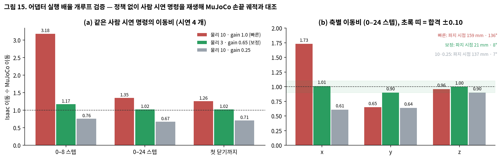

참고: MuJoCo OSC 의 반응 실측은 정지 상태 첫 스텝에 목표 변위의 약 9 %, 같은 명령을 계속 줄 때 스텝당 약 23 %, 집게 완전 닫힘 14 스텝이다. 지금 어댑터에 남은 차이는 **출발 8 스텝의 17 % 선행**(MuJoCo 는 천천히 출발해 가속)과 **y 축 10 % 부족**이다. 출발 가속 램프와 축별 배율이 다음 개선 후보다.

---

## 7. 어댑터 외 설정과 그에 따른 양상

| 설정 | 바꾼 값 | 결과 | 해석 |
|---|---|---|---|
| **실행 설정 × 모델** | 빠른 · 고정 s00 대 보정 · 50 배치 | OpenVLA 22.8 → 13.8 %, OFT 11.0 → 46.5 % | 매 스텝 다시 보는 OpenVLA 는 빠른 실행이 들기에 유리했고, 청크를 실행하는 OFT 는 MuJoCo 와 같은 실행이어야 첫 청크가 맞음. 배치도 함께 바뀌어 분리 측정 예정 |
| 같은 배치 s00, 실행만 | OpenVLA T6: 보정 3/42 대 빠른 40/50 | | 빠른 실행에서 OpenVLA 의 들기가 쉬움 |
| 스텝 한도 | 220 대 600 (보정 실행, T0 · T6 각 5 판) | OpenVLA 4/10 → 2/10, OFT 4/10 → 3/10 | 시간 부족 아님 |
| 카메라 | LIBERO 원본 256² · 45° 대 D405 crop 0.35 (약 46°) | 둘 다 T0 · T6 5/10 | LIBERO 화각 근처에서는 같음 |
| | D405 crop 0.9 (약 68°, 설정 착오) | T6 0/5 | 화면이 크게 넓어지면 OpenVLA 무너짐 |
| 그릇 질량 | 85 g (자산 기본) 대 6 g (MuJoCo) | 정책 평가 개선 없음 (5/20), 파지 시험 얕은 쥠에서 일부 개선 | 성공률의 주원인 아님. 아주 가벼우면 빠른 실행에서 튕겨 나가기도 함 |
| 그릇 쪽 PhysX 설정 | 반복 계산 32, 재질 0.95 · max, 접촉 여유 2 mm, 비틀림 마찰 1 · 2 cm | 파지 시험 기울기 변화 없음 | 그릇 쪽으로는 접촉 차이를 못 고침 |
| 손가락 마찰 (09-02) | 5.0 대 0.05 | 3/10 → 0/10 (접촉 8/10, 안정 파지 1/10) | 마찰은 결정적 → 5.0 유지 |
| 명시적 프롬프트 (09-02) | 원문 대 구체화 | 17.6 → 5.0 % | 학습 문장 그대로가 좋음 |
| 판정 문턱 (GR00T 측정) | 접시 중심 50 mm 대 20 mm | 67.6 → 24.6 % | 판정 정의가 수치를 크게 바꿈 → S9 공통 사용 |
| 렌더 | 서브스텝마다 대 마지막만 | 속도만 차이 | |

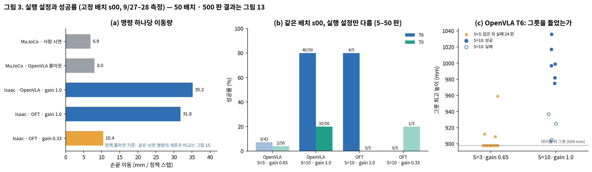

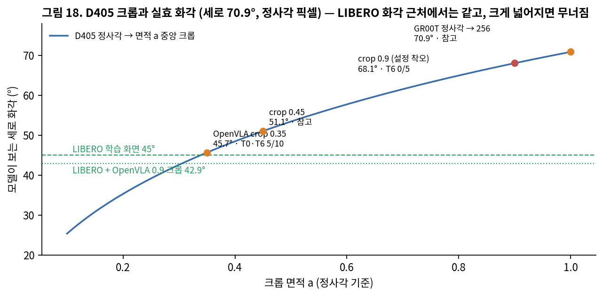

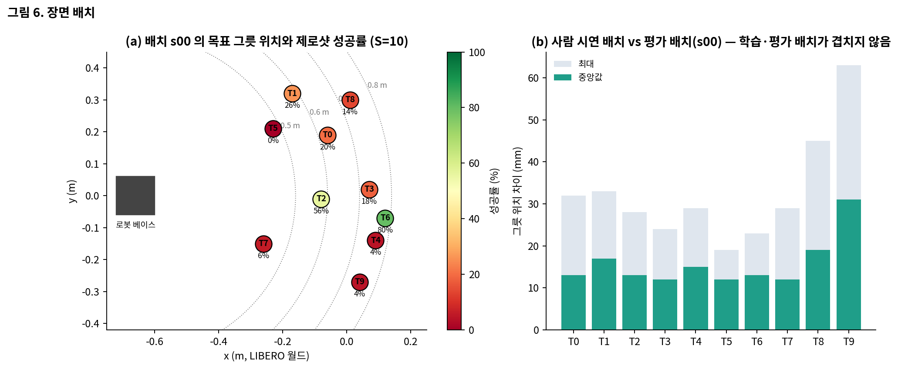

---

## 8. 학습 데이터와 재학습

**수집.** LIBERO-Spatial 사람 시연 500 개를 Isaac 에서 재생해 과제에 성공(S9)한 것만 남긴다. 현재 **429 / 500** (T0 43 · T1 47 · T2 48 · T3 47 · T4 43 · T5 14 · T6 50 · T7 46 · T8 45 · T9 46). task 5 는 4 절 ③ 의 접촉 문제로 막혀 있어 학습셋에서 3 배 반복한다.

**변환 (`build_finetune_dataset_v4b.py`).** 정사각 → 면적 0.389 → 224 (학습 증강 0.9 를 거치면 평가 crop 0.35 와 같은 시야), 스텝 k 에 화면 k+1, no-op 제거, 집게 환경 규약. 변환기 검사(집게 규약 · 이미지 방향 · 정지 프레임 · 길이 · 액션 분포)와 시간 정렬 검증(`verify_dataset_v4c.py`)을 모두 통과했다. 화면을 한 칸 옮기자 화면–동작 곡선이 1.06 스텝 이동해 원본 LIBERO 와 0.2 스텝 안으로 겹쳤다.

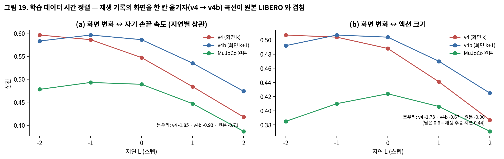

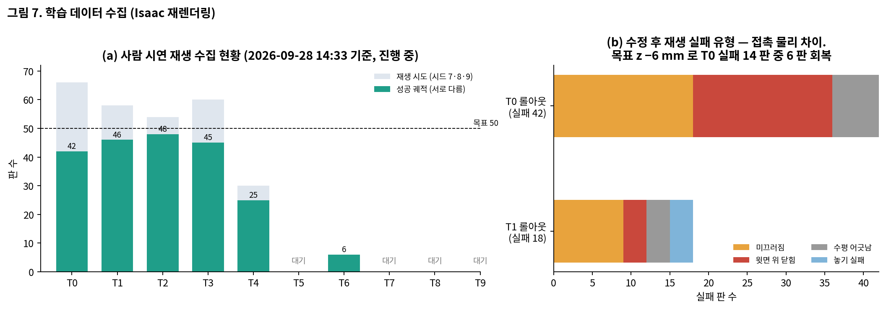

**재학습 (진행 중).** 출발점 `openvla-7b-finetuned-libero-spatial`, LoRA r32, 학습률 5e-5, 배치 16, 8,000 스텝 (2,000 스텝마다 저장), 이미지 증강. RLDS 는 등록된 `isaac_libero_spatial` 이름 · 9 월과 같은 스키마로 별도 폴더에 빌드하고 npz 와 한 값까지 대조한다. 평가는 4 개 저장 시점을 보정 실행 · 50 배치로 재서 제로샷(13.8 %, 재측정 중)과 비교한다.

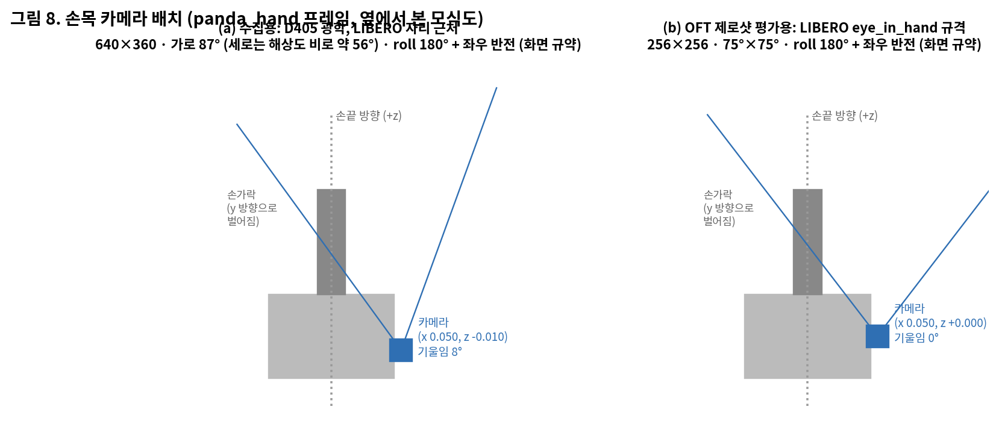

---

## 9. GR00T 평가와의 관계

같은 장면을 쓰는 GR00T 팀의 N1.7 제로샷 67.6 % 는 환경 앵커 배치 하나, 1 차는 9 개 태스크에서 방해 그릇 없음, 1,200–2,800 액션 예산, 접시 중심 50 mm 판정에서 잰 값이다(배치 30 세트 17 %, 20 mm 판정 24.6 %). 두 팀은 아래 공통 조건에 합의했다.

| 항목 | 공통 조건 |
|---|---|
| 배치 · 방해 물체 | LIBERO 초기 상태 50 개, 원래대로 |
| 스텝 한도 | 220 실행 액션 (주), 600 (보조) |
| 판정 | S9 + 파지 감사 |
| 실행 배율 | 값이 아니라 식 7 의 합격 기준을 각 하네스가 통과 |
| 카메라 | D405 (실물과 맞춤). 렌더는 공통, 모델 입력 전처리는 모델별 명시 |

이 조건으로 잰 첫 결과가 OFT 46.5 % 다.

---

## 10. 그림 목록

| 그림 | 내용 | v2 상태 |
|---|---|---|
| 1 | 제로샷 개요 (v1) | 그대로. 최신은 그림 13 |
| 2 | 태스크별 결과와 도달 단계 분포 | 그대로 |
| 3 | 실행 설정과 성공률 | **정정** (제목 · 해석) |
| 4 | 쿼터니언 순서 오류 | 그대로 |
| 5 | 재생 성공률과 도달 거리 | 그대로 |
| 6 | 장면 배치 | 그대로 |
| 7 | 학습 데이터 수집 | 그대로 (현황은 8 절) |
| 8 | 손목 카메라 배치 | **정정** (세로 화각) |
| 9a · 9b | 평가 · 데이터 파이프라인 | **9a 정정** (실행 배율) |
| 10 | 단계 사다리 | 그대로 |
| 11 · 12 | MuJoCo · Isaac 입력 화면, 손목 화면 (실제 렌더) | 그대로 |
| **13** | 모델 × 실행 설정 제로샷 | 새로 |
| **14** | 결과 5 부류 | 새로 |
| **15** | 실행 배율 개루프 검증 | 새로 |
| **16** | 실패 원인 가설 검증 | 새로 |
| **17** | 정책 없는 파지 시험 | 새로 |
| **18** | 카메라 크롭과 실효 화각 | 새로 |
| **19** | 학습셋 시간 정렬 | 새로 |
| `figures/isaac/` | 실제 실행 장면: 태스크별 초기 · 파지 · 놓기, 성공 · 실패 GIF, 필름스트립, 파지 시험, 카메라 | 새로 (`collect_isaac_figures.sh`) |

그림 1–12 는 `figures/make_report_figures.py` + `figure_data.json`, 13–19 는 `figures/make_report_figures_v2.py` + `figure_data_v2.json` 으로 다시 만든다.

---

## 11. 한계 · 앞으로 할 일

**한계.** 보정 실행 OFT 의 46.5 % 는 실행 배율과 배치가 함께 바뀐 결과다. 적은 판 수(5–10 판) 보조 시험이 여럿 있다. 모든 측정은 시드 하나다. 접촉 차이의 손가락 쪽 원인은 확인하지 않았다. OpenVLA 에 대한 같은 자세 탐침은 하지 않았다. task 4 (서랍) · task 5 (라메킨) · 받침 태스크(스토브 5.2 cm, 캐비닛 9.7 cm 낮음)에는 장면 자산 차이가 남아 있다.

**앞으로 할 일.** OpenVLA 보정 실행 · 50 배치 500 판 재측정 완료, OFT 빠른 실행 · 50 배치로 배율 효과 분리, 재학습 모델 평가 (4 개 저장 시점), OpenVLA 같은 자세 탐침, 접시 볼록 분해 시험, 어댑터 출발 가속 · 축별 배율, GR00T 와 공통 조건 비교.

---

## 12. 재현

### 환경

Isaac Sim 6.0.1, RTX 5090 32 GB (평가). 학습은 RTX PRO 6000 Blackwell 96 GB 한 장. OpenVLA 서버 · MuJoCo 도구 `openvla_libero5090`, OFT 서버 `oft5090` (둘 다 PyTorch 2.7.1 + CUDA 12.8), 학습 `openvla` (PyTorch 2.7.1 + CUDA 12.8, tensorflow-datasets 4.9.3), 브리지는 Isaac 내장 Python.

### 하네스 패치

v1 과 같다 ([README_v1](README_v1_2026-09-28.md) 15 절).

### 평가 (보정 실행 · LIBERO 초기 상태 50 개)

```bash
# OpenVLA (서버 :8000, crop 0.35)
k=0; for E in "$(seq 0 12)" "$(seq 13 25)" "$(seq 26 37)" "$(seq 38 49)"; do k=$((k+1))
  EXTRA="--sim-steps-per-action 3 --convergence-gain 0.65" OUT=~/LIBERO/experiments/zs_ovla_cal_50ep \
  TASKS="0 1 2 3 4 5 6 7 8 9" EPISODES="$E" SUM_FILE=~/ovla_cal50_w$k.txt nohup bash code/eval/eval_zs_all_isaac_v5.sh > ~/ovla_cal50_w$k.log 2>&1 & sleep 5; done
# OFT 는 CFGBASE=libero_spatial_environment_oft SERVER=http://127.0.0.1:8001 과 EXTRA 에 --policy-kind oft
python3 code/eval/summarize_isaac_eval.py ~/LIBERO/experiments/zs_ovla_cal_50ep
python3 code/analysis/classify_episodes_v2.py ~/LIBERO/experiments/zs_ovla_cal_50ep
```

### 검증 · 분석

```bash
python3 code/analysis/verify_adapter_scale_v2.py run --tasks 0 6 --demos 0 1 && python3 code/analysis/verify_adapter_scale_v2.py report   # 그림 15
python3 code/analysis/isaac_vs_mujoco_probe_v2.py query --mj ~/oft_check_mj.npz                                                           # 그림 16a
python3 code/analysis/grasp_bench_v4.py mujoco --tasks 0 && python3 code/analysis/grasp_bench_v4.py isaac --tasks 0 && python3 code/analysis/grasp_bench_v4.py report   # 그림 17
```

### 학습 데이터 · 재학습

```bash
python3 code/dataset/build_finetune_dataset_v4b.py            # 재생 기록 → npz (검사 내장)
python3 code/dataset/verify_dataset_v4c.py --root ~/LIBERO/experiments/finetune_dataset_v4b
# 학습 서버: code/train/rlds_builder_v4b 와 train_v4b.sh 를 올린 뒤
setsid nohup bash ~/rlds_builder_v4b/train_v4b.sh > /dev/null 2>&1 &
```

데이터 변환 점검 순서는 `code/dataset/data_conversion_checklist_v2.md`.

### 그림

```bash
python3 figures/make_report_figures.py && python3 figures/make_report_figures_v2.py
bash code/report/collect_isaac_figures.sh       # figures/isaac/ (실제 실행 장면)
```

---

## 부록 A. v1 → v2 정정 목록

| v1 의 서술 | v2 |
|---|---|
| S=3 · gain 0.65 → S=10 · gain 1.0 을 「수정」 으로 채택 | 개루프 검증에서 MuJoCo 와 맞는 것은 S=3 · gain 0.65. S=10 · gain 1.0 은 비교용 |
| S=10 · gain 1.0 은 MuJoCo 의 약 3 배 속도 | 같은 명령 기준 출발 8 스텝 3.2 배, 접근 구간 1.26–1.35 배, 축별 0.65–1.73 배 |
| MuJoCo 근접 속도는 S=10 · gain 0.25–0.33 | gain 0.25 는 0.71 배로 느림 |
| MuJoCo 속도에서는 두 모델 모두 220 스텝 안에 못 끝냄 | OFT 는 보정 실행 · 50 배치에서 46.5 %. 600 스텝도 나아지지 않음 |
| 주 병목의 원인은 렌더링 외관 차이 | OFT 탐침에서 화면 차이는 판단을 거의 안 바꿈. 정렬 실패는 실행 동역학, 들기 실패는 접촉 차이 |
| 손목 D405 87° × 58° | 세로는 해상도 비로 정해짐 (agentview 70.9°, 손목 640×360 은 약 56°) |
| S3 · S4 를 묶어 「정렬–파지 구간」 으로 분석 | 물리 신호 5 부류로 분석 |
| 학습셋 화면은 재생 영상의 같은 번호 프레임 | 재생 모드에서는 화면 k+1 을 써야 함 |
