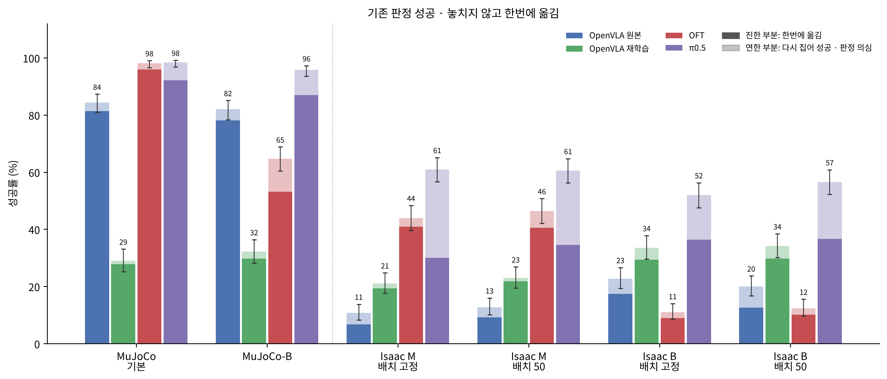
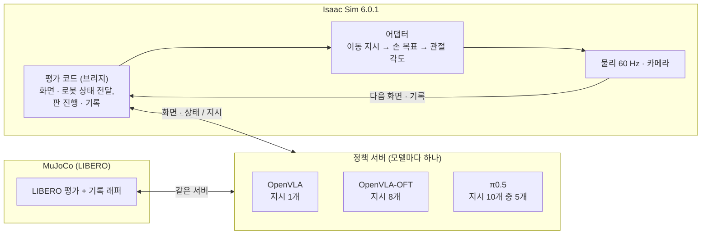
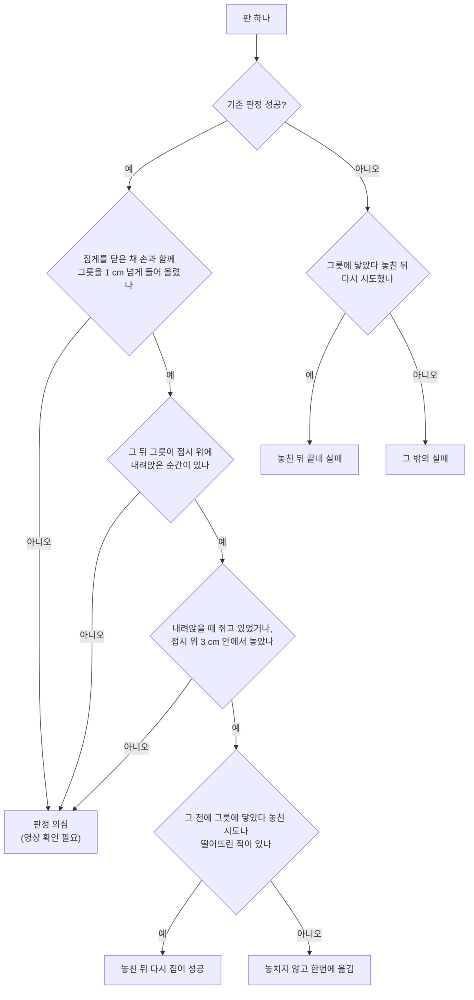
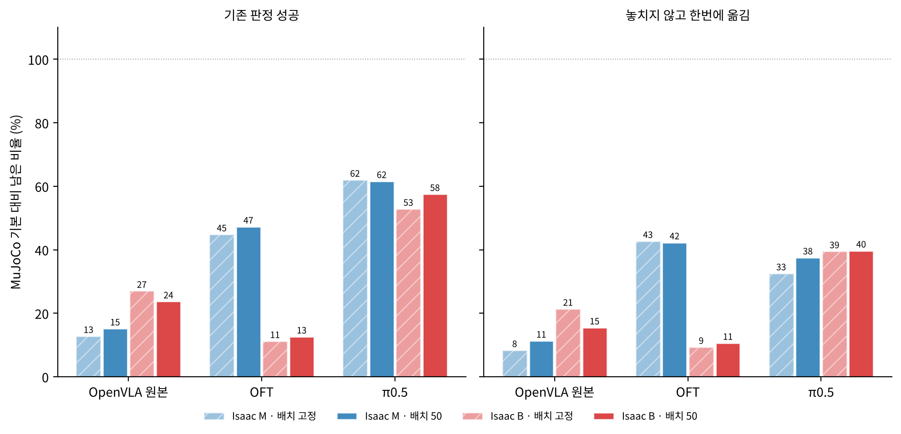

# Isaac Sim에서의 VLA 로봇 정책 평가 — MuJoCo에서 학습한 모델을 다른 시뮬레이터로 옮겼을 때

English: [README_en.md](README_en.md)

로봇 팔이 「검은 그릇을 집어 접시 위에 놓는」 과제를 하도록 MuJoCo 시뮬레이터에서 학습된 인공지능 모델 세 가지(OpenVLA, OpenVLA-OFT, π0.5)를, 추가 학습 없이 Isaac Sim 시뮬레이터로 옮겨 시험한 기록이다. 성공률이 얼마나, 왜 떨어지는지 밝히고, OpenVLA는 Isaac Sim 데이터로 다시 학습해 얼마나 되찾는지도 쟀다. 이 문서는 전체 내용을 한곳에 정리한 총 정리이고, 자세한 내용은 아래 보고서에 있다.

## 보고서

| 번호 | 제목 | 상태 |
| --- | --- | --- |
| 1-1 | [OpenVLA를 Isaac Sim으로 옮겼을 때 — 성공률 16.8 %에서 22.8 %까지, 그리고 더 오르지 않은 이유](reports/1-1_openvla_zero_shot/README.md) | 공개 (판 1-1a, 2026-10-01) |
| 2 | [OpenVLA — 제로샷과 Isaac Sim 데이터 재학습, 실행 설정과 물체 위치를 하나씩 바꿔 본 결과](reports/2_openvla_zero_shot_and_finetune/README.md) | 공개 (2026-10-13) |
| 3 | [OpenVLA-OFT 제로샷 — 동작 8개를 묶어 실행하는 모델](reports/3_oft_zero_shot/README.md) | 공개 (2026-10-13) |
| 4 | [π0.5 제로샷 — 성공의 절반 가까이는 다시 집어서 얻은 것](reports/4_pi05_zero_shot/README.md) | 공개 (2026-10-13) |

보고서 1-1은 공개 당시 그대로 두었다. 1-1에서 「다시 재는 중」이라고 적은 시험(MuJoCo와 같은 속도, 물체 위치 50가지)의 결과는 보고서 2에 있다.

## 한눈에 보는 결론

*그림 1. 모델 4개 × 시험 조건 6칸의 성공률(각 500판). 진한 부분은 그릇을 놓치지 않고 한번에 옮긴 판, 연한 부분은 놓친 뒤 다시 집어 성공했거나 영상 확인이 필요한 판이다. 막대 위 선은 95 % 신뢰 범위.*

| 질문 | 답 |
| --- | --- |
| MuJoCo에서 잘하던 모델이 Isaac Sim에서는? | MuJoCo에서 84–98 %인 모델이 Isaac Sim(MuJoCo와 같은 속도, 물체 위치 50가지)에서는 OpenVLA 12.8 %, OpenVLA-OFT 46.4 %, π0.5 60.6 %다. MuJoCo 성능 중 남은 비율은 15 %, 47 %, 62 %로, **격차는 모델 하나의 문제가 아니라 세 모델 모두에서 크다** |
| 지시 하나를 실행하는 시간을 바꾸면? | **모델이 동작을 내는 방식에 따라 반대로 움직인다.** 화면을 볼 때마다 동작 하나를 내는 OpenVLA는 지시 하나를 더 길게 실행하는 설정(B)에서 Isaac Sim 성공률이 오르고(+12.0 · +7.2 %p), 동작 8개를 묶어 실행하는 OFT는 크게 떨어지며(−33.0 · −34.0 %p), 5개씩 실행하는 π0.5는 조금 떨어진다(−9.0 · −4.0 %p). OFT는 MuJoCo에서 같은 식으로 바꿔도 −33.4 %p 떨어져, 묶어 실행하는 방식 자체의 약점이다 |
| 성공한 방식은 같은가? | 아니다. π0.5는 Isaac Sim M(MuJoCo와 같은 속도)에서 성공의 40–47 %가 **그릇을 놓친 뒤 다시 집어서** 얻은 것이다. 그릇을 놓치지 않고 한번에 옮긴 판만 세면, MuJoCo와 같은 속도에서는 OFT가 π0.5보다 높다(41.0 % 대 30.0 %, 물체 위치 고정) |
| Isaac Sim 데이터로 다시 학습하면? | OpenVLA는 Isaac Sim 네 칸 모두에서 10–14 %p 올라 최고 34.2 %가 됐지만, MuJoCo에서는 84.4 %에서 29.0 %로 떨어졌다. 다시 학습한 모델은 MuJoCo에서 판의 절반 가까이 집게를 닫지도 않는다 |
| 물체 위치를 바꾸면? | 전체 성공률은 변하지 않는다(네 모델 · 두 실행 설정 모두 우연 범위 안). 다만 과제 하나하나는 크게 바뀔 수 있다 |
| 공통으로 안 되는 것은? | 그릇이 스토브 위에서 시작하는 과제 7은 MuJoCo로 학습한 세 모델 모두 Isaac Sim 네 칸에서 50판 중 0–8판이다(MuJoCo 기본 41–50판). Isaac Sim 데이터로 다시 학습한 OpenVLA만 19–32판 |
| 아직 확인 중인 것 | 「판정 의심」 판의 영상 확인, 들어 올리는 방향의 실행 속도까지 MuJoCo와 맞춘 설정(M2) |

## 1. 무엇을 평가하나

**과제.** LIBERO-Spatial이라는 시험 묶음의 10가지 과제다. 모든 과제가 「검은 그릇을 집어 접시 위에 놓기」이고, 그릇이 처음 놓인 위치가 다르다.

| 과제 | 그릇의 처음 위치 | 과제 | 그릇의 처음 위치 |
| --- | --- | --- | --- |
| 0 | 접시와 라메킨(작은 그릇) 사이 | 5 | 라메킨 위 |
| 1 | 라메킨 옆 | 6 | 쿠키 상자 옆 |
| 2 | 테이블 가운데 | 7 | 스토브 위 |
| 3 | 쿠키 상자 위 | 8 | 접시 옆 |
| 4 | 나무 캐비닛 윗 서랍 안 | 9 | 나무 캐비닛 위 |

**판.** 시험 한 번을 「판」이라 부른다. 과제마다 50판, 모두 500판을 한 칸으로 잰다. 모델이 지시를 220번 낼 때까지 성공하지 못하면 실패다. **모든 비교는 판 수가 같은 칸끼리만 한다**(모든 칸 500판, 빠진 판은 다시 돌려 채움).

**두 시뮬레이터.**

| | MuJoCo (원래 학습 환경) | Isaac Sim 6.0.1 (옮겨 간 환경) |
| --- | --- | --- |
| 장면 | LIBERO 원본 | LIBERO 장면을 옮겨 만듦 (물체 크기 · 위치 같음) |
| 로봇 | Franka Panda | Franka Panda |
| 지시를 따르는 방식 | 목표와의 차이에 비례하는 힘으로 손을 끌어당김. 0.05초 동안 지시한 거리의 일부만 움직임 | 손 목표를 관절 각도로 바꿔(역기구학) 관절을 그 각도로 움직임 |
| 물리 계산 | MuJoCo | PhysX, 1초에 60번 |
| 모델이 보는 화면 | 앞쪽 카메라 + 손목 카메라 | 같은 위치의 카메라 (시야를 MuJoCo 학습 화면에 맞춰 자름) |

시작 화면 비교는 [보고서 1-1의 그림 9](reports/1-1_openvla_zero_shot/README.md#1-무엇을-평가하나)에 있다.

## 2. 모델과 연결 방법

모델은 로봇 관절을 직접 돌리지 않는다. 카메라 화면과 과제 문장을 보고 「손을 앞으로 2 cm, 아래로 1 cm, 집게 닫기」 같은 짧은 이동 지시를 낸다. 세 모델은 지시를 내는 방식이 다르다.

| | OpenVLA | OpenVLA-OFT | π0.5 |
| --- | --- | --- | --- |
| 공개 모델 | openvla-7b-finetuned-libero-spatial | openvla-7b-oft-finetuned-libero-spatial | openpi pi05_libero |
| 보는 것 | 앞쪽 카메라, 과제 문장 | 앞쪽 · 손목 카메라, 로봇 상태 8개 값, 과제 문장 | 앞쪽 · 손목 카메라, 로봇 상태 8개 값, 과제 문장 |
| 화면 한 번에 내는 지시 | 1개 | 8개 | 10개 (그중 앞 5개를 실행) |
| 이 시험에서의 학습 | MuJoCo 데이터 그대로 (제로샷) + Isaac Sim 데이터로 다시 학습한 판 | MuJoCo 데이터 그대로 (제로샷) | MuJoCo 데이터 그대로 (제로샷) |

로봇 상태 8개 값은 손 위치 3개, 손 방향 3개, 손가락 2개다. 묶음으로 지시를 내는 모델은 그 묶음을 다 실행할 때까지 화면을 다시 보지 않는다.

세 모델 모두 같은 Isaac Sim 평가 코드(브리지)와 같은 판정으로 잰다. 모델마다 정책 서버를 하나씩 두고, 평가 코드는 같은 형식으로 화면과 로봇 상태를 보내 지시를 받는다.

MuJoCo 쪽은 LIBERO의 원래 평가 도구를 고치지 않고 감싸서, 판마다 손 · 손가락 · 그릇 · 접시 위치를 Isaac Sim과 같은 형식으로 기록했다. 그래서 두 시뮬레이터의 판을 같은 규칙으로 판정할 수 있다. 이렇게 다시 잰 OpenVLA의 MuJoCo 성공률은 84.4 %로, 8월에 잰 값과 같다.

## 3. 시험 조건 — 실행 설정과 물체 위치

모델의 지시 하나는 「0.05초 동안의 움직임」으로 학습됐다(사람 시범을 1초에 20번 기록). 그런데 MuJoCo 로봇은 지시 하나에 지시한 거리의 일부만 움직이고, Isaac Sim 로봇은 거의 다 움직인다. 그래서 Isaac Sim에서는 지시 하나를 얼마 동안, 얼마만큼 실행할지를 두 가지로 정해 비교한다. 같은 비교를 MuJoCo에서도 한다.

| 이름 | 시뮬레이터 | 지시 하나의 실행 시간 | 같은 지시에 손이 움직이는 거리 (MuJoCo 기본 = 1) |
| --- | --- | --- | --- |
| MuJoCo 기본 | MuJoCo | 0.05초 (1초에 20번) | 1 |
| MuJoCo-B | MuJoCo | 0.10초 (1초에 10번) | 다가갈 때 1.62배, 들어 올릴 때 1.18배 |
| M (MuJoCo와 같은 속도) | Isaac Sim | 0.05초 (물리 계산 3번), 손 목표를 지시한 거리의 65 %로 | 다가갈 때 1.08배, 들어 올릴 때 0.63배 |
| B (지시 하나에 더 많이 움직임) | Isaac Sim | 0.17초 (물리 계산 10번), 손 목표는 지시한 거리 그대로 | 다가갈 때 1.26배, 들어 올릴 때 약 1.5배 |

거리 배율은 사람 시범의 지시를 모델 없이 두 시뮬레이터에 똑같이 넣어 잰 값이다. MuJoCo-B는 지시 간격 다섯 가지를 재 보고, Isaac Sim의 B와 배율이 가장 가까운 1초 10번을 골랐다.

**화면을 한 번 본 뒤 다음 화면을 볼 때까지 움직이는 시간.** 묶음으로 실행하는 모델은 이 시간이 길다. B에서 OFT는 1.36초 동안 화면을 다시 보지 않는다.

| 모델 (화면 한 번에 실행하는 지시 수) | MuJoCo 기본 | MuJoCo-B | M | B |
| --- | --- | --- | --- | --- |
| OpenVLA (1) | 0.05초 | 0.10초 | 0.05초 | 0.17초 |
| π0.5 (5) | 0.25초 | 0.50초 | 0.25초 | 0.85초 |
| OpenVLA-OFT (8) | 0.40초 | 0.80초 | 0.40초 | 1.36초 |

**물체 위치.** 「배치 고정」은 LIBERO가 정해 둔 첫 번째 물체 위치 하나로 과제마다 50판을 돌린다(이전 논문과 같은 방식). 「배치 50」은 LIBERO의 표준 방식대로 판마다 다른 물체 위치 50가지를 쓴다. MuJoCo는 두 설정 모두 배치 50이다.

결과적으로 모델마다 6칸을 잰다: MuJoCo 기본, MuJoCo-B, Isaac Sim M · 배치 고정, M · 배치 50, B · 배치 고정, B · 배치 50.

## 4. 판정

**기존 판정.** 마지막에 그릇이 접시 위에 놓여 있으면 성공이다. Isaac Sim은 평가 코드의 판정(그릇 바닥이 접시 위에 놓이고 높이가 접시 윗면과 맞으며 움직임이 멈췄는지 등, 자세한 기준은 [보고서 1-1의 1절](reports/1-1_openvla_zero_shot/README.md#1-무엇을-평가하나))을, MuJoCo는 LIBERO 자체 판정을 쓴다.

**그릇을 놓치지 않고 한번에 옮긴 경우.** 기존 판정만으로는 「한 번에 집어 옮겼는지」, 「놓친 뒤 다시 집어 겨우 해냈는지」, 「밀거나 떨어뜨려 우연히 접시에 걸렸는지」를 구별하지 못한다. 그래서 판마다 손가락 폭과 그릇 · 손의 위치 기록을 보고 다섯 가지로 나눈다.

- **시도**는 집게를 닫았다(손가락 폭 35 mm 미만) 다시 여는 한 번이다. 그릇에 닿지 않은 헛손질은 「놓친 시도」로 치지 않는다. 그릇에 닿았다는 것은 손가락이 그릇 벽 두께에서 멈췄거나, 그릇이 5 mm 넘게 밀렸거나, 그릇이 기울거나 돌기 시작한 것이다.
- **판정 의심**은 실패로 정한 것이 아니다. 기존 판정은 성공인데, 기록만으로는 그릇을 집어 들어 접시에 내려놓았다는 것을 확인할 수 없는 판이다. 세 가지 이유가 있다. 1) 그릇을 손과 함께 들어 올린 기록이 없다(밀어서 접시 턱 위로 올렸을 수 있음). 2) 들어 올린 뒤 그릇이 접시 위에 내려앉은 순간을 찾지 못했다. 3) 내려앉을 때 쥐고 있지 않았고, 마지막으로 쥐고 있던 순간 그릇 바닥이 접시 윗면보다 3 cm 넘게 위였다(높은 곳에서 떨어뜨렸을 수 있음). 그래서 표의 「한번에 옮김」은 최소값이고, 판정 의심이 모두 한번에 옮긴 것으로 확인될 때의 값을 함께 적는다.

**실패 종류.** 실패한 판은 손가락 폭과 그릇 높이로 나눈다.

| 실패 종류 | 기준 |
| --- | --- |
| 집게를 닫지 않음 | 판 내내 손가락 폭이 35 mm 아래로 내려가지 않음 |
| 물지 못하고 닫음 | 닫았지만 손가락이 그릇 벽 두께에서 멈춘 적이 없음 (그릇 바깥에서 닫음) |
| 물었지만 들지 못함 | 손가락이 그릇 벽 두께(Isaac Sim 1.5–12 mm, MuJoCo 1.5–18 mm)에서 3번 연속 멈췄지만 그릇이 4 cm 넘게 오르지 않음 |
| 들었지만 접시까지 못 감 | 그릇이 4 cm 넘게 올랐지만 끝났을 때 접시 중심에서 10 cm 밖 |
| 접시 근처에서 실패 | 그릇이 4 cm 넘게 올랐고 끝났을 때 접시 중심 10 cm 안이지만 성공 판정이 나지 않음 |

손가락 폭 기준은 정답을 아는 판으로 채점해 골랐다. 그릇이 전혀 움직이지 않은 실패 판을 「물었다」로 잘못 세는 비율이 이전 기준의 85 %에서 6.8 %(Isaac Sim)로 줄었다.

**두 비율의 차이.** z는 두 성공률의 차이가 우연인지 보는 값이고, 절댓값이 1.96을 넘으면 우연일 가능성이 5 % 미만이다. 500판이면 95 % 신뢰 범위는 성공률에 따라 ±1–4.4 %p다(성공률이 50 % 근처일 때 가장 넓다).

## 5. 전체 결과

**기존 판정 성공 (500판 중)**

| 모델 | MuJoCo 기본 | MuJoCo-B | Isaac M · 배치 고정 | Isaac M · 배치 50 | Isaac B · 배치 고정 | Isaac B · 배치 50 |
| --- | --- | --- | --- | --- | --- | --- |
| OpenVLA 원본 | 422 (84.4 %) | 410 (82.0 %) | 54 (10.8 %) | 64 (12.8 %) | 114 (22.8 %) | 100 (20.0 %) |
| OpenVLA 재학습 | 145 (29.0 %) | 161 (32.2 %) | 105 (21.0 %) | 115 (23.0 %) | 168 (33.6 %) | 171 (34.2 %) |
| OpenVLA-OFT | 491 (98.2 %) | 324 (64.8 %) | 220 (44.0 %) | 232 (46.4 %) | 55 (11.0 %) | 62 (12.4 %) |
| π0.5 | 492 (98.4 %) | 479 (95.8 %) | 305 (61.0 %) | 303 (60.6 %) | 260 (52.0 %) | 283 (56.6 %) |

**그릇을 놓치지 않고 한번에 옮긴 판 (500판 중)**

| 모델 | MuJoCo 기본 | MuJoCo-B | Isaac M · 배치 고정 | Isaac M · 배치 50 | Isaac B · 배치 고정 | Isaac B · 배치 50 |
| --- | --- | --- | --- | --- | --- | --- |
| OpenVLA 원본 | 407 (81.4 %) | 391 (78.2 %) | 34 (6.8 %) | 46 (9.2 %) | 87 (17.4 %) | 63 (12.6 %) |
| OpenVLA 재학습 | 139 (27.8 %) | 149 (29.8 %) | 97 (19.4 %) | 109 (21.8 %) | 147 (29.4 %) | 149 (29.8 %) |
| OpenVLA-OFT | 480 (96.0 %) | 266 (53.2 %) | 205 (41.0 %) | 203 (40.6 %) | 45 (9.0 %) | 51 (10.2 %) |
| π0.5 | 461 (92.2 %) | 435 (87.0 %) | 150 (30.0 %) | 173 (34.6 %) | 182 (36.4 %) | 183 (36.6 %) |

*그림 2. MuJoCo 기본 대비 Isaac Sim에서 남은 비율. MuJoCo 데이터로만 학습한 세 모델만 그렸다(재학습한 OpenVLA는 Isaac Sim 데이터로 학습했으므로 뺐다).*

## 6. 모델별로 본 것

- **OpenVLA** ([보고서 2](reports/2_openvla_zero_shot_and_finetune/README.md)). 실패의 대부분은 그릇 바깥에서 집게를 닫는 것이다(M · 배치 50 실패 436판 중 291판). B는 이 실패를 줄여 성공률을 올리지만 MuJoCo에서는 차이가 없어, B가 OpenVLA에 좋은 설정이라기보다 Isaac Sim의 부족한 점(M에서 들어 올리는 움직임이 MuJoCo의 0.63배)을 메운 것으로 본다. Isaac Sim 데이터로 다시 학습하면 Isaac Sim에서 오르고 MuJoCo에서 떨어진다.
- **OpenVLA-OFT** ([보고서 3](reports/3_oft_zero_shot/README.md)). M에서는 성공의 88–93 %가 한번에 옮긴 판이다. B에서는 묶음 8개를 1.36초 동안 화면을 다시 보지 않고 실행하며 그릇 바깥에서 닫는 실패가 크게 늘고(배치 50 실패 438판 중 331판), 판마다 집게를 평균 7.7–7.9번 닫는다.
- **π0.5** ([보고서 4](reports/4_pi05_zero_shot/README.md)). 기존 판정으로는 세 모델 중 가장 높지만, M에서 성공의 40–47 %는 놓친 뒤 다시 집어서 얻었다. 한번에 옮긴 경우만 세면 B가 M보다 낮지 않고(배치 고정 30.0 % → 36.4 %), 과제별로는 B에서 잘 되는 과제와 M에서 잘 되는 과제가 뚜렷하게 갈린다.

## 7. 한계와 다음 실험

- **판정 의심 영상 확인.** 특히 그릇이 접시 옆에서 시작하는 과제 0 · 8에서 「들어 올린 적 없음」으로 나온 판(OFT 22판 등)은 밀어서 올렸을 가능성이 있어, 확인되면 기존 판정 성공에서도 빼야 한다.
- **M2.** M에서 들어 올리는 움직임이 MuJoCo의 0.63배다. 그릇이 없는 장면에서도 0.65배라 그릇 무게가 아니라 팔 제어 자체의 차이로 보고, 수평은 0.65배 그대로 두고 위아래만 MuJoCo와 맞춘 설정(M2)을 측정 중이다.
- **판정 기준의 차이.** Isaac Sim의 기존 판정은 이 평가 코드의 판정이고, MuJoCo는 LIBERO 자체 판정이다. 「한번에 옮김」과 실패 종류는 두 시뮬레이터에 같은 규칙을 썼다.
- 모든 칸은 한 번씩만 돌렸다. 이 평가는 모델이 계산하는 동안 시뮬레이션 시간을 멈춘다.

## 레포 구성

| 위치 | 내용 |
| --- | --- |
| `reports/` | 보고서마다 폴더 하나. 한국어 본문(`README.md`), 영어판(`README_en.md`), PDF, 그림 |
| `figures/` · `figures_en/` | 이 문서의 그림 |
| `data/results_2026-10-13/` | 모든 표의 원천: 판마다 한 줄인 `episodes_all.csv`(24칸 × 500판)와 표 CSV |
| `code/` | 평가 · 분석 · 학습 데이터 · 학습 · 정책 서버 코드. 재현 방법은 각 보고서의 「재현 방법」 절 |

표와 그림은 `code/report/make_report_assets_v2.py` 하나로 결과 폴더에서 다시 만들 수 있다.

## 갱신 기록

| 날짜 | 내용 |
| --- | --- |
| 2026-10-01 | 보고서 1-1 (판 1-1a) 공개. 이전에 올렸던 전체 기록(v2)은 git 태그 `v2`에 남아 있다 |
| 2026-10-13 | 보고서 2 · 3 · 4 공개, 이 문서를 총 정리로 다시 씀. 자리만 만들어 두었던 1-2 · 2 · 3 폴더는 새 보고서로 대체 |
