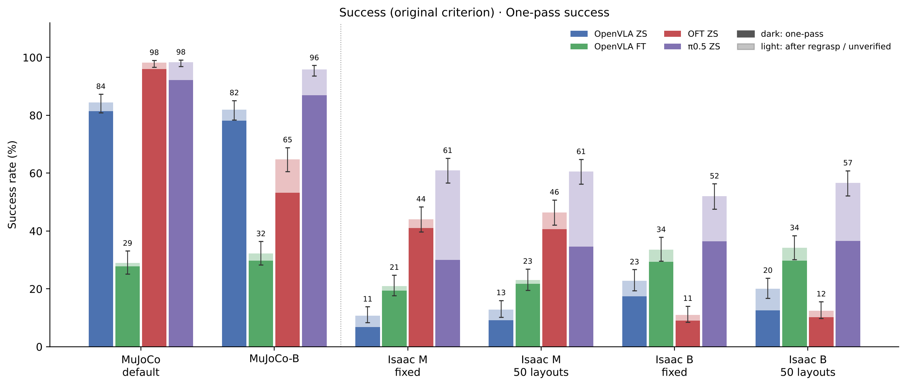
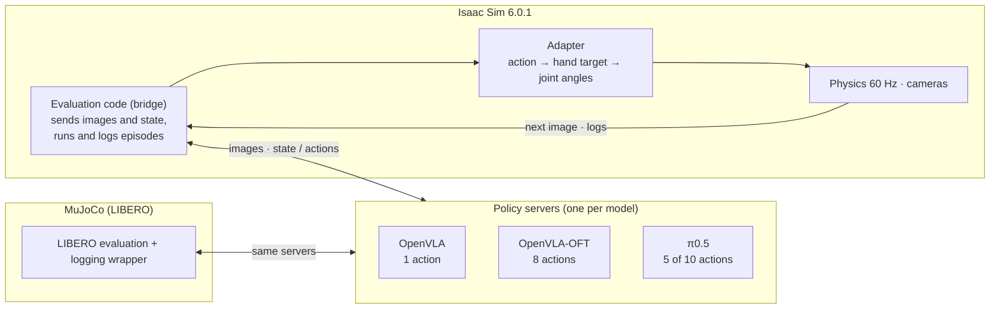
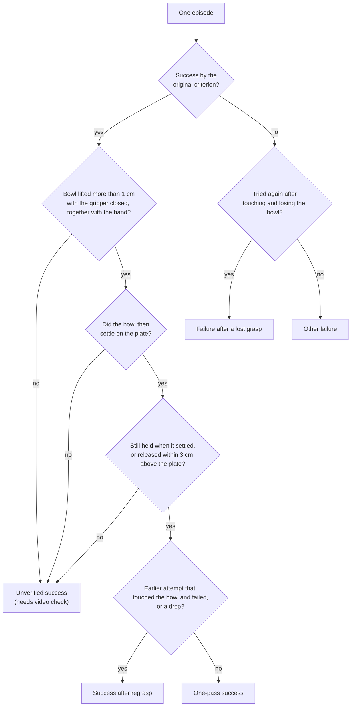
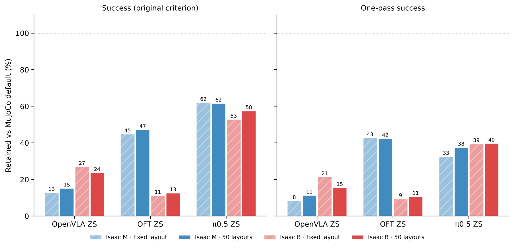

# Evaluating VLA robot policies in Isaac Sim — moving models trained in MuJoCo to another simulator

한국어 (main): [README.md](README.md)

This repository records how three AI models (OpenVLA, OpenVLA-OFT, π0.5), trained in the MuJoCo simulator to make a robot arm "pick up the black bowl and place it on the plate", perform when moved to the Isaac Sim simulator without additional training. We measure how much and why success drops, and, for OpenVLA, how much is recovered by retraining on Isaac Sim data. This page is the overall summary; details are in the reports below.

## Reports

| No. | Title | Status |
| --- | --- | --- |
| 1-1 | [Moving OpenVLA to Isaac Sim — from 16.8 % to 22.8 % success, and why it did not go higher](reports/1-1_openvla_zero_shot/README_en.md) | Published (version 1-1a, 2026-10-01) |
| 2 | [OpenVLA — zero-shot and retraining on Isaac Sim data, changing the execution setting and object placement one at a time](reports/2_openvla_zero_shot_and_finetune/README_en.md) | Published (2026-10-13) |
| 3 | [OpenVLA-OFT zero-shot — a model that executes 8 actions per observation](reports/3_oft_zero_shot/README_en.md) | Published (2026-10-13) |
| 4 | [π0.5 zero-shot — nearly half of its successes come from regrasping](reports/4_pi05_zero_shot/README_en.md) | Published (2026-10-13) |

Report 1-1 is kept as published. The runs that 1-1 listed as "being re-measured" (MuJoCo-matched speed, 50 object layouts) are reported in Report 2.

## Conclusions at a glance

*Figure 1. Success rate for 4 models × 6 test cells (500 episodes each). The dark part is one-pass success (bowl carried without being lost); the light part is success after regrasp or unverified success that needs a video check. Lines above the bars are 95 % confidence ranges.*

| Question | Answer |
| --- | --- |
| How do models that do well in MuJoCo perform in Isaac Sim? | Models at 84–98 % in MuJoCo reach, in Isaac Sim (MuJoCo-matched speed, 50 layouts), 12.8 % (OpenVLA), 46.4 % (OpenVLA-OFT) and 60.6 % (π0.5). They retain 15 %, 47 % and 62 % of their MuJoCo performance: **the gap is large for all three models, not just one** |
| What if each action is executed for longer? | **The effect depends on how the model issues actions.** OpenVLA, which issues one action per observation, improves in Isaac Sim under the setting that executes each action for longer (B) (+12.0 · +7.2 %p). OFT, which executes 8 actions per observation, collapses (−33.0 · −34.0 %p). π0.5, which executes 5, drops slightly (−9.0 · −4.0 %p). OFT also drops by −33.4 %p when the same change is made in MuJoCo, so this is a weakness of executing actions in chunks |
| Do models succeed in the same way? | No. Under Isaac M (MuJoCo-matched speed), 40–47 % of π0.5's successes come **after losing the bowl and grasping it again**. Counting only one-pass successes, OFT is higher than π0.5 at MuJoCo-matched speed (41.0 % vs 30.0 %, fixed layout) |
| What does retraining on Isaac Sim data do? | OpenVLA gains 10–14 %p in all four Isaac Sim cells (best 34.2 %), but drops from 84.4 % to 29.0 % in MuJoCo. In MuJoCo, the retrained model never even closes the gripper in almost half of the episodes |
| What if object placement changes? | Overall success does not change (within chance for all four models and both execution settings). Individual tasks can change a lot |
| What fails for everyone? | Task 7, where the bowl starts on the stove: all three models trained only in MuJoCo succeed in 0–8 of 50 episodes in every Isaac Sim cell (MuJoCo default: 41–50). Only OpenVLA retrained on Isaac Sim data reaches 19–32 |
| Still being checked | Video check of "unverified" successes; an execution setting that also matches MuJoCo in the vertical (lifting) direction (M2) |

## 1. What is evaluated

**Tasks.** The 10 tasks of LIBERO-Spatial. Every task is "pick up the black bowl and place it on the plate"; tasks differ in where the bowl starts.

| Task | Where the bowl starts | Task | Where the bowl starts |
| --- | --- | --- | --- |
| 0 | between the plate and the ramekin (small bowl) | 5 | on the ramekin |
| 1 | next to the ramekin | 6 | next to the cookie box |
| 2 | at the center of the table | 7 | on the stove |
| 3 | on the cookie box | 8 | next to the plate |
| 4 | in the top drawer of the wooden cabinet | 9 | on the wooden cabinet |

**Episodes.** One trial is an "episode". Each task gets 50 episodes, 500 in total per cell. An episode fails if the model has not succeeded after issuing 220 actions. **All comparisons are between cells with the same number of episodes** (every cell has 500; missing episodes were re-run).

**Two simulators.**

| | MuJoCo (original training environment) | Isaac Sim 6.0.1 (target environment) |
| --- | --- | --- |
| Scene | LIBERO original | LIBERO scene ported (same object sizes and positions) |
| Robot | Franka Panda | Franka Panda |
| How the robot follows an action | Pulls the hand toward the target with a force proportional to the remaining distance; moves only part of the commanded distance in 0.05 s | Converts the hand target into joint angles (inverse kinematics) and drives the joints there |
| Physics | MuJoCo | PhysX, 60 steps per second |
| Images the model sees | Front camera + wrist camera | Cameras at the same positions (cropped to match the MuJoCo training field of view) |

Start screens of both simulators are compared in [Figure 9 of Report 1-1](reports/1-1_openvla_zero_shot/README_en.md#1-what-is-evaluated).

## 2. Models and how they are connected

The models do not turn the robot joints directly. They look at camera images and the task sentence, and issue short movement actions such as "move the hand 2 cm forward, 1 cm down, close the gripper". The three models issue actions differently.

| | OpenVLA | OpenVLA-OFT | π0.5 |
| --- | --- | --- | --- |
| Public model | openvla-7b-finetuned-libero-spatial | openvla-7b-oft-finetuned-libero-spatial | openpi pi05_libero |
| Inputs | Front camera, task sentence | Front and wrist cameras, 8 robot-state values, task sentence | Front and wrist cameras, 8 robot-state values, task sentence |
| Actions per observation | 1 | 8 | 10 (first 5 executed) |
| Training in these tests | MuJoCo data only (zero-shot), plus a version retrained on Isaac Sim data | MuJoCo data only (zero-shot) | MuJoCo data only (zero-shot) |

The 8 robot-state values are hand position (3), hand orientation (3) and fingers (2). Models that issue chunks of actions do not look at the screen again until the chunk is finished.

All three models are measured with the same Isaac Sim evaluation code (bridge) and the same criteria. Each model has its own policy server, and the evaluation code sends images and robot state in the same format and receives actions.

On the MuJoCo side, LIBERO's original evaluation tool is wrapped without modification so that each episode logs hand, finger, bowl and plate positions in the same format as Isaac Sim. Episodes from both simulators can therefore be judged by the same rules. Re-measured this way, OpenVLA's MuJoCo success rate is 84.4 %, the same as measured in August.

## 3. Test cells — execution setting and object placement

The model's action was learned as "movement over 0.05 s" (human demonstrations were recorded 20 times per second). But the MuJoCo robot moves only part of the commanded distance per action, while the Isaac Sim robot moves almost all of it. So in Isaac Sim we compare two choices of how long and how far each action is executed, and make the same comparison in MuJoCo.

| Name | Simulator | Execution time per action | Hand travel for the same action (MuJoCo default = 1) |
| --- | --- | --- | --- |
| MuJoCo default | MuJoCo | 0.05 s (20 per second) | 1 |
| MuJoCo-B | MuJoCo | 0.10 s (10 per second) | 1.62× approaching, 1.18× lifting |
| M (MuJoCo-matched speed) | Isaac Sim | 0.05 s (3 physics steps), hand target set to 65 % of the commanded distance | 1.08× approaching, 0.63× lifting |
| B (more motion per action) | Isaac Sim | 0.17 s (10 physics steps), hand target at the full commanded distance | 1.26× approaching, about 1.5× lifting |

The travel ratios were measured by feeding the actions of human demonstrations, without the model, to both simulators. For MuJoCo-B we measured five action intervals and picked 10 per second, whose ratios are closest to Isaac Sim B.

**Time the robot moves before looking at the screen again.** Models that execute chunks move for longer. Under B, OFT does not look at the screen for 1.36 s.

| Model (actions executed per observation) | MuJoCo default | MuJoCo-B | M | B |
| --- | --- | --- | --- | --- |
| OpenVLA (1) | 0.05 s | 0.10 s | 0.05 s | 0.17 s |
| π0.5 (5) | 0.25 s | 0.50 s | 0.25 s | 0.85 s |
| OpenVLA-OFT (8) | 0.40 s | 0.80 s | 0.40 s | 1.36 s |

**Object placement.** "Fixed layout" runs all 50 episodes of a task from LIBERO's first object placement (as in the earlier paper). "50 layouts" uses LIBERO's standard 50 placements, a different one per episode. MuJoCo always uses 50 layouts.

Each model is therefore measured in 6 cells: MuJoCo default, MuJoCo-B, Isaac Sim M · fixed layout, M · 50 layouts, B · fixed layout, B · 50 layouts.

## 4. Criteria

**Original criterion.** Success if the bowl ends up on the plate. Isaac Sim uses the evaluation code's check (the bowl bottom rests on the plate at the plate-top height and has stopped moving, among other conditions; see [Section 1 of Report 1-1](reports/1-1_openvla_zero_shot/README_en.md#1-what-is-evaluated)). MuJoCo uses LIBERO's own check.

**One-pass success (bowl carried without being lost).** The original criterion cannot tell apart "picked up and carried in one go", "lost the bowl and only managed after grasping again", and "pushed or dropped it onto the plate by chance". So each episode is put into one of five groups using the finger-width and bowl/hand position logs.

- An **attempt** is one close-and-reopen of the gripper (finger width below 35 mm). Closing in the air without touching the bowl does not count as a "lost attempt". "Touched" means the fingers stopped at the bowl-wall width, the bowl was pushed more than 5 mm, or the bowl started to tilt or rotate.
- An **unverified success** is not a failure. The original criterion says success, but the logs alone cannot confirm that the bowl was picked up and placed. There are three reasons. 1) There is no record of lifting the bowl together with the hand (it may have been pushed over the plate rim). 2) After lifting, no moment where the bowl settles on the plate was found. 3) The bowl was not held when it settled, and at the last held moment its bottom was more than 3 cm above the plate top (it may have been dropped from a height). One-pass counts are therefore lower bounds, and we also show the value if all unverified successes turn out to be one-pass.

**Failure kinds.** Failed episodes are classified by finger width and bowl height.

| Failure kind | Rule |
| --- | --- |
| Never closed | Finger width never goes below 35 mm |
| Closed without grasping | Closed, but the fingers never stopped at the bowl-wall width (closed outside the bowl) |
| Grasped but not lifted | Fingers stopped at the bowl-wall width (Isaac Sim 1.5–12 mm, MuJoCo 1.5–18 mm) for 3 consecutive steps, but the bowl did not rise more than 4 cm |
| Lifted, not carried to plate | Bowl rose more than 4 cm, but ended more than 10 cm from the plate center |
| Failed near plate | Bowl rose more than 4 cm and ended within 10 cm of the plate center, but no success |

The finger-width rule was chosen by scoring it on episodes whose answer is known. The rate of wrongly counting a failed episode whose bowl never moved as "grasped" fell from 85 % (old rule) to 6.8 % (Isaac Sim).

**Difference between two rates.** z tells whether a difference between two success rates could be chance; |z| above 1.96 means less than 5 % chance. With 500 episodes, the 95 % confidence range is ±1–4.4 %p depending on the rate (widest near 50 %).

## 5. All results

**Success by the original criterion (out of 500)**

| Model | MuJoCo default | MuJoCo-B | Isaac M · fixed | Isaac M · 50 layouts | Isaac B · fixed | Isaac B · 50 layouts |
| --- | --- | --- | --- | --- | --- | --- |
| OpenVLA (zero-shot) | 422 (84.4 %) | 410 (82.0 %) | 54 (10.8 %) | 64 (12.8 %) | 114 (22.8 %) | 100 (20.0 %) |
| OpenVLA (retrained) | 145 (29.0 %) | 161 (32.2 %) | 105 (21.0 %) | 115 (23.0 %) | 168 (33.6 %) | 171 (34.2 %) |
| OpenVLA-OFT | 491 (98.2 %) | 324 (64.8 %) | 220 (44.0 %) | 232 (46.4 %) | 55 (11.0 %) | 62 (12.4 %) |
| π0.5 | 492 (98.4 %) | 479 (95.8 %) | 305 (61.0 %) | 303 (60.6 %) | 260 (52.0 %) | 283 (56.6 %) |

**One-pass success (out of 500)**

| Model | MuJoCo default | MuJoCo-B | Isaac M · fixed | Isaac M · 50 layouts | Isaac B · fixed | Isaac B · 50 layouts |
| --- | --- | --- | --- | --- | --- | --- |
| OpenVLA (zero-shot) | 407 (81.4 %) | 391 (78.2 %) | 34 (6.8 %) | 46 (9.2 %) | 87 (17.4 %) | 63 (12.6 %) |
| OpenVLA (retrained) | 139 (27.8 %) | 149 (29.8 %) | 97 (19.4 %) | 109 (21.8 %) | 147 (29.4 %) | 149 (29.8 %) |
| OpenVLA-OFT | 480 (96.0 %) | 266 (53.2 %) | 205 (41.0 %) | 203 (40.6 %) | 45 (9.0 %) | 51 (10.2 %) |
| π0.5 | 461 (92.2 %) | 435 (87.0 %) | 150 (30.0 %) | 173 (34.6 %) | 182 (36.4 %) | 183 (36.6 %) |

*Figure 2. Share of MuJoCo-default performance retained in Isaac Sim. Only the three models trained on MuJoCo data alone are shown (the retrained OpenVLA was trained on Isaac Sim data).*

## 6. What we saw per model

- **OpenVLA** ([Report 2](reports/2_openvla_zero_shot_and_finetune/README_en.md)). Most failures close the gripper outside the bowl (291 of 436 failures at M · 50 layouts). B reduces these and raises success, but makes no difference in MuJoCo. We therefore see B not as a setting that suits OpenVLA, but as one that compensates for a weakness of Isaac Sim (lifting motion under M is 0.63× of MuJoCo). Retraining on Isaac Sim data raises Isaac Sim success and lowers MuJoCo success.
- **OpenVLA-OFT** ([Report 3](reports/3_oft_zero_shot/README_en.md)). Under M, 88–93 % of successes are one-pass. Under B, it executes 8 actions for 1.36 s without looking again. Closing outside the bowl rises sharply (331 of 438 failures at 50 layouts), and the gripper closes 7.7–7.9 times per episode on average.
- **π0.5** ([Report 4](reports/4_pi05_zero_shot/README_en.md)). It is the highest of the three by the original criterion, but under M 40–47 % of its successes come after losing the bowl and grasping again. Counting only one-pass successes, B is not lower than M (fixed layout 30.0 % → 36.4 %). Per task, there is a clear split between tasks that go well under B and tasks that go well under M.

## 7. Limitations and next experiments

- **Video check of unverified successes.** In particular, the episodes marked "never lifted with the hand" in tasks 0 and 8, where the bowl starts next to the plate (22 for OFT, among others), may have pushed the bowl. If confirmed, they must also be removed from success by the original criterion.
- **M2.** Under M, the lifting motion is 0.63× of MuJoCo. It is 0.65× even with the bowl removed, so we attribute it to the arm control itself rather than the bowl's weight. We are measuring a setting (M2) that keeps the horizontal motion as in M (0.65) and matches only the vertical motion to MuJoCo.
- **Different success checks.** The original criterion in Isaac Sim is the evaluation code's check, while MuJoCo uses LIBERO's own check. One-pass grouping and failure kinds use the same rules in both simulators.
- Each cell was run once. The evaluation pauses simulation time while the model computes.

## Repository layout

| Path | Contents |
| --- | --- |
| `reports/` | One folder per report: Korean text (`README.md`), English (`README_en.md`), PDFs, figures |
| `figures/` · `figures_en/` | Figures for this page |
| `data/results_2026-10-13/` | Source of all tables: `episodes_all.csv` with one row per episode (24 cells × 500) and table CSVs |
| `code/` | Evaluation, analysis, training data, training and policy-server code. See each report's "How to reproduce" section |

All tables and figures can be rebuilt from the result folders with `code/report/make_report_assets_v2.py`.

## Update log

| Date | Change |
| --- | --- |
| 2026-10-01 | Report 1-1 (version 1-1a) published. The earlier full record (v2) remains under git tag `v2` |
| 2026-10-13 | Reports 2, 3 and 4 published; this page rewritten as the overall summary. The placeholder folders 1-2, 2 and 3 were replaced by the new reports |
