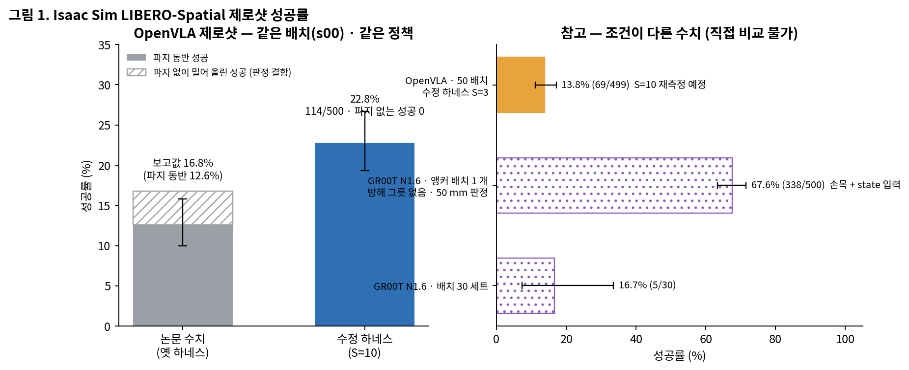
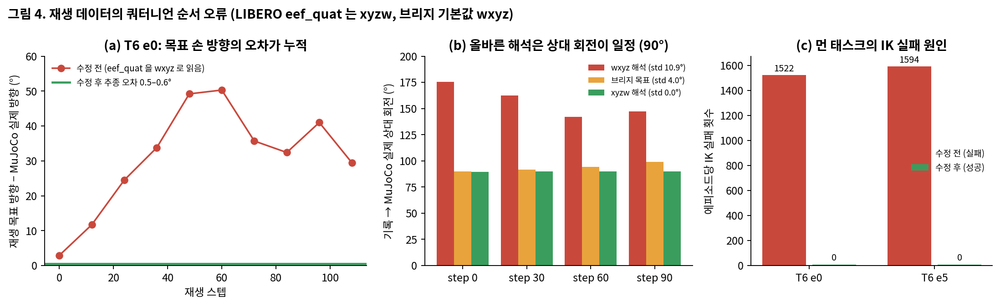
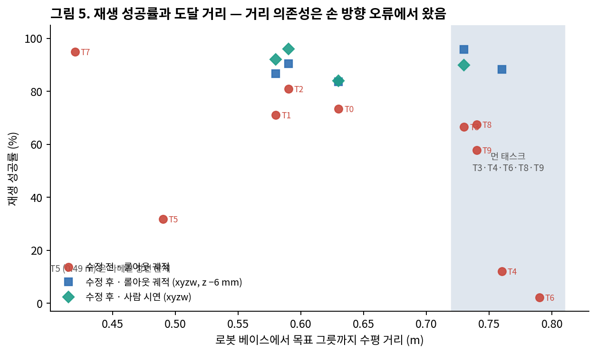

# Isaac Sim 에서의 LIBERO-Spatial VLA 제로샷 평가 — 하네스 수정, 평가 기준, 학습 데이터 수집

MuJoCo(LIBERO)에서 학습된 VLA 정책을 Isaac Sim 6.0.1 의 LIBERO-Spatial 재현 장면에서 평가하는 파이프라인을 처음부터 다시 점검한 기록이다. 평가 하네스와 재생(replay) 데이터 파이프라인에서 결과를 왜곡하던 결함을 찾아 고쳤고, 같은 배치·같은 정책에서 OpenVLA 제로샷 성공률이 파지 동반 기준 12.6% 에서 22.8% 로 올랐다. 이와 함께 OpenVLA, OpenVLA-OFT, π0.5, GR00T 에 공통으로 쓸 수 있는 Isaac 재렌더링 학습 데이터(사람 시연 기반, 손목 카메라·상태·관절 포함)를 수집하는 모듈을 추가했다.

작성일 2026-09-28. OpenVLA-OFT 제로샷 500 판과 학습 데이터 수집은 진행 중이며, 해당 수치는 완료되는 대로 갱신한다.

## 핵심 결과

| 조건 (정책: `openvla-7b-finetuned-libero-spatial`) | 성공 / 판 | 성공률 | 비고 |
|---|---|---|---|
| 기존 보고값, 옛 하네스, 배치 s00 | 84 / 500 | 16.8% | 파지 없이 밀어 올린 성공 21 판 포함 |
| 위 값에서 파지 동반 성공만 | 63 / 500 | 12.6% | |
| **수정 하네스, 배치 s00, S=10·gain 1.0** | **114 / 500** | **22.8%** | 파지 없는 성공 0 판, 16.8% 대비 z = +2.38 |
| 수정 하네스, LIBERO 초기 상태 50 개, S=3·gain 0.65 | 69 / 499 | 13.8% | 파지 없는 성공 0 판, S=10 으로 재측정 예정 |
| OpenVLA-OFT, 배치 s00, S=10·gain 1.0 (예비, 태스크당 5 판) | T6 4/5, T0 0/5 | — | 500 판 진행 중 |

같은 배치(s00)와 같은 정책에서 하네스만 바꾼 비교다. 조건이 다른 GR00T 수치와의 관계는 [9 절](#9-gr00t-수치와의-관계)에 정리했다.



---

## 목차

1. [배경](#1-배경)
2. [무엇이 문제였나](#2-무엇이-문제였나)
3. [하네스 수정](#3-하네스-수정)
4. [명령 실행 속도](#4-명령-실행-속도)
5. [평가 기준](#5-평가-기준)
6. [제로샷 결과](#6-제로샷-결과)
7. [재생 파이프라인 수정](#7-재생-파이프라인-수정)
8. [학습 데이터 수집](#8-학습-데이터-수집)
9. [GR00T 수치와의 관계](#9-gr00t-수치와의-관계)
10. [OpenVLA-OFT 평가 경로](#10-openvla-oft-평가-경로)
11. [추가 · 변경된 모듈](#11-추가--변경된-모듈)
12. [벤치마크 수집 방법](#12-벤치마크-수집-방법)
13. [한계](#13-한계)
14. [앞으로 할 일](#14-앞으로-할-일)
15. [재현](#15-재현)

---

## 1. 배경

LIBERO-Spatial 은 10 개 태스크로 이루어진 픽앤플레이스 벤치마크다. 모든 태스크는 「특정 위치의 검은 그릇을 접시 위에 놓기」이고, 그릇의 위치(쿠키 상자 옆, 라메킨 위, 서랍 안 등)가 태스크를 가른다. 공개된 VLA 체크포인트(OpenVLA, OpenVLA-OFT, π0.5, GR00T)는 모두 이 벤치마크의 MuJoCo 사람 시연 500 개로 미세조정되어 있다.

이 저장소의 작업은 그 정책들을 Isaac Sim 으로 옮겼을 때 성공률이 얼마나, 왜 떨어지는지 재고, Isaac 화면으로 다시 학습시켜 회복시키는 연구의 평가·데이터 파트다. 장면은 LIBERO 배치를 그대로 옮긴 Isaac 장면이고, 정책은 HTTP 서버로 띄워 브리지(`run_openvla_isaac_bridge.py`)가 관측을 보내고 액션을 받아 Lula IK 와 PhysX 로 실행한다(그림 9a).

## 2. 무엇이 문제였나

이전 보고에서는 제로샷 16.8%, Isaac 데이터로 미세조정해도 성공률이 오르지 않는 것으로 나타났다. 원인을 추적한 결과 정책 자체보다 평가와 데이터 생성 과정에 결과를 왜곡하는 결함이 여러 겹 있었다.

**평가 하네스.** 브리지의 안전 규칙(닫기 6 회 제한, IK 연속 실패 시 중단, 온라인 닫기 재시도 3 회)이 500 판 중 395 판을 끝까지 가지 못하게 끊고 있었다. 집게는 닫기 명령이 오면 팔을 멈추고 한 스텝(0.35 초) 만에 닫았는데, MuJoCo 에서는 약 0.7 초에 걸쳐 닫히는 동안 팔이 계속 내려간다. 재생 목표에는 설정 파일의 `libero_to_isaac_world_offset_m: [0, 0, 0.015]` 가 더해져 손이 15 mm 높게 갔다. 50 판이 모두 초기 배치 하나(s00)에서 돌아 LIBERO 프로토콜(판마다 다른 초기 상태 50 개)과 달랐다.

**성공 판정.** 기존 16.8% 에는 그릇을 잡지 않고 닫힌 손으로 밀어 접시에 올린 판 21 개가 성공으로 들어 있었다(18 개가 task 6). 판정이 「접시 위에 놓였는가」만 보고 파지 여부를 따로 기록하지 않았기 때문이다.

**재생(학습) 데이터.** 미세조정 데이터는 MuJoCo 궤적을 Isaac 에서 따라가며 화면을 새로 찍어 만든다. 여기에 다섯 가지 결함이 있었다. LIBERO 가 xyzw 순서로 저장하는 손 방향 쿼터니언을 브리지 기본값(wxyz)으로 읽어 손 방향이 최대 50° 틀어졌고, 이 때문에 먼 태스크의 IK 가 에피소드당 1,500 회 넘게 실패했다. 재생 스텝 기본값 100 에 긴 궤적이 놓기 전에 잘렸다(118 판). IK 실패가 물리 서브스텝 안에서 예외로 새어 브리지가 통째로 종료됐다(170 판). task 5 는 라메킨의 높이를 떨어지기 전 공중에서 재서 그릇이 22 cm 위에서 떨어졌다. 그리고 모든 궤적을 배치 하나에서 재생했고, 「파지만 성립하면」 채택해 과제에 실패한 판이 학습 데이터에 섞였다.

## 3. 하네스 수정

| 항목 | 이전 | 수정 | 근거 |
|---|---|---|---|
| 조기 종료 관문 | `--max-close-transitions 6`, `--ik-failure-policy hold`, `--online-close-failure-retries 3` | 1000 / `observe` / 1000 (사실상 해제) | 500 판 중 395 판 조기 종료 → 0 판 |
| 집게 (평가) | 닫기 명령 시 팔 정지 후 즉시 닫힘 | 위치 목표만 주고 PD 로 닫히는 동안 팔 계속 이동 (`--close-approach-settle-steps 0 --gripper-settle-steps 1`) | MuJoCo 의 닫힘 타이밍과 맞춤 |
| 집게 (재생) | 즉시 닫힘 | 0.057 m/s 램프 (약 0.7 초) | 같음 |
| 재생 z 오프셋 | +15 mm | 0 (`--libero-world-offset-m 0 0 0`) | 그릇 테두리 위 허공에서 닫힘 |
| 배치 | s00 하나 | s00 (기존 수치와 비교용) 과 LIBERO 초기 상태 50 개 (프로토콜) 를 모두 측정 | |
| IK 실패 처리 | 5 회 연속이면 중단 | 현재 자세 유지 후 계속. 재생 전용 방향 완화 fallback 은 평가에서 끔 (`--no-ik-position-fallback`) | 평가에서 켜면 손이 임의 방향으로 틀어져 0/69 |
| 명령 실행 | S=3, gain 0.65 | S=10, gain 1.0 | [4 절](#4-명령-실행-속도) |
| 렌더 | 물리 서브스텝마다 렌더 | 마지막 서브스텝만 렌더 | 판당 3–5 분 → 1–2 분 |
| 무응답 판 | 수동 처리 | `watchdog.sh` 가 15 분 무응답 판을 끊고 재시도 | 7 시간 멈춘 판 발생 |

## 4. 명령 실행 속도

브리지는 정책의 델타 액션을 `목표 = 현재 손 위치 + gain × 액션` 으로 바꾼 뒤 물리를 S 번 돌려 목표로 이동한다. 이전 설정(S=3, gain 0.65)은 여러 스텝을 누적했을 때의 이동량이 MuJoCo 와 같아지도록 응답 프로브로 맞춘 값이었다. 그런데 이 설정에서 task 6 은 그릇을 잡고도 한 번도 들어 올리지 못했다. 잡은 뒤 실패한 24 판 중 23 판에서 그릇의 최고 높이가 테이블 위 높이(898 mm)를 벗어나지 않았고, 모두 220 스텝을 다 쓰고 끝났다(그림 3c).

S=10, gain 1.0 으로 바꾸자 같은 배치에서 task 6 이 3/42 에서 40/50 으로 올랐다. 처음에는 이것을 「작은 명령이 한 스텝 안에 끝까지 실행되어 MuJoCo 와 같아진 것」으로 해석했으나, 이후 측정에서 이 해석은 틀린 것으로 확인됐다. MuJoCo 의 OSC 제어기도 명령한 거리를 한 스텝에 다 가지 않기 때문에, S=10·gain 1.0 은 MuJoCo 와 같은 속도가 아니라 **액션 단위당 이동이 MuJoCo 의 약 3 배인 실행**이다(스텝당 이동으로는 4–5 배, 그림 3a).

| 실행 | 손끝 이동 (mm/스텝) | 액션 크기 \|xyz\| 평균 | 액션 단위당 이동 |
|---|---|---|---|
| MuJoCo, 사람 시연 (task 0) | 6.9 | 0.305 | 약 23 mm |
| MuJoCo, OpenVLA 롤아웃 (task 0) | 8.0 | — | — |
| Isaac, OpenVLA, S=10·gain 1.0 | 35.2 | 0.509 | 약 69 mm |
| Isaac, OFT, S=10·gain 1.0 | 31.8 | 0.442 | 약 72 mm |
| Isaac, OFT, S=10·gain 0.33 | 9.8–11.0 | — | MuJoCo 에 근접 |

속도 효과는 모델에 관계없이 나타났다. MuJoCo 에 가까운 속도에서는 OpenVLA(S=3·gain 0.65)와 OFT(S=10·gain 0.33) 모두 task 6 에서 거의 성공하지 못했고(3/42, 0/5), 빠른 실행에서는 둘 다 성공했다(40/50, 4/5). 느린 설정의 실패는 모두 220 스텝 한도를 다 쓰고 끝났으므로, 「Isaac 화면에서 정책이 느리게 진행해 시간 안에 못 끝내는 것」인지 「특정 단계에서 막히는 것」인지는 아직 가려지지 않았다. 스텝 한도를 600 으로 늘린 시험으로 확인할 예정이다.

이 보고서의 헤드라인 수치(22.8%)는 **S=10·gain 1.0, 즉 MuJoCo 보다 빠른 실행에서 잰 값**이다. 하네스를 MuJoCo 에 「충실하게」 맞춘 결과로 해석하면 안 되며, 두 실행 속도의 결과를 함께 보고한다.


## 5. 평가 기준

브리지의 `StageTelemetry` 는 에피소드마다 S0–S10 단계 사다리를 읽기 전용으로 기록한다(관절 목표나 장면을 바꾸지 않는다). 헤드라인 성공은 **S9 도달**이다. S9 는 그릇 중심이 접시 유효 영역 안에 있고(footprint), 접시 윗면 높이에 놓여 있고, 선속도·각속도가 문턱 이하이며, 접시 위 30 mm 이상에서 내려온 적이 있어야(descent) 성립한다. 마지막 조건 때문에 들고 지나가다 접시와 겹친 판은 성공이 되지 않는다. S10(해제 후 2 초 안정)과 LIBERO 자체 판정(placement)도 함께 기록한다.


이번에 바뀐 점은 세 가지다. 첫째, **파지 동반 여부를 모든 성공 판에 대해 따로 감사**한다. 에피소드 동안 `gripper_holding_ok` 가 한 번도 참이 되지 않았거나 손가락 폭이 파지 대역(1–12 mm)에 들어간 적이 없는 성공은 「파지 없는 성공」으로 분리해 보고한다. 기존 16.8% 에서는 21 판이었고, 수정 하네스의 세 측정(배치 s00·S=10 성공 114 판, LIBERO 50 배치 69 판, 배치 s00·S=3 11 판)에서는 모두 0 판이었다. 둘째, **학습 데이터의 채택 기준을 파지 성립(S4)에서 과제 성공(S9)으로 올렸다.** 셋째, 단계 분포를 읽는 법을 명확히 했다. 요약의 `stage_level` 은 「연속으로 통과한 마지막 단계」라서, 실패 판의 S3 는 「S3 까지 통과하고 S4(접촉)에서 멈춤」을 뜻한다. S4 접촉 근거가 없는 경우 성공 판에도 S3 이 찍히므로 S3 과 S4 의 경계는 느슨하며, 이 보고서에서는 둘을 묶어 「정렬–파지 구간」으로 쓴다.

## 6. 제로샷 결과

배치 s00, 수정 하네스, S=10·gain 1.0 에서의 태스크별 결과다.

| 태스크 | T0 | T1 | T2 | T3 | T4 | T5 | T6 | T7 | T8 | T9 | 전체 |
|---|---|---|---|---|---|---|---|---|---|---|---|
| 성공 / 50 | 10 | 13 | 28 | 9 | 2 | 0 | 40 | 3 | 7 | 2 | 114 / 500 |
| 성공률 | 20% | 26% | 56% | 18% | 4% | 0% | 80% | 6% | 14% | 4% | 22.8% |

실패 386 판 중 337 판(87%)이 S3–S4, 즉 그릇 위에 손을 맞추고 테두리를 무는 구간에서 멈췄다(그림 2b). 하네스 결함을 걷어 낸 뒤 남은 가장 큰 병목이 이 구간이다. 화면 기하(화각·물체 크기·위치)는 서버의 crop 으로 LIBERO 와 1 픽셀 안팎으로 맞췄지만, 렌더러가 다른 데서 오는 외관 차이(음영·재질·그림자·경계 선명도)는 crop 으로 맞출 수 없다. 같은 배치·같은 자세의 첫 스텝에서 정책 명령이 MuJoCo 와 이미 달랐고(x 성분 0.54 → 0.89), MuJoCo 안에서 배경만 바꾼 시험에서는 성공률이 변하지 않았다(25/30 → 25/30). 정책이 민감한 곳은 배경이 아니라 그릇과 손 주변의 모양이며, 손목 카메라와 상태 입력이 없는 OpenVLA 는 이 한 장의 3 인칭 화면에 전적으로 의존한다. task 5 는 라메킨 충돌 형상 문제, task 4 는 서랍 안 접근이라는 장면 문제가 겹친다.


MuJoCo 와 Isaac 의 정책 입력 화면(태스크 0–9, 배치 s00)은 `code/analysis/compare_start_views.py` 로 만든 그림 11 에서 나란히 볼 수 있다.


## 7. 재생 파이프라인 수정

재생은 MuJoCo 에서 기록된 손끝 자세 궤적을 Isaac 의 Lula IK 로 따라가며 화면을 새로 찍는 것이다. 화면과 액션 라벨이 같은 사건을 가리키려면 궤적을 정확히 따라가고, 과제에 성공한 판만 남겨야 한다.

**쿼터니언 순서.** 목표 손 방향과 MuJoCo 가 실제로 있던 방향의 차이가 스텝이 진행될수록 커져 50° 까지 벌어졌다(그림 4a). 기록된 `eef_quat` 을 두 가지 순서로 읽어 MuJoCo 실제 방향과의 상대 회전을 재면, xyzw 로 읽을 때만 상대 회전이 90.0° 로 일정했다(표준편차 0.0°, wxyz 는 10.9°). 브리지의 `--libero-eef-quat-order` 기본값이 wxyz 였던 것이 원인이었고, xyzw 로 바꾸자 task 6 재생의 IK 실패가 에피소드당 1,522 / 1,594 회에서 0 회로, 추종 방향 오차가 0.5–0.6° 로 줄고 과제에 성공했다. 먼 태스크(베이스에서 0.73 m 이상)의 재생 실패는 도달 한계가 아니라 이 방향 오류 때문이었다(그림 5).





**그 밖의 수정.** 재생 스텝을 220 으로 늘렸고(잘림 118 판), 서브스텝 보간 중의 IK 실패를 잡아 그 서브스텝만 현재 자세로 유지하게 했으며(`patch_bridge_replay_ik_hold.py`, 중단 170 판), task 5 는 받침 정렬을 끈 전용 설정과 MuJoCo 안정 높이 +5 mm 배치를 쓴다. 방향을 고친 뒤 남은 재생 실패는 접촉 물리 차이였다. MuJoCo 의 부드러운 접촉에서는 테두리를 얕게 물어도 버티지만 Isaac 의 강체 접촉에서는 미끄러지거나 윗면 위 허공에서 닫힌다. 재생 목표를 6 mm 낮추자 task 0 실패 14 판 중 6 판이 회복됐고 성공 판에는 영향이 없어, 수집 기본값을 z −6 mm 로 두었다(그림 7b).

## 8. 학습 데이터 수집

학습 데이터는 **LIBERO-Spatial 사람 시연 500 개**(태스크당 50 개)를 Isaac 에서 재생해 만든다. 네 모델의 LIBERO 체크포인트가 모두 이 시연으로 학습됐으므로, 같은 시연을 Isaac 화면으로 다시 찍으면 액션 라벨은 그대로이고 화면만 바뀐 데이터가 된다. 학습 데이터를 고정하면 모델만 변수로 남아 모델 간 비교가 깔끔해진다. 이전 데이터(OpenVLA 가 MuJoCo 에서 스스로 성공한 롤아웃 422 개)도 같은 방식으로 수정해 재생했으며, 기존 수치와 같은 출처의 비교용으로 보관한다.


**배치.** 시연은 평가용 초기 상태 50 개와 다른 배치에서 시작한다(같은 번호끼리도 그릇 위치가 9–35 mm 다름). 그래서 시연마다 첫 MuJoCo 상태에서 물체 배치를 뽑아 별도의 배치 JSON 을 만들었다(`make_demo_pose_jsons.py`). 결과적으로 학습 배치와 평가 배치가 겹치지 않아, 미세조정 뒤의 성능이 배치를 외운 결과가 아님을 보일 수 있다(그림 6b).

**선별.** 수집기(`collect_success_per_task.py`)는 태스크마다 서로 다른 시연 궤적의 S9 성공이 50 개가 될 때까지 재생한다. 시드 7 로 모든 궤적을 한 번 돌리고, 실패한 궤적만 시드 8, 9 로 다시 시도하며, 목표에 도달한 태스크는 멈춘다. 같은 궤적의 두 번째 성공은 세지 않는다. 결과가 없는 판(Isaac 충돌 등)은 다시 시도된다.

**기록 항목.** agentview(D405 광학, 640×480), 손목 카메라(D405 광학, 640×360), 스텝별 손끝 위치·회전, 손가락 폭, 팔 관절 7 개와 손가락 관절 2 개, 액션(환경 규약, 집게 −1 열림 / +1 닫힘), 지시문. 변환기는 이를 224 해상도의 `image`, `wrist_image`, 8 차원 `state`(손끝 위치 3 · 축각 3 · 손가락 2, robosuite 규약), `joint_pos`, `action` 으로 묶어 OpenVLA·OFT 용 RLDS 와 π0.5·GR00T 용 LeRobot 형식으로 내보낸다.

**손목 카메라.** 실물과 같은 RealSense D405 광학(87°×58°)을 `panda_hand` 프레임의 (0.05, 0, −0.01) m 에 8° 기울여 달고, 화면 규약을 MuJoCo `eye_in_hand` 와 맞추기 위해 roll 180° 와 좌우 반전을 적용했다. 위치와 기울기는 MuJoCo 손목 화면과 나란히 비교하며 맞췄다(그림 8a, 그림 12). OFT 제로샷 평가에는 공개 체크포인트가 본 LIBERO 규격(같은 자리, 기울임 0°, 75°×75°, 256²)을 별도 설정으로 쓴다(그림 8b).


**현황 (2026-09-28 14:33).** 사람 시연 재생 성공 궤적은 task 0–3 에서 42 / 46 / 48 / 45 개(시연 50 개 중)이고, 나머지 태스크는 진행 중이다. 같은 시점 롤아웃 재생은 task 0–4 에서 41 / 39 / 38 / 46 / 30 개였다. 사람 시연 재생의 성공률은 84–96% 로 롤아웃 재생보다 높다.


## 9. GR00T 수치와의 관계

같은 장면을 쓰는 GR00T 팀의 공개 저장소([Libero-GR00T-in-IsaacSim](https://github.com/SungjinDavidLee/Libero-GR00T-in-IsaacSim))와 회신으로 조건을 확인했다. GR00T N1.6 제로샷 67.6%(338/500)는 LIBERO 원본 초기 상태가 아닌 환경 기본 앵커 배치 하나에서, 9 개 태스크의 방해 그릇이 테이블 밖에 있는 상태로, 손목 카메라와 실측 상태를 입력으로 쓰고, 접시 중심 50 mm 반경 판정으로 잰 값이다. 방해 그릇을 복원하고 task 6 배치를 바꾼 2 차 측정은 69.8%, 배치를 30 세트로 바꾼 측정은 5/30(17%)이었고, 판정 문턱을 20 mm 로 좁히면 24.6% 였다.

따라서 67.6% 와 이 보고서의 OpenVLA 수치의 격차에는 배치, 방해 물체, 판정 문턱, 입력(손목·상태) 차이가 함께 들어 있어 직접 비교할 수 없다. 다만 가까운 태스크(베이스에서 약 0.63 m 인 task 0)에서 배치가 거의 같은데도 GR00T 90% 대 OpenVLA 20% 인 차이는 조건보다 모델 쪽 차이로 보이며, 손목 카메라가 정렬 단계에서 주는 정보가 유력한 이유다. 이것을 같은 조건에서 확인하는 것이 OpenVLA-OFT 평가의 목적이다.

## 10. OpenVLA-OFT 평가 경로

OpenVLA-OFT(`moojink/openvla-7b-oft-finetuned-libero-spatial`)는 OpenVLA 백본에 손목 카메라, 8 차원 상태 입력, 8 스텝 액션 청크(L1 회귀)를 더한 모델이다. 브리지에 `--policy-kind oft` 경로를 추가했다. `OFTClient` 는 청크 큐를 두고, 큐가 비었을 때만 agentview·손목 화면·상태를 서버로 보내 8 개 액션을 받아 한 스텝씩 실행한다. 액션 규약, IK, 캡처, 판정은 OpenVLA 와 같다.

상태는 Isaac 의 `right_gripper` 자세를 robosuite `robot0_eef` 프레임으로 바꿔야 학습 때와 같아진다. MuJoCo 관절값을 Lula FK 에 넣어 두 프레임의 고정 변환을 직접 쟀다(`oft_proprio_calib.py`). 회전 오프셋은 180°(272 샘플 흩어짐 0.1°), 위치 오프셋은 3.7 mm(두 모델의 툴 길이 0.100 m 대 0.097 m 차이와 일치)였고, 이 변환으로 재구성한 상태는 MuJoCo 관측과 위치 1.3 mm, 축각 0.002 rad 안에서 일치했다. 쿼터니언 부호는 MuJoCo 초기값을 기준으로 연속성을 유지한다.

서버 전처리는 OFT 공식 LIBERO 평가를 따른다. agentview 는 OpenVLA 서버와 같은 최종 화각이 되도록 면적 0.389 로 자른 뒤(OFT 내부에서 0.9 를 한 번 더 자르므로 0.35 ÷ 0.9) 256 → 224 로 줄이고, 손목 화면은 256 → 224 로 줄인다. 한 판 시험에서 첫 질의 상태는 위치 (−0.212, −0.011, 1.177), 축각 (3.142, 0.000, −0.011), 손가락 (0.040, −0.040)으로 학습 규약과 일치했다.

기존 `openvla-oft` 환경의 PyTorch 2.2.0(CUDA 12.1)에는 RTX 5090(sm_120) 커널이 없어, 환경을 복제해 PyTorch 2.7.1(CUDA 12.8)로 올린 `oft5090` 환경에서 서버를 띄운다. 이 환경은 `protobuf 4.25.3`, `tensorflow-metadata 1.15.0`(`--no-deps` 설치), `numpy 1.26.4` 조합이 필요하다.

## 11. 추가 · 변경된 모듈

모든 경로는 워크스테이션 기준이다. 하네스 패치는 기존 `run_openvla_isaac_bridge.py`, `libero_spatial_env_isaac601.py`, `libero_spatial_environment.yaml` 을 제자리에서 고치며, 각 패치는 백업 파일(`.bak_*`)을 남기고 이미 적용된 경우 건너뛴다.

| 분류 | 파일 | 역할 |
|---|---|---|
| 하네스 | `code/harness/patch_bridge_render_last_substep.py` | 물리 서브스텝 중 마지막만 렌더 |
| | `code/harness/patch_bridge_gripper_speed.py` | 재생 집게 닫힘 속도 램프 (`--gripper-speed-mps`) |
| | `code/harness/patch_bridge_replay_ik_hold.py` | 재생 서브스텝의 IK 실패를 잡아 현재 자세 유지 |
| | `code/harness/patch_bridge_ik_position_fallback.py` | 방향 제약을 푼 IK fallback (재생 진단용, 평가에서는 `--no-ik-position-fallback`) |
| | `code/harness/patch_bridge_ik_graded_fallback.py` | 방향 허용 오차 10–45° 단계 완화 (진단용, 같은 인자로 끔) |
| | `code/harness/patch_bridge_joint_state.py` | 스텝별 관측에 팔 관절 7 · 손가락 관절 2 기록 |
| | `code/harness/patch_wrist_camera.py` | 손목 D405 카메라 생성 · 캡처 (`wrist_rgb.mp4`), yaml `wrist_camera` 블록 |
| | `code/harness/patch_wrist_flip.py` | 손목 화면 좌우 · 상하 반전 옵션 |
| | `code/harness/patch_bridge_oft_client.py` | `--policy-kind oft`, 청크 큐 클라이언트, robosuite 규약 상태 |
| 평가 | `code/eval/eval_zs_all_isaac.sh` | 500 판 평가 워커 (배치 고정 `FIXED_STATE`, 설정 `CFGBASE`, 이어하기) |
| | `code/eval/summarize_isaac_eval.py` | 태스크별 성공률 · 도달 단계 · 종료 사유 · 기준 대비 z |
| 데이터 | `code/data/libero_demo_to_replay_npz.py` | LIBERO 사람 시연 HDF5 → 재생 소스 npz (no-op 제거, xyzw) |
| | `code/data/make_demo_pose_jsons.py` | 시연별 초기 배치 JSON |
| | `code/data/make_libero_pose_jsons.py` | 평가용 LIBERO 초기 상태 50 개의 배치 JSON |
| | `code/data/collect_success_per_task.py` | 태스크당 서로 다른 성공 궤적 N 개까지 자동 재생 |
| | `code/data/build_finetune_dataset.py` | 캡처 → 학습용 npz (과제 성공 선별, 환경 규약 액션, 실제 상태) |
| OFT | `code/oft/oft_server.py` | OFT 추론 서버 (:8001, `/predict_chunk`) |
| | `code/oft/oft_proprio_calib.py` | right_gripper ↔ robot0_eef 프레임 보정 |
| | `code/oft/make_oft_yaml.py` | 평가용 LIBERO 규격 손목 카메라 yaml |
| 분석 | `code/analysis/lula_ik_probe.py`, `lula_ik_chain.py`, `mujoco_joints_for_lula.py` | IK 실패 원인 진단 (쿼터니언 순서 확정) |
| | `code/analysis/compare_start_views.py` | MuJoCo · Isaac 정책 입력 화면 비교 (그림 11) |
| | `code/analysis/mujoco_render_capture.py`, `view_wrist_capture.py` | MuJoCo 손목 화면 렌더, 캡처 비교 뷰어 |
| 운영 | `code/tools/check.sh`, `code/tools/watchdog.sh` | 진행 확인, 무응답 판 자동 처리 |
| 그림 | `figures/make_report_figures.py`, `figures/figure_data.json` | 이 보고서의 그림 재생성 (수치와 출처 포함) |


## 12. 벤치마크 수집 방법

제로샷은 태스크 10 개 × 50 판 = 500 판을 기본 단위로 한다. 배치는 두 가지로 잰다. 기존 수치와 직접 비교하기 위한 **배치 고정(s00)** 은 모든 판을 LIBERO 초기 상태 0 번에서 시작하고, **LIBERO 프로토콜** 은 판마다 LIBERO 초기 상태 0–49 번을 쓴다. 한 판의 상한은 220 스텝(LIBERO-Spatial 표준)이고, 성공(S9) 도달 시 종료한다. 시드는 7 이다.

평가 설정은 `--steps 220 --sim-steps-per-action 10 --convergence-gain 1.0 --ik-backtrack-factors 1.0 0.5 --no-ik-position-fallback --close-approach-settle-steps 0 --gripper-settle-steps 1 --target-position-tolerance-m 0.5 --target-rotation-tolerance-deg 90 --libero-world-offset-m 0 0 0 --stage-telemetry` 이다. OpenVLA 서버는 Isaac 원본 화면(640×480)을 정사각으로 자른 뒤 면적 0.35 로 중앙을 잘라 224 로 줄인다. task 5 는 받침 정렬을 끈 전용 설정과 배치를 쓴다.

실행은 정책 서버 하나(약 15–16 GB)와 평가 워커 2 개로 하고, 판마다 Isaac 을 새로 띄운다. 결과가 있는 판은 건너뛰므로 중단 후 같은 명령으로 이어서 돌릴 수 있다. GPU(32 GB)는 서버와 Isaac 4 개가 상한이라 평가와 재생 수집을 합쳐 워커 4 개를 넘기지 않았다. 15 분 넘게 로그가 멈춘 판은 감시자가 끊고, 결과 없이 끝난 판(Isaac 충돌, 종료 코드 139 등)은 다시 돌려 빈 판이 없게 했다. 집계는 `summarize_isaac_eval.py` 가 에피소드별 `episode_result.json` 을 직접 읽어 계산하며, 성공률 신뢰구간은 Wilson 95% 를 쓴다.

## 13. 한계

헤드라인 수치는 MuJoCo 보다 약 3 배 빠른 실행(S=10·gain 1.0)에서 잰 것이며, MuJoCo 속도에서는 두 모델 모두 성공률이 크게 낮다. 원인이 시간 한도인지 정책의 정체인지는 아직 가려지지 않았다. S9 판정은 원리상 파지 없이 밀어 올린 판도 성공으로 칠 수 있으므로 파지 동반 여부를 별도로 감사하고 있다. 단계 분포의 S3 과 S4 경계는 느슨하다. OFT 수치는 태스크당 5 판의 예비 시험이다. 모든 측정은 시드 하나다. 롤아웃 재생 데이터의 일부는 z 오프셋 0, 일부는 −6 mm 로 찍혔다(판별로 기록됨). 손목 카메라의 위치·각도는 MuJoCo 화면과 눈으로 비교해 맞췄다. task 4(서랍)와 task 5(라메킨)는 장면 자산 문제가 남아 있다.

## 14. 앞으로 할 일

가장 먼저 OpenVLA-OFT 제로샷 500 판(배치 s00, OpenVLA 와 같은 하네스)을 마치고, 두 모델 모두 LIBERO 프로토콜(초기 상태 50 개)에서 S=10 으로 다시 잰다. 실행 속도 문제는 MuJoCo 에 맞춘 속도(gain 약 0.25–0.33)에서 스텝 한도를 600 으로 늘린 시험으로 「시간 한도 대 정체」를 가르고, MuJoCo 와 Isaac 의 액션 단위당 이동 비율을 전 태스크에서 정확히 재서 보고한다.

학습 쪽은 사람 시연 재생 500 개 수집을 마친 뒤, 태스크당 50 개를 궤적 중복 없이 골라 RLDS·LeRobot 으로 변환한다. OpenVLA 는 `openvla-7b-finetuned-libero-spatial` 에서 시작하는 도메인 적응(LoRA r32, 학습률 5e-5, 5,000–8,000 스텝)을 주 실험으로, 기본 `openvla-7b` 에서 시작하는 학습을 비교 실험으로 둔다. 이어서 OpenVLA-OFT, π0.5, GR00T 를 각자의 LIBERO 체크포인트에서 같은 데이터로 미세조정해, 모든 모델이 「LIBERO 체크포인트 → 같은 Isaac 데이터」라는 한 규칙을 따르게 한다. 장면 쪽은 라메킨의 충돌 형상을 볼록 분해로 바꾸고 캐비닛 치수를 LIBERO 에 맞춘다.

## 15. 재현

하네스 패치는 아래 순서로 적용한다(브리지의 조기 종료 관문 기본값 변경은 이전 작업에서 브리지에 직접 반영되어 있다).

```bash
B=~/isaac_libero/bridge; H=code/harness
python3 $H/patch_bridge_render_last_substep.py  $B/run_openvla_isaac_bridge.py
python3 $H/patch_bridge_gripper_speed.py        $B/run_openvla_isaac_bridge.py
python3 $H/patch_bridge_replay_ik_hold.py       $B/run_openvla_isaac_bridge.py
python3 $H/patch_bridge_ik_position_fallback.py $B/run_openvla_isaac_bridge.py
python3 $H/patch_bridge_ik_graded_fallback.py   $B/run_openvla_isaac_bridge.py
python3 $H/patch_bridge_joint_state.py          $B/run_openvla_isaac_bridge.py
python3 $H/patch_wrist_camera.py                $B
python3 $H/patch_wrist_flip.py                  $B/libero_spatial_env_isaac601.py
python3 $H/patch_bridge_oft_client.py           $B/run_openvla_isaac_bridge.py
```

제로샷 500 판(배치 s00, 워커 2 개)과 집계는 다음과 같다. OFT 는 `oft5090` 환경에서 `code/oft/oft_server.py` 를 포트 8001 로 띄운 뒤 `CFGBASE=libero_spatial_environment_oft SERVER=http://127.0.0.1:8001 EXTRA="--policy-kind oft"` 를 붙인다.

```bash
for T in "0 1 2 3 4" "5 6 7 8 9"; do
  FIXED_STATE=00 OUT=~/LIBERO/experiments/zs_s00_S10 TASKS="$T" nohup bash code/eval/eval_zs_all_isaac.sh > ~/eval_$(echo $T | cut -c1).log 2>&1 &
done
python3 code/eval/summarize_isaac_eval.py ~/LIBERO/experiments/zs_s00_S10 --ref 84/500
```

사람 시연 재생 수집은 다음과 같다.

```bash
python3 code/data/libero_demo_to_replay_npz.py --tasks 0 1 2 3 4 5 6 7 8 9 --out ~/isaac_libero/runs/replay_src_demo --drop-noops
python3 code/data/make_demo_pose_jsons.py --tasks 0 1 2 3 4 5 6 7 8 9
python3 code/data/collect_success_per_task.py --src ~/isaac_libero/runs/replay_src_demo \
    --pose-root ~/isaac_libero/bridge/poses_demo --tasks 0 1 2 3 --out ~/LIBERO/experiments/replay_demo
```

그림은 `figures/figure_data.json` 의 수치를 고친 뒤 `python3 figures/make_report_figures.py` 로 다시 만든다.

### 환경

Isaac Sim 6.0.1, RTX 5090 32 GB. OpenVLA 서버와 MuJoCo 도구는 `openvla_libero5090`(PyTorch 2.7.1 + CUDA 12.8, transformers 4.40.1), OFT 서버는 `oft5090`(같은 PyTorch, TensorFlow 2.15, protobuf 4.25.3, tensorflow-metadata 1.15.0), 브리지는 Isaac 내장 Python(`isaacsim/python.sh`)에서 돈다.
