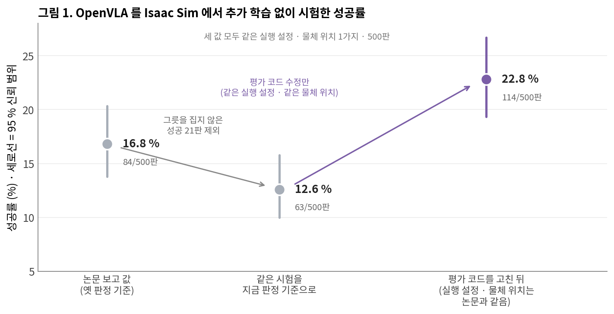
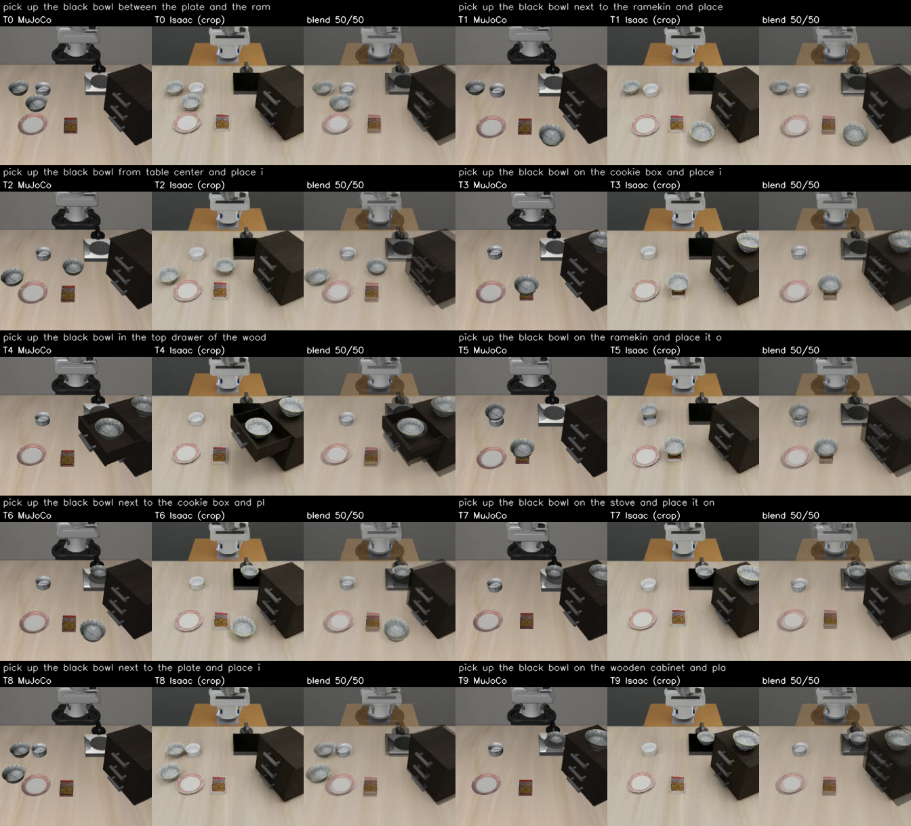
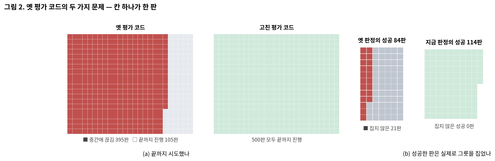
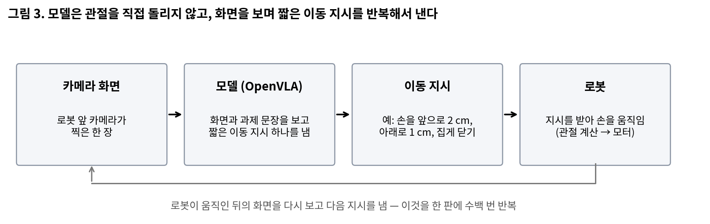
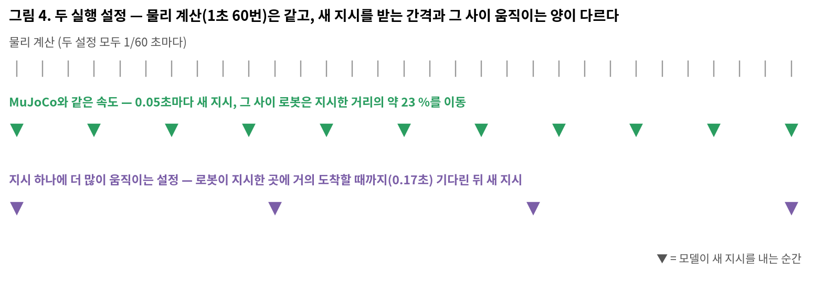
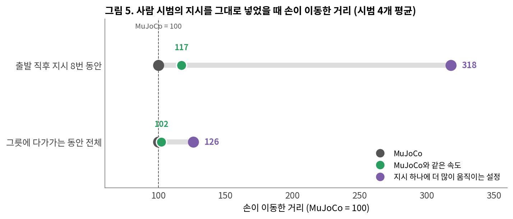
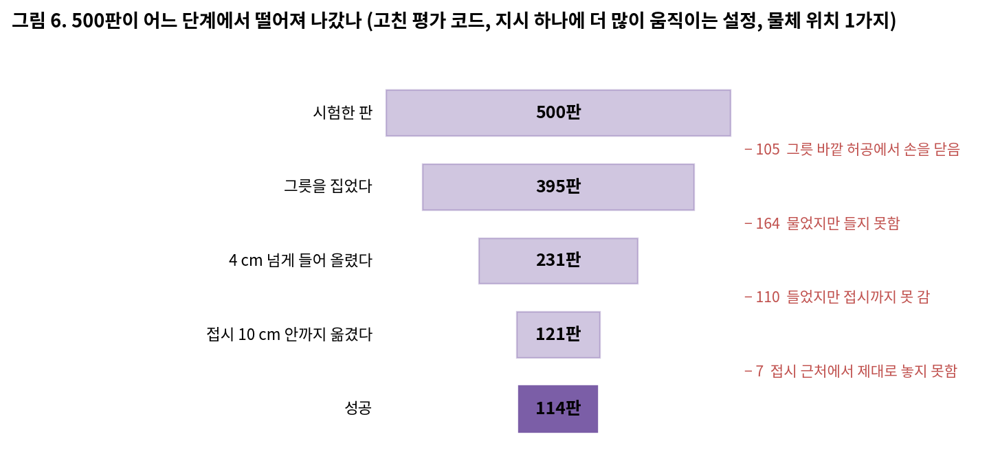
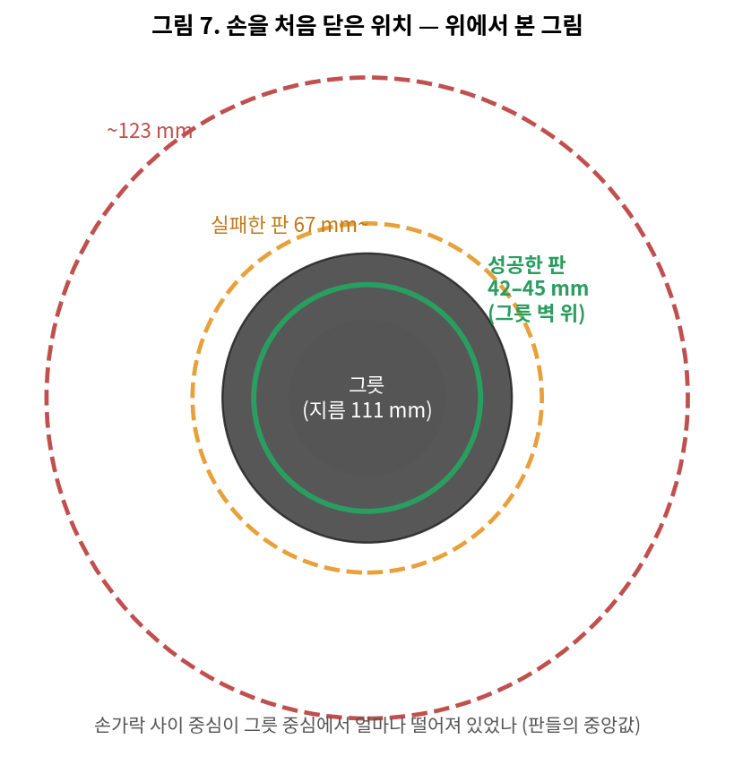
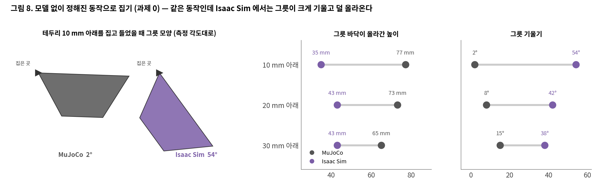

# 보고서 1-1. OpenVLA를 Isaac Sim으로 옮겼을 때 — 성공률 16.8 %에서 22.8 %까지, 그리고 더 오르지 않은 이유

작성 2026-10-01 · 판 1-1a · English: [README_en.md](README_en.md) · PDF: [한국어](report_1-1_ko.pdf) · [English](report_1-1_en.pdf)

> 이 판은 같은 조건 · 같은 판 수로 잰 결과만 담았다. 실행 설정에 따른 차이는 같은 판 수의 시험을 다시 돌리고 있어, 끝나는 대로 이 보고서를 고치고 보고서 1-2에서 자세히 다룬다.

## 0. 이 보고서는 무엇인가

로봇 팔이 「검은 그릇을 집어 접시 위에 놓는」 과제를 하도록 학습된 인공지능 모델 OpenVLA는, MuJoCo라는 시뮬레이션 프로그램에서 사람이 보여 준 시범으로 학습됐다. 이 보고서는 그 모델을 추가 학습 없이 다른 시뮬레이션 프로그램인 Isaac Sim으로 옮겨 시험했을 때의 성공률과, 그 성공률을 왜곡하던 평가 코드의 문제를 고친 과정, 그리고 고친 뒤에도 성공률이 크게 오르지 않은 이유를 정리한다.

## 한눈에 보는 결론

평가 코드의 결함을 고치자, 같은 조건에서 성공률이 **12.6 %(그릇을 실제로 집은 성공만)에서 22.8 %로** 올랐다. 남은 실패의 대부분은 그릇을 잘못 찾아가서가 아니라, **그릇을 물고도 들어 올리지 못하거나 그릇 바깥 허공에서 손을 닫는** 경우였고, 모델 없이 같은 동작으로 그릇을 집어 보면 Isaac Sim에서는 그릇이 크게 기울며 덜 올라온다.

| 질문 | 답 | 근거 |
| --- | --- | --- |
| 성공률은 얼마나 올랐나 | 논문에 실린 값은 16.8 %(500판 중 84판)다. 그중 21판은 그릇을 집지 않았는데 성공으로 셌던 경우라, 그릇을 실제로 집어 옮긴 성공만 세면 12.6 %다. 평가 코드를 고친 뒤 같은 기준으로 22.8 %(500판 중 114판) | 그림 1, 2 |
| 무엇이 올렸나 | 평가 코드의 결함 수정. 세 값 모두 같은 실행 설정 · 같은 물체 위치 · 500판으로 쟀다 | 2 · 3절 |
| 이 실행 설정은 원래 학습 환경과 같은가 | 아니다. 같은 지시에 로봇 손이 MuJoCo보다 많이 움직인다(그릇에 다가가는 동안 1.3배, 출발 직후 3배 남짓). MuJoCo와 같은 속도로 맞춘 결과는 같은 판 수로 다시 재고 있다 | 그림 5, 5절 |
| 왜 더 오르지 않았나 | 500판 중 105판은 그릇 바깥 허공에서 손을 닫았고, 164판은 그릇을 물었지만 들지 못했으며, 110판은 들어 올린 뒤 접시까지 가지 못했다. 모델 없이 같은 동작으로 집어 보면 Isaac Sim에서는 그릇이 38~54° 기운다(MuJoCo 2~15°) | 그림 6, 7, 8 |
| 원인이 아니었던 것 | 화면을 처리하는 과정, 카메라 시야, 물체 크기. 그릇 무게는 일부만 영향 | 6절 표 |
| 아직 모르는 것 | 실행 설정을 MuJoCo와 같은 속도로 바꾸면 같은 조건에서 성공률이 어떻게 달라지는지 | 8절 |
| 다음 | MuJoCo와 같은 속도 · 같은 물체 위치 500판 시험(진행 중, 보고서 1-2). Isaac Sim에서 실제로 들어 올린 사람 시범으로 모델을 다시 학습(진행 중) | 8절 |

## 1. 무엇을 평가하나

**과제.** LIBERO-Spatial이라는 시험 묶음의 10가지 과제다. 모든 과제가 「검은 그릇을 집어 접시 위에 놓기」이고, 그릇이 처음 놓인 위치가 다르다.

| 과제 | 그릇의 처음 위치 | 과제 | 그릇의 처음 위치 |
| --- | --- | --- | --- |
| 0 | 접시와 라메킨(작은 그릇) 사이 | 5 | 라메킨 위 |
| 1 | 라메킨 옆 | 6 | 쿠키 상자 옆 |
| 2 | 테이블 가운데 | 7 | 스토브 위 |
| 3 | 쿠키 상자 위 | 8 | 접시 옆 |
| 4 | 나무 캐비닛 위 서랍 안 | 9 | 나무 캐비닛 위 |

**판과 물체 위치.** 시험 한 번을 「판」이라 부른다. 과제마다 50판, 모두 500판을 한 묶음으로 잰다. 이 보고서의 시험은 모두 물체(그릇 · 접시 · 상자)를 LIBERO가 정해 둔 첫 번째 위치 하나에 놓고 시작한다(논문과 같은 방식).

**한 판의 길이.** 모델이 지시를 220번 낼 때까지 성공하지 못하면 실패다.

**성공 판정.** 그릇의 바닥이 접시 위에 놓이고, 높이가 접시 윗면과 맞고, 움직임이 멈췄으며, 그릇이 접시보다 3 cm 넘게 높은 곳에서 내려왔을 때 성공이다. 여기에 더해, 성공한 판마다 손가락 기록을 보고 **로봇이 그릇을 실제로 집었는지** 확인한다.

*그림 9. 과제 10개의 시작 화면. 왼쪽부터 MuJoCo, Isaac Sim(모델이 보는 화면), 둘을 겹친 화면.*

## 2. 출발점의 숫자가 정확했나

**현상.** 논문에 실린 성공률은 16.8 %였는데, 성공의 절반 가까이(84판 중 39판)가 과제 6 하나에서 나왔다.

**의심한 것과 이유.** 두 가지를 의심했다. 첫째, 당시 판정은 「시험이 끝났을 때 그릇이 접시 근처에 있으면 성공」이어서, 로봇이 그릇을 집지 않고 밀어서 옮긴 경우도 성공으로 셀 수 있었다. 둘째, 평가 코드에 「집게를 6번 넘게 닫으면 중단」 같은 안전 규칙이 있어, 모델이 다시 시도할 기회를 빼앗고 있을 수 있었다.

**확인 방법과 결과.** 성공한 84판의 손가락 기록을 하나씩 확인하니 **21판은 그릇을 집지 않은 경우**였다(그중 18판이 과제 6). 판이 끝난 이유를 집계하니 **500판 중 395판이 220번을 다 쓰기 전에 안전 규칙으로 끊겨** 있었다.

**고친 것.**

- 판을 중간에 끊는 규칙을 없앴다. 실패는 220번을 다 쓴 경우로만 정한다.
- 집게를 닫는 방식을 바꿨다. 옛 코드는 닫기 지시를 받으면 팔을 멈추고 닫았는데, MuJoCo에서는 집게가 닫히는 동안에도 팔이 계속 움직인다.
- 손의 목표 높이에 들어 있던 15 mm 오차를 없앴다. 이 오차 때문에 손이 그릇 테두리보다 높은 곳에서 닫히는 경우가 있었다.
- 팔의 관절 계산(역기구학)이 실패하면 판을 끝내던 동작을, 그 순간의 자세를 유지하는 동작으로 바꿨다.
- 성공 판정을 위의 엄격한 기준으로 바꾸고, 실제로 집었는지를 모든 성공 판에서 확인한다.

## 3. 평가 코드를 고친 뒤의 결과

같은 모델, 같은 실행 설정, 같은 물체 위치로 500판을 다시 재니 **22.8 %(114판)**였고, 그릇을 집지 않은 성공은 0판이었다. 같은 판정 기준으로 비교하면 12.6 %에서 22.8 %로, 95 % 신뢰 범위가 겹치지 않는 차이다(그림 1).

| 과제 | 0 | 1 | 2 | 3 | 4 | 5 | 6 | 7 | 8 | 9 | 전체 |
| --- | --- | --- | --- | --- | --- | --- | --- | --- | --- | --- | --- |
| 성공 / 50판 | 10 | 13 | 28 | 9 | 2 | 0 | 40 | 3 | 7 | 2 | 114 / 500 |
| 성공률 | 20 % | 26 % | 56 % | 18 % | 4 % | 0 % | 80 % | 6 % | 14 % | 4 % | 22.8 % |

## 4. 모델이 로봇을 움직이는 방식

모델은 로봇의 관절을 직접 돌리지 않는다. 카메라 화면과 과제 문장을 보고 「손을 앞으로 2 cm, 아래로 1 cm」 같은 짧은 이동 지시를 하나 내고, 로봇이 움직인 뒤의 화면을 다시 보고 다음 지시를 낸다. 이것을 한 판에 수백 번 반복한다.

**지시 하나의 시간.** 모델이 학습한 사람 시범은 1초에 20번, 즉 0.05초마다 지시를 기록했다. 그래서 모델의 지시 하나는 「0.05초 동안의 움직임」을 뜻한다. MuJoCo의 로봇은 0.05초 안에 지시한 거리를 다 가지 못하고, 멈춰 있다가 처음 받은 지시에는 약 9 %, 계속 움직이는 중에는 지시 하나에 약 23 %를 움직인다. 모델은 이 반응에 맞춰 지시를 내도록 학습됐다.

**모델의 계산 시간.** 「OpenVLA는 1초에 5~10번 지시를 낸다」는 말은 GPU가 지시를 계산하는 속도를 뜻한다. 이 평가는 LIBERO의 원래 평가처럼 모델이 계산하는 동안 시뮬레이션 시간을 멈춰 두고, 지시를 받은 뒤에 시간을 진행한다. 우리 환경에서 지시 하나를 계산하는 데 평균 0.73초가 걸렸지만, 로봇 입장에서는 정해진 간격마다 지시를 받는다.

## 5. 실행 설정 — 무엇을 썼고, 원래 학습 환경과 무엇이 다른가

Isaac Sim의 로봇이 지시 하나에 얼마나 움직이게 할지는 두 값으로 정한다. 지시 하나마다 물리 계산을 몇 번 하고 다음 지시로 넘어가는지(물리 계산은 1초에 60번), 그리고 손의 목표 지점을 지시한 거리의 몇 %로 잡는지다.

| | 지시 하나에 더 많이 움직이는 설정 | MuJoCo와 같은 속도 |
| --- | --- | --- |
| 새 지시를 받는 간격 | 0.17초 (물리 계산 10번) | 0.05초 (물리 계산 3번, MuJoCo와 같음) |
| 손의 목표 지점 | 지시한 거리 그대로 | 지시한 거리의 65 % |
| 지시 하나에 실제로 움직이는 양 | 지시한 거리의 거의 전부 | 약 23 % (MuJoCo와 같음) |
| 이 보고서의 시험 | **논문 시험과 고친 평가 코드 시험 모두 이 설정** | 같은 판 수로 다시 재는 중 |

**지금까지의 과정.**

- **현상.** 논문 시험과 고친 평가 코드 시험은 모두 「지시 하나에 더 많이 움직이는 설정」이었다(결과 파일에 남은 지시당 물리 계산 횟수가 두 시험 모두 10번).
- **의심한 것과 이유.** 9월 25일, 이 설정이 MuJoCo의 로봇과 다르게 움직일 수 있다고 보고 「MuJoCo와 같은 속도」로 맞췄다. 그런데 그 설정으로 같은 물체 위치에서 시험해 보니 과제 6의 성공률이 크게 떨어져(로봇이 그릇을 물고도 들어 올리지 못함), 9월 27일에 원래 설정으로 되돌려 22.8 %를 쟀다. 이때 그 시험은 216판에서 멈춰서, 판 수가 같은 비교로 쓸 수 없다.
- **확인 방법과 결과.** 9월 29일, 사람 시범의 지시를 두 시뮬레이터에 똑같이 넣어 손이 움직인 거리를 비교했다(시범 4개). 「MuJoCo와 같은 속도」는 MuJoCo와 거의 같은 거리(102)를 움직였고, 「지시 하나에 더 많이 움직이는 설정」은 그릇에 다가가는 동안 1.3배(126), 출발 직후에는 3배 남짓(318) 더 움직였다. 방향별로도 앞뒤 1.73배, 좌우 0.65배, 위아래 0.96배로 고르지 않았고, 그릇을 집는 순간의 손 위치는 MuJoCo와 159 mm, 손 방향은 136° 달랐다(MuJoCo와 같은 속도에서는 21 mm, 8°).

**지금 말할 수 있는 것.** 16.8 %와 22.8 %는 모두 원래 학습 환경과 다르게 움직이는 실행 설정에서 잰 값이다. 두 값의 차이는 평가 코드를 고친 효과이고, 실행 설정을 MuJoCo와 같게 했을 때 같은 물체 위치에서 성공률이 어떻게 되는지는 500판 시험을 다시 돌리고 있다.

## 6. 왜 더 오르지 않았나

**현상.** 평가 코드를 고친 뒤에도 500판 중 386판이 실패했다.

**확인 방법.** 실패를 손가락 폭과 그릇 높이 기록으로 나눴다. 손가락이 그릇 벽 두께만큼 벌어진 채 멈춘 순간이 있으면 「그릇을 집었다」, 그릇 바닥이 4 cm 넘게 올라갔으면 「들어 올렸다」, 끝났을 때 그릇이 접시 10 cm 안에 있으면 「접시 근처까지 옮겼다」로 봤다.

**결과.** 실패는 세 단계에 고르게 퍼져 있었다.

- **그릇 바깥 허공에서 손을 닫음 (105판).** 성공한 판은 손가락 사이의 중심이 그릇 중심에서 42~45 mm, 즉 그릇 벽 위에서 손을 닫았고, 실패한 판은 67~123 mm, 즉 그릇 바깥에서 닫았다(그림 7). 지시 하나에 로봇이 MuJoCo보다 많이, 그리고 방향마다 다르게 움직이는 것(5절)이 손을 그릇 위에 정확히 멈추지 못하게 했을 수 있다. 이것은 MuJoCo와 같은 속도 시험이 끝나면 확인한다.
- **그릇을 물었지만 들지 못함 (164판).** 모델은 들어 올리라고 지시하는데 그릇이 따라 올라오지 않았다.
- **들었지만 접시까지 가지 못함 (110판).** 그릇을 든 뒤 접시를 향해 가지 못했다.

**「들지 못함」의 원인을 확인한 시험.** 모델의 판단 문제인지 물리 계산 문제인지 가르기 위해, **모델 없이** 로봇에게 정해진 동작(그릇 테두리를 10 · 20 · 30 mm 아래에서 집고 8 cm 들기)을 시켜 두 시뮬레이터에서 비교했다(과제 0, 깊이마다 한 번씩).

같은 동작인데 MuJoCo에서는 그릇이 거의 수평으로(2~15°) 65~77 mm 올라왔고, Isaac Sim에서는 집은 곳을 축으로 **38~54° 기울며 35~43 mm만** 올라왔다. 즉 Isaac Sim에서는 그릇 한쪽을 집으면 그릇이 크게 기울어 들기 어렵다. 그릇 쪽 물리 설정 다섯 가지(계산 반복 횟수, 마찰 재질, 접촉 여유, 비틀림 마찰 등)를 바꿔도 달라지지 않았고, 그릇 무게를 MuJoCo와 같게(85 g → 6 g) 바꾸면 얕게 집을 때만 일부 나아졌다. 손가락 쪽 설정은 아직 시험하지 않았다.

**원인이 아니었던 것.**

| 의심한 것 | 확인한 방법 | 결과 |
| --- | --- | --- |
| 화면 처리 과정 (자르기, 뒤집기, 과제 문장, 지시 해석) | 모델이 판 초반에 그릇 3 cm 앞까지 정확히 손을 내리는지 관찰 | 정확히 내림 → 원인 아님 |
| 카메라 시야 | 모델이 받는 화면의 세로 시야각 계산 | 약 46°로 MuJoCo 학습 화면(45°)과 거의 같음 |
| 물체 크기 | 두 시뮬레이터의 그릇 · 접시 모양과 충돌 모양 비교 | 같음 |
| 그릇 무게 (MuJoCo 6 g, Isaac Sim 85 g) | 성공한 판의 그릇 무게, 모델 없는 집기 시험에서 6 g으로 바꿈 | 성공한 판도 85 g이었고, 6 g은 얕게 집을 때만 일부 개선 → 주원인 아님 |

## 7. 지금 원인으로 보이는 것

- **집기 단계: 물리 계산의 차이.** Isaac Sim에서는 그릇 한쪽을 집으면 그릇이 크게 기울어, 모델이 MuJoCo에서 배운 집는 방법이 통하지 않는다. 그릇 쪽 설정으로는 고쳐지지 않았다.
- **손을 맞추는 단계: 실행 설정의 차이(확인 중).** 지시 하나에 로봇이 원래 학습 환경과 다르게 움직이면, 손을 그릇 위에 정확히 멈추기 어렵다.

## 8. 한계와 다음 실험

**한계.**

- 이 보고서의 모든 시험은 원래 학습 환경과 다르게 움직이는 실행 설정에서 쟀다. MuJoCo와 같은 속도로 같은 물체 위치 500판을 다시 돌리고 있고, 결과가 나오면 이 보고서를 고친다.
- 물체 위치 하나로만 쟀다. 물체 위치를 판마다 바꾸는 LIBERO의 표준 방식(50가지)은 보고서 1-2에서 같은 판 수로 비교한다.
- 시험은 모두 한 번씩만 돌렸다. 모델 없는 집기 시험은 깊이마다 한 번이다.
- 이 평가는 모델이 계산하는 동안 시뮬레이션 시간을 멈춘다. 실물 로봇처럼 계산하는 동안에도 시간이 흐르는 경우는 다루지 않았다.

**다음 실험.**

1. MuJoCo와 같은 속도 · 같은 물체 위치 500판 — 실행 설정만 다를 때의 차이 (진행 중, 보고서 1-2)
2. 지시 하나에 더 많이 움직이는 설정 · 물체 위치 50가지 500판 — 물체 위치만 다를 때의 차이 (보고서 1-2)
3. Isaac Sim에서 실제로 들어 올린 사람 시범 429개로 모델을 다시 학습 — 집기 단계의 물리 차이를 모델 쪽에서 넘을 수 있는지 (진행 중)
4. 손가락 쪽 물리 설정 — 그릇 기울기를 줄일 수 있는지

## 9. 재현 방법

이 절에만 코드에서 쓰는 이름과 값을 적는다.

- 시뮬레이터: Isaac Sim 6.0.1, 물리 60 Hz. GPU: RTX 5090 32 GB.
- 모델: `openvla/openvla-7b-finetuned-libero-spatial`, 역정규화 키 `libero_spatial`, 서버에서 정사각으로 자른 뒤 가운데 면적 0.35를 224×224로 줄임.
- 지시 하나에 더 많이 움직이는 설정: `--sim-steps-per-action 10 --convergence-gain 1.0`. MuJoCo와 같은 속도: `--sim-steps-per-action 3 --convergence-gain 0.65`.
- 고친 평가 코드의 주요 인자: `--steps 220 --ik-backtrack-factors 1.0 0.5 --no-ik-position-fallback --close-approach-settle-steps 0 --gripper-settle-steps 1 --libero-world-offset-m 0 0 0 --stage-telemetry`.
- 물체 위치 하나: 평가 스크립트에 `FIXED_STATE=00`.
- 실행 설정 확인: 판 기록의 `physics_steps_accounted`(지시 하나마다 실제로 한 물리 계산 횟수)가 10이면 지시 하나에 더 많이 움직이는 설정, 3이면 MuJoCo와 같은 속도.

## 부록. 용어

| 용어 | 뜻 |
| --- | --- |
| 판 | 시험 한 번 |
| 지시 | 모델이 화면을 보고 내는 짧은 이동 명령. 손의 위치 · 방향 변화와 집게 열기 / 닫기 |
| 평가 코드 | 모델의 지시를 로봇 동작으로 바꾸고, 판을 진행 · 종료 · 판정하는 프로그램 |
| 실행 설정 | 지시 하나에 로봇을 얼마나 움직이게 할지 정하는 값 (5절) |
| 95 % 신뢰 범위 | 같은 시험을 반복하면 성공률이 대략 들어갈 범위. 500판이면 ±3~4 %포인트 |
