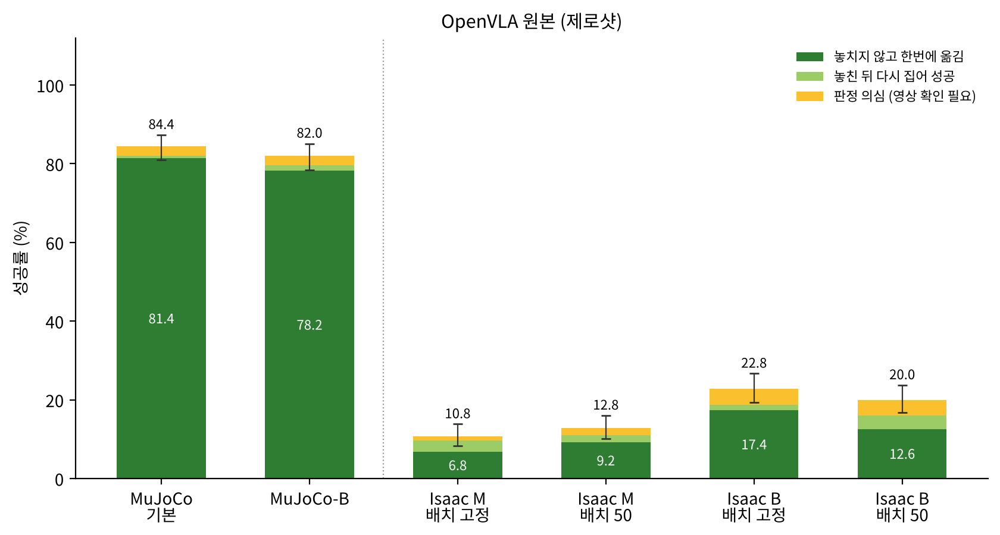
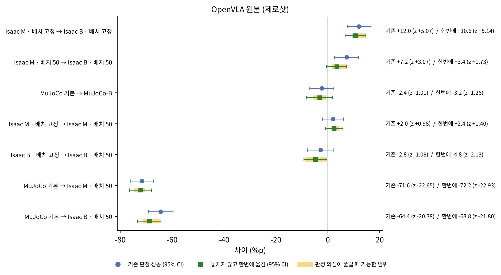
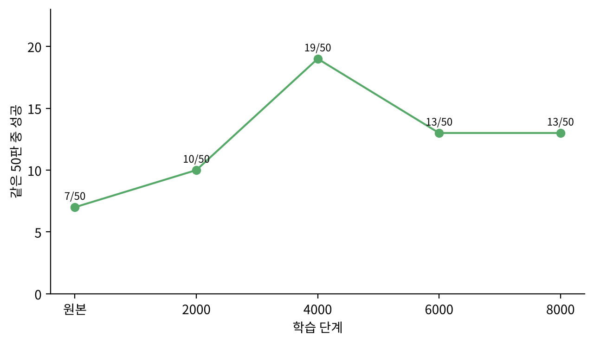
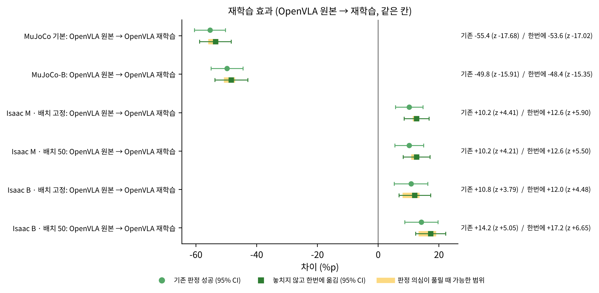
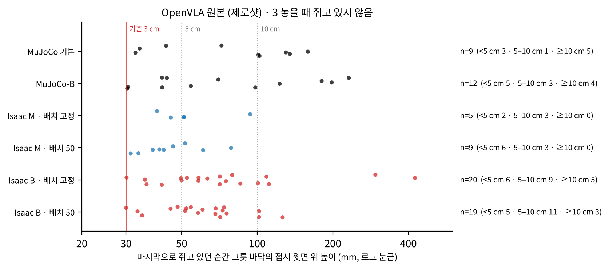
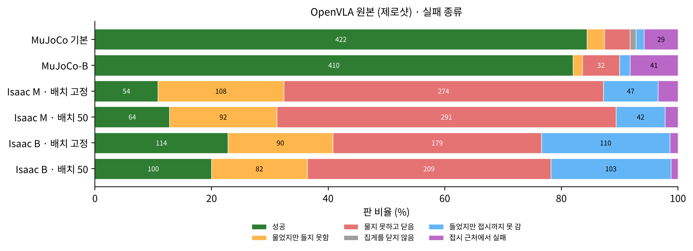
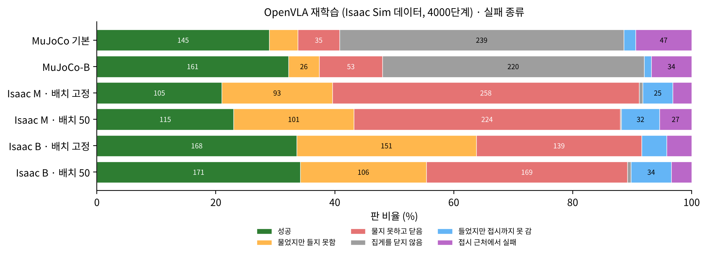
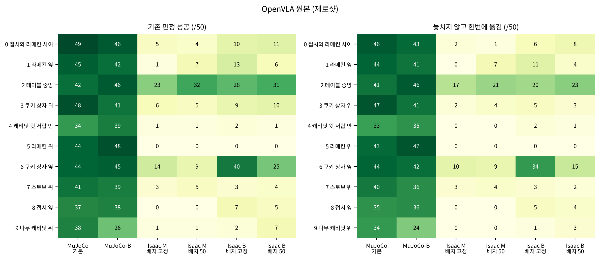
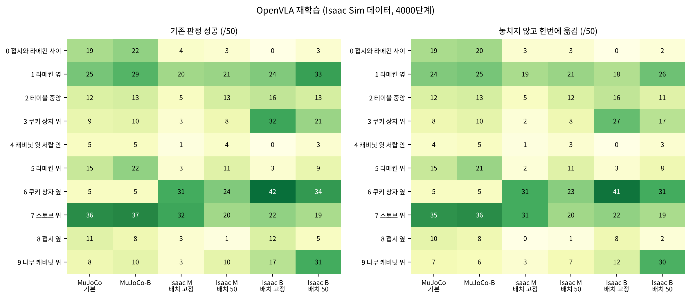
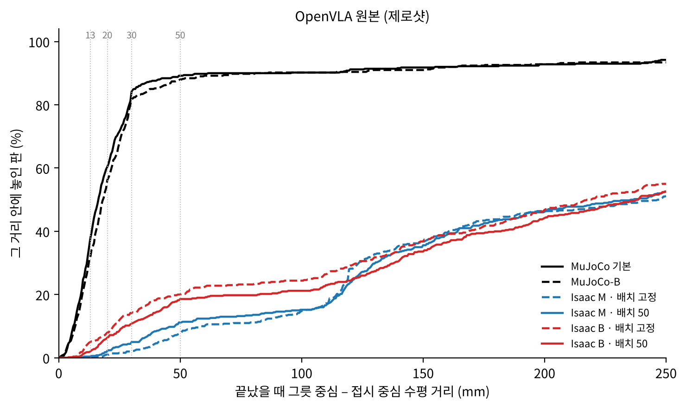

# 보고서 2. OpenVLA — 제로샷과 Isaac Sim 데이터 재학습, 실행 설정과 물체 위치를 하나씩 바꿔 본 결과

작성 2026-10-13 · English: [README_en.md](README_en.md) · PDF: [한국어](report_2_ko.pdf) · [English](report_2_en.pdf)

## 0. 이 보고서는 무엇인가

[보고서 1-1](../1-1_openvla_zero_shot/README.md)에서는 Isaac Sim 평가 코드의 결함을 고쳐 OpenVLA의 성공률이 22.8 %가 된 과정을 다뤘다. 그때는 한 칸(지시 하나에 더 많이 움직이는 설정 B, 물체 위치 고정)만 쟀기 때문에, 실행 설정과 물체 위치에 따른 차이와 MuJoCo와의 공정한 비교가 남아 있었다.

이 보고서는 두 모델을 각각 6칸씩, 모든 칸 500판으로 잰 결과를 정리한다. 하나는 OpenVLA 원본(MuJoCo 데이터로만 학습, 제로샷)이고, 다른 하나는 Isaac Sim 데이터로 다시 학습한 OpenVLA다. 실행 설정, 물체 위치, 재학습 가운데 한 가지만 바꿨을 때 무엇이 달라지는지가 중심이다. 평가 환경, 시험 조건(M · B · MuJoCo-B · 배치), 판정은 [README](../../README.md) 1–4절에 있다.

## 한눈에 보는 결론

| 질문 | 답 | 근거 |
| --- | --- | --- |
| MuJoCo와 같은 속도로 맞추면 원본은? | Isaac Sim M · 배치 50에서 12.8 %(64판). MuJoCo 84.4 %의 15 %만 남는다 | 3절 |
| 지시 하나를 더 길게 실행하면(B)? | Isaac Sim에서는 오른다(+12.0 %p, z = +5.07 · +7.2 %p, z = +3.07). MuJoCo에서 같은 방향으로 바꾸면 차이가 없다(−2.4 %p, z = −1.01). B의 이점은 OpenVLA의 성질이 아니라 Isaac Sim 쪽의 실행 차이를 메운 것으로 본다 | 4절 |
| 물체 위치를 바꾸면? | 전체 성공률은 변하지 않는다(−2.8 · +2.0 %p, z = −1.08 · +0.98) | 5절 |
| Isaac Sim 데이터로 다시 학습하면? | Isaac Sim 네 칸 모두 +10.2–14.2 %p(z = +3.79–+5.05), 최고 34.2 %(B · 배치 50). 대신 MuJoCo는 84.4 %에서 29.0 %로 떨어진다 | 6절 |
| 재학습이 고친 것은? | 그릇을 무는 판이 늘었다(M · 배치 50 집음 41.4 % → 55.0 %). 들고 나서 접시까지 못 가는 실패가 크게 줄었다(B · 배치 50 103판 → 34판). 원본이 거의 못 하던 과제 7(스토브 위)도 3–5판에서 19–32판으로 올랐다 | 6절 |
| 한번에 옮긴 판만 세면? | 재학습 모델은 성공의 87–95 %가 한번에 옮긴 판이고, 원본은 63–76 %다. 원본의 B 칸은 판정 의심이 20판씩이고, 대부분 접시 위 3 cm보다 높은 곳에서 그릇을 놓은 판이다 | 7절 |
| 다음 | 판정 의심 영상 확인, 들어 올리는 방향까지 MuJoCo와 맞춘 실행 설정(M2), MuJoCo와 Isaac Sim 데이터를 섞은 재학습 | 12절 |

## 1. 시험한 모델

| 이름 | 모델 | 학습 데이터 | 동작 수를 원래 크기로 되돌리는 통계 |
| --- | --- | --- | --- |
| OpenVLA 원본 (OpZ) | `openvla/openvla-7b-finetuned-libero-spatial` | LIBERO 사람 시범 (MuJoCo 화면) | `libero_spatial` |
| OpenVLA 재학습 (OpF4) | 원본에서 LoRA로 4000단계 더 학습 | Isaac Sim에서 다시 재생한 사람 시범 (6절) | `isaac_libero_spatial` |

두 모델 모두 앞쪽 카메라 화면과 과제 문장을 보고 지시를 하나씩 낸다. Isaac Sim 화면은 가운데를 잘라 MuJoCo 학습 화면과 시야를 맞춘다(서버에서 정사각으로 자른 뒤 가운데 면적 0.35).

## 2. MuJoCo 기준을 같은 절차로 다시 재기

**현상.** 이전 논문의 MuJoCo 성공률 84.4 %는 8월에 쟀고, 판마다의 기록이 없었다. 그래서 「그릇을 무는 비율」, 「놓인 위치 오차」 같은 지표를 Isaac Sim과 같은 정의로 비교할 수 없었다.

**한 것.** LIBERO의 원래 평가 도구를 고치지 않고 감쌌다(`code/eval/mujoco_eval_logged.py`). 판마다 손 · 손가락 · 그릇 · 접시 · 다른 물체의 위치를 Isaac Sim과 같은 형식으로 기록한다. 화면 처리, 지시 변환, 성공 판정은 원래 도구 그대로다.

**결과.** OpenVLA 원본은 84.4 %(422/500)로 8월 값과 같았다. MuJoCo-B(1초에 10번)는 82.0 %(410/500)다. MuJoCo-B의 간격은 사람 시범의 지시를 모델 없이 MuJoCo에 넣고 간격 다섯 가지(1초에 20 · 10 · 8 · 6 · 5번)를 비교해, 같은 지시에 손이 움직이는 거리가 Isaac Sim의 B와 가장 비슷한 것으로 골랐다(`code/eval/mujoco_travel_calib.py`).

## 3. 원본(제로샷) 결과

*그림 1. OpenVLA 원본의 성공률. 진한 초록은 그릇을 놓치지 않고 한번에 옮긴 판, 연한 초록은 놓친 뒤 다시 집어 성공한 판, 노랑은 판정 의심. 막대 위 선은 기존 판정 성공률의 95 % 신뢰 범위.*

| 칸 | 기존 판정 성공 | 95 % 신뢰 범위 | 놓치지 않고 한번에 옮김 |
| --- | --- | --- | --- |
| MuJoCo 기본 | 422 (84.4 %) | 81.0–87.3 | 407 (81.4 %) |
| MuJoCo-B | 410 (82.0 %) | 78.4–85.1 | 391 (78.2 %) |
| Isaac M · 배치 고정 | 54 (10.8 %) | 8.4–13.8 | 34 (6.8 %) |
| Isaac M · 배치 50 | 64 (12.8 %) | 10.2–16.0 | 46 (9.2 %) |
| Isaac B · 배치 고정 | 114 (22.8 %) | 19.3–26.7 | 87 (17.4 %) |
| Isaac B · 배치 50 | 100 (20.0 %) | 16.7–23.7 | 63 (12.6 %) |

Isaac B · 배치 고정의 22.8 %가 보고서 1-1의 값이다. MuJoCo와 같은 속도(M)로 맞추면 10.8–12.8 %로 더 낮다. MuJoCo 기본에서 Isaac M · 배치 50으로 옮기면 71.6 %p가 떨어진다(z = −22.65).

## 4. 실행 설정을 바꿨을 때 (M → B)

**현상.** Isaac Sim에서는 지시 하나를 0.17초 동안 지시한 거리 그대로 실행하는 B가, MuJoCo와 같은 속도인 M보다 높다. 배치 고정에서 +12.0 %p(z = +5.07), 배치 50에서 +7.2 %p(z = +3.07)다.

**의심한 것과 이유.** B가 OpenVLA에 원래 맞는 실행 방식이라면 MuJoCo에서도 같은 방향으로 바꿨을 때 좋아져야 한다. 그렇지 않다면 B는 Isaac Sim의 다른 부족한 점을 메우고 있는 것이다.

**확인 방법과 결과.**

1. **MuJoCo에서 같은 방향으로 바꾸기.** MuJoCo-B(지시 하나 0.10초, 다가갈 때 1.62배 · 들어 올릴 때 1.18배 움직임)는 MuJoCo 기본과 차이가 없었다(84.4 % → 82.0 %, z = −1.01). B의 이점은 OpenVLA 자체의 성질이 아니다.
2. **같은 지시에 손이 움직이는 거리 재기.** 사람 시범의 지시를 모델 없이 Isaac Sim에 넣고 MuJoCo 기록과 비교했다(과제 10개, 10월 12일). M은 그릇에 다가갈 때 MuJoCo의 1.08배로 거의 같았지만, 들어 올릴 때는 0.63배였다. 그릇을 치운 장면에서도 0.65배여서, 그릇 무게가 아니라 팔을 움직이는 방식 자체의 차이다. MuJoCo의 제어기는 중력을 계산해 보태 주는 반면, Isaac Sim 어댑터의 관절 제어는 위로 올릴 때 뒤처지는 것으로 의심한다. B는 들어 올릴 때 약 1.5배를 움직인다.
3. **실패 종류의 변화.** M에서 B로 바꾸면 그릇 바깥에서 집게를 닫는 실패가 274 → 179판(배치 고정), 291 → 209판(배치 50)으로 줄고, 그릇을 무는 판이 44.0 → 62.6 %, 41.4 → 57.0 %로 는다. 대신 들어 올린 뒤 접시까지 가지 못하는 판이 47 → 110판, 42 → 103판으로 는다.

*그림 2. OpenVLA 원본에서 한 가지만 바꿨을 때의 차이. 동그라미는 기존 판정, 네모는 한번에 옮긴 판, 노란 띠는 판정 의심이 풀릴 때 가능한 범위.*

**지금 말할 수 있는 것.** B의 이점은 Isaac Sim에서만 나타난다. M에서 들어 올리는 움직임이 MuJoCo보다 작다는 것은 측정으로 확인했지만, 이것이 성공률 차이를 얼마나 설명하는지는 아직 모른다. 수평은 M 그대로 두고 위아래만 MuJoCo와 맞춘 설정(M2)으로 확인한다.

## 5. 물체 위치를 바꿨을 때 (배치 고정 → 배치 50)

| 모델 · 설정 | 기존 판정 | z |
| --- | --- | --- |
| 원본 · M | 10.8 % → 12.8 % (+2.0 %p) | +0.98 |
| 원본 · B | 22.8 % → 20.0 % (−2.8 %p) | −1.08 |
| 재학습 · M | 21.0 % → 23.0 % (+2.0 %p) | +0.76 |
| 재학습 · B | 33.6 % → 34.2 % (+0.6 %p) | +0.20 |

네 경우 모두 우연 범위 안이다. 다만 과제 하나하나는 바뀔 수 있다. 배치 고정은 과제마다 같은 장면을 50번 돌리므로 0이나 50에 가까운 값이 나오기 쉽다. 예를 들어 원본 B의 과제 6은 40판에서 25판으로 바뀌었다(9절).

## 6. Isaac Sim 데이터로 다시 학습

### 6-1. 데이터

LIBERO의 사람 시범 지시를 모델 없이 Isaac Sim에서 그대로 재생해, 그릇을 실제로 접시에 옮긴 시범만 모았다. 화면은 MuJoCo 학습 화면과 같은 시야로 자르고, 손목 카메라와 로봇 상태도 함께 저장했다. 학습 파일은 457개다. 과제 5(라메킨 위)는 재생이 50개 중 14개만 성공해 적다.

### 6-2. 학습과 단계 고르기

OpenVLA 원본에서 LoRA(rank 32, batch 16, 학습률 5e-5, 화면 변형 사용)로 이어서 학습하고, 2000 · 4000 · 6000 · 8000단계를 저장했다. 같은 50판(과제마다 0–4번 물체 위치, M · 배치 50 설정)으로 비교해 가장 높은 4000단계를 골랐다.

*그림 3. 학습 단계별로 같은 50판에서 성공한 판 수. 원본 7판, 2000단계 10판, 4000단계 19판, 6000 · 8000단계 13판.*

### 6-3. 결과

| 칸 | 기존 판정: 원본 → 재학습 | 차이 (z) | 한번에 옮김: 원본 → 재학습 | 차이 (z) |
| --- | --- | --- | --- | --- |
| MuJoCo 기본 | 84.4 → 29.0 % | −55.4 %p (−17.68) | 81.4 → 27.8 % | −53.6 %p (−17.02) |
| MuJoCo-B | 82.0 → 32.2 % | −49.8 %p (−15.91) | 78.2 → 29.8 % | −48.4 %p (−15.35) |
| Isaac M · 배치 고정 | 10.8 → 21.0 % | +10.2 %p (+4.41) | 6.8 → 19.4 % | +12.6 %p (+5.90) |
| Isaac M · 배치 50 | 12.8 → 23.0 % | +10.2 %p (+4.21) | 9.2 → 21.8 % | +12.6 %p (+5.50) |
| Isaac B · 배치 고정 | 22.8 → 33.6 % | +10.8 %p (+3.79) | 17.4 → 29.4 % | +12.0 %p (+4.48) |
| Isaac B · 배치 50 | 20.0 → 34.2 % | +14.2 %p (+5.05) | 12.6 → 29.8 % | +17.2 %p (+6.65) |

*그림 4. 원본에서 재학습으로 바꿨을 때의 차이(같은 칸끼리).*

재학습 모델에서도 실행 설정의 효과는 같은 방향이다. B가 M보다 +12.6 %p(z = +4.47), +11.2 %p(z = +3.92) 높고, MuJoCo에서는 차이가 없다(+3.2 %p, z = +1.10).

### 6-4. 재학습이 고친 것

- **그릇을 무는 단계.** 그릇 바깥에서 닫는 실패가 줄고 그릇을 무는 판이 늘었다. M · 배치 50에서 바깥에서 닫음은 291 → 224판, 집음은 41.4 → 55.0 %다. B · 배치 50에서는 집음이 57.0 → 65.2 %다.
- **옮기는 단계.** 들어 올린 뒤 접시까지 가지 못하는 판이 크게 줄었다. B · 배치 고정에서 110 → 21판, B · 배치 50에서 103 → 34판이다.
- **과제.** 원본이 Isaac Sim 네 칸에서 3–5판이던 과제 7(스토브 위)이 19–32판이 됐고, 과제 1(라메킨 옆)은 1–13판에서 20–33판이 됐다. 반대로 원본이 가장 잘하던 과제 2(테이블 가운데)는 23–32판에서 5–16판으로 떨어졌다.

### 6-5. MuJoCo 성능이 떨어진 이유

재학습 모델은 MuJoCo 500판 중 239판에서 집게를 아예 닫지 않는다(원본 5판). 9월에 따로 한 대조 실험에서는 같은 궤적을 MuJoCo 화면으로 학습한 모델이 MuJoCo 73.4 %를 유지했다. 그래서 원인은 학습 절차보다 **Isaac Sim 화면으로 학습하면서 MuJoCo 화면을 잊은 것**으로 본다. 대조 실험의 결과 폴더는 이 보고서의 24칸에 들어 있지 않다.

## 7. 그릇을 놓치지 않고 한번에 옮긴 경우

| 칸 | 원본: 기존 → 한번에 (다시 집어 · 판정 의심) | 재학습: 기존 → 한번에 (다시 집어 · 판정 의심) |
| --- | --- | --- |
| MuJoCo 기본 | 422 → 407 (3 · 12) | 145 → 139 (1 · 5) |
| MuJoCo-B | 410 → 391 (7 · 12) | 161 → 149 (6 · 6) |
| Isaac M · 배치 고정 | 54 → 34 (14 · 6) | 105 → 97 (4 · 4) |
| Isaac M · 배치 50 | 64 → 46 (9 · 9) | 115 → 109 (5 · 1) |
| Isaac B · 배치 고정 | 114 → 87 (7 · 20) | 168 → 147 (13 · 8) |
| Isaac B · 배치 50 | 100 → 63 (17 · 20) | 171 → 149 (13 · 9) |

- **재학습 모델은 성공 대부분이 한번에 옮긴 판이다.** Isaac Sim 네 칸에서 87–95 %로, 원본(63–76 %)보다 깨끗하게 성공한다.
- **원본의 B 칸은 판정 의심이 20판씩이다.** 거의 모두 「놓을 때 쥐고 있지 않음」이고, 그릇을 접시 위 3 cm보다 높은 곳에서 놓은 판이다. 놓은 높이는 대부분 3–10 cm이고, 30 cm 안팎과 40 cm 넘는 곳에서 떨어져 우연히 접시에 걸린 것으로 보이는 판이 2판 있다(그림 5). Isaac Sim에서 이런 판은 과제 2(테이블 가운데)와 과제 3(쿠키 상자 위)에 가장 많고(Isaac Sim 네 칸의 53판 중 38판), 과제 6(쿠키 상자 옆)이 그다음이다. MuJoCo에서는 과제 2 · 3에 몰리지 않는다.
- **판정 의심 때문에 결론을 미뤄야 하는 비교가 두 개 있다.** 원본의 M → B는 배치 고정에서는 한번에 옮긴 판으로 봐도 B가 확실히 높다(+10.6 %p, z = +5.14). 배치 50에서는 +3.4 %p(z = +1.73)로, 판정 의심이 어떻게 풀리느냐에 따라 z가 +0.78–+3.49 사이에서 달라진다. 원본 B의 배치 고정 → 50(−4.8 %p, z = −2.13)도 같은 이유로 결론으로 쓰지 않는다. 재학습 모델의 결론은 판정 의심과 관계없이 그대로다.

*그림 5. OpenVLA 원본에서 「놓을 때 쥐고 있지 않음」으로 판정 의심이 된 판의 놓은 높이(마지막으로 쥐고 있던 순간 그릇 바닥이 접시 윗면보다 얼마나 위에 있었는지). 빨간 선이 3 cm 기준.*

## 8. 실패 종류

*그림 6 · 7. 원본(위)과 재학습(아래)의 실패 종류(판 비율, 숫자는 판 수).*

원본은 Isaac Sim에서 「물지 못하고 닫음」(그릇 바깥에서 집게를 닫음)이 가장 크다. M에서 실패의 61–67 %, B에서 46–52 %다. 재학습은 이 실패와 「들었지만 접시까지 못 감」을 줄였다. MuJoCo에서 재학습 모델의 실패는 대부분 「집게를 닫지 않음」이다(6-5절).

## 9. 과제별

*그림 8 · 9. 과제 × 칸별 성공 판 수(50판 중). 왼쪽은 기존 판정, 오른쪽은 한번에 옮긴 판. 위는 원본, 아래는 재학습.*

- **원본의 Isaac Sim 성공은 과제 2와 6에 몰려 있다.** 예를 들어 M · 배치 50의 64판 중 32판이 과제 2, B · 배치 고정의 114판 중 40판이 과제 6이다. 과제 5(라메킨 위)는 네 칸 모두 0판이고, 과제 4(서랍 안)는 1–2판, 과제 8(접시 옆)은 M에서 0판이다.
- **재학습 모델은 과제 1 · 6 · 7에서 강하다.** 과제 2는 원본보다 약하다.

## 10. 자세한 지표

| 칸 | 원본: 집음 / 놓인 위치 오차 중앙값 | 재학습: 집음 / 놓인 위치 오차 중앙값 |
| --- | --- | --- |
| MuJoCo 기본 | 94.4 % / 16.2 mm | 44.8 % / 159.0 mm |
| Isaac M · 배치 50 | 41.4 % / 236.1 mm | 55.0 % / 165.4 mm |
| Isaac B · 배치 50 | 57.0 % / 238.2 mm | 65.2 % / 164.7 mm |

놓인 위치 오차는 판이 끝났을 때 그릇 중심과 접시 중심 사이의 수평 거리이고, 실패한 판도 포함한다. 모든 칸의 지표(집게를 닫은 판, 다른 물체를 건드리지 않은 판, 접시 중심 13 · 20 · 30 · 50 mm 안에 놓인 판)는 부록 A에 있다.

*그림 10. OpenVLA 원본: 판이 끝났을 때 그릇–접시 중심 거리의 누적 분포. 같은 그림의 재학습판은 `figures/openvla_ft_5_placement_cdf.png`.*

## 11. 지금 원인으로 보이는 것

- **그릇을 무는 위치 (가장 큼).** 원본의 Isaac Sim 실패 대부분은 그릇 바깥에서 집게를 닫는 것이다. 보고서 1-1에서 성공한 판은 그릇 벽 위(손가락 사이 중심이 그릇 중심에서 42–45 mm)에서, 실패한 판은 그 바깥(67–123 mm)에서 닫는 것을 확인했다.
- **들어 올리는 움직임 (측정으로 확인, 영향은 확인 중).** M에서 들어 올리는 움직임이 MuJoCo의 0.63배다. B는 이것을 넘치게 메우고 Isaac Sim에서만 이점을 보인다.
- **그릇의 물리 반응 (보고서 1-1).** 모델 없이 같은 동작으로 집어도 Isaac Sim에서는 그릇 한쪽을 집으면 그릇이 38–54° 기운다(MuJoCo 2–15°).
- **재학습의 맞바꿈.** Isaac Sim 화면과 물리로 다시 학습하면 무는 단계와 옮기는 단계가 나아지지만, MuJoCo 화면을 잊는다.

## 12. 한계와 다음 실험

**한계.**

- 칸마다 한 번씩만 돌렸다. 재학습 단계는 50판으로 골랐다.
- Isaac Sim의 기존 판정은 이 평가 코드의 판정이고, MuJoCo는 LIBERO 자체 판정이다. 「한번에 옮김」과 실패 종류는 두 시뮬레이터에 같은 규칙을 썼다.
- 「판정 의심」은 아직 영상으로 확인하지 않았다.
- 이 평가는 모델이 계산하는 동안 시뮬레이션 시간을 멈춘다.

**다음 실험.**

1. 판정 의심 영상 확인 — 원본 B 칸의 40판부터 (7절의 미룬 비교 두 개가 여기에 걸려 있음)
2. M2 — 수평은 M 그대로, 위아래 움직임만 MuJoCo와 맞춘 설정으로 원본 · 재학습을 다시 비교
3. MuJoCo와 Isaac Sim 데이터를 섞어 다시 학습 — 재학습의 맞바꿈(MuJoCo 성능 하락)을 줄일 수 있는지
4. 손가락 쪽 물리 설정 — 그릇 기울기를 줄일 수 있는지

## 13. 재현 방법

이 절에만 코드에서 쓰는 이름과 값을 적는다.

| 칸 | 원본 결과 폴더 | 재학습 결과 폴더 |
| --- | --- | --- |
| MuJoCo 기본 | `MJ_OpZ_default_layout50` | `MJ_OpF4_default_layout50` |
| MuJoCo-B | `MJ_OpZ_B_layout50` | `MJ_OpF4_B_layout50` |
| Isaac M · 배치 고정 | `zs_s00_S3_full` | `OpF4_M_layout1` |
| Isaac M · 배치 50 | `zs_ovla_cal_50ep` | `ft_v4b_4000_full` |
| Isaac B · 배치 고정 | `zs_s00_S10` | `OpF4_B_layout1` |
| Isaac B · 배치 50 | `OpZ_B_layout50` | `OpF4_B_layout50` |

- 시뮬레이터: Isaac Sim 6.0.1, 물리 60 Hz. GPU: RTX 5090 32 GB.
- Isaac Sim 평가: `code/eval/eval_zs_all_isaac_v6.sh`. 결과는 `<결과 폴더>/task_XX/eYYY/`에 저장되고, 이미 있는 판은 건너뛴다. 환경 변수는 다음과 같다.
  - `OUT`: 결과 폴더
  - `FIXED_STATE=00`: 배치 고정
  - `SERVER`: 정책 서버 주소
  - `EXTRA`: 러너에 덧붙일 인자. B는 기본값(`--sim-steps-per-action 10 --convergence-gain 1.0`)이고, M은 `EXTRA="--sim-steps-per-action 3 --convergence-gain 0.65"`
- MuJoCo 평가: `code/eval/mujoco_eval_logged.py`(LIBERO 원래 평가를 감싼 것)
  - `MJ_CONTROL_FREQ=20`(기본) 또는 `10`(MuJoCo-B)
  - `MJ_LOG_OUT=<결과 폴더>`
  - 재학습 모델은 `MJ_UNNORM_KEY=isaac_libero_spatial`
- 재학습 체크포인트: `openvla-7b-finetuned-libero-spatial+isaac_libero_spatial+b16+lr-5e-05+lora-r32+dropout-0.0--v4b_0930_2243--image_aug--4000_chkpt`. 학습 데이터 생성은 `code/dataset/build_finetune_dataset_v4b.py`, 학습은 `code/train/`.
- 손이 움직인 거리 측정: `code/analysis/verify_adapter_scale_v4.py`. MuJoCo-B 간격 고르기: `code/eval/mujoco_travel_calib.py`.
- 판정 · 표 · 그림: `code/report/make_report_assets_v2.py`가 결과 폴더 24개를 읽어 `data/results_2026-10-13/`의 모든 표와 이 보고서의 그림을 만든다. 판정 규칙은 `code/analysis/vla_signals.py`(실패 종류, 지표), `code/analysis/strict_outcomes.py`(한번에 옮겼는지), `code/analysis/grasp_rule.json`(그릇을 물었다고 보는 손가락 폭)에 있다.

## 부록 A. 전체 표

<!-- TABLES:openvla:start -->
*이 부록의 표는 `code/report/make_report_assets_v2.py`가 `data/results_2026-10-13/episodes_all.csv`에서 만든 것을 그대로 넣었다. 같은 숫자가 `data/results_2026-10-13/tables/`에 CSV로 있다.*

### OpenVLA 원본 (제로샷)

#### 성공률

| 칸 | 판 | 기존 판정 성공 | 95 % 구간 | 한번에 옮김 | 판정 의심이 모두 한번에일 때 | MuJoCo 기본 대비 (기존 / 한번에) |
|---|---|---|---|---|---|---|
| MuJoCo 기본 | 500 | 422 (84.4%) | 81.0–87.3 | 407 (81.4%) | 419 (83.8%) | — |
| MuJoCo-B | 500 | 410 (82.0%) | 78.4–85.1 | 391 (78.2%) | 403 (80.6%) | 97 % / 96 % |
| Isaac M · 배치 고정 | 500 | 54 (10.8%) | 8.4–13.8 | 34 (6.8%) | 40 (8.0%) | 13 % / 8 % |
| Isaac M · 배치 50 | 500 | 64 (12.8%) | 10.2–16.0 | 46 (9.2%) | 55 (11.0%) | 15 % / 11 % |
| Isaac B · 배치 고정 | 500 | 114 (22.8%) | 19.3–26.7 | 87 (17.4%) | 107 (21.4%) | 27 % / 21 % |
| Isaac B · 배치 50 | 500 | 100 (20.0%) | 16.7–23.7 | 63 (12.6%) | 83 (16.6%) | 24 % / 15 % |

#### 그릇을 놓치지 않고 한번에 옮긴 경우

| 칸 | 기존 판정 성공 | 놓치지 않고 한번에 옮김 | 놓친 뒤 다시 집어 성공 | 판정 의심 (영상 확인 필요) | 놓친 뒤 끝내 실패 | 그 밖의 실패 | 평균 닫은 횟수 | 평균 닿은 시도 |
|---|---|---|---|---|---|---|---|---|
| MuJoCo 기본 | 422 | 407 (81.4%) | 3 | 12 | 12 | 66 | 1.10 | 1.00 |
| MuJoCo-B | 410 | 391 (78.2%) | 7 | 12 | 22 | 68 | 1.32 | 1.05 |
| Isaac M · 배치 고정 | 54 | 34 (6.8%) | 14 | 6 | 286 | 160 | 3.66 | 1.90 |
| Isaac M · 배치 50 | 64 | 46 (9.2%) | 9 | 9 | 256 | 180 | 3.89 | 1.82 |
| Isaac B · 배치 고정 | 114 | 87 (17.4%) | 7 | 20 | 304 | 82 | 5.80 | 3.23 |
| Isaac B · 배치 50 | 100 | 63 (12.6%) | 17 | 20 | 315 | 85 | 5.86 | 3.19 |

#### 판정 의심의 이유와 놓은 높이

| 칸 | 판정 의심 | 1 들어 올린 적 없음 | 2 접시 위 순간 없음 | 3 놓을 때 쥐고 있지 않음 | 3 중 5 cm 미만 | 5~10 cm | 10 cm 이상 | 쥔 순간 없음 | 1번이 나온 과제 (과제:판) |
|---|---|---|---|---|---|---|---|---|---|
| MuJoCo 기본 | 12 | 0 | 3 | 9 | 3 | 1 | 5 | 0 | — |
| MuJoCo-B | 12 | 0 | 0 | 12 | 5 | 3 | 4 | 0 | — |
| Isaac M · 배치 고정 | 6 | 0 | 1 | 5 | 2 | 3 | 0 | 0 | — |
| Isaac M · 배치 50 | 9 | 0 | 0 | 9 | 6 | 3 | 0 | 0 | — |
| Isaac B · 배치 고정 | 20 | 0 | 0 | 20 | 6 | 9 | 5 | 0 | — |
| Isaac B · 배치 50 | 20 | 0 | 1 | 19 | 5 | 11 | 3 | 0 | — |

#### 실패 종류

| 칸 | 성공 | 물었지만 들지 못함 | 물지 못하고 닫음 | 집게를 닫지 않음 | 들었지만 접시까지 못 감 | 접시 근처에서 실패 |
|---|---|---|---|---|---|---|
| MuJoCo 기본 | 422 | 15 | 22 | 5 | 7 | 29 |
| MuJoCo-B | 410 | 8 | 32 | 0 | 9 | 41 |
| Isaac M · 배치 고정 | 54 | 108 | 274 | 0 | 47 | 17 |
| Isaac M · 배치 50 | 64 | 92 | 291 | 0 | 42 | 11 |
| Isaac B · 배치 고정 | 114 | 90 | 179 | 0 | 110 | 7 |
| Isaac B · 배치 50 | 100 | 82 | 209 | 0 | 103 | 6 |

#### 자세한 지표 (Table 1 지표)

| 칸 | 닫음 시도 % | 집음 % | 놓기 성공 % | 다른 물체 안 건드림 % | 접시 중심까지 중앙값 (mm) | 13 mm 안 % | 20 mm 안 % | 30 mm 안 % | 50 mm 안 % |
|---|---|---|---|---|---|---|---|---|---|
| MuJoCo 기본 | 99.0 | 94.4 | 84.4 | 90.6 | 16.2 | 37.8 | 60.4 | 84.2 | 89.2 |
| MuJoCo-B | 100.0 | 92.6 | 82.0 | 92.2 | 18.3 | 31.8 | 56.2 | 82.0 | 88.0 |
| Isaac M · 배치 고정 | 100.0 | 44.0 | 10.8 | — | 247.0 | 0.0 | 1.0 | 2.2 | 7.8 |
| Isaac M · 배치 50 | 100.0 | 41.4 | 12.8 | — | 236.1 | 0.4 | 2.2 | 5.0 | 11.2 |
| Isaac B · 배치 고정 | 100.0 | 62.6 | 22.8 | — | 218.5 | 5.0 | 8.0 | 14.2 | 20.0 |
| Isaac B · 배치 50 | 100.0 | 57.0 | 20.0 | — | 238.2 | 2.0 | 6.4 | 10.8 | 18.6 |

다른 물체 안 건드림은 다른 물체 위치 기록이 있는 판만 셈 (지금은 MuJoCo 만 기록이 있음). 거리 지표는 실패 판도 포함한다.

#### 과제별 성공 (기존 판정, 과제당 판 수 대비)

| 과제 | 그릇 위치 | MuJoCo 기본 | MuJoCo-B | Isaac M · 배치 고정 | Isaac M · 배치 50 | Isaac B · 배치 고정 | Isaac B · 배치 50 |
|---|---|---|---|---|---|---|---|
| 0 | 접시와 라메킨 사이 | 49 | 46 | 5 | 4 | 10 | 11 |
| 1 | 라메킨 옆 | 45 | 42 | 1 | 7 | 13 | 6 |
| 2 | 테이블 중앙 | 42 | 46 | 23 | 32 | 28 | 31 |
| 3 | 쿠키 상자 위 | 48 | 41 | 6 | 5 | 9 | 10 |
| 4 | 캐비닛 윗 서랍 안 | 34 | 39 | 1 | 1 | 2 | 1 |
| 5 | 라메킨 위 | 44 | 48 | 0 | 0 | 0 | 0 |
| 6 | 쿠키 상자 옆 | 44 | 45 | 14 | 9 | 40 | 25 |
| 7 | 스토브 위 | 41 | 39 | 3 | 5 | 3 | 4 |
| 8 | 접시 옆 | 37 | 38 | 0 | 0 | 7 | 5 |
| 9 | 나무 캐비닛 위 | 38 | 26 | 1 | 1 | 2 | 7 |
| 합계 |  | 422 | 410 | 54 | 64 | 114 | 100 |

#### 과제별 한번에 옮긴 판

| 과제 | 그릇 위치 | MuJoCo 기본 | MuJoCo-B | Isaac M · 배치 고정 | Isaac M · 배치 50 | Isaac B · 배치 고정 | Isaac B · 배치 50 |
|---|---|---|---|---|---|---|---|
| 0 | 접시와 라메킨 사이 | 46 | 43 | 2 | 1 | 6 | 8 |
| 1 | 라메킨 옆 | 44 | 41 | 0 | 7 | 11 | 4 |
| 2 | 테이블 중앙 | 41 | 46 | 17 | 21 | 20 | 23 |
| 3 | 쿠키 상자 위 | 47 | 41 | 2 | 4 | 5 | 3 |
| 4 | 캐비닛 윗 서랍 안 | 33 | 35 | 0 | 0 | 2 | 1 |
| 5 | 라메킨 위 | 43 | 47 | 0 | 0 | 0 | 0 |
| 6 | 쿠키 상자 옆 | 44 | 42 | 10 | 9 | 34 | 15 |
| 7 | 스토브 위 | 40 | 36 | 3 | 4 | 3 | 2 |
| 8 | 접시 옆 | 35 | 36 | 0 | 0 | 5 | 4 |
| 9 | 나무 캐비닛 위 | 34 | 24 | 0 | 0 | 1 | 3 |
| 합계 |  | 407 | 391 | 34 | 46 | 87 | 63 |

#### 한 가지만 바꿨을 때

| 비교 | 기존 판정 성공 지금 차이 (z) | 한번에 옮김 지금 차이 (z) | 한번에 옮김 영상 확인 후 가능한 범위 (z) |
|---|---|---|---|
| Isaac M · 배치 고정 → Isaac B · 배치 고정 | +12.0 (+5.07) | +10.6 (+5.14) | +9.4 ~ +14.6 (+4.46 ~ +6.63) |
| Isaac M · 배치 50 → Isaac B · 배치 50 | +7.2 (+3.07) | +3.4 (+1.73) | +1.6 ~ +7.4 (+0.78 ~ +3.49) |
| MuJoCo 기본 → MuJoCo-B | -2.4 (-1.01) | -3.2 (-1.26) | -5.6 ~ -0.8 (-2.26 ~ -0.32) |
| Isaac M · 배치 고정 → Isaac M · 배치 50 | +2.0 (+0.98) | +2.4 (+1.40) | +1.2 ~ +4.2 (+0.68 ~ +2.33) |
| Isaac B · 배치 고정 → Isaac B · 배치 50 | -2.8 (-1.08) | -4.8 (-2.13) | -8.8 ~ -0.8 (-3.70 ~ -0.34) |
| MuJoCo 기본 → Isaac M · 배치 50 | -71.6 (-22.65) | -72.2 (-22.93) | -74.6 ~ -70.4 (-23.65 ~ -22.33) |
| MuJoCo 기본 → Isaac B · 배치 50 | -64.4 (-20.38) | -68.8 (-21.80) | -71.2 ~ -64.8 (-22.53 ~ -20.50) |

### OpenVLA 재학습 (Isaac Sim 데이터, 4000단계)

#### 성공률

| 칸 | 판 | 기존 판정 성공 | 95 % 구간 | 한번에 옮김 | 판정 의심이 모두 한번에일 때 | MuJoCo 기본 대비 (기존 / 한번에) |
|---|---|---|---|---|---|---|
| MuJoCo 기본 | 500 | 145 (29.0%) | 25.2–33.1 | 139 (27.8%) | 144 (28.8%) | — |
| MuJoCo-B | 500 | 161 (32.2%) | 28.3–36.4 | 149 (29.8%) | 155 (31.0%) | — |
| Isaac M · 배치 고정 | 500 | 105 (21.0%) | 17.7–24.8 | 97 (19.4%) | 101 (20.2%) | — |
| Isaac M · 배치 50 | 500 | 115 (23.0%) | 19.5–26.9 | 109 (21.8%) | 110 (22.0%) | — |
| Isaac B · 배치 고정 | 500 | 168 (33.6%) | 29.6–37.9 | 147 (29.4%) | 155 (31.0%) | — |
| Isaac B · 배치 50 | 500 | 171 (34.2%) | 30.2–38.5 | 149 (29.8%) | 158 (31.6%) | — |

#### 그릇을 놓치지 않고 한번에 옮긴 경우

| 칸 | 기존 판정 성공 | 놓치지 않고 한번에 옮김 | 놓친 뒤 다시 집어 성공 | 판정 의심 (영상 확인 필요) | 놓친 뒤 끝내 실패 | 그 밖의 실패 | 평균 닫은 횟수 | 평균 닿은 시도 |
|---|---|---|---|---|---|---|---|---|
| MuJoCo 기본 | 145 | 139 (27.8%) | 1 | 5 | 20 | 335 | 0.66 | 0.54 |
| MuJoCo-B | 161 | 149 (29.8%) | 6 | 6 | 31 | 308 | 0.87 | 0.59 |
| Isaac M · 배치 고정 | 105 | 97 (19.4%) | 4 | 4 | 179 | 216 | 1.89 | 1.43 |
| Isaac M · 배치 50 | 115 | 109 (21.8%) | 5 | 1 | 149 | 236 | 1.81 | 1.37 |
| Isaac B · 배치 고정 | 168 | 147 (29.4%) | 13 | 8 | 193 | 139 | 2.48 | 1.75 |
| Isaac B · 배치 50 | 171 | 149 (29.8%) | 13 | 9 | 189 | 140 | 2.48 | 1.75 |

#### 판정 의심의 이유와 놓은 높이

| 칸 | 판정 의심 | 1 들어 올린 적 없음 | 2 접시 위 순간 없음 | 3 놓을 때 쥐고 있지 않음 | 3 중 5 cm 미만 | 5~10 cm | 10 cm 이상 | 쥔 순간 없음 | 1번이 나온 과제 (과제:판) |
|---|---|---|---|---|---|---|---|---|---|
| MuJoCo 기본 | 5 | 0 | 2 | 3 | 0 | 1 | 2 | 0 | — |
| MuJoCo-B | 6 | 0 | 2 | 4 | 1 | 2 | 1 | 0 | — |
| Isaac M · 배치 고정 | 4 | 2 | 1 | 1 | 0 | 0 | 1 | 0 | 8:2 |
| Isaac M · 배치 50 | 1 | 0 | 0 | 1 | 0 | 0 | 1 | 0 | — |
| Isaac B · 배치 고정 | 8 | 0 | 1 | 7 | 3 | 3 | 1 | 0 | — |
| Isaac B · 배치 50 | 9 | 1 | 1 | 7 | 1 | 4 | 2 | 0 | 0:1 |

#### 실패 종류

| 칸 | 성공 | 물었지만 들지 못함 | 물지 못하고 닫음 | 집게를 닫지 않음 | 들었지만 접시까지 못 감 | 접시 근처에서 실패 |
|---|---|---|---|---|---|---|
| MuJoCo 기본 | 145 | 24 | 35 | 239 | 10 | 47 |
| MuJoCo-B | 161 | 26 | 53 | 220 | 6 | 34 |
| Isaac M · 배치 고정 | 105 | 93 | 258 | 3 | 25 | 16 |
| Isaac M · 배치 50 | 115 | 101 | 224 | 1 | 32 | 27 |
| Isaac B · 배치 고정 | 168 | 151 | 139 | 0 | 21 | 21 |
| Isaac B · 배치 50 | 171 | 106 | 169 | 3 | 34 | 17 |

#### 자세한 지표 (Table 1 지표)

| 칸 | 닫음 시도 % | 집음 % | 놓기 성공 % | 다른 물체 안 건드림 % | 접시 중심까지 중앙값 (mm) | 13 mm 안 % | 20 mm 안 % | 30 mm 안 % | 50 mm 안 % |
|---|---|---|---|---|---|---|---|---|---|
| MuJoCo 기본 | 52.2 | 44.8 | 29.0 | 94.0 | 159.0 | 7.0 | 16.6 | 29.6 | 35.2 |
| MuJoCo-B | 56.0 | 44.2 | 32.2 | 92.4 | 156.5 | 6.8 | 17.6 | 32.6 | 36.6 |
| Isaac M · 배치 고정 | 99.4 | 47.8 | 21.0 | — | 176.2 | 1.8 | 2.8 | 7.2 | 19.4 |
| Isaac M · 배치 50 | 99.8 | 55.0 | 23.0 | — | 165.4 | 1.4 | 3.8 | 11.6 | 22.8 |
| Isaac B · 배치 고정 | 100.0 | 72.2 | 33.6 | — | 165.2 | 5.0 | 10.8 | 20.8 | 32.0 |
| Isaac B · 배치 50 | 99.4 | 65.2 | 34.2 | — | 164.7 | 2.4 | 6.8 | 18.0 | 31.8 |

다른 물체 안 건드림은 다른 물체 위치 기록이 있는 판만 셈 (지금은 MuJoCo 만 기록이 있음). 거리 지표는 실패 판도 포함한다.

#### 과제별 성공 (기존 판정, 과제당 판 수 대비)

| 과제 | 그릇 위치 | MuJoCo 기본 | MuJoCo-B | Isaac M · 배치 고정 | Isaac M · 배치 50 | Isaac B · 배치 고정 | Isaac B · 배치 50 |
|---|---|---|---|---|---|---|---|
| 0 | 접시와 라메킨 사이 | 19 | 22 | 4 | 3 | 0 | 3 |
| 1 | 라메킨 옆 | 25 | 29 | 20 | 21 | 24 | 33 |
| 2 | 테이블 중앙 | 12 | 13 | 5 | 13 | 16 | 13 |
| 3 | 쿠키 상자 위 | 9 | 10 | 3 | 8 | 32 | 21 |
| 4 | 캐비닛 윗 서랍 안 | 5 | 5 | 1 | 4 | 0 | 3 |
| 5 | 라메킨 위 | 15 | 22 | 3 | 11 | 3 | 9 |
| 6 | 쿠키 상자 옆 | 5 | 5 | 31 | 24 | 42 | 34 |
| 7 | 스토브 위 | 36 | 37 | 32 | 20 | 22 | 19 |
| 8 | 접시 옆 | 11 | 8 | 3 | 1 | 12 | 5 |
| 9 | 나무 캐비닛 위 | 8 | 10 | 3 | 10 | 17 | 31 |
| 합계 |  | 145 | 161 | 105 | 115 | 168 | 171 |

#### 과제별 한번에 옮긴 판

| 과제 | 그릇 위치 | MuJoCo 기본 | MuJoCo-B | Isaac M · 배치 고정 | Isaac M · 배치 50 | Isaac B · 배치 고정 | Isaac B · 배치 50 |
|---|---|---|---|---|---|---|---|
| 0 | 접시와 라메킨 사이 | 19 | 20 | 3 | 3 | 0 | 2 |
| 1 | 라메킨 옆 | 24 | 25 | 19 | 21 | 18 | 26 |
| 2 | 테이블 중앙 | 12 | 13 | 5 | 12 | 16 | 11 |
| 3 | 쿠키 상자 위 | 8 | 10 | 2 | 8 | 27 | 17 |
| 4 | 캐비닛 윗 서랍 안 | 4 | 5 | 1 | 3 | 0 | 3 |
| 5 | 라메킨 위 | 15 | 21 | 2 | 11 | 3 | 8 |
| 6 | 쿠키 상자 옆 | 5 | 5 | 31 | 23 | 41 | 31 |
| 7 | 스토브 위 | 35 | 36 | 31 | 20 | 22 | 19 |
| 8 | 접시 옆 | 10 | 8 | 0 | 1 | 8 | 2 |
| 9 | 나무 캐비닛 위 | 7 | 6 | 3 | 7 | 12 | 30 |
| 합계 |  | 139 | 149 | 97 | 109 | 147 | 149 |

#### 한 가지만 바꿨을 때

| 비교 | 기존 판정 성공 지금 차이 (z) | 한번에 옮김 지금 차이 (z) | 한번에 옮김 영상 확인 후 가능한 범위 (z) |
|---|---|---|---|
| Isaac M · 배치 고정 → Isaac B · 배치 고정 | +12.6 (+4.47) | +10.0 (+3.68) | +9.2 ~ +11.6 (+3.37 ~ +4.22) |
| Isaac M · 배치 50 → Isaac B · 배치 50 | +11.2 (+3.92) | +8.0 (+2.89) | +7.8 ~ +9.8 (+2.82 ~ +3.50) |
| MuJoCo 기본 → MuJoCo-B | +3.2 (+1.10) | +2.0 (+0.70) | +1.0 ~ +3.2 (+0.35 ~ +1.11) |
| Isaac M · 배치 고정 → Isaac M · 배치 50 | +2.0 (+0.76) | +2.4 (+0.94) | +1.6 ~ +2.6 (+0.62 ~ +1.01) |
| Isaac B · 배치 고정 → Isaac B · 배치 50 | +0.6 (+0.20) | +0.4 (+0.14) | -1.2 ~ +2.2 (-0.41 ~ +0.76) |
| MuJoCo 기본 → Isaac M · 배치 50 | -6.0 (-2.16) | -6.0 (-2.20) | -7.0 ~ -5.8 (-2.55 ~ -2.12) |
| MuJoCo 기본 → Isaac B · 배치 50 | +5.2 (+1.77) | +2.0 (+0.70) | +1.0 ~ +3.8 (+0.35 ~ +1.31) |

### 재학습 효과 (OpenVLA 원본 → 재학습, 같은 칸)

| 칸 | 기존 판정 성공 % | 지금 차이 (z) | 한번에 옮김 % | 지금 차이 (z) |
|---|---|---|---|---|
| MuJoCo 기본 | 84.4 → 29.0 | -55.4 (-17.68) | 81.4 → 27.8 | -53.6 (-17.02) |
| MuJoCo-B | 82.0 → 32.2 | -49.8 (-15.91) | 78.2 → 29.8 | -48.4 (-15.35) |
| Isaac M · 배치 고정 | 10.8 → 21.0 | +10.2 (+4.41) | 6.8 → 19.4 | +12.6 (+5.90) |
| Isaac M · 배치 50 | 12.8 → 23.0 | +10.2 (+4.21) | 9.2 → 21.8 | +12.6 (+5.50) |
| Isaac B · 배치 고정 | 22.8 → 33.6 | +10.8 (+3.79) | 17.4 → 29.4 | +12.0 (+4.48) |
| Isaac B · 배치 50 | 20.0 → 34.2 | +14.2 (+5.05) | 12.6 → 29.8 | +17.2 (+6.65) |

### 재학습 단계 고르기 (OpZ · M · 배치 50 설정, 과제마다 0~4번 판, 같은 50판)

| 학습 단계 | 결과 폴더 | 같은 50판 중 성공 |
|---|---|---|
| 원본 | zs_ovla_cal_50ep | 7 / 50 |
| 2000 | ft_v4b_2000_screen | 10 / 50 |
| 4000 | ft_v4b_4000_screen | 19 / 50 |
| 6000 | ft_v4b_6000_screen | 13 / 50 |
| 8000 | ft_v4b_8000_screen | 13 / 50 |
<!-- TABLES:openvla:end -->

## 부록 B. 용어

| 용어 | 뜻 |
| --- | --- |
| 판 | 시험 한 번. 칸마다 500판(과제 10개 × 50판) |
| 지시 | 모델이 화면을 보고 내는 짧은 이동 명령. 손의 위치 · 방향 변화와 집게 열기 / 닫기 |
| 제로샷 | 옮겨 간 환경(Isaac Sim)의 데이터로 추가 학습하지 않고 그대로 시험하는 것 |
| M / B | Isaac Sim 실행 설정. M은 지시 하나를 0.05초 동안 실행하고 손 목표를 지시한 거리의 65 %로 잡음(MuJoCo와 같은 속도). B는 0.17초 동안 지시한 거리 그대로 |
| MuJoCo-B | MuJoCo에서 지시 간격을 1초 10번(0.10초)으로 늘린 설정 |
| 배치 고정 / 배치 50 | 물체 위치를 LIBERO의 첫 번째 위치 하나로 고정 / 판마다 50가지 중 하나 |
| 기존 판정 | 마지막에 그릇이 접시 위에 놓여 있으면 성공 |
| 놓치지 않고 한번에 옮김 | 그릇을 집은 뒤 한 번도 놓치거나 떨어뜨리지 않고 접시에 놓은 판 |
| 판정 의심 | 기존 판정은 성공이지만, 기록만으로는 집어서 옮겼다는 것을 확인할 수 없어 영상 확인이 필요한 판 |
| LoRA | 큰 모델의 가중치 대부분은 그대로 두고 작은 추가 가중치만 학습하는 방법 |
| z | 두 성공률의 차이가 우연인지 보는 값. 절댓값 1.96을 넘으면 우연일 가능성 5 % 미만 |
