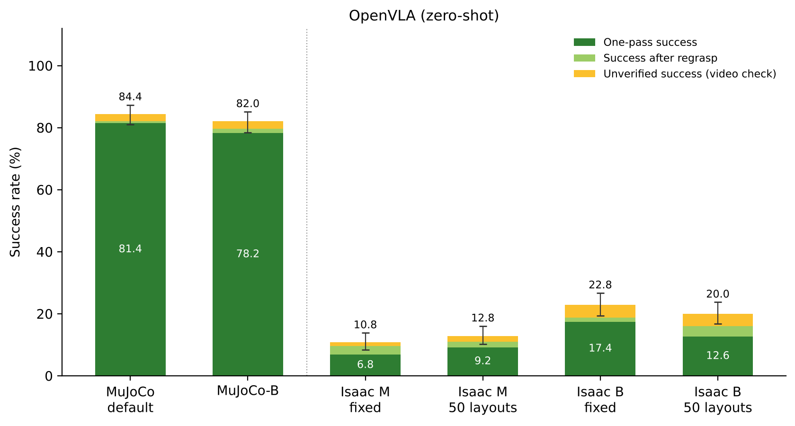
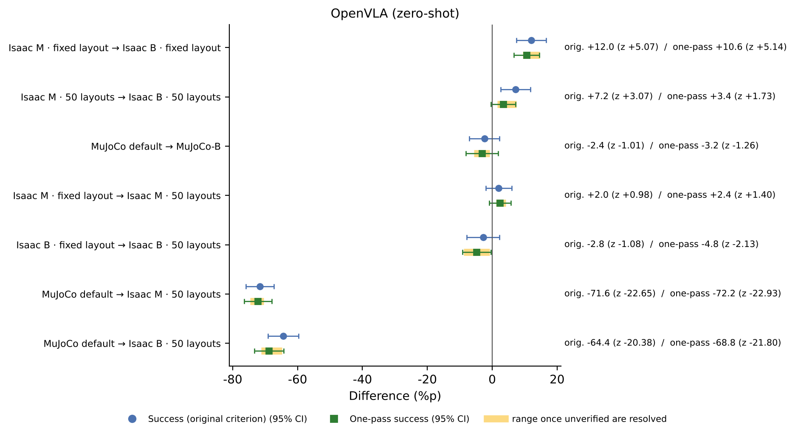
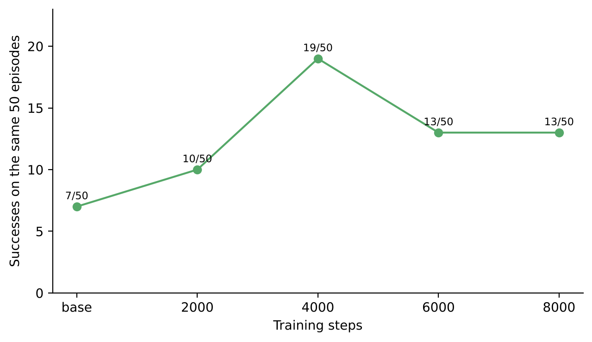
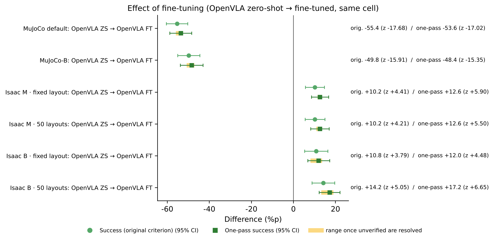
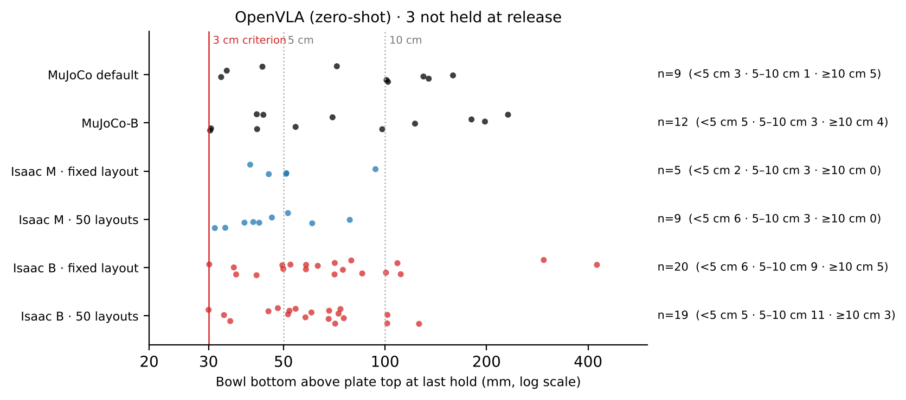
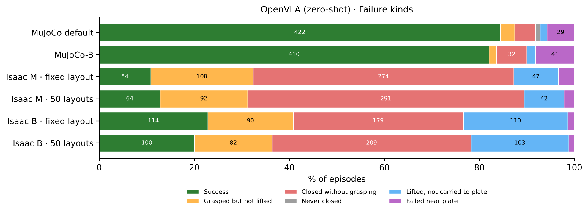
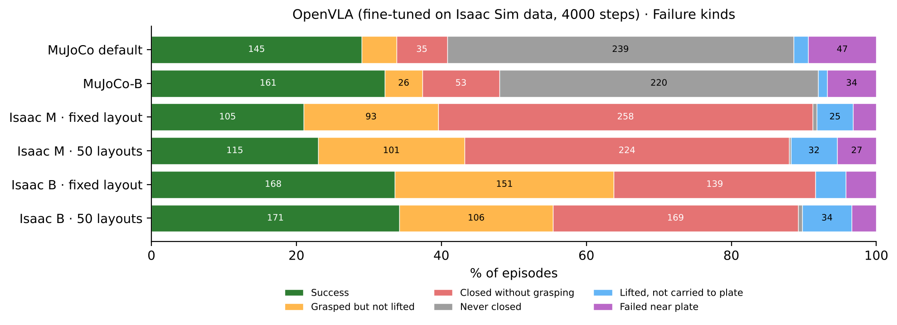
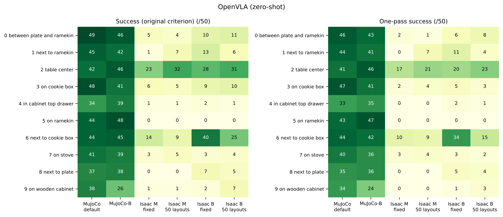
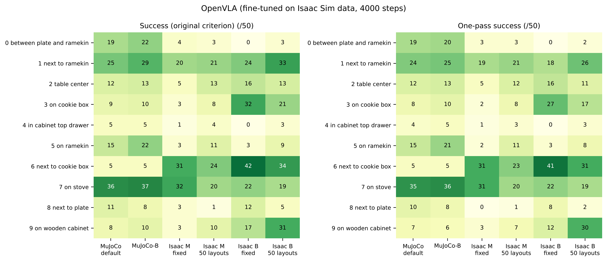
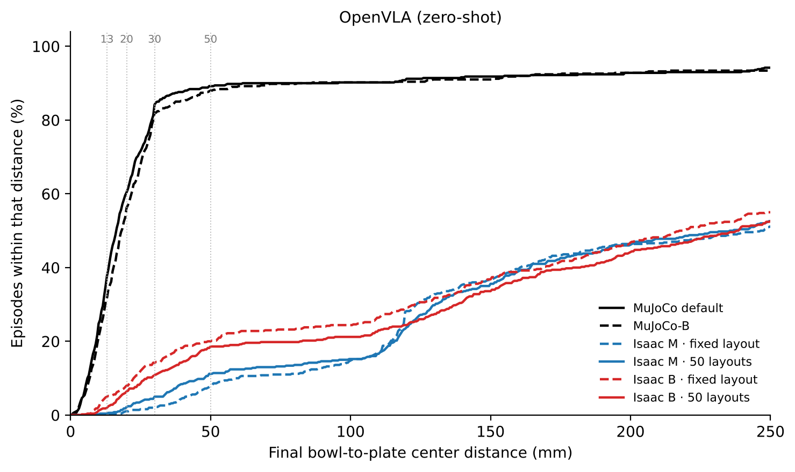

# Report 2. OpenVLA — zero-shot and retraining on Isaac Sim data, changing the execution setting and object placement one at a time

Written 2026-10-13 · 한국어 (main): [README.md](README.md) · PDF: [English](report_2_en.pdf) · [한국어](report_2_ko.pdf)

## 0. What this report is about

[Report 1-1](../1-1_openvla_zero_shot/README_en.md) described how fixing defects in the Isaac Sim evaluation code raised OpenVLA's success rate to 22.8 %. That report measured only one cell (setting B, which moves more per action, with a fixed layout). The effects of the execution setting and object placement, and a fair comparison with MuJoCo, were left open.

This report covers two models, each measured in 6 cells with 500 episodes per cell. One is the original OpenVLA (trained only on MuJoCo data, zero-shot). The other is OpenVLA retrained on Isaac Sim data. It focuses on what changes when only one factor is changed: the execution setting, the object placement, or retraining. The evaluation setup, test cells (M · B · MuJoCo-B · layouts) and criteria are described in Sections 1–4 of the [README](../../README_en.md).

## Conclusions at a glance

| Question | Answer | Evidence |
| --- | --- | --- |
| What does the original model achieve at MuJoCo-matched speed? | 12.8 % (64 episodes) at Isaac M · 50 layouts. Only 15 % of its MuJoCo 84.4 % remains | Section 3 |
| What if each action is executed for longer (B)? | It improves in Isaac Sim (+12.0 %p, z = +5.07 · +7.2 %p, z = +3.07). The same change in MuJoCo makes no difference (−2.4 %p, z = −1.01). We read the benefit of B not as a property of OpenVLA but as compensation for an execution difference on the Isaac Sim side | Section 4 |
| What if object placement changes? | Overall success does not change (−2.8 · +2.0 %p, z = −1.08 · +0.98) | Section 5 |
| What does retraining on Isaac Sim data do? | +10.2 to +14.2 %p in all four Isaac Sim cells (z = +3.79 to +5.05), best 34.2 % (B · 50 layouts). MuJoCo, however, drops from 84.4 % to 29.0 % | Section 6 |
| What did retraining fix? | More episodes grasp the bowl (grasp rate 41.4 % → 55.0 % at M · 50 layouts). Failures to carry the lifted bowl to the plate drop sharply (103 → 34 at B · 50 layouts). Task 7 (on the stove), which the original model hardly solves, rises from 3–5 to 19–32 episodes | Section 6 |
| What if only one-pass successes are counted? | For the retrained model, 87–95 % of successes are one-pass; for the original, 63–76 %. The original model's B cells each have 20 unverified successes, mostly releasing the bowl more than 3 cm above the plate | Section 7 |
| Next | Video check of unverified successes, an execution setting matching MuJoCo also in the lifting direction (M2), retraining on mixed MuJoCo and Isaac Sim data | Section 12 |

## 1. Models tested

| Name | Model | Training data | Statistics used to scale actions back |
| --- | --- | --- | --- |
| OpenVLA zero-shot (OpZ) | `openvla/openvla-7b-finetuned-libero-spatial` | LIBERO human demonstrations (MuJoCo images) | `libero_spatial` |
| OpenVLA retrained (OpF4) | Original model trained 4000 more steps with LoRA | Human demonstrations replayed in Isaac Sim (Section 6) | `isaac_libero_spatial` |

Both models look at the front camera image and the task sentence and issue one action at a time. The Isaac Sim image is cropped at the center to match the field of view of the MuJoCo training images (square crop on the server, then the central area 0.35).

## 2. Re-measuring the MuJoCo baseline with the same procedure

**What we saw.** The earlier paper's MuJoCo success rate of 84.4 % was measured in August, with no per-episode logs. Metrics such as "grasp rate" or "placement error" could not be compared with Isaac Sim under the same definitions.

**What we did.** We wrapped LIBERO's original evaluation tool without modifying it (`code/eval/mujoco_eval_logged.py`). Each episode logs hand, finger, bowl, plate and other-object positions in the same format as Isaac Sim. Image processing, action conversion and success checking are the original tool's.

**Result.** The original OpenVLA scored 84.4 % (422/500), the same as in August. MuJoCo-B (10 actions per second) scored 82.0 % (410/500). The MuJoCo-B interval was chosen by feeding human-demonstration actions to MuJoCo without the model and comparing five intervals (20, 10, 8, 6 and 5 per second). We picked the one whose hand travel for the same actions is closest to Isaac Sim B (`code/eval/mujoco_travel_calib.py`).

## 3. Results of the original model (zero-shot)

*Figure 1. Success of the original OpenVLA. Dark green: one-pass success; light green: success after regrasp; yellow: unverified success. Lines above the bars: 95 % confidence range of success by the original criterion.*

| Cell | Success (original) | 95 % confidence range | One-pass success |
| --- | --- | --- | --- |
| MuJoCo default | 422 (84.4 %) | 81.0–87.3 | 407 (81.4 %) |
| MuJoCo-B | 410 (82.0 %) | 78.4–85.1 | 391 (78.2 %) |
| Isaac M · fixed layout | 54 (10.8 %) | 8.4–13.8 | 34 (6.8 %) |
| Isaac M · 50 layouts | 64 (12.8 %) | 10.2–16.0 | 46 (9.2 %) |
| Isaac B · fixed layout | 114 (22.8 %) | 19.3–26.7 | 87 (17.4 %) |
| Isaac B · 50 layouts | 100 (20.0 %) | 16.7–23.7 | 63 (12.6 %) |

The 22.8 % of Isaac B · fixed layout is the value from Report 1-1. At MuJoCo-matched speed (M) the rate is lower, 10.8–12.8 %. Moving from MuJoCo default to Isaac M · 50 layouts costs 71.6 %p (z = −22.65).

## 4. Changing the execution setting (M → B)

**What we saw.** In Isaac Sim, B (each action executed for 0.17 s at the full commanded distance) is higher than M (MuJoCo-matched speed): +12.0 %p with the fixed layout (z = +5.07) and +7.2 %p with 50 layouts (z = +3.07).

**What we suspected and why.** If B were the execution style that naturally suits OpenVLA, the same change in MuJoCo should also help. If not, B is compensating for some other weakness of Isaac Sim.

**How we checked and what we found.**

1. **The same change in MuJoCo.** MuJoCo-B (0.10 s per action; 1.62× travel approaching, 1.18× lifting) made no difference from MuJoCo default (84.4 % → 82.0 %, z = −1.01). The benefit of B is not a property of OpenVLA itself.
2. **Hand travel for the same actions.** We fed human-demonstration actions to Isaac Sim without the model and compared with the MuJoCo logs (10 tasks, October 12). Under M, the hand moves 1.08× of MuJoCo while approaching the bowl, almost the same, but only 0.63× while lifting. With the bowl removed from the scene it is still 0.65×, so this comes from how the arm is driven, not from the bowl's weight. We suspect the cause is that MuJoCo's controller adds computed gravity compensation, while the Isaac Sim adapter's joint control lags when moving up. Under B, lifting moves about 1.5×.
3. **How the failure kinds change.** Going from M to B, closing the gripper outside the bowl drops from 274 to 179 (fixed layout) and from 291 to 209 (50 layouts). The grasp rate rises from 44.0 to 62.6 % and from 41.4 to 57.0 %. In exchange, episodes that lift the bowl but do not reach the plate rise from 47 to 110 and from 42 to 103.

*Figure 2. Differences when one factor is changed for the original OpenVLA. Circles: original criterion; squares: one-pass success; yellow band: possible range once unverified successes are resolved.*

**What we can say now.** The benefit of B appears only in Isaac Sim. We have measured that lifting under M moves less than in MuJoCo, but how much of the success difference this explains is not yet known. We will check it with a setting (M2) that keeps the horizontal motion of M and matches only the vertical motion to MuJoCo.

## 5. Changing the object placement (fixed layout → 50 layouts)

| Model · setting | Success (original) | z |
| --- | --- | --- |
| Zero-shot · M | 10.8 % → 12.8 % (+2.0 %p) | +0.98 |
| Zero-shot · B | 22.8 % → 20.0 % (−2.8 %p) | −1.08 |
| Retrained · M | 21.0 % → 23.0 % (+2.0 %p) | +0.76 |
| Retrained · B | 33.6 % → 34.2 % (+0.6 %p) | +0.20 |

All four are within chance. Individual tasks can still change. The fixed layout runs the same scene 50 times per task, so values close to 0 or 50 are common. For example, task 6 of the original model under B went from 40 to 25 (Section 9).

## 6. Retraining on Isaac Sim data

### 6-1. Data

We replayed the actions of LIBERO's human demonstrations in Isaac Sim without the model and kept only the demonstrations that actually moved the bowl onto the plate. Images were cropped to the field of view of the MuJoCo training images, and wrist images and robot state were saved as well. There are 457 training files. Task 5 (on the ramekin) has few, because only 14 of 50 replays succeeded.

### 6-2. Training and choosing the step

Starting from the original OpenVLA, we trained with LoRA (rank 32, batch 16, learning rate 5e-5, image augmentation) and saved checkpoints at 2000, 4000, 6000 and 8000 steps. We compared them on the same 50 episodes (object placements 0–4 of every task, M · 50 layouts setting) and chose 4000 steps, which scored highest.

*Figure 3. Successes on the same 50 episodes by training step: original 7, 2000 steps 10, 4000 steps 19, 6000 and 8000 steps 13.*

### 6-3. Results

| Cell | Original criterion: zero-shot → retrained | Difference (z) | One-pass: zero-shot → retrained | Difference (z) |
| --- | --- | --- | --- | --- |
| MuJoCo default | 84.4 → 29.0 % | −55.4 %p (−17.68) | 81.4 → 27.8 % | −53.6 %p (−17.02) |
| MuJoCo-B | 82.0 → 32.2 % | −49.8 %p (−15.91) | 78.2 → 29.8 % | −48.4 %p (−15.35) |
| Isaac M · fixed layout | 10.8 → 21.0 % | +10.2 %p (+4.41) | 6.8 → 19.4 % | +12.6 %p (+5.90) |
| Isaac M · 50 layouts | 12.8 → 23.0 % | +10.2 %p (+4.21) | 9.2 → 21.8 % | +12.6 %p (+5.50) |
| Isaac B · fixed layout | 22.8 → 33.6 % | +10.8 %p (+3.79) | 17.4 → 29.4 % | +12.0 %p (+4.48) |
| Isaac B · 50 layouts | 20.0 → 34.2 % | +14.2 %p (+5.05) | 12.6 → 29.8 % | +17.2 %p (+6.65) |

*Figure 4. Difference from the zero-shot to the retrained model (same cell).*

The effect of the execution setting has the same direction for the retrained model. B is higher than M by +12.6 %p (z = +4.47) and +11.2 %p (z = +3.92), with no difference in MuJoCo (+3.2 %p, z = +1.10).

### 6-4. What retraining fixed

- **Grasping.** Closing outside the bowl decreased and grasping increased. At M · 50 layouts, closing outside the bowl went from 291 to 224 and the grasp rate from 41.4 to 55.0 %. At B · 50 layouts, the grasp rate went from 57.0 to 65.2 %.
- **Carrying.** Episodes that lift the bowl but do not reach the plate dropped sharply: from 110 to 21 at B · fixed layout and from 103 to 34 at B · 50 layouts.
- **Tasks.** Task 7 (on the stove), at 3–5 episodes for the original model in the four Isaac Sim cells, rose to 19–32. Task 1 (next to the ramekin) rose from 1–13 to 20–33. Conversely, task 2 (center of the table), where the original model did best, fell from 23–32 to 5–16.

### 6-5. Why MuJoCo performance dropped

In MuJoCo, the retrained model never closes the gripper in 239 of 500 episodes (original: 5). In a separate control experiment in September, a model trained on the same trajectories with MuJoCo images kept 73.4 % in MuJoCo. We therefore attribute the drop not to the training procedure but to **forgetting MuJoCo images while learning Isaac Sim images**. The control experiment's result folders are not among the 24 cells of this report.

## 7. One-pass success (bowl carried without being lost)

| Cell | Zero-shot: original → one-pass (after regrasp · unverified) | Retrained: original → one-pass (after regrasp · unverified) |
| --- | --- | --- |
| MuJoCo default | 422 → 407 (3 · 12) | 145 → 139 (1 · 5) |
| MuJoCo-B | 410 → 391 (7 · 12) | 161 → 149 (6 · 6) |
| Isaac M · fixed layout | 54 → 34 (14 · 6) | 105 → 97 (4 · 4) |
| Isaac M · 50 layouts | 64 → 46 (9 · 9) | 115 → 109 (5 · 1) |
| Isaac B · fixed layout | 114 → 87 (7 · 20) | 168 → 147 (13 · 8) |
| Isaac B · 50 layouts | 100 → 63 (17 · 20) | 171 → 149 (13 · 9) |

- **Most of the retrained model's successes are one-pass.** In the four Isaac Sim cells, 87–95 % are one-pass, cleaner than the original model (63–76 %).
- **The original model's B cells have 20 unverified successes each.** Almost all are "not held at release": the bowl was released more than 3 cm above the plate. Most were released 3–10 cm above. Two episodes, dropped from about 30 cm and more than 40 cm, appear to have landed on the plate by chance (Figure 5). In Isaac Sim such episodes are most common in task 2 (center of the table) and task 3 (on the cookie box) (38 of 53 across the four Isaac Sim cells), followed by task 6 (next to the cookie box). In MuJoCo they do not concentrate in tasks 2 and 3.
- **Two comparisons must wait for the video check.** For the original model, M → B is clearly higher under B with the fixed layout even counting one-pass success (+10.6 %p, z = +5.14). With 50 layouts it is +3.4 %p (z = +1.73), and depending on how the unverified successes resolve, z ranges from +0.78 to +3.49. The original model's B fixed layout → 50 layouts (−4.8 %p, z = −2.13) is not used as a conclusion for the same reason. The retrained model's conclusions hold regardless of the unverified successes.

*Figure 5. Release height of the original OpenVLA's unverified successes marked "not held at release" (how far the bowl bottom was above the plate top at the last held moment). The red line is the 3 cm threshold.*

## 8. Failure kinds

*Figures 6 and 7. Failure kinds of the zero-shot (top) and retrained (bottom) models (share of episodes; numbers are episode counts).*

For the original model in Isaac Sim, "closed without grasping" (closing the gripper outside the bowl) is the largest failure: 61–67 % of failures under M and 46–52 % under B. Retraining reduced this and "lifted, not carried to plate". In MuJoCo, most failures of the retrained model are "never closed" (Section 6-5).

## 9. Per task

*Figures 8 and 9. Successes per task × cell (out of 50). Left: original criterion; right: one-pass. Top: zero-shot; bottom: retrained.*

- **The original model's Isaac Sim successes concentrate in tasks 2 and 6.** For example, 32 of 64 at M · 50 layouts come from task 2, and 40 of 114 at B · fixed layout from task 6. Task 5 (on the ramekin) is 0 in all four cells, task 4 (in the drawer) 1–2, and task 8 (next to the plate) 0 under M.
- **The retrained model is strong in tasks 1, 6 and 7.** It is weaker than the original model in task 2.

## 10. Detailed metrics

| Cell | Zero-shot: grasp / median placement error | Retrained: grasp / median placement error |
| --- | --- | --- |
| MuJoCo default | 94.4 % / 16.2 mm | 44.8 % / 159.0 mm |
| Isaac M · 50 layouts | 41.4 % / 236.1 mm | 55.0 % / 165.4 mm |
| Isaac B · 50 layouts | 57.0 % / 238.2 mm | 65.2 % / 164.7 mm |

Placement error is the horizontal distance between the bowl center and the plate center at the end of the episode, including failed episodes. All metrics for every cell (episodes that closed the gripper, episodes that left other objects undisturbed, episodes within 13 · 20 · 30 · 50 mm of the plate center) are in Appendix A.

*Figure 10. Original OpenVLA: cumulative distribution of the final bowl-to-plate center distance. The same figure for the retrained model is `figures_en/openvla_ft_5_placement_cdf.png`.*

## 11. What now appears to be the cause

- **Where the gripper closes (largest).** Most Isaac Sim failures of the original model close the gripper outside the bowl. Report 1-1 found that successful episodes close over the bowl wall (finger midpoint 42–45 mm from the bowl center) and failed ones outside it (67–123 mm).
- **Lifting motion (measured; effect being checked).** Under M, lifting moves 0.63× of MuJoCo. B overcompensates and helps only in Isaac Sim.
- **Physical response of the bowl (Report 1-1).** Even with the same motion and no model, grasping one side tilts the bowl 38–54° in Isaac Sim (MuJoCo 2–15°).
- **The trade-off of retraining.** Retraining on Isaac Sim images and physics improves grasping and carrying, but forgets MuJoCo images.

## 12. Limitations and next experiments

**Limitations.**

- Each cell was run once. The retraining step was chosen on 50 episodes.
- In Isaac Sim the original criterion is the evaluation code's check; MuJoCo uses LIBERO's own check. One-pass grouping and failure kinds use the same rules in both simulators.
- Unverified successes have not yet been checked on video.
- The evaluation pauses simulation time while the model computes.

**Next experiments.**

1. Video check of unverified successes, starting with the 40 in the original model's B cells (the two postponed comparisons in Section 7 depend on them)
2. M2 — keep the horizontal motion of M, match only the vertical motion to MuJoCo, and compare both models again
3. Retraining on mixed MuJoCo and Isaac Sim data — whether it reduces the trade-off (MuJoCo drop)
4. Finger-side physics settings — whether the bowl tilt can be reduced

## 13. How to reproduce

Only this section uses the names and values from the code.

| Cell | Zero-shot result folder | Retrained result folder |
| --- | --- | --- |
| MuJoCo default | `MJ_OpZ_default_layout50` | `MJ_OpF4_default_layout50` |
| MuJoCo-B | `MJ_OpZ_B_layout50` | `MJ_OpF4_B_layout50` |
| Isaac M · fixed layout | `zs_s00_S3_full` | `OpF4_M_layout1` |
| Isaac M · 50 layouts | `zs_ovla_cal_50ep` | `ft_v4b_4000_full` |
| Isaac B · fixed layout | `zs_s00_S10` | `OpF4_B_layout1` |
| Isaac B · 50 layouts | `OpZ_B_layout50` | `OpF4_B_layout50` |

- Simulator: Isaac Sim 6.0.1, physics 60 Hz. GPU: RTX 5090 32 GB.
- Isaac Sim evaluation: `code/eval/eval_zs_all_isaac_v6.sh`. Results go to `<result folder>/task_XX/eYYY/`, and episodes that already exist are skipped. Environment variables:
  - `OUT`: result folder
  - `FIXED_STATE=00`: fixed layout
  - `SERVER`: policy server address
  - `EXTRA`: extra runner arguments. B is the default (`--sim-steps-per-action 10 --convergence-gain 1.0`); M is `EXTRA="--sim-steps-per-action 3 --convergence-gain 0.65"`
- MuJoCo evaluation: `code/eval/mujoco_eval_logged.py` (a wrapper around LIBERO's original evaluation)
  - `MJ_CONTROL_FREQ=20` (default) or `10` (MuJoCo-B)
  - `MJ_LOG_OUT=<result folder>`
  - For the retrained model, `MJ_UNNORM_KEY=isaac_libero_spatial`
- Retrained checkpoint: `openvla-7b-finetuned-libero-spatial+isaac_libero_spatial+b16+lr-5e-05+lora-r32+dropout-0.0--v4b_0930_2243--image_aug--4000_chkpt`. Training data built with `code/dataset/build_finetune_dataset_v4b.py`; training in `code/train/`.
- Hand-travel measurement: `code/analysis/verify_adapter_scale_v4.py`. Choosing the MuJoCo-B interval: `code/eval/mujoco_travel_calib.py`.
- Criteria, tables and figures: `code/report/make_report_assets_v2.py` reads the 24 result folders and builds all tables in `data/results_2026-10-13/` and the figures of this report. The rules are in `code/analysis/vla_signals.py` (failure kinds, metrics), `code/analysis/strict_outcomes.py` (one-pass grouping) and `code/analysis/grasp_rule.json` (finger width counted as grasping the bowl).

## Appendix A. Full tables

<!-- TABLES:openvla:start -->
*The tables in this appendix are generated by `code/report/make_report_assets_v2.py` from `data/results_2026-10-13/episodes_all.csv` and inserted unchanged. The same numbers are in `data/results_2026-10-13/tables/` as CSV.*

### OpenVLA (zero-shot)

#### Success rate

| Cell | Episodes | Success (original) | 95% CI | One-pass | If all unverified are one-pass | Retained vs MuJoCo default (original / one-pass) |
|---|---|---|---|---|---|---|
| MuJoCo default | 500 | 422 (84.4%) | 81.0–87.3 | 407 (81.4%) | 419 (83.8%) | — |
| MuJoCo-B | 500 | 410 (82.0%) | 78.4–85.1 | 391 (78.2%) | 403 (80.6%) | 97 % / 96 % |
| Isaac M · fixed layout | 500 | 54 (10.8%) | 8.4–13.8 | 34 (6.8%) | 40 (8.0%) | 13 % / 8 % |
| Isaac M · 50 layouts | 500 | 64 (12.8%) | 10.2–16.0 | 46 (9.2%) | 55 (11.0%) | 15 % / 11 % |
| Isaac B · fixed layout | 500 | 114 (22.8%) | 19.3–26.7 | 87 (17.4%) | 107 (21.4%) | 27 % / 21 % |
| Isaac B · 50 layouts | 500 | 100 (20.0%) | 16.7–23.7 | 63 (12.6%) | 83 (16.6%) | 24 % / 15 % |

#### One-pass success (bowl carried without being lost)

| Cell | Success (original) | One-pass success | Success after regrasp | Unverified success (video check) | Failure after a lost grasp | Other failure | Mean closings | Mean touching attempts |
|---|---|---|---|---|---|---|---|---|
| MuJoCo default | 422 | 407 (81.4%) | 3 | 12 | 12 | 66 | 1.10 | 1.00 |
| MuJoCo-B | 410 | 391 (78.2%) | 7 | 12 | 22 | 68 | 1.32 | 1.05 |
| Isaac M · fixed layout | 54 | 34 (6.8%) | 14 | 6 | 286 | 160 | 3.66 | 1.90 |
| Isaac M · 50 layouts | 64 | 46 (9.2%) | 9 | 9 | 256 | 180 | 3.89 | 1.82 |
| Isaac B · fixed layout | 114 | 87 (17.4%) | 7 | 20 | 304 | 82 | 5.80 | 3.23 |
| Isaac B · 50 layouts | 100 | 63 (12.6%) | 17 | 20 | 315 | 85 | 5.86 | 3.19 |

#### Unverified successes: reasons and release height

| Cell | Unverified | 1 never lifted with the hand | 2 no on-plate moment | 3 not held at release | 3: <5 cm | 5–10 cm | ≥10 cm | never held | Tasks with reason 1 (task:count) |
|---|---|---|---|---|---|---|---|---|---|
| MuJoCo default | 12 | 0 | 3 | 9 | 3 | 1 | 5 | 0 | — |
| MuJoCo-B | 12 | 0 | 0 | 12 | 5 | 3 | 4 | 0 | — |
| Isaac M · fixed layout | 6 | 0 | 1 | 5 | 2 | 3 | 0 | 0 | — |
| Isaac M · 50 layouts | 9 | 0 | 0 | 9 | 6 | 3 | 0 | 0 | — |
| Isaac B · fixed layout | 20 | 0 | 0 | 20 | 6 | 9 | 5 | 0 | — |
| Isaac B · 50 layouts | 20 | 0 | 1 | 19 | 5 | 11 | 3 | 0 | — |

#### Failure kinds

| Cell | Success | Grasped but not lifted | Closed without grasping | Never closed | Lifted, not carried to plate | Failed near plate |
|---|---|---|---|---|---|---|
| MuJoCo default | 422 | 15 | 22 | 5 | 7 | 29 |
| MuJoCo-B | 410 | 8 | 32 | 0 | 9 | 41 |
| Isaac M · fixed layout | 54 | 108 | 274 | 0 | 47 | 17 |
| Isaac M · 50 layouts | 64 | 92 | 291 | 0 | 42 | 11 |
| Isaac B · fixed layout | 114 | 90 | 179 | 0 | 110 | 7 |
| Isaac B · 50 layouts | 100 | 82 | 209 | 0 | 103 | 6 |

#### Detailed metrics (Table 1 metrics)

| Cell | Gripper close % | Grasp % | Placement % | Undisturbed % | Median error (mm) | ≤13 mm % | ≤20 mm % | ≤30 mm % | ≤50 mm % |
|---|---|---|---|---|---|---|---|---|---|
| MuJoCo default | 99.0 | 94.4 | 84.4 | 90.6 | 16.2 | 37.8 | 60.4 | 84.2 | 89.2 |
| MuJoCo-B | 100.0 | 92.6 | 82.0 | 92.2 | 18.3 | 31.8 | 56.2 | 82.0 | 88.0 |
| Isaac M · fixed layout | 100.0 | 44.0 | 10.8 | — | 247.0 | 0.0 | 1.0 | 2.2 | 7.8 |
| Isaac M · 50 layouts | 100.0 | 41.4 | 12.8 | — | 236.1 | 0.4 | 2.2 | 5.0 | 11.2 |
| Isaac B · fixed layout | 100.0 | 62.6 | 22.8 | — | 218.5 | 5.0 | 8.0 | 14.2 | 20.0 |
| Isaac B · 50 layouts | 100.0 | 57.0 | 20.0 | — | 238.2 | 2.0 | 6.4 | 10.8 | 18.6 |

Undisturbed counts only episodes that log other objects' positions (currently MuJoCo only). Distance metrics include failed episodes.

#### Per-task success (original criterion)

| Task | Bowl location | MuJoCo default | MuJoCo-B | Isaac M · fixed layout | Isaac M · 50 layouts | Isaac B · fixed layout | Isaac B · 50 layouts |
|---|---|---|---|---|---|---|---|
| 0 | between plate and ramekin | 49 | 46 | 5 | 4 | 10 | 11 |
| 1 | next to ramekin | 45 | 42 | 1 | 7 | 13 | 6 |
| 2 | table center | 42 | 46 | 23 | 32 | 28 | 31 |
| 3 | on cookie box | 48 | 41 | 6 | 5 | 9 | 10 |
| 4 | in cabinet top drawer | 34 | 39 | 1 | 1 | 2 | 1 |
| 5 | on ramekin | 44 | 48 | 0 | 0 | 0 | 0 |
| 6 | next to cookie box | 44 | 45 | 14 | 9 | 40 | 25 |
| 7 | on stove | 41 | 39 | 3 | 5 | 3 | 4 |
| 8 | next to plate | 37 | 38 | 0 | 0 | 7 | 5 |
| 9 | on wooden cabinet | 38 | 26 | 1 | 1 | 2 | 7 |
| Total |  | 422 | 410 | 54 | 64 | 114 | 100 |

#### Per-task one-pass successes

| Task | Bowl location | MuJoCo default | MuJoCo-B | Isaac M · fixed layout | Isaac M · 50 layouts | Isaac B · fixed layout | Isaac B · 50 layouts |
|---|---|---|---|---|---|---|---|
| 0 | between plate and ramekin | 46 | 43 | 2 | 1 | 6 | 8 |
| 1 | next to ramekin | 44 | 41 | 0 | 7 | 11 | 4 |
| 2 | table center | 41 | 46 | 17 | 21 | 20 | 23 |
| 3 | on cookie box | 47 | 41 | 2 | 4 | 5 | 3 |
| 4 | in cabinet top drawer | 33 | 35 | 0 | 0 | 2 | 1 |
| 5 | on ramekin | 43 | 47 | 0 | 0 | 0 | 0 |
| 6 | next to cookie box | 44 | 42 | 10 | 9 | 34 | 15 |
| 7 | on stove | 40 | 36 | 3 | 4 | 3 | 2 |
| 8 | next to plate | 35 | 36 | 0 | 0 | 5 | 4 |
| 9 | on wooden cabinet | 34 | 24 | 0 | 0 | 1 | 3 |
| Total |  | 407 | 391 | 34 | 46 | 87 | 63 |

#### One factor changed at a time

| Comparison | Success (original) Difference now (z) | One-pass Difference now (z) | One-pass Possible range after video check (z) |
|---|---|---|---|
| Isaac M · fixed layout → Isaac B · fixed layout | +12.0 (+5.07) | +10.6 (+5.14) | +9.4 ~ +14.6 (+4.46 ~ +6.63) |
| Isaac M · 50 layouts → Isaac B · 50 layouts | +7.2 (+3.07) | +3.4 (+1.73) | +1.6 ~ +7.4 (+0.78 ~ +3.49) |
| MuJoCo default → MuJoCo-B | -2.4 (-1.01) | -3.2 (-1.26) | -5.6 ~ -0.8 (-2.26 ~ -0.32) |
| Isaac M · fixed layout → Isaac M · 50 layouts | +2.0 (+0.98) | +2.4 (+1.40) | +1.2 ~ +4.2 (+0.68 ~ +2.33) |
| Isaac B · fixed layout → Isaac B · 50 layouts | -2.8 (-1.08) | -4.8 (-2.13) | -8.8 ~ -0.8 (-3.70 ~ -0.34) |
| MuJoCo default → Isaac M · 50 layouts | -71.6 (-22.65) | -72.2 (-22.93) | -74.6 ~ -70.4 (-23.65 ~ -22.33) |
| MuJoCo default → Isaac B · 50 layouts | -64.4 (-20.38) | -68.8 (-21.80) | -71.2 ~ -64.8 (-22.53 ~ -20.50) |

### OpenVLA (fine-tuned on Isaac Sim data, 4000 steps)

#### Success rate

| Cell | Episodes | Success (original) | 95% CI | One-pass | If all unverified are one-pass | Retained vs MuJoCo default (original / one-pass) |
|---|---|---|---|---|---|---|
| MuJoCo default | 500 | 145 (29.0%) | 25.2–33.1 | 139 (27.8%) | 144 (28.8%) | — |
| MuJoCo-B | 500 | 161 (32.2%) | 28.3–36.4 | 149 (29.8%) | 155 (31.0%) | — |
| Isaac M · fixed layout | 500 | 105 (21.0%) | 17.7–24.8 | 97 (19.4%) | 101 (20.2%) | — |
| Isaac M · 50 layouts | 500 | 115 (23.0%) | 19.5–26.9 | 109 (21.8%) | 110 (22.0%) | — |
| Isaac B · fixed layout | 500 | 168 (33.6%) | 29.6–37.9 | 147 (29.4%) | 155 (31.0%) | — |
| Isaac B · 50 layouts | 500 | 171 (34.2%) | 30.2–38.5 | 149 (29.8%) | 158 (31.6%) | — |

#### One-pass success (bowl carried without being lost)

| Cell | Success (original) | One-pass success | Success after regrasp | Unverified success (video check) | Failure after a lost grasp | Other failure | Mean closings | Mean touching attempts |
|---|---|---|---|---|---|---|---|---|
| MuJoCo default | 145 | 139 (27.8%) | 1 | 5 | 20 | 335 | 0.66 | 0.54 |
| MuJoCo-B | 161 | 149 (29.8%) | 6 | 6 | 31 | 308 | 0.87 | 0.59 |
| Isaac M · fixed layout | 105 | 97 (19.4%) | 4 | 4 | 179 | 216 | 1.89 | 1.43 |
| Isaac M · 50 layouts | 115 | 109 (21.8%) | 5 | 1 | 149 | 236 | 1.81 | 1.37 |
| Isaac B · fixed layout | 168 | 147 (29.4%) | 13 | 8 | 193 | 139 | 2.48 | 1.75 |
| Isaac B · 50 layouts | 171 | 149 (29.8%) | 13 | 9 | 189 | 140 | 2.48 | 1.75 |

#### Unverified successes: reasons and release height

| Cell | Unverified | 1 never lifted with the hand | 2 no on-plate moment | 3 not held at release | 3: <5 cm | 5–10 cm | ≥10 cm | never held | Tasks with reason 1 (task:count) |
|---|---|---|---|---|---|---|---|---|---|
| MuJoCo default | 5 | 0 | 2 | 3 | 0 | 1 | 2 | 0 | — |
| MuJoCo-B | 6 | 0 | 2 | 4 | 1 | 2 | 1 | 0 | — |
| Isaac M · fixed layout | 4 | 2 | 1 | 1 | 0 | 0 | 1 | 0 | 8:2 |
| Isaac M · 50 layouts | 1 | 0 | 0 | 1 | 0 | 0 | 1 | 0 | — |
| Isaac B · fixed layout | 8 | 0 | 1 | 7 | 3 | 3 | 1 | 0 | — |
| Isaac B · 50 layouts | 9 | 1 | 1 | 7 | 1 | 4 | 2 | 0 | 0:1 |

#### Failure kinds

| Cell | Success | Grasped but not lifted | Closed without grasping | Never closed | Lifted, not carried to plate | Failed near plate |
|---|---|---|---|---|---|---|
| MuJoCo default | 145 | 24 | 35 | 239 | 10 | 47 |
| MuJoCo-B | 161 | 26 | 53 | 220 | 6 | 34 |
| Isaac M · fixed layout | 105 | 93 | 258 | 3 | 25 | 16 |
| Isaac M · 50 layouts | 115 | 101 | 224 | 1 | 32 | 27 |
| Isaac B · fixed layout | 168 | 151 | 139 | 0 | 21 | 21 |
| Isaac B · 50 layouts | 171 | 106 | 169 | 3 | 34 | 17 |

#### Detailed metrics (Table 1 metrics)

| Cell | Gripper close % | Grasp % | Placement % | Undisturbed % | Median error (mm) | ≤13 mm % | ≤20 mm % | ≤30 mm % | ≤50 mm % |
|---|---|---|---|---|---|---|---|---|---|
| MuJoCo default | 52.2 | 44.8 | 29.0 | 94.0 | 159.0 | 7.0 | 16.6 | 29.6 | 35.2 |
| MuJoCo-B | 56.0 | 44.2 | 32.2 | 92.4 | 156.5 | 6.8 | 17.6 | 32.6 | 36.6 |
| Isaac M · fixed layout | 99.4 | 47.8 | 21.0 | — | 176.2 | 1.8 | 2.8 | 7.2 | 19.4 |
| Isaac M · 50 layouts | 99.8 | 55.0 | 23.0 | — | 165.4 | 1.4 | 3.8 | 11.6 | 22.8 |
| Isaac B · fixed layout | 100.0 | 72.2 | 33.6 | — | 165.2 | 5.0 | 10.8 | 20.8 | 32.0 |
| Isaac B · 50 layouts | 99.4 | 65.2 | 34.2 | — | 164.7 | 2.4 | 6.8 | 18.0 | 31.8 |

Undisturbed counts only episodes that log other objects' positions (currently MuJoCo only). Distance metrics include failed episodes.

#### Per-task success (original criterion)

| Task | Bowl location | MuJoCo default | MuJoCo-B | Isaac M · fixed layout | Isaac M · 50 layouts | Isaac B · fixed layout | Isaac B · 50 layouts |
|---|---|---|---|---|---|---|---|
| 0 | between plate and ramekin | 19 | 22 | 4 | 3 | 0 | 3 |
| 1 | next to ramekin | 25 | 29 | 20 | 21 | 24 | 33 |
| 2 | table center | 12 | 13 | 5 | 13 | 16 | 13 |
| 3 | on cookie box | 9 | 10 | 3 | 8 | 32 | 21 |
| 4 | in cabinet top drawer | 5 | 5 | 1 | 4 | 0 | 3 |
| 5 | on ramekin | 15 | 22 | 3 | 11 | 3 | 9 |
| 6 | next to cookie box | 5 | 5 | 31 | 24 | 42 | 34 |
| 7 | on stove | 36 | 37 | 32 | 20 | 22 | 19 |
| 8 | next to plate | 11 | 8 | 3 | 1 | 12 | 5 |
| 9 | on wooden cabinet | 8 | 10 | 3 | 10 | 17 | 31 |
| Total |  | 145 | 161 | 105 | 115 | 168 | 171 |

#### Per-task one-pass successes

| Task | Bowl location | MuJoCo default | MuJoCo-B | Isaac M · fixed layout | Isaac M · 50 layouts | Isaac B · fixed layout | Isaac B · 50 layouts |
|---|---|---|---|---|---|---|---|
| 0 | between plate and ramekin | 19 | 20 | 3 | 3 | 0 | 2 |
| 1 | next to ramekin | 24 | 25 | 19 | 21 | 18 | 26 |
| 2 | table center | 12 | 13 | 5 | 12 | 16 | 11 |
| 3 | on cookie box | 8 | 10 | 2 | 8 | 27 | 17 |
| 4 | in cabinet top drawer | 4 | 5 | 1 | 3 | 0 | 3 |
| 5 | on ramekin | 15 | 21 | 2 | 11 | 3 | 8 |
| 6 | next to cookie box | 5 | 5 | 31 | 23 | 41 | 31 |
| 7 | on stove | 35 | 36 | 31 | 20 | 22 | 19 |
| 8 | next to plate | 10 | 8 | 0 | 1 | 8 | 2 |
| 9 | on wooden cabinet | 7 | 6 | 3 | 7 | 12 | 30 |
| Total |  | 139 | 149 | 97 | 109 | 147 | 149 |

#### One factor changed at a time

| Comparison | Success (original) Difference now (z) | One-pass Difference now (z) | One-pass Possible range after video check (z) |
|---|---|---|---|
| Isaac M · fixed layout → Isaac B · fixed layout | +12.6 (+4.47) | +10.0 (+3.68) | +9.2 ~ +11.6 (+3.37 ~ +4.22) |
| Isaac M · 50 layouts → Isaac B · 50 layouts | +11.2 (+3.92) | +8.0 (+2.89) | +7.8 ~ +9.8 (+2.82 ~ +3.50) |
| MuJoCo default → MuJoCo-B | +3.2 (+1.10) | +2.0 (+0.70) | +1.0 ~ +3.2 (+0.35 ~ +1.11) |
| Isaac M · fixed layout → Isaac M · 50 layouts | +2.0 (+0.76) | +2.4 (+0.94) | +1.6 ~ +2.6 (+0.62 ~ +1.01) |
| Isaac B · fixed layout → Isaac B · 50 layouts | +0.6 (+0.20) | +0.4 (+0.14) | -1.2 ~ +2.2 (-0.41 ~ +0.76) |
| MuJoCo default → Isaac M · 50 layouts | -6.0 (-2.16) | -6.0 (-2.20) | -7.0 ~ -5.8 (-2.55 ~ -2.12) |
| MuJoCo default → Isaac B · 50 layouts | +5.2 (+1.77) | +2.0 (+0.70) | +1.0 ~ +3.8 (+0.35 ~ +1.31) |

### Effect of fine-tuning (OpenVLA zero-shot → fine-tuned, same cell)

| Cell | Success (original) % | Difference now (z) | One-pass % | Difference now (z) |
|---|---|---|---|---|
| MuJoCo default | 84.4 → 29.0 | -55.4 (-17.68) | 81.4 → 27.8 | -53.6 (-17.02) |
| MuJoCo-B | 82.0 → 32.2 | -49.8 (-15.91) | 78.2 → 29.8 | -48.4 (-15.35) |
| Isaac M · fixed layout | 10.8 → 21.0 | +10.2 (+4.41) | 6.8 → 19.4 | +12.6 (+5.90) |
| Isaac M · 50 layouts | 12.8 → 23.0 | +10.2 (+4.21) | 9.2 → 21.8 | +12.6 (+5.50) |
| Isaac B · fixed layout | 22.8 → 33.6 | +10.8 (+3.79) | 17.4 → 29.4 | +12.0 (+4.48) |
| Isaac B · 50 layouts | 20.0 → 34.2 | +14.2 (+5.05) | 12.6 → 29.8 | +17.2 (+6.65) |

### Choosing the fine-tuning step (OpZ · M · 50 layouts setting, episodes 0–4 of every task, same 50 episodes)

| Training steps | result folder | Successes on the same 50 episodes |
|---|---|---|
| base | zs_ovla_cal_50ep | 7 / 50 |
| 2000 | ft_v4b_2000_screen | 10 / 50 |
| 4000 | ft_v4b_4000_screen | 19 / 50 |
| 6000 | ft_v4b_6000_screen | 13 / 50 |
| 8000 | ft_v4b_8000_screen | 13 / 50 |
<!-- TABLES:openvla:end -->

## Appendix B. Terms

| Term | Meaning |
| --- | --- |
| Episode | One trial. 500 per cell (10 tasks × 50) |
| Action | A short movement command the model issues after looking at the image: change of hand position and orientation, and gripper open / close |
| Zero-shot | Testing in the target environment (Isaac Sim) without additional training on its data |
| M / B | Isaac Sim execution settings. M executes each action for 0.05 s with the hand target at 65 % of the commanded distance (MuJoCo-matched speed). B executes for 0.17 s at the full commanded distance |
| MuJoCo-B | MuJoCo with the action interval lengthened to 10 per second (0.10 s) |
| Fixed layout / 50 layouts | Objects always at LIBERO's first placement / one of 50 placements per episode |
| Original criterion | Success if the bowl ends up on the plate |
| One-pass success | The bowl was picked up and placed on the plate without ever being lost or dropped |
| Unverified success | Success by the original criterion, but the logs alone cannot confirm that the bowl was picked up and carried; needs a video check |
| LoRA | Training only small added weights while keeping most of a large model's weights fixed |
| z | Tells whether a difference between two success rates could be chance. Above 1.96 in absolute value means less than 5 % chance |
