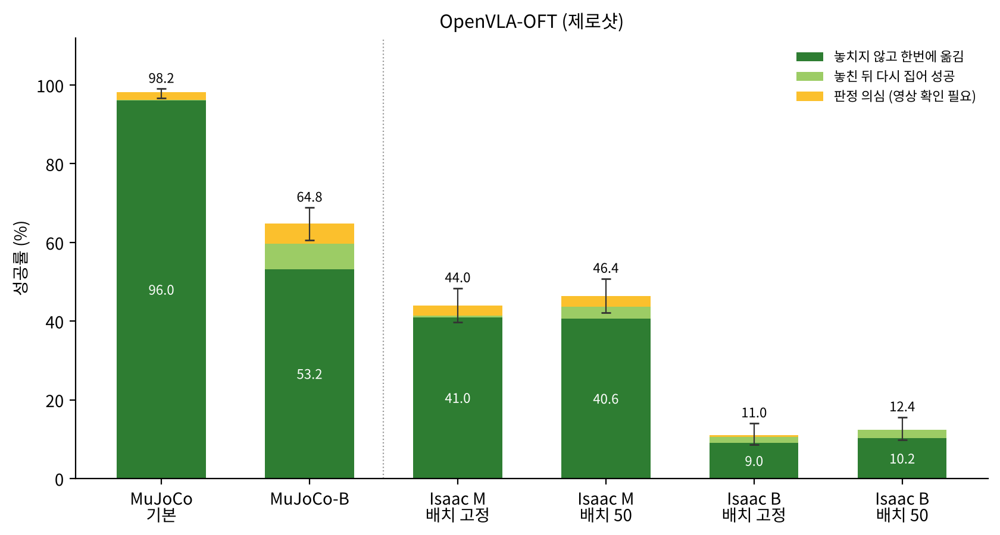
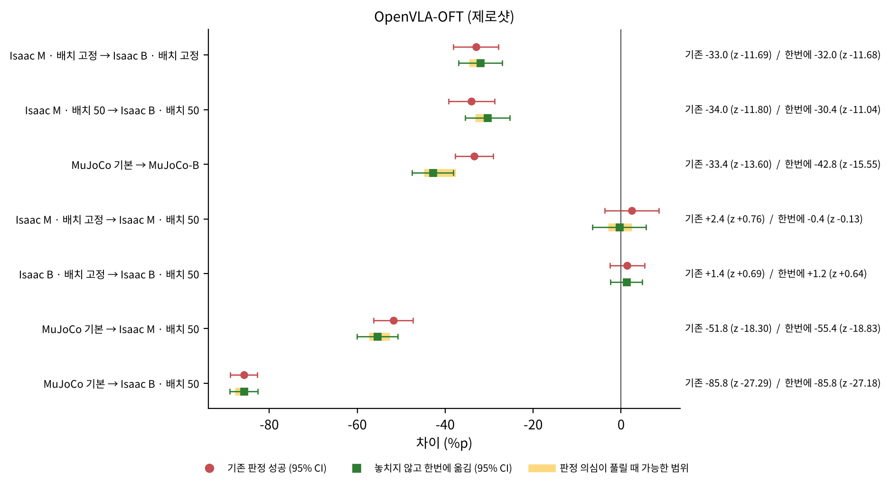
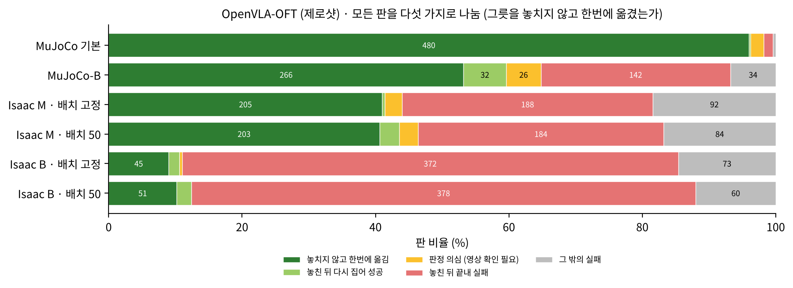
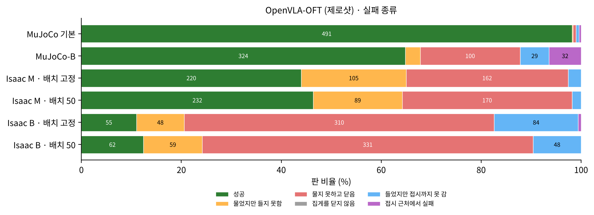
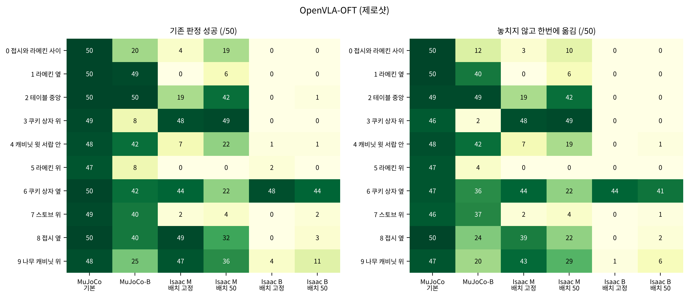
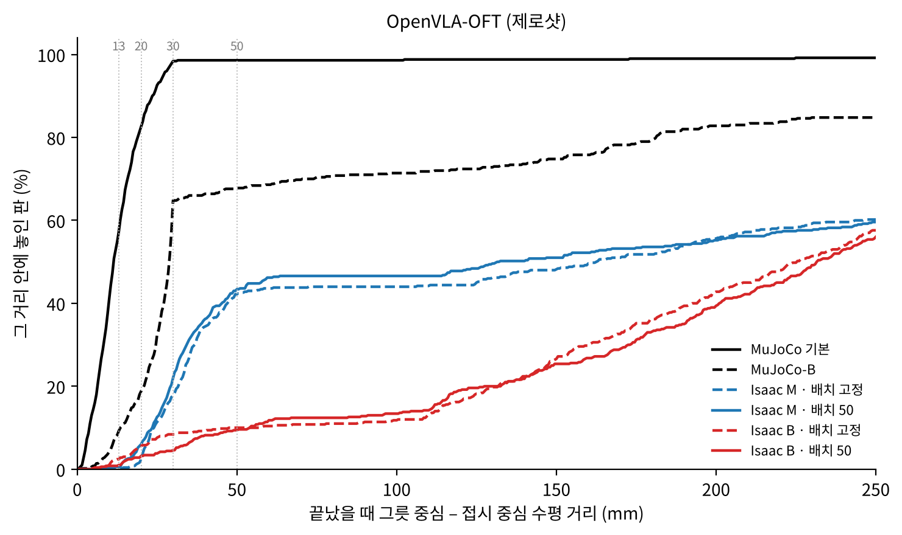

# 보고서 3. OpenVLA-OFT 제로샷 — 동작 8개를 묶어 실행하는 모델을 Isaac Sim으로 옮겼을 때

작성 2026-10-13 · English: [README_en.md](README_en.md) · PDF: [한국어](report_3_ko.pdf) · [English](report_3_en.pdf)

## 0. 이 보고서는 무엇인가

OpenVLA만으로는 Isaac Sim에서의 낮은 성공률이 OpenVLA 한 모델의 문제인지, MuJoCo에서 학습한 모델 전반의 문제인지 알 수 없다. 그래서 같은 평가 코드와 같은 판정으로 다른 모델도 쟀다.

이 보고서는 그중 OpenVLA-OFT를 다룬다. OFT는 OpenVLA를 바탕으로 만든 모델로, 화면을 한 번 보고 동작 8개를 한꺼번에 내며, 손목 카메라와 로봇 상태도 함께 본다. MuJoCo 데이터로 학습된 공개 모델을 추가 학습 없이(제로샷) 6칸, 모든 칸 500판으로 쟀다. 평가 환경, 시험 조건, 판정은 [README](../../README.md) 1–4절에 있다.

## 한눈에 보는 결론

| 질문 | 답 | 근거 |
| --- | --- | --- |
| Isaac Sim으로 옮기면? | MuJoCo 98.2 %에서 Isaac Sim M(MuJoCo와 같은 속도) 44.0–46.4 %로, MuJoCo 성능의 절반 가까이(47 %)가 남는다 | 2절 |
| 지시 하나를 더 길게 실행하면(B)? | 크게 무너진다. 배치 고정 44.0 → 11.0 %(−33.0 %p, z = −11.69), 배치 50 46.4 → 12.4 %(−34.0 %p, z = −11.80). MuJoCo에서 같은 방향으로 바꿔도 98.2 → 64.8 %(−33.4 %p, z = −13.60)로 떨어진다. 동작 8개를 화면을 다시 보지 않고 실행하는 방식이 실행 시간 차이에 약하다 | 3절 |
| 물체 위치를 바꾸면? | 전체 성공률은 변하지 않는다(+2.4 · +1.4 %p, z = +0.76 · +0.69) | 4절 |
| 성공한 방식은? | M에서는 성공의 88–93 %가 그릇을 놓치지 않고 한번에 옮긴 판이다. 판정 의심 27판 중 22판은 그릇이 접시 옆에서 시작하는 과제 8 · 0에서 「들어 올린 적 없음」으로 나왔다(밀어서 올렸을 가능성) | 5절 |
| 어떻게 실패하나? | 대부분 그릇 바깥에서 집게를 닫는다(M · 배치 50 실패의 63 %, B · 배치 50 실패의 76 %). B에서는 한 판에 집게를 평균 7.7–7.9번 닫는다 | 6절 |
| 잘 되는 과제와 안 되는 과제는? | M에서 과제 3(쿠키 상자 위)은 48–49판인데 과제 5(라메킨 위)는 0판, 과제 7(스토브 위)은 2–4판이다. B에서는 과제 6(쿠키 상자 옆)만 44–48판으로 남는다 | 7절 |

## 1. 모델과 연결 방법

| 항목 | 내용 |
| --- | --- |
| 모델 | `moojink/openvla-7b-oft-finetuned-libero-spatial` (LIBERO 사람 시범으로 학습, 추가 학습 없음) |
| 보는 것 | 앞쪽 카메라, 손목 카메라, 로봇 상태 8개 값(손 위치 3 · 손 방향 3 · 손가락 2), 과제 문장 |
| 내는 것 | 화면 한 번에 지시 8개. 8개를 모두 실행한 뒤 화면을 다시 본다 |
| 앞쪽 화면 | 가운데를 잘라 MuJoCo 학습 화면과 시야를 맞춤(서버에서 면적 0.389, 모델 안에서 OFT 원래 평가처럼 0.9를 한 번 더). 결과 시야는 OpenVLA와 같다 |
| 손목 화면 | 자르지 않음 |
| 로봇 상태 | Isaac Sim 값을 MuJoCo 학습 때와 같은 크기 · 부호로 맞춰 넣음. 손가락 값이 LIBERO 사람 시범의 범위(±0.036–0.040)와 같은지 확인함 |

OFT는 화면을 한 번 보면 지시 8개를 이어서 실행하므로, 화면을 다시 볼 때까지 움직이는 시간이 OpenVLA의 8배다.

| | MuJoCo 기본 | MuJoCo-B | Isaac M | Isaac B |
| --- | --- | --- | --- | --- |
| 지시 하나의 실행 시간 | 0.05초 | 0.10초 | 0.05초 | 0.17초 |
| 화면을 다시 볼 때까지 | 0.40초 | 0.80초 | 0.40초 | 1.36초 |

정책 서버(`code/oft/oft_server_v2.py`)는 OFT의 원래 LIBERO 평가와 같은 화면 처리를 한다. Isaac Sim 평가 코드와 MuJoCo 평가 코드가 같은 서버에 묻는다. MuJoCo에서는 OFT의 원래 평가처럼 집게 값을 열림 · 닫힘 두 값으로 잘라 쓴다.

## 2. 결과

*그림 1. OpenVLA-OFT의 성공률. 진한 초록은 그릇을 놓치지 않고 한번에 옮긴 판, 연한 초록은 놓친 뒤 다시 집어 성공한 판, 노랑은 판정 의심. 막대 위 선은 기존 판정 성공률의 95 % 신뢰 범위.*

| 칸 | 기존 판정 성공 | 95 % 신뢰 범위 | 놓치지 않고 한번에 옮김 | MuJoCo 기본 대비 (기존 / 한번에) |
| --- | --- | --- | --- | --- |
| MuJoCo 기본 | 491 (98.2 %) | 96.6–99.1 | 480 (96.0 %) | — |
| MuJoCo-B | 324 (64.8 %) | 60.5–68.9 | 266 (53.2 %) | 66 % / 55 % |
| Isaac M · 배치 고정 | 220 (44.0 %) | 39.7–48.4 | 205 (41.0 %) | 45 % / 43 % |
| Isaac M · 배치 50 | 232 (46.4 %) | 42.1–50.8 | 203 (40.6 %) | 47 % / 42 % |
| Isaac B · 배치 고정 | 55 (11.0 %) | 8.5–14.0 | 45 (9.0 %) | 11 % / 9 % |
| Isaac B · 배치 50 | 62 (12.4 %) | 9.8–15.6 | 51 (10.2 %) | 13 % / 11 % |

MuJoCo 기본에서 Isaac M · 배치 50으로 옮기면 51.8 %p가 떨어진다(z = −18.30). 같은 조건에서 OpenVLA 원본은 MuJoCo 성능의 15 %가 남았는데([보고서 2](../2_openvla_zero_shot_and_finetune/README.md)), OFT는 47 %가 남는다.

## 3. 실행 설정을 바꿨을 때 (M → B)

**현상.** OpenVLA는 Isaac Sim에서 B가 M보다 높았는데, OFT는 반대로 B에서 성공률이 4분의 1로 떨어진다. 배치 고정에서 −33.0 %p(z = −11.69), 배치 50에서 −34.0 %p(z = −11.80)다.

**의심한 것과 이유.** B에서는 지시 하나가 0.17초 동안, 지시한 거리 그대로 실행된다. 그러면 지시 하나에 손이 MuJoCo보다 많이 움직인다(다가갈 때 1.26배, 출발 직후 3배 남짓). OFT는 화면을 한 번 보고 지시 8개를 이어서 실행하므로, 지시 하나의 오차가 8개 동안 쌓인 뒤에야 화면을 다시 본다. 이것이 Isaac Sim 고유의 문제인지, 묶어 실행하는 방식 자체의 약점인지 가르려 했다.

**확인 방법과 결과.**

1. **MuJoCo에서 같은 방향으로 바꾸기.** MuJoCo-B(지시 하나 0.10초, 다가갈 때 1.62배 · 들어 올릴 때 1.18배)에서 OFT는 98.2 → 64.8 %로, Isaac Sim과 거의 같은 폭(−33.4 %p, z = −13.60)으로 떨어졌다. 같은 변화에서 OpenVLA는 −2.4 %p(차이 없음)였다. 따라서 **실행 시간이 학습 때와 달라지면 묶음 안에서 오차가 쌓이는 것**으로 본다. Isaac Sim만의 문제가 아니다.
2. **실패 모양.** B에서는 그릇 바깥에서 집게를 닫는 실패가 크게 는다(배치 50: M 170판 → B 331판). 한 판에 집게를 닫는 횟수도 M 3.5–3.8번에서 B 7.7–7.9번으로 늘고, 그중 그릇에 닿은 시도도 1.9번에서 4.2–4.5번으로 는다. 손이 그릇 근처까지는 가지만 묶음 8개를 실행하는 동안 쥘 자리를 지나쳐, 닫았다 열기를 되풀이하는 모양이다.
3. **어떤 과제가 무너지나.** MuJoCo-B에서는 과제 3(쿠키 상자 위) 49 → 8판, 과제 5(라메킨 위) 47 → 8판, 과제 9(나무 캐비닛 위) 48 → 25판으로, 그릇이 다른 물체 위에서 시작하는 과제가 크게 무너졌다. Isaac Sim B에서는 과제 6(쿠키 상자 옆)을 빼고 모든 과제가 0–11판이다.

*그림 2. OFT에서 한 가지만 바꿨을 때의 차이. 동그라미는 기존 판정, 네모는 한번에 옮긴 판, 노란 띠는 판정 의심이 풀릴 때 가능한 범위.*

**지금 말할 수 있는 것.** 화면을 볼 때마다 동작 하나를 내는 OpenVLA와 달리, 동작을 묶어 실행하는 OFT에는 학습 때와 같은 실행 시간이 중요하다. 그래서 OFT를 평가하거나 실물 로봇에 옮길 때는 M처럼 지시 하나의 실행 시간을 학습 때와 맞추는 것이 공정하다. B만으로 OFT를 평가하면 실제보다 훨씬 나쁘게 보인다.

## 4. 물체 위치를 바꿨을 때 (배치 고정 → 배치 50)

| 설정 | 기존 판정 | z | 한번에 옮김 | z |
| --- | --- | --- | --- | --- |
| M | 44.0 → 46.4 % (+2.4 %p) | +0.76 | 41.0 → 40.6 % (−0.4 %p) | −0.13 |
| B | 11.0 → 12.4 % (+1.4 %p) | +0.69 | 9.0 → 10.2 % (+1.2 %p) | +0.64 |

전체 성공률은 물체 위치에 따라 달라지지 않는다. 하지만 과제 하나하나는 크게 바뀐다. M에서 과제 2는 19 → 42판, 과제 6은 44 → 22판, 과제 8은 49 → 32판이 됐다. 배치 고정은 과제마다 같은 장면을 50번 돌리므로, 한 장면이 잘 맞거나 안 맞으면 그 과제 전체가 0이나 50에 가까워진다.

## 5. 그릇을 놓치지 않고 한번에 옮긴 경우

| 칸 | 기존 판정 성공 | 한번에 옮김 | 다시 집어 성공 | 판정 의심 | 놓친 뒤 끝내 실패 | 그 밖의 실패 |
| --- | --- | --- | --- | --- | --- | --- |
| MuJoCo 기본 | 491 | 480 | 1 | 10 | 7 | 2 |
| MuJoCo-B | 324 | 266 | 32 | 26 | 142 | 34 |
| Isaac M · 배치 고정 | 220 | 205 | 2 | 13 | 188 | 92 |
| Isaac M · 배치 50 | 232 | 203 | 15 | 14 | 184 | 84 |
| Isaac B · 배치 고정 | 55 | 45 | 8 | 2 | 372 | 73 |
| Isaac B · 배치 50 | 62 | 51 | 11 | 0 | 378 | 60 |

*그림 3. 500판을 다섯 가지로 나눈 비율(숫자는 판 수).*

- **M에서는 성공 대부분이 한번에 옮긴 판이다.** 배치 고정 93 %, 배치 50 88 %다. 일단 그릇을 들면 대부분 놓치지 않고 접시까지 옮긴다.
- **판정 의심 중 「들어 올린 적 없음」은 과제 8 · 0에 몰려 있다.** M 두 칸의 판정 의심 27판 중 22판이 이 이유이고, 그중 19판은 과제 8(접시 옆), 3판은 과제 0(접시와 라메킨 사이)에서 나왔다. 두 과제 모두 그릇이 접시에 붙어 시작한다. 그래서 그릇을 들지 않고 밀어서 접시 턱 위로 올렸을 가능성이 크다. 영상에서 밀기로 확인되면 기존 판정 성공에서도 빼야 하며, 그러면 M · 배치 고정은 220 → 209판, M · 배치 50은 232 → 221판이 된다. 실행 설정에 대한 결론은 바뀌지 않는다.
- **나머지 판정 의심은 대부분 「놓을 때 쥐고 있지 않음」이다.** Isaac M에서는 모두 과제 9(나무 캐비닛 위)에서 나왔고, 접시 위 5 cm보다 높은 곳에서 놓은 판이 많다.

## 6. 실패 종류

*그림 4. 실패 종류(판 비율, 숫자는 판 수).*

| 칸 | 물었지만 들지 못함 | 물지 못하고 닫음 | 들었지만 접시까지 못 감 | 접시 근처에서 실패 |
| --- | --- | --- | --- | --- |
| Isaac M · 배치 고정 | 105 | 162 | 13 | 0 |
| Isaac M · 배치 50 | 89 | 170 | 9 | 0 |
| Isaac B · 배치 고정 | 48 | 310 | 84 | 3 |
| Isaac B · 배치 50 | 59 | 331 | 48 | 0 |

「집게를 닫지 않음」은 모든 칸에서 0판이다. 즉 집으려는 시도는 항상 한다.

- **가장 많은 실패는 그릇 바깥에서 집게를 닫는 것이다.** M · 배치 50 실패 268판 중 170판(63 %), B · 배치 50 실패 438판 중 331판(76 %)이다.
- **M에서는 「접시 근처에서 실패」가 없다.** 그릇을 들고 접시까지 가면 놓는 데는 성공한다. 실패는 거의 모두 그릇을 무는 단계에서 난다.

## 7. 과제별

*그림 5. 과제 × 칸별 성공 판 수(50판 중). 왼쪽은 기존 판정, 오른쪽은 한번에 옮긴 판.*

- **MuJoCo에서는 모든 과제가 47–50판이다.**
- **Isaac M에서 잘 되는 과제와 안 되는 과제.** 과제 3(쿠키 상자 위) 48–49판, 과제 9(나무 캐비닛 위) 36–47판, 과제 8(접시 옆) 32–49판은 잘 된다. 과제 5(라메킨 위)는 0판, 과제 7(스토브 위)은 2–4판, 과제 1(라메킨 옆)은 0–6판이다.
- **Isaac B에서는 과제 6(쿠키 상자 옆)만 남는다.** 배치 고정 48판, 배치 50 44판이다. 나머지 과제는 0–11판이다.

## 8. 자세한 지표

| 칸 | 집음 | 놓인 위치 오차 중앙값 | 접시 중심 30 mm 안 | 50 mm 안 |
| --- | --- | --- | --- | --- |
| MuJoCo 기본 | 99.4 % | 11.3 mm | 98.4 % | 98.6 % |
| MuJoCo-B | 78.8 % | 28.8 mm | 64.8 % | 67.8 % |
| Isaac M · 배치 고정 | 67.6 % | 162.5 mm | 17.6 % | 42.2 % |
| Isaac M · 배치 50 | 66.0 % | 131.9 mm | 22.0 % | 43.4 % |
| Isaac B · 배치 고정 | 36.8 % | 225.1 mm | 8.4 % | 10.0 % |
| Isaac B · 배치 50 | 32.2 % | 231.6 mm | 4.6 % | 9.4 % |

- **Isaac Sim에서는 성공해도 접시 가장자리 쪽에 놓는 경우가 많다.** MuJoCo에서는 성공한 판이 거의 모두 접시 중심 30 mm 안에 놓인다(성공 98.2 %, 30 mm 안 98.4 %). Isaac M · 배치 50에서는 성공 46.4 %인데 30 mm 안은 22.0 %다.
- **MuJoCo-B에서는 집는 단계부터 나빠진다.** 집음이 99.4 → 78.8 %로 떨어지고, 다른 물체를 건드리지 않은 판도 94.0 → 80.4 %로 준다.

*그림 6. 판이 끝났을 때 그릇–접시 중심 거리의 누적 분포(실패한 판 포함).*

## 9. 지금 원인으로 보이는 것

- **그릇을 무는 위치.** Isaac M에서도 실패의 대부분은 그릇 바깥에서 닫는 것이다. OpenVLA와 같은 약점이다.
- **실행 시간과 묶음 실행.** 지시 하나의 실행 시간이 학습 때와 달라지면(Isaac B, MuJoCo-B) 묶음 8개 동안 오차가 쌓여 무너진다. M에서는 이 문제가 줄어든다.
- **들어 올리는 움직임.** M에서 들어 올리는 움직임이 MuJoCo의 0.63배다([보고서 2](../2_openvla_zero_shot_and_finetune/README.md) 4절). OFT의 「물었지만 들지 못함」(M 89–105판)과 관련이 있을 수 있고, M2로 확인한다.

## 10. 한계와 다음 실험

**한계.**

- 칸마다 한 번씩만 돌렸다. 판정 의심은 아직 영상으로 확인하지 않았다.
- Isaac Sim의 기존 판정은 이 평가 코드의 판정이고, MuJoCo는 LIBERO 자체 판정이다. 「한번에 옮김」과 실패 종류는 두 시뮬레이터에 같은 규칙을 썼다.
- OFT는 Isaac Sim 데이터로 다시 학습하지 않았다(학습 서버에 OFT 학습 코드를 아직 준비하지 않음).

**다음 실험.**

1. 판정 의심 영상 확인. 과제 8 · 0의 「들어 올린 적 없음」 22판부터 본다.
2. M2(위아래 움직임까지 MuJoCo와 맞춘 설정)에서 다시 재기.
3. 묶음 중 앞 몇 개만 실행하고 화면을 다시 보게 했을 때 B에서의 하락이 줄어드는지. 실행 시간 차이에 대한 묶음 길이의 영향을 직접 확인한다.
4. Isaac Sim 데이터로 OFT 다시 학습.

## 11. 재현 방법

이 절에만 코드에서 쓰는 이름과 값을 적는다.

| 칸 | 결과 폴더 |
| --- | --- |
| MuJoCo 기본 | `MJ_OFT_default_layout50` |
| MuJoCo-B | `MJ_OFT_B_layout50` |
| Isaac M · 배치 고정 | `OFT_M_layout1` |
| Isaac M · 배치 50 | `zs_oft_cal_50ep` |
| Isaac B · 배치 고정 | `zs_oft_s00` |
| Isaac B · 배치 50 | `OFT_B_layout50` |

- 정책 서버: `code/oft/oft_server_v2.py`(openvla-oft 파이썬 환경). 체크포인트는 `moojink/openvla-7b-oft-finetuned-libero-spatial`.
- Isaac Sim 평가: `code/eval/eval_zs_all_isaac_v6.sh`에 `CFGBASE=libero_spatial_environment_oft`(OFT 형식 연결: 손목 카메라와 로봇 상태를 보내고, 지시 묶음을 받음)를 준다. M은 `EXTRA="--sim-steps-per-action 3 --convergence-gain 0.65"`, 배치 고정은 `FIXED_STATE=00`이다. 로봇 상태 맞춤 값은 `code/oft/oft_proprio_calib.py`로 만든다.
- MuJoCo 평가: `code/eval/mujoco_eval_chunk.py --model-name openvla-oft --binarize-gripper`. MuJoCo-B는 지시 간격을 1초 10번으로 준다.
- 판정 · 표 · 그림: `code/report/make_report_assets_v2.py`. 판정 규칙은 `code/analysis/vla_signals.py`, `code/analysis/strict_outcomes.py`, `code/analysis/grasp_rule.json`에 있다.

## 부록 A. 전체 표

<!-- TABLES:oft:start -->
*이 부록의 표는 `code/report/make_report_assets_v2.py`가 `data/results_2026-10-13/episodes_all.csv`에서 만든 것을 그대로 넣었다. 같은 숫자가 `data/results_2026-10-13/tables/`에 CSV로 있다.*

### OpenVLA-OFT (제로샷)

#### 성공률

| 칸 | 판 | 기존 판정 성공 | 95 % 구간 | 한번에 옮김 | 판정 의심이 모두 한번에일 때 | MuJoCo 기본 대비 (기존 / 한번에) |
|---|---|---|---|---|---|---|
| MuJoCo 기본 | 500 | 491 (98.2%) | 96.6–99.1 | 480 (96.0%) | 490 (98.0%) | — |
| MuJoCo-B | 500 | 324 (64.8%) | 60.5–68.9 | 266 (53.2%) | 292 (58.4%) | 66 % / 55 % |
| Isaac M · 배치 고정 | 500 | 220 (44.0%) | 39.7–48.4 | 205 (41.0%) | 218 (43.6%) | 45 % / 43 % |
| Isaac M · 배치 50 | 500 | 232 (46.4%) | 42.1–50.8 | 203 (40.6%) | 217 (43.4%) | 47 % / 42 % |
| Isaac B · 배치 고정 | 500 | 55 (11.0%) | 8.5–14.0 | 45 (9.0%) | 47 (9.4%) | 11 % / 9 % |
| Isaac B · 배치 50 | 500 | 62 (12.4%) | 9.8–15.6 | 51 (10.2%) | 51 (10.2%) | 13 % / 11 % |

#### 그릇을 놓치지 않고 한번에 옮긴 경우

| 칸 | 기존 판정 성공 | 놓치지 않고 한번에 옮김 | 놓친 뒤 다시 집어 성공 | 판정 의심 (영상 확인 필요) | 놓친 뒤 끝내 실패 | 그 밖의 실패 | 평균 닫은 횟수 | 평균 닿은 시도 |
|---|---|---|---|---|---|---|---|---|
| MuJoCo 기본 | 491 | 480 (96.0%) | 1 | 10 | 7 | 2 | 1.06 | 1.01 |
| MuJoCo-B | 324 | 266 (53.2%) | 32 | 26 | 142 | 34 | 3.27 | 1.59 |
| Isaac M · 배치 고정 | 220 | 205 (41.0%) | 2 | 13 | 188 | 92 | 3.77 | 1.87 |
| Isaac M · 배치 50 | 232 | 203 (40.6%) | 15 | 14 | 184 | 84 | 3.52 | 1.92 |
| Isaac B · 배치 고정 | 55 | 45 (9.0%) | 8 | 2 | 372 | 73 | 7.93 | 4.45 |
| Isaac B · 배치 50 | 62 | 51 (10.2%) | 11 | 0 | 378 | 60 | 7.72 | 4.23 |

#### 판정 의심의 이유와 놓은 높이

| 칸 | 판정 의심 | 1 들어 올린 적 없음 | 2 접시 위 순간 없음 | 3 놓을 때 쥐고 있지 않음 | 3 중 5 cm 미만 | 5~10 cm | 10 cm 이상 | 쥔 순간 없음 | 1번이 나온 과제 (과제:판) |
|---|---|---|---|---|---|---|---|---|---|
| MuJoCo 기본 | 10 | 0 | 1 | 9 | 1 | 2 | 6 | 0 | — |
| MuJoCo-B | 26 | 0 | 9 | 17 | 2 | 6 | 9 | 0 | — |
| Isaac M · 배치 고정 | 13 | 11 | 0 | 2 | 0 | 0 | 2 | 0 | 0:1 8:10 |
| Isaac M · 배치 50 | 14 | 11 | 0 | 3 | 0 | 2 | 1 | 0 | 0:2 8:9 |
| Isaac B · 배치 고정 | 2 | 0 | 1 | 1 | 0 | 0 | 1 | 0 | — |
| Isaac B · 배치 50 | 0 | 0 | 0 | 0 | 0 | 0 | 0 | 0 | — |

#### 실패 종류

| 칸 | 성공 | 물었지만 들지 못함 | 물지 못하고 닫음 | 집게를 닫지 않음 | 들었지만 접시까지 못 감 | 접시 근처에서 실패 |
|---|---|---|---|---|---|---|
| MuJoCo 기본 | 491 | 1 | 3 | 0 | 3 | 2 |
| MuJoCo-B | 324 | 15 | 100 | 0 | 29 | 32 |
| Isaac M · 배치 고정 | 220 | 105 | 162 | 0 | 13 | 0 |
| Isaac M · 배치 50 | 232 | 89 | 170 | 0 | 9 | 0 |
| Isaac B · 배치 고정 | 55 | 48 | 310 | 0 | 84 | 3 |
| Isaac B · 배치 50 | 62 | 59 | 331 | 0 | 48 | 0 |

#### 자세한 지표 (Table 1 지표)

| 칸 | 닫음 시도 % | 집음 % | 놓기 성공 % | 다른 물체 안 건드림 % | 접시 중심까지 중앙값 (mm) | 13 mm 안 % | 20 mm 안 % | 30 mm 안 % | 50 mm 안 % |
|---|---|---|---|---|---|---|---|---|---|
| MuJoCo 기본 | 100.0 | 99.4 | 98.2 | 94.0 | 11.3 | 57.2 | 82.6 | 98.4 | 98.6 |
| MuJoCo-B | 100.0 | 78.8 | 64.8 | 80.4 | 28.8 | 9.2 | 18.8 | 64.8 | 67.8 |
| Isaac M · 배치 고정 | 100.0 | 67.6 | 44.0 | — | 162.5 | 0.0 | 2.4 | 17.6 | 42.2 |
| Isaac M · 배치 50 | 100.0 | 66.0 | 46.4 | — | 131.9 | 0.6 | 6.0 | 22.0 | 43.4 |
| Isaac B · 배치 고정 | 100.0 | 36.8 | 11.0 | — | 225.1 | 2.4 | 5.6 | 8.4 | 10.0 |
| Isaac B · 배치 50 | 100.0 | 32.2 | 12.4 | — | 231.6 | 1.0 | 3.2 | 4.6 | 9.4 |

다른 물체 안 건드림은 다른 물체 위치 기록이 있는 판만 셈 (지금은 MuJoCo 만 기록이 있음). 거리 지표는 실패 판도 포함한다.

#### 과제별 성공 (기존 판정, 과제당 판 수 대비)

| 과제 | 그릇 위치 | MuJoCo 기본 | MuJoCo-B | Isaac M · 배치 고정 | Isaac M · 배치 50 | Isaac B · 배치 고정 | Isaac B · 배치 50 |
|---|---|---|---|---|---|---|---|
| 0 | 접시와 라메킨 사이 | 50 | 20 | 4 | 19 | 0 | 0 |
| 1 | 라메킨 옆 | 50 | 49 | 0 | 6 | 0 | 0 |
| 2 | 테이블 중앙 | 50 | 50 | 19 | 42 | 0 | 1 |
| 3 | 쿠키 상자 위 | 49 | 8 | 48 | 49 | 0 | 0 |
| 4 | 캐비닛 윗 서랍 안 | 48 | 42 | 7 | 22 | 1 | 1 |
| 5 | 라메킨 위 | 47 | 8 | 0 | 0 | 2 | 0 |
| 6 | 쿠키 상자 옆 | 50 | 42 | 44 | 22 | 48 | 44 |
| 7 | 스토브 위 | 49 | 40 | 2 | 4 | 0 | 2 |
| 8 | 접시 옆 | 50 | 40 | 49 | 32 | 0 | 3 |
| 9 | 나무 캐비닛 위 | 48 | 25 | 47 | 36 | 4 | 11 |
| 합계 |  | 491 | 324 | 220 | 232 | 55 | 62 |

#### 과제별 한번에 옮긴 판

| 과제 | 그릇 위치 | MuJoCo 기본 | MuJoCo-B | Isaac M · 배치 고정 | Isaac M · 배치 50 | Isaac B · 배치 고정 | Isaac B · 배치 50 |
|---|---|---|---|---|---|---|---|
| 0 | 접시와 라메킨 사이 | 50 | 12 | 3 | 10 | 0 | 0 |
| 1 | 라메킨 옆 | 50 | 40 | 0 | 6 | 0 | 0 |
| 2 | 테이블 중앙 | 49 | 49 | 19 | 42 | 0 | 0 |
| 3 | 쿠키 상자 위 | 46 | 2 | 48 | 49 | 0 | 0 |
| 4 | 캐비닛 윗 서랍 안 | 48 | 42 | 7 | 19 | 0 | 1 |
| 5 | 라메킨 위 | 47 | 4 | 0 | 0 | 0 | 0 |
| 6 | 쿠키 상자 옆 | 47 | 36 | 44 | 22 | 44 | 41 |
| 7 | 스토브 위 | 46 | 37 | 2 | 4 | 0 | 1 |
| 8 | 접시 옆 | 50 | 24 | 39 | 22 | 0 | 2 |
| 9 | 나무 캐비닛 위 | 47 | 20 | 43 | 29 | 1 | 6 |
| 합계 |  | 480 | 266 | 205 | 203 | 45 | 51 |

#### 한 가지만 바꿨을 때

| 비교 | 기존 판정 성공 지금 차이 (z) | 한번에 옮김 지금 차이 (z) | 한번에 옮김 영상 확인 후 가능한 범위 (z) |
|---|---|---|---|
| Isaac M · 배치 고정 → Isaac B · 배치 고정 | -33.0 (-11.69) | -32.0 (-11.68) | -34.6 ~ -31.6 (-12.43 ~ -11.51) |
| Isaac M · 배치 50 → Isaac B · 배치 50 | -34.0 (-11.80) | -30.4 (-11.04) | -33.2 ~ -30.4 (-11.85 ~ -11.04) |
| MuJoCo 기본 → MuJoCo-B | -33.4 (-13.60) | -42.8 (-15.55) | -44.8 ~ -37.6 (-16.49 ~ -14.17) |
| Isaac M · 배치 고정 → Isaac M · 배치 50 | +2.4 (+0.76) | -0.4 (-0.13) | -3.0 ~ +2.4 (-0.96 ~ +0.77) |
| Isaac B · 배치 고정 → Isaac B · 배치 50 | +1.4 (+0.69) | +1.2 (+0.64) | +0.8 ~ +1.2 (+0.43 ~ +0.64) |
| MuJoCo 기본 → Isaac M · 배치 50 | -51.8 (-18.30) | -55.4 (-18.83) | -57.4 ~ -52.6 (-19.68 ~ -18.10) |
| MuJoCo 기본 → Isaac B · 배치 50 | -85.8 (-27.29) | -85.8 (-27.18) | -87.8 ~ -85.8 (-27.86 ~ -27.18) |
<!-- TABLES:oft:end -->

## 부록 B. 용어

| 용어 | 뜻 |
| --- | --- |
| 판 | 시험 한 번. 칸마다 500판(과제 10개 × 50판) |
| 지시 · 묶음 | 지시는 모델이 내는 짧은 이동 명령이다. OFT는 화면 한 번에 지시 8개(묶음)를 내고 모두 실행한 뒤 화면을 다시 본다 |
| 제로샷 | 옮겨 간 환경(Isaac Sim)의 데이터로 추가 학습하지 않고 그대로 시험하는 것 |
| M / B | Isaac Sim 실행 설정. M은 지시 하나를 0.05초 동안 실행하고 손 목표를 65 %로 잡음(MuJoCo와 같은 속도). B는 0.17초 동안 지시한 거리 그대로 |
| MuJoCo-B | MuJoCo에서 지시 간격을 1초 10번(0.10초)으로 늘린 설정 |
| 배치 고정 / 배치 50 | 물체 위치를 LIBERO의 첫 번째 위치 하나로 고정 / 판마다 50가지 중 하나 |
| 놓치지 않고 한번에 옮김 | 그릇을 집은 뒤 한 번도 놓치거나 떨어뜨리지 않고 접시에 놓은 판 |
| 판정 의심 | 기존 판정은 성공이지만, 기록만으로는 집어서 옮겼다는 것을 확인할 수 없어 영상 확인이 필요한 판 |
| z | 두 성공률의 차이가 우연인지 보는 값. 절댓값 1.96을 넘으면 우연일 가능성 5 % 미만 |
