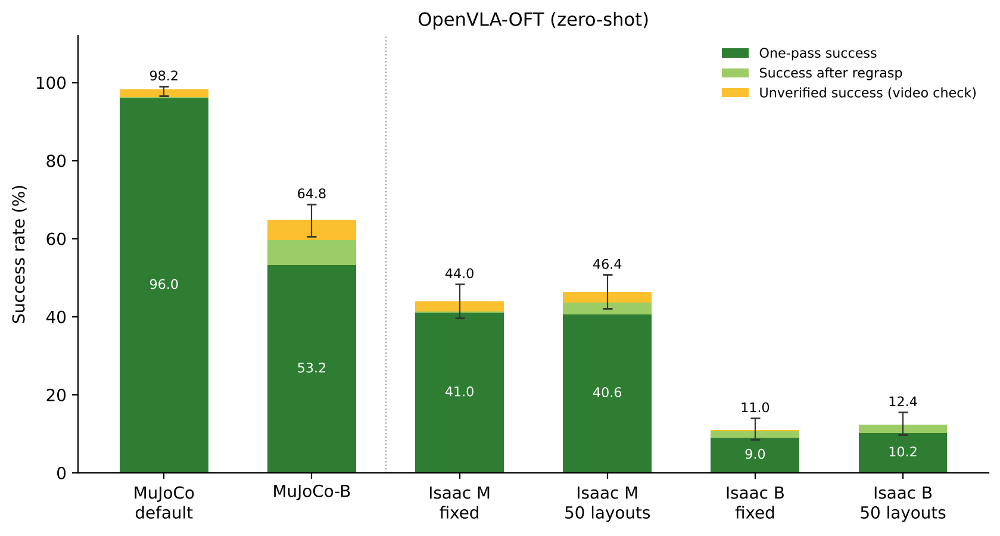
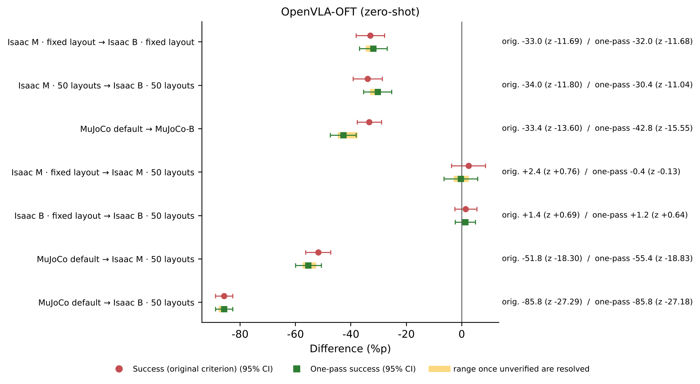
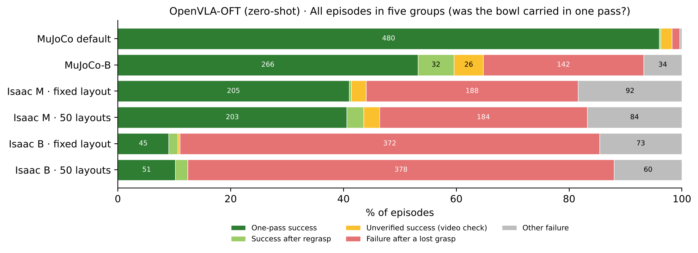
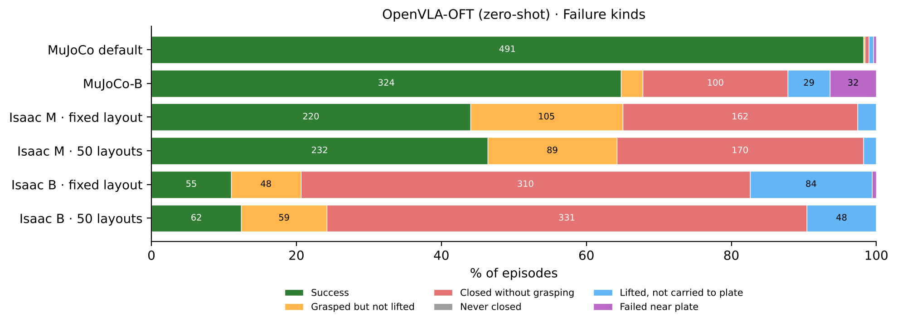
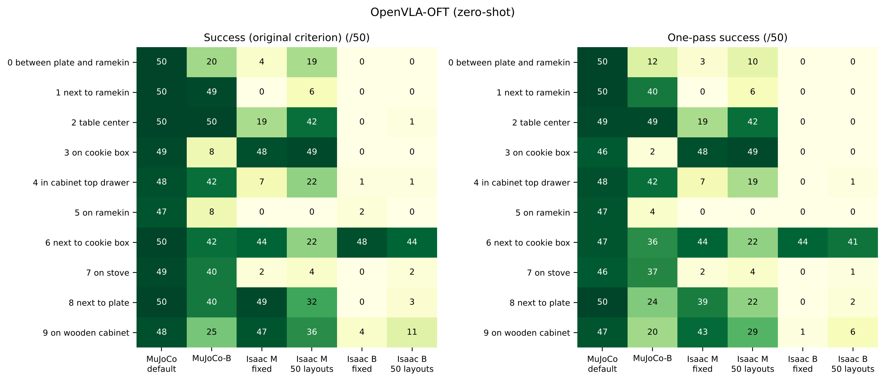
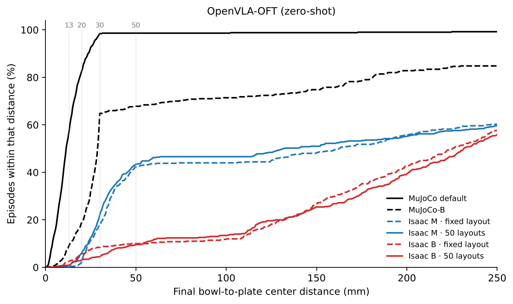

# Report 3. OpenVLA-OFT zero-shot — moving a model that executes 8 actions per observation to Isaac Sim

Written 2026-10-13 · 한국어 (main): [README.md](README.md) · PDF: [English](report_3_en.pdf) · [한국어](report_3_ko.pdf)

## 0. What this report is about

OpenVLA alone cannot tell whether its low success in Isaac Sim is a problem of that one model or of models trained in MuJoCo in general. So we measured other models with the same evaluation code and the same criteria.

This report covers OpenVLA-OFT. OFT is built on OpenVLA; it looks at the screen once and issues 8 actions together, and it also sees a wrist camera and the robot state. We measured the public model trained on MuJoCo data without additional training (zero-shot), in 6 cells with 500 episodes each. The evaluation setup, test cells and criteria are described in Sections 1–4 of the [README](../../README_en.md).

## Conclusions at a glance

| Question | Answer | Evidence |
| --- | --- | --- |
| What happens when moved to Isaac Sim? | From 98.2 % in MuJoCo to 44.0–46.4 % in Isaac Sim M (MuJoCo-matched speed). Nearly half (47 %) of its MuJoCo performance remains | Section 2 |
| What if each action is executed for longer (B)? | It collapses: fixed layout 44.0 → 11.0 % (−33.0 %p, z = −11.69), 50 layouts 46.4 → 12.4 % (−34.0 %p, z = −11.80). The same change in MuJoCo also drops it from 98.2 to 64.8 % (−33.4 %p, z = −13.60). Executing 8 actions without looking again is sensitive to differences in execution time | Section 3 |
| What if object placement changes? | Overall success does not change (+2.4 · +1.4 %p, z = +0.76 · +0.69) | Section 4 |
| How does it succeed? | Under M, 88–93 % of successes are one-pass. Of the 27 unverified successes, 22 are "never lifted with the hand" in tasks 8 and 0, where the bowl starts next to the plate (possibly pushed) | Section 5 |
| How does it fail? | Mostly by closing the gripper outside the bowl (63 % of failures at M · 50 layouts, 76 % at B · 50 layouts). Under B it closes the gripper 7.7–7.9 times per episode on average | Section 6 |
| Which tasks work? | Under M, task 3 (on the cookie box) succeeds in 48–49 episodes, but task 5 (on the ramekin) in 0 and task 7 (on the stove) in 2–4. Under B only task 6 (next to the cookie box) remains, at 44–48 | Section 7 |

## 1. Model and connection

| Item | Details |
| --- | --- |
| Model | `moojink/openvla-7b-oft-finetuned-libero-spatial` (trained on LIBERO human demonstrations, no additional training) |
| Inputs | Front camera, wrist camera, 8 robot-state values (hand position 3 · orientation 3 · fingers 2), task sentence |
| Outputs | 8 actions per observation; all 8 are executed before the next observation |
| Front image | Cropped at the center to match the MuJoCo training field of view (area 0.389 on the server, then 0.9 inside the model as in OFT's original evaluation). The resulting view is the same as OpenVLA's |
| Wrist image | Not cropped |
| Robot state | Isaac Sim values matched in scale and sign to those seen in MuJoCo training. We checked that the finger values fall in the range of LIBERO human demonstrations (±0.036–0.040) |

Because OFT executes 8 actions per observation, it moves 8 times longer than OpenVLA before looking at the screen again.

| | MuJoCo default | MuJoCo-B | Isaac M | Isaac B |
| --- | --- | --- | --- | --- |
| Execution time per action | 0.05 s | 0.10 s | 0.05 s | 0.17 s |
| Until the next observation | 0.40 s | 0.80 s | 0.40 s | 1.36 s |

The policy server (`code/oft/oft_server_v2.py`) processes images as OFT's original LIBERO evaluation does. Both the Isaac Sim and the MuJoCo evaluation code query the same server. In MuJoCo, the gripper value is cut to open/closed, as in OFT's original evaluation.

## 2. Results

*Figure 1. Success of OpenVLA-OFT. Dark green: one-pass success; light green: success after regrasp; yellow: unverified success. Lines above the bars: 95 % confidence range of success by the original criterion.*

| Cell | Success (original) | 95 % confidence range | One-pass success | Retained vs MuJoCo default (original / one-pass) |
| --- | --- | --- | --- | --- |
| MuJoCo default | 491 (98.2 %) | 96.6–99.1 | 480 (96.0 %) | — |
| MuJoCo-B | 324 (64.8 %) | 60.5–68.9 | 266 (53.2 %) | 66 % / 55 % |
| Isaac M · fixed layout | 220 (44.0 %) | 39.7–48.4 | 205 (41.0 %) | 45 % / 43 % |
| Isaac M · 50 layouts | 232 (46.4 %) | 42.1–50.8 | 203 (40.6 %) | 47 % / 42 % |
| Isaac B · fixed layout | 55 (11.0 %) | 8.5–14.0 | 45 (9.0 %) | 11 % / 9 % |
| Isaac B · 50 layouts | 62 (12.4 %) | 9.8–15.6 | 51 (10.2 %) | 13 % / 11 % |

Moving from MuJoCo default to Isaac M · 50 layouts costs 51.8 %p (z = −18.30). Under the same conditions the original OpenVLA retained 15 % of its MuJoCo performance ([Report 2](../2_openvla_zero_shot_and_finetune/README_en.md)); OFT retains 47 %.

## 3. Changing the execution setting (M → B)

**What we saw.** For OpenVLA, B was higher than M in Isaac Sim. For OFT it is the opposite: under B success falls to a quarter. The drop is −33.0 %p with the fixed layout (z = −11.69) and −34.0 %p with 50 layouts (z = −11.80).

**What we suspected and why.** Under B each action is executed for 0.17 s at the full commanded distance. The hand then moves more per action than in MuJoCo (1.26× while approaching, more than 3× right after starting). OFT executes 8 actions per observation, so the error of each action accumulates over 8 actions before it looks again. We wanted to tell whether this is specific to Isaac Sim or a weakness of executing in chunks.

**How we checked and what we found.**

1. **The same change in MuJoCo.** Under MuJoCo-B (0.10 s per action; 1.62× approaching, 1.18× lifting), OFT fell from 98.2 to 64.8 %, by almost the same amount as in Isaac Sim (−33.4 %p, z = −13.60). OpenVLA, under the same change, moved −2.4 %p (no difference). We therefore read this as **errors accumulating within the chunk when the execution time differs from training**, not as an Isaac Sim-only problem.
2. **How it fails.** Under B, closing the gripper outside the bowl rises sharply (50 layouts: 170 under M → 331 under B). Gripper closings per episode rise from 3.5–3.8 under M to 7.7–7.9 under B. Attempts that touched the bowl also rise, from 1.9 to 4.2–4.5. The hand gets near the bowl but overshoots the grasp position while executing the 8-action chunk, and the gripper closes and opens again and again.
3. **Which tasks collapse.** Under MuJoCo-B, tasks where the bowl starts on top of another object collapse most: task 3 (on the cookie box) 49 → 8, task 5 (on the ramekin) 47 → 8 and task 9 (on the wooden cabinet) 48 → 25. Under Isaac Sim B, every task except task 6 (next to the cookie box) is at 0–11.

*Figure 2. Differences when one factor is changed for OFT. Circles: original criterion; squares: one-pass success; yellow band: possible range once unverified successes are resolved.*

**What we can say now.** Unlike OpenVLA, which issues one action per observation, OFT executes actions in chunks, and for it matching the training execution time matters. When evaluating OFT or moving it to a real robot, matching the execution time per action to training, as M does, is the fair choice. Evaluating OFT only under B makes it look far worse than it is.

## 4. Changing the object placement (fixed layout → 50 layouts)

| Setting | Success (original) | z | One-pass | z |
| --- | --- | --- | --- | --- |
| M | 44.0 → 46.4 % (+2.4 %p) | +0.76 | 41.0 → 40.6 % (−0.4 %p) | −0.13 |
| B | 11.0 → 12.4 % (+1.4 %p) | +0.69 | 9.0 → 10.2 % (+1.2 %p) | +0.64 |

Overall success does not depend on object placement. Individual tasks, however, change a lot. Under M, task 2 went from 19 to 42, task 6 from 44 to 22 and task 8 from 49 to 32. The fixed layout repeats the same scene 50 times per task, so if one scene suits the model (or does not), the whole task goes close to 0 or 50.

## 5. One-pass success (bowl carried without being lost)

| Cell | Success (original) | One-pass | After regrasp | Unverified | Failure after a lost grasp | Other failure |
| --- | --- | --- | --- | --- | --- | --- |
| MuJoCo default | 491 | 480 | 1 | 10 | 7 | 2 |
| MuJoCo-B | 324 | 266 | 32 | 26 | 142 | 34 |
| Isaac M · fixed layout | 220 | 205 | 2 | 13 | 188 | 92 |
| Isaac M · 50 layouts | 232 | 203 | 15 | 14 | 184 | 84 |
| Isaac B · fixed layout | 55 | 45 | 8 | 2 | 372 | 73 |
| Isaac B · 50 layouts | 62 | 51 | 11 | 0 | 378 | 60 |

*Figure 3. All 500 episodes in five groups (numbers are episode counts).*

- **Under M, most successes are one-pass.** The share is 93 % with the fixed layout and 88 % with 50 layouts. Once OFT lifts the bowl, it mostly carries it to the plate without losing it.
- **Unverified successes marked "never lifted with the hand" concentrate in tasks 8 and 0.** This reason accounts for 22 of the 27 unverified successes in the two M cells: 19 in task 8 (next to the plate) and 3 in task 0 (between the plate and the ramekin). In both tasks the bowl starts touching the plate, so the bowl may have been pushed over the plate rim instead of lifted. If the video check confirms pushing, these must also be removed from success by the original criterion. M · fixed layout would then be 209 instead of 220, and M · 50 layouts 221 instead of 232. The conclusions about the execution setting do not change.
- **The remaining unverified successes are mostly "not held at release".** In Isaac M they all come from task 9 (on the wooden cabinet), and many were released more than 5 cm above the plate.

## 6. Failure kinds

*Figure 4. Failure kinds (share of episodes; numbers are episode counts).*

| Cell | Grasped but not lifted | Closed without grasping | Lifted, not carried to plate | Failed near plate |
| --- | --- | --- | --- | --- |
| Isaac M · fixed layout | 105 | 162 | 13 | 0 |
| Isaac M · 50 layouts | 89 | 170 | 9 | 0 |
| Isaac B · fixed layout | 48 | 310 | 84 | 3 |
| Isaac B · 50 layouts | 59 | 331 | 48 | 0 |

"Never closed" is 0 in every cell. In other words, it always tries to grasp.

- **The most common failure is closing outside the bowl.** It accounts for 170 of 268 failures (63 %) at M · 50 layouts and 331 of 438 (76 %) at B · 50 layouts.
- **Under M there are no "failed near plate" episodes.** Once it lifts the bowl and reaches the plate, it places it. Almost all failures happen while grasping.

## 7. Per task

*Figure 5. Successes per task × cell (out of 50). Left: original criterion; right: one-pass.*

- **In MuJoCo every task succeeds in 47–50 episodes.**
- **Under Isaac M, some tasks work and others do not.** Task 3 (on the cookie box) succeeds in 48–49, task 9 (on the wooden cabinet) in 36–47 and task 8 (next to the plate) in 32–49. Task 5 (on the ramekin) is at 0, task 7 (on the stove) at 2–4 and task 1 (next to the ramekin) at 0–6.
- **Under Isaac B, only task 6 (next to the cookie box) remains.** It succeeds in 48 episodes with the fixed layout and 44 with 50 layouts; every other task is at 0–11.

## 8. Detailed metrics

| Cell | Grasp | Median placement error | Within 30 mm of plate center | Within 50 mm |
| --- | --- | --- | --- | --- |
| MuJoCo default | 99.4 % | 11.3 mm | 98.4 % | 98.6 % |
| MuJoCo-B | 78.8 % | 28.8 mm | 64.8 % | 67.8 % |
| Isaac M · fixed layout | 67.6 % | 162.5 mm | 17.6 % | 42.2 % |
| Isaac M · 50 layouts | 66.0 % | 131.9 mm | 22.0 % | 43.4 % |
| Isaac B · fixed layout | 36.8 % | 225.1 mm | 8.4 % | 10.0 % |
| Isaac B · 50 layouts | 32.2 % | 231.6 mm | 4.6 % | 9.4 % |

- **In Isaac Sim, even successful episodes often place the bowl toward the plate edge.** In MuJoCo almost every success lands within 30 mm of the plate center (success 98.2 %, within 30 mm 98.4 %). At Isaac M · 50 layouts, success is 46.4 % but only 22.0 % lands within 30 mm.
- **Under MuJoCo-B, problems start at the grasp.** The grasp rate falls from 99.4 to 78.8 %, and episodes that leave other objects undisturbed fall from 94.0 to 80.4 %.

*Figure 6. Cumulative distribution of the final bowl-to-plate center distance (including failed episodes).*

## 9. What now appears to be the cause

- **Where the gripper closes.** Even under Isaac M, most failures close outside the bowl. This is the same weakness as OpenVLA.
- **Execution time and chunk execution.** When the execution time per action differs from training (Isaac B, MuJoCo-B), errors accumulate over the 8-action chunk and success collapses. Under M this problem shrinks.
- **Lifting motion.** Under M, lifting moves 0.63× of MuJoCo (Section 4 of [Report 2](../2_openvla_zero_shot_and_finetune/README_en.md)). This may be related to OFT's "grasped but not lifted" (89–105 episodes under M). We will check with M2.

## 10. Limitations and next experiments

**Limitations.**

- Each cell was run once. Unverified successes have not yet been checked on video.
- In Isaac Sim the original criterion is the evaluation code's check; MuJoCo uses LIBERO's own check. One-pass grouping and failure kinds use the same rules in both simulators.
- OFT was not retrained on Isaac Sim data (the OFT training code has not yet been set up on the training server).

**Next experiments.**

1. Video check of unverified successes, starting with the 22 "never lifted with the hand" episodes in tasks 8 and 0.
2. Measure again under M2 (a setting that also matches the vertical motion to MuJoCo).
3. Execute only the first few actions of each chunk before looking again, and see whether the drop under B shrinks. This directly tests how chunk length interacts with execution-time differences.
4. Retrain OFT on Isaac Sim data.

## 11. How to reproduce

Only this section uses the names and values from the code.

| Cell | Result folder |
| --- | --- |
| MuJoCo default | `MJ_OFT_default_layout50` |
| MuJoCo-B | `MJ_OFT_B_layout50` |
| Isaac M · fixed layout | `OFT_M_layout1` |
| Isaac M · 50 layouts | `zs_oft_cal_50ep` |
| Isaac B · fixed layout | `zs_oft_s00` |
| Isaac B · 50 layouts | `OFT_B_layout50` |

- Policy server: `code/oft/oft_server_v2.py` (openvla-oft Python environment). Checkpoint: `moojink/openvla-7b-oft-finetuned-libero-spatial`.
- Isaac Sim evaluation: `code/eval/eval_zs_all_isaac_v6.sh` with `CFGBASE=libero_spatial_environment_oft` (OFT-style connection: sends the wrist image and robot state, receives action chunks). M uses `EXTRA="--sim-steps-per-action 3 --convergence-gain 0.65"`; the fixed layout uses `FIXED_STATE=00`. The robot-state matching values are produced by `code/oft/oft_proprio_calib.py`.
- MuJoCo evaluation: `code/eval/mujoco_eval_chunk.py --model-name openvla-oft --binarize-gripper`. For MuJoCo-B, set the action interval to 10 per second.
- Criteria, tables and figures: `code/report/make_report_assets_v2.py`. The rules are in `code/analysis/vla_signals.py`, `code/analysis/strict_outcomes.py` and `code/analysis/grasp_rule.json`.

## Appendix A. Full tables

<!-- TABLES:oft:start -->
*The tables in this appendix are generated by `code/report/make_report_assets_v2.py` from `data/results_2026-10-13/episodes_all.csv` and inserted unchanged. The same numbers are in `data/results_2026-10-13/tables/` as CSV.*

### OpenVLA-OFT (zero-shot)

#### Success rate

| Cell | Episodes | Success (original) | 95% CI | One-pass | If all unverified are one-pass | Retained vs MuJoCo default (original / one-pass) |
|---|---|---|---|---|---|---|
| MuJoCo default | 500 | 491 (98.2%) | 96.6–99.1 | 480 (96.0%) | 490 (98.0%) | — |
| MuJoCo-B | 500 | 324 (64.8%) | 60.5–68.9 | 266 (53.2%) | 292 (58.4%) | 66 % / 55 % |
| Isaac M · fixed layout | 500 | 220 (44.0%) | 39.7–48.4 | 205 (41.0%) | 218 (43.6%) | 45 % / 43 % |
| Isaac M · 50 layouts | 500 | 232 (46.4%) | 42.1–50.8 | 203 (40.6%) | 217 (43.4%) | 47 % / 42 % |
| Isaac B · fixed layout | 500 | 55 (11.0%) | 8.5–14.0 | 45 (9.0%) | 47 (9.4%) | 11 % / 9 % |
| Isaac B · 50 layouts | 500 | 62 (12.4%) | 9.8–15.6 | 51 (10.2%) | 51 (10.2%) | 13 % / 11 % |

#### One-pass success (bowl carried without being lost)

| Cell | Success (original) | One-pass success | Success after regrasp | Unverified success (video check) | Failure after a lost grasp | Other failure | Mean closings | Mean touching attempts |
|---|---|---|---|---|---|---|---|---|
| MuJoCo default | 491 | 480 (96.0%) | 1 | 10 | 7 | 2 | 1.06 | 1.01 |
| MuJoCo-B | 324 | 266 (53.2%) | 32 | 26 | 142 | 34 | 3.27 | 1.59 |
| Isaac M · fixed layout | 220 | 205 (41.0%) | 2 | 13 | 188 | 92 | 3.77 | 1.87 |
| Isaac M · 50 layouts | 232 | 203 (40.6%) | 15 | 14 | 184 | 84 | 3.52 | 1.92 |
| Isaac B · fixed layout | 55 | 45 (9.0%) | 8 | 2 | 372 | 73 | 7.93 | 4.45 |
| Isaac B · 50 layouts | 62 | 51 (10.2%) | 11 | 0 | 378 | 60 | 7.72 | 4.23 |

#### Unverified successes: reasons and release height

| Cell | Unverified | 1 never lifted with the hand | 2 no on-plate moment | 3 not held at release | 3: <5 cm | 5–10 cm | ≥10 cm | never held | Tasks with reason 1 (task:count) |
|---|---|---|---|---|---|---|---|---|---|
| MuJoCo default | 10 | 0 | 1 | 9 | 1 | 2 | 6 | 0 | — |
| MuJoCo-B | 26 | 0 | 9 | 17 | 2 | 6 | 9 | 0 | — |
| Isaac M · fixed layout | 13 | 11 | 0 | 2 | 0 | 0 | 2 | 0 | 0:1 8:10 |
| Isaac M · 50 layouts | 14 | 11 | 0 | 3 | 0 | 2 | 1 | 0 | 0:2 8:9 |
| Isaac B · fixed layout | 2 | 0 | 1 | 1 | 0 | 0 | 1 | 0 | — |
| Isaac B · 50 layouts | 0 | 0 | 0 | 0 | 0 | 0 | 0 | 0 | — |

#### Failure kinds

| Cell | Success | Grasped but not lifted | Closed without grasping | Never closed | Lifted, not carried to plate | Failed near plate |
|---|---|---|---|---|---|---|
| MuJoCo default | 491 | 1 | 3 | 0 | 3 | 2 |
| MuJoCo-B | 324 | 15 | 100 | 0 | 29 | 32 |
| Isaac M · fixed layout | 220 | 105 | 162 | 0 | 13 | 0 |
| Isaac M · 50 layouts | 232 | 89 | 170 | 0 | 9 | 0 |
| Isaac B · fixed layout | 55 | 48 | 310 | 0 | 84 | 3 |
| Isaac B · 50 layouts | 62 | 59 | 331 | 0 | 48 | 0 |

#### Detailed metrics (Table 1 metrics)

| Cell | Gripper close % | Grasp % | Placement % | Undisturbed % | Median error (mm) | ≤13 mm % | ≤20 mm % | ≤30 mm % | ≤50 mm % |
|---|---|---|---|---|---|---|---|---|---|
| MuJoCo default | 100.0 | 99.4 | 98.2 | 94.0 | 11.3 | 57.2 | 82.6 | 98.4 | 98.6 |
| MuJoCo-B | 100.0 | 78.8 | 64.8 | 80.4 | 28.8 | 9.2 | 18.8 | 64.8 | 67.8 |
| Isaac M · fixed layout | 100.0 | 67.6 | 44.0 | — | 162.5 | 0.0 | 2.4 | 17.6 | 42.2 |
| Isaac M · 50 layouts | 100.0 | 66.0 | 46.4 | — | 131.9 | 0.6 | 6.0 | 22.0 | 43.4 |
| Isaac B · fixed layout | 100.0 | 36.8 | 11.0 | — | 225.1 | 2.4 | 5.6 | 8.4 | 10.0 |
| Isaac B · 50 layouts | 100.0 | 32.2 | 12.4 | — | 231.6 | 1.0 | 3.2 | 4.6 | 9.4 |

Undisturbed counts only episodes that log other objects' positions (currently MuJoCo only). Distance metrics include failed episodes.

#### Per-task success (original criterion)

| Task | Bowl location | MuJoCo default | MuJoCo-B | Isaac M · fixed layout | Isaac M · 50 layouts | Isaac B · fixed layout | Isaac B · 50 layouts |
|---|---|---|---|---|---|---|---|
| 0 | between plate and ramekin | 50 | 20 | 4 | 19 | 0 | 0 |
| 1 | next to ramekin | 50 | 49 | 0 | 6 | 0 | 0 |
| 2 | table center | 50 | 50 | 19 | 42 | 0 | 1 |
| 3 | on cookie box | 49 | 8 | 48 | 49 | 0 | 0 |
| 4 | in cabinet top drawer | 48 | 42 | 7 | 22 | 1 | 1 |
| 5 | on ramekin | 47 | 8 | 0 | 0 | 2 | 0 |
| 6 | next to cookie box | 50 | 42 | 44 | 22 | 48 | 44 |
| 7 | on stove | 49 | 40 | 2 | 4 | 0 | 2 |
| 8 | next to plate | 50 | 40 | 49 | 32 | 0 | 3 |
| 9 | on wooden cabinet | 48 | 25 | 47 | 36 | 4 | 11 |
| Total |  | 491 | 324 | 220 | 232 | 55 | 62 |

#### Per-task one-pass successes

| Task | Bowl location | MuJoCo default | MuJoCo-B | Isaac M · fixed layout | Isaac M · 50 layouts | Isaac B · fixed layout | Isaac B · 50 layouts |
|---|---|---|---|---|---|---|---|
| 0 | between plate and ramekin | 50 | 12 | 3 | 10 | 0 | 0 |
| 1 | next to ramekin | 50 | 40 | 0 | 6 | 0 | 0 |
| 2 | table center | 49 | 49 | 19 | 42 | 0 | 0 |
| 3 | on cookie box | 46 | 2 | 48 | 49 | 0 | 0 |
| 4 | in cabinet top drawer | 48 | 42 | 7 | 19 | 0 | 1 |
| 5 | on ramekin | 47 | 4 | 0 | 0 | 0 | 0 |
| 6 | next to cookie box | 47 | 36 | 44 | 22 | 44 | 41 |
| 7 | on stove | 46 | 37 | 2 | 4 | 0 | 1 |
| 8 | next to plate | 50 | 24 | 39 | 22 | 0 | 2 |
| 9 | on wooden cabinet | 47 | 20 | 43 | 29 | 1 | 6 |
| Total |  | 480 | 266 | 205 | 203 | 45 | 51 |

#### One factor changed at a time

| Comparison | Success (original) Difference now (z) | One-pass Difference now (z) | One-pass Possible range after video check (z) |
|---|---|---|---|
| Isaac M · fixed layout → Isaac B · fixed layout | -33.0 (-11.69) | -32.0 (-11.68) | -34.6 ~ -31.6 (-12.43 ~ -11.51) |
| Isaac M · 50 layouts → Isaac B · 50 layouts | -34.0 (-11.80) | -30.4 (-11.04) | -33.2 ~ -30.4 (-11.85 ~ -11.04) |
| MuJoCo default → MuJoCo-B | -33.4 (-13.60) | -42.8 (-15.55) | -44.8 ~ -37.6 (-16.49 ~ -14.17) |
| Isaac M · fixed layout → Isaac M · 50 layouts | +2.4 (+0.76) | -0.4 (-0.13) | -3.0 ~ +2.4 (-0.96 ~ +0.77) |
| Isaac B · fixed layout → Isaac B · 50 layouts | +1.4 (+0.69) | +1.2 (+0.64) | +0.8 ~ +1.2 (+0.43 ~ +0.64) |
| MuJoCo default → Isaac M · 50 layouts | -51.8 (-18.30) | -55.4 (-18.83) | -57.4 ~ -52.6 (-19.68 ~ -18.10) |
| MuJoCo default → Isaac B · 50 layouts | -85.8 (-27.29) | -85.8 (-27.18) | -87.8 ~ -85.8 (-27.86 ~ -27.18) |
<!-- TABLES:oft:end -->

## Appendix B. Terms

| Term | Meaning |
| --- | --- |
| Episode | One trial. 500 per cell (10 tasks × 50) |
| Action · chunk | An action is a short movement command the model issues. OFT issues 8 actions (a chunk) per observation and executes all of them before looking again |
| Zero-shot | Testing in the target environment (Isaac Sim) without additional training on its data |
| M / B | Isaac Sim execution settings. M executes each action for 0.05 s with the hand target at 65 % (MuJoCo-matched speed). B executes for 0.17 s at the full commanded distance |
| MuJoCo-B | MuJoCo with the action interval lengthened to 10 per second (0.10 s) |
| Fixed layout / 50 layouts | Objects always at LIBERO's first placement / one of 50 placements per episode |
| One-pass success | The bowl was picked up and placed on the plate without ever being lost or dropped |
| Unverified success | Success by the original criterion, but the logs alone cannot confirm that the bowl was picked up and carried; needs a video check |
| z | Tells whether a difference between two success rates could be chance. Above 1.96 in absolute value means less than 5 % chance |
