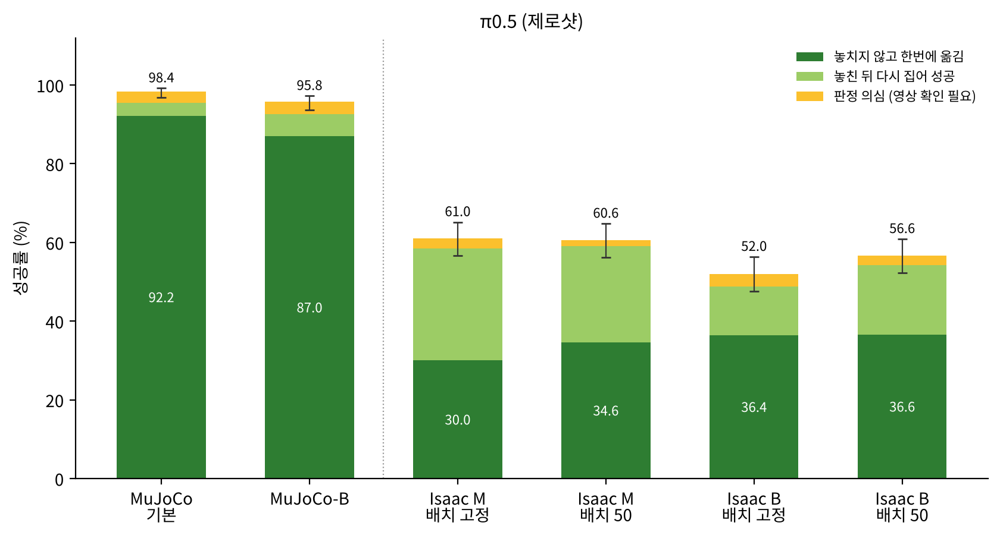
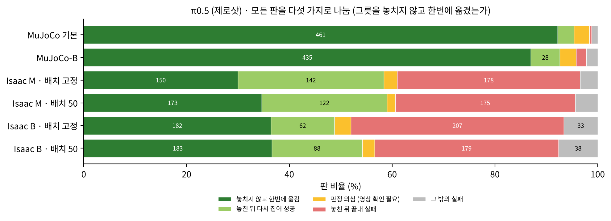
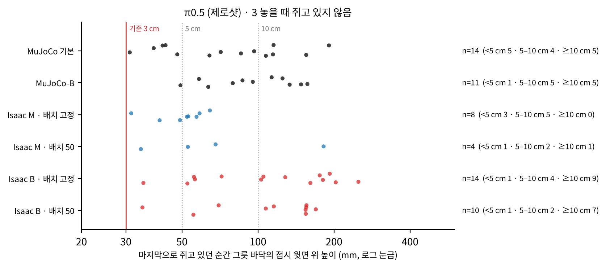
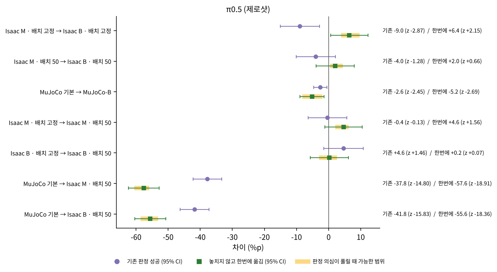
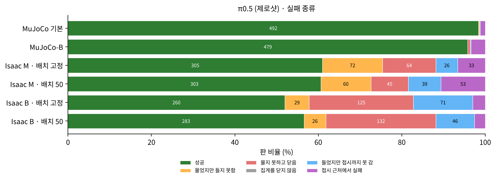
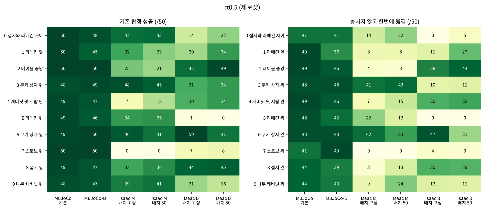
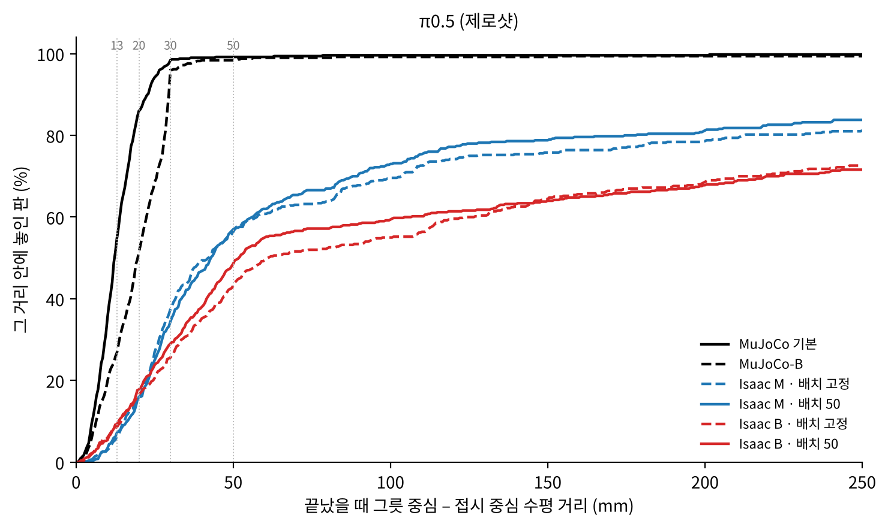

# 보고서 4. π0.5 제로샷 — MuJoCo 98.4 %에서 Isaac Sim 61 %, 그중 절반 가까이는 다시 집어서 얻은 성공

작성 2026-10-13 · English: [README_en.md](README_en.md) · PDF: [한국어](report_4_ko.pdf) · [English](report_4_en.pdf)

## 0. 이 보고서는 무엇인가

OpenVLA 계열이 아닌 모델도 MuJoCo에서 Isaac Sim으로 옮겼을 때 같은 식으로 떨어지는지 보려고, Physical Intelligence의 π0.5를 같은 평가 코드와 같은 판정으로 쟀다. π0.5는 화면을 한 번 보고 동작 10개를 내며, 이 시험에서는 openpi의 LIBERO 예제처럼 앞 5개를 실행한 뒤 화면을 다시 본다.

MuJoCo 데이터로 학습된 공개 모델을 추가 학습 없이(제로샷) 6칸, 모든 칸 500판으로 쟀다. 평가 환경, 시험 조건, 판정은 [README](../../README.md) 1–4절에 있다.

## 한눈에 보는 결론

| 질문 | 답 | 근거 |
| --- | --- | --- |
| Isaac Sim으로 옮기면? | MuJoCo 98.4 %에서 Isaac Sim 52.0–61.0 %. 세 제로샷 모델 중 가장 높고, MuJoCo 성능의 53–62 %가 남는다 | 2절 |
| 그 성공은 어떻게 얻었나? | Isaac M(MuJoCo와 같은 속도)에서 성공의 40–47 %는 **그릇을 놓친 뒤 다시 집어서** 얻었다. MuJoCo에서는 3 %다. 그릇을 놓치지 않고 한번에 옮긴 판만 세면 Isaac M에서 30.0–34.6 %다 | 3절 |
| 지시 하나를 더 길게 실행하면(B)? | 판정에 따라 결론이 달라진다. 기존 판정으로는 조금 떨어지지만(−9.0 %p, z = −2.87 · −4.0 %p, z = −1.28), 한번에 옮긴 판만 세면 떨어지지 않는다(+6.4 %p, z = +2.15 · +2.0 %p, z = +0.66). 5개씩 묶어 실행하는 π0.5는 8개씩 묶는 OFT(−33 %p)보다 실행 시간 차이에 훨씬 덜 민감하다 | 4절 |
| 물체 위치를 바꾸면? | 전체 성공률은 변하지 않는다(−0.4 · +4.6 %p, z = −0.13 · +1.46) | 5절 |
| 어떻게 실패하나? | M에서는 실패가 모든 단계에 퍼져 있고, 접시까지 가서 실패하는 판도 17–27 %다. B에서는 그릇 바깥에서 닫는 실패가 절반을 넘는다 | 6절 |
| 과제별로는? | M과 B에서 잘 되는 과제가 뚜렷하게 갈린다. 과제 2(테이블 가운데)는 B에서 42–49판(M 21–25판)인데, 과제 5(라메킨 위)는 M에서 34–35판, B에서 0–1판이다. 과제 7(스토브 위)은 M에서 0판이다 | 7절 |

## 1. 모델과 연결 방법

| 항목 | 내용 |
| --- | --- |
| 모델 | openpi `pi05_libero` (LIBERO 사람 시범으로 학습, 추가 학습 없음) |
| 보는 것 | 앞쪽 카메라, 손목 카메라, 로봇 상태 8개 값(손 위치 3 · 손 방향 3 · 손가락 2), 과제 문장 |
| 내는 것 | 화면 한 번에 지시 10개. 앞 5개를 실행한 뒤 화면을 다시 봄 (openpi LIBERO 예제와 같음) |
| 앞쪽 화면 | 가운데 면적 0.389를 잘라 MuJoCo 학습 화면과 시야를 맞춤. π0.5는 MuJoCo 화면을 자르지 않고 학습했고 모델 안에서도 자르지 않으므로, 결과 시야가 OpenVLA · OFT와 같다 |
| 손목 화면 | 자르지 않음 |
| 집게 값 | π0.5가 내는 값(−1 열기 · +1 닫기)을 평가 코드 형식(0 닫기 · 1 열기)으로 바꿔 돌려줌 |

π0.5는 지시 5개를 이어서 실행하므로, 화면을 다시 볼 때까지 움직이는 시간이 OpenVLA의 5배다.

| | MuJoCo 기본 | MuJoCo-B | Isaac M | Isaac B |
| --- | --- | --- | --- | --- |
| 지시 하나의 실행 시간 | 0.05초 | 0.10초 | 0.05초 | 0.17초 |
| 화면을 다시 볼 때까지 | 0.25초 | 0.50초 | 0.25초 | 0.85초 |

정책 서버(`code/pi05/pi05_server.py`)는 OFT 서버와 같은 형식으로 주고받는다. 그래서 Isaac Sim 평가 코드를 고치지 않고 OFT 형식 연결을 그대로 쓴다. 서버를 켤 때 가짜 입력으로 두 번 미리 계산해 둔다. 첫 계산의 준비 시간 때문에 평가 코드가 시간 초과로 멈추는 것을 막기 위해서다. MuJoCo에서는 openpi 예제처럼 집게 값을 이어진 값 그대로 쓴다.

## 2. 결과



*그림 1. π0.5의 성공률. 진한 초록은 그릇을 놓치지 않고 한번에 옮긴 판, 연한 초록은 놓친 뒤 다시 집어 성공한 판, 노랑은 판정 의심. 막대 위 선은 기존 판정 성공률의 95 % 신뢰 범위.*

| 칸 | 기존 판정 성공 | 95 % 신뢰 범위 | 놓치지 않고 한번에 옮김 | MuJoCo 기본 대비 (기존 / 한번에) |
| --- | --- | --- | --- | --- |
| MuJoCo 기본 | 492 (98.4 %) | 96.9–99.2 | 461 (92.2 %) | — |
| MuJoCo-B | 479 (95.8 %) | 93.7–97.2 | 435 (87.0 %) | 97 % / 94 % |
| Isaac M · 배치 고정 | 305 (61.0 %) | 56.7–65.2 | 150 (30.0 %) | 62 % / 33 % |
| Isaac M · 배치 50 | 303 (60.6 %) | 56.3–64.8 | 173 (34.6 %) | 62 % / 38 % |
| Isaac B · 배치 고정 | 260 (52.0 %) | 47.6–56.3 | 182 (36.4 %) | 53 % / 39 % |
| Isaac B · 배치 50 | 283 (56.6 %) | 52.2–60.9 | 183 (36.6 %) | 58 % / 40 % |

MuJoCo 기본에서 Isaac M · 배치 50으로 옮기면 37.8 %p가 떨어진다(z = −14.80). 세 제로샷 모델 중 가장 적게 떨어지지만, MuJoCo에서 98 %인 모델도 Isaac Sim에서는 60 % 안팎이다.

## 3. 다시 집어서 얻은 성공

**현상.** 시험 영상에서 π0.5가 그릇을 놓치거나 제대로 물지 못한 뒤 다시 집으려는 모습이 자주 보였다. 기존 판정은 마지막에 그릇이 접시 위에 있는지만 보므로, 이런 판도 깨끗하게 한 번에 옮긴 판과 똑같이 성공으로 센다.

**확인 방법.** 판마다 손가락 폭과 그릇 · 손의 위치 기록으로 「그릇을 놓치지 않고 한번에 옮겼는지」를 판정했다(README 4절).

| 칸 | 기존 판정 성공 | 한번에 옮김 | 다시 집어 성공 | 판정 의심 | 놓친 뒤 끝내 실패 | 그 밖의 실패 | 한 판에 집게를 닫은 평균 횟수 |
| --- | --- | --- | --- | --- | --- | --- | --- |
| MuJoCo 기본 | 492 | 461 | 16 | 15 | 2 | 6 | 1.06 |
| MuJoCo-B | 479 | 435 | 28 | 16 | 10 | 11 | 1.24 |
| Isaac M · 배치 고정 | 305 | 150 | 142 | 13 | 178 | 17 | 2.87 |
| Isaac M · 배치 50 | 303 | 173 | 122 | 8 | 175 | 22 | 2.80 |
| Isaac B · 배치 고정 | 260 | 182 | 62 | 16 | 207 | 33 | 2.88 |
| Isaac B · 배치 50 | 283 | 183 | 88 | 12 | 179 | 38 | 2.77 |



*그림 2. 500판을 다섯 가지로 나눈 비율(숫자는 판 수).*

**결과.**

- **Isaac M에서 성공의 절반 가까이가 다시 집어서 얻은 것이다.** 배치 고정 305판 중 142판(47 %), 배치 50 303판 중 122판(40 %)이다. MuJoCo 기본에서는 492판 중 16판(3 %)뿐이어서, Isaac Sim에서 새로 생긴 행동이다.
- **실패한 판도 대부분 다시 시도한 판이다.** Isaac Sim 실패의 82–91 %가 「놓친 뒤 끝내 실패」이고, 한 판에 집게를 평균 2.8–2.9번 닫는다(MuJoCo 1.06번).
- **판정 의심은 칸마다 8–16판이다.** M에서는 「놓을 때 쥐고 있지 않음」 판 대부분이 접시 위 3–7 cm에서 놓은 판이다. 기준(3 cm)을 조금 넘긴 것으로, 떨어뜨렸다기보다 조금 높은 곳에서 내려놓은 것에 가깝다. B에서는 3번 판의 3분의 2가 10 cm 넘는 곳에서 놓아, 실제로 떨어뜨린 것이다. 「들어 올린 적 없음」은 M에서 9판인데, 그중 6판이 그릇이 접시 옆에서 시작하는 과제 8이다. 나머지 3판은 과제 9(나무 캐비닛 위)다. 과제 9는 그릇이 접시보다 높은 곳에서 시작하므로, 쥔 채로 끌어내리면 제대로 옮겼어도 이 검사에 걸릴 수 있다(검사의 한계, 영상으로 확인).



*그림 3. 「놓을 때 쥐고 있지 않음」으로 판정 의심이 된 판의 놓은 높이. 빨간 선이 3 cm 기준.*

**지금 말할 수 있는 것.** π0.5는 Isaac Sim에서 한 번에 실패해도 포기하지 않고 다시 시도해서 성공률을 끌어올린다. 그래서 기존 판정만으로 π0.5를 다른 모델과 비교하면 「한 번에 해내는 능력」을 과대평가한다. 두 판정을 함께 보고해야 한다.

## 4. 실행 설정을 바꿨을 때 (M → B)

| 비교 | 기존 판정 | z | 한번에 옮김 | z | 한번에 옮김: 판정 의심이 풀릴 때 가능한 범위 (z) |
| --- | --- | --- | --- | --- | --- |
| Isaac M → B, 배치 고정 | 61.0 → 52.0 % (−9.0 %p) | −2.87 | 30.0 → 36.4 % (+6.4 %p) | +2.15 | +3.8 ~ +9.6 %p (+1.26 ~ +3.19) |
| Isaac M → B, 배치 50 | 60.6 → 56.6 % (−4.0 %p) | −1.28 | 34.6 → 36.6 % (+2.0 %p) | +0.66 | +0.4 ~ +4.4 %p (+0.13 ~ +1.44) |
| MuJoCo 기본 → MuJoCo-B | 98.4 → 95.8 % (−2.6 %p) | −2.45 | 92.2 → 87.0 % (−5.2 %p) | −2.69 | — |



*그림 4. π0.5에서 한 가지만 바꿨을 때의 차이. 동그라미는 기존 판정, 네모는 한번에 옮긴 판, 노란 띠는 판정 의심이 풀릴 때 가능한 범위.*

- **판정에 따라 M과 B의 순서가 바뀐다.** 기존 판정으로는 M이 높지만, 한번에 옮긴 판만 세면 B가 M보다 낮지 않다. M에서 성공이 더 많은 것은 다시 집기가 더 많기 때문이다(M 122–142판, B 62–88판). 배치 고정에서 「B가 높다」(z = +2.15)는 결론은 판정 의심이 어떻게 풀리느냐에 따라 유의하지 않을 수도 있다(z = +1.26). 다만 어느 경우에도 M이 B보다 높아지지는 않는다.
- **M에서 다시 집기가 많은 이유(가설).** M에서는 그릇을 물고도 들어 올리지 못하는 실패가 B보다 많다(60–72판 대 26–29판). M에서 들어 올리는 움직임이 MuJoCo의 0.63배라는 측정([보고서 2](../2_openvla_zero_shot_and_finetune/README.md) 4절)과 같은 방향이다. 들어 올리다 놓치고 다시 집는 판이 M에서 많아지는 것으로 보고, 위아래 움직임까지 맞춘 설정(M2)으로 확인한다.
- **묶음 길이의 영향.** MuJoCo에서 같은 방향으로 바꿨을 때 π0.5는 −2.6 %p로 조금만 떨어졌다. 8개씩 묶는 OFT는 −33.4 %p였다([보고서 3](../3_oft_zero_shot/README.md)). 묶음이 짧을수록 실행 시간 차이에 덜 민감하다.

## 5. 물체 위치를 바꿨을 때 (배치 고정 → 배치 50)

| 설정 | 기존 판정 | z | 한번에 옮김 | z |
| --- | --- | --- | --- | --- |
| M | 61.0 → 60.6 % (−0.4 %p) | −0.13 | 30.0 → 34.6 % (+4.6 %p) | +1.56 |
| B | 52.0 → 56.6 % (+4.6 %p) | +1.46 | 36.4 → 36.6 % (+0.2 %p) | +0.07 |

전체 성공률은 물체 위치에 따라 달라지지 않는다. 과제별 변화도 OFT보다 작다. M에서 과제 1(32 → 23판)과 과제 4(7 → 18판)를 빼면 대부분 ±5판 안이다.

## 6. 실패 종류



*그림 5. 실패 종류(판 비율, 숫자는 판 수).*

| 칸 | 물었지만 들지 못함 | 물지 못하고 닫음 | 들었지만 접시까지 못 감 | 접시 근처에서 실패 |
| --- | --- | --- | --- | --- |
| Isaac M · 배치 고정 | 72 | 64 | 26 | 33 |
| Isaac M · 배치 50 | 60 | 45 | 39 | 53 |
| Isaac B · 배치 고정 | 29 | 125 | 71 | 15 |
| Isaac B · 배치 50 | 26 | 132 | 46 | 13 |

「집게를 닫지 않음」은 모든 칸에서 0판이다.

- **M에서는 실패가 단계마다 고르게 퍼져 있다.** 접시까지 그릇을 가져가서 실패하는 판(「접시 근처에서 실패」)이 실패의 17–27 %로, OFT(0판)와 다르다.
- **B에서는 그릇을 무는 단계로 실패가 몰린다.** 그릇 바깥에서 닫는 실패가 52–61 %다. 지시 5개 동안 손이 쥘 자리를 지나치는 것으로 본다.

## 7. 과제별



*그림 6. 과제 × 칸별 성공 판 수(50판 중). 왼쪽은 기존 판정, 오른쪽은 한번에 옮긴 판.*

| 과제 (그릇의 처음 위치) | M · 배치 50: 기존 (한번에) | B · 배치 50: 기존 (한번에) | B − M (기존) |
| --- | --- | --- | --- |
| 0 접시와 라메킨 사이 | 43 (22) | 22 (5) | −21 |
| 1 라메킨 옆 | 23 (8) | 34 (27) | +11 |
| 2 테이블 가운데 | 21 (3) | 49 (44) | +28 |
| 3 쿠키 상자 위 | 45 (43) | 34 (11) | −11 |
| 4 캐비닛 윗 서랍 안 | 18 (15) | 34 (32) | +16 |
| 5 라메킨 위 | 35 (12) | 0 (0) | −35 |
| 6 쿠키 상자 옆 | 41 (33) | 41 (21) | 0 |
| 7 스토브 위 | 0 (0) | 8 (3) | +8 |
| 8 접시 옆 | 36 (13) | 45 (29) | +9 |
| 9 나무 캐비닛 위 | 41 (24) | 16 (11) | −25 |
| 합계 | 303 (173) | 283 (183) | −20 |

- **전체로는 M → B 차이가 20판뿐이지만, 과제별로는 크게 갈린다.** B에서 과제 2(+28), 4(+16), 1(+11)은 오르고, 과제 5(−35), 9(−25), 0(−21)은 떨어진다.
- **과제 2는 M에서 다시 집기로 성공한다.** M에서는 21판 성공 중 한번에 옮긴 판이 3판뿐이지만, B에서는 49판 중 44판이 한번에 옮긴 판이다.
- **과제 7(스토브 위)은 M에서 0판이다.** MuJoCo에서는 50판이다. MuJoCo로만 학습한 세 모델 모두 Isaac Sim에서 이 과제를 거의 하지 못한다.

## 8. 자세한 지표

| 칸 | 집음 | 놓인 위치 오차 중앙값 | 접시 중심 30 mm 안 | 50 mm 안 |
| --- | --- | --- | --- | --- |
| MuJoCo 기본 | 100.0 % | 12.1 mm | 98.4 % | 99.2 % |
| MuJoCo-B | 99.2 % | 19.7 mm | 96.0 % | 98.4 % |
| Isaac M · 배치 고정 | 86.8 % | 41.9 mm | 37.4 % | 56.4 % |
| Isaac M · 배치 50 | 90.0 % | 42.9 mm | 34.4 % | 57.0 % |
| Isaac B · 배치 고정 | 74.2 % | 61.0 mm | 25.6 % | 43.2 % |
| Isaac B · 배치 50 | 73.6 % | 51.8 mm | 29.0 % | 48.6 % |

- **그릇을 무는 비율은 높다.** Isaac M에서 87–90 %로, 같은 칸의 OFT(66–68 %)나 OpenVLA 원본(41–44 %)보다 높다.
- **놓는 위치는 덜 정확하다.** MuJoCo에서는 성공한 판이 거의 모두 접시 중심 30 mm 안에 놓인다(성공 98.4 %, 30 mm 안 98.4 %). Isaac M에서는 성공 61 %인데 30 mm 안은 34–37 %로, 성공해도 접시 가장자리 쪽에 놓는 판이 많다.
- **MuJoCo-B에서는 접시 위에 놓되 덜 정확하다.** 접시 중심 30 mm 안은 96.0 %로 거의 그대로지만, 놓인 위치 오차 중앙값이 12.1 → 19.7 mm로 커진다.



*그림 7. 판이 끝났을 때 그릇–접시 중심 거리의 누적 분포(실패한 판 포함).*

## 9. 지금 원인으로 보이는 것

- **들어 올리는 단계.** M에서는 그릇을 물고도 들지 못하는 실패와 다시 집기가 많다. 들어 올리는 움직임이 MuJoCo의 0.63배라는 측정과 같은 방향이다(확인 중).
- **그릇을 무는 위치.** B에서는 지시 5개를 이어서 실행하는 동안 쥘 자리를 지나치는 실패가 늘어난다.
- **놓는 위치의 정확도.** 그릇을 접시까지 가져가도 가장자리에 놓거나, 조금 높은 곳에서 놓는 판이 많다.

## 10. 한계와 다음 실험

**한계.**

- 칸마다 한 번씩만 돌렸다. 판정 의심은 아직 영상으로 확인하지 않았다.
- Isaac Sim의 기존 판정은 이 평가 코드의 판정이고, MuJoCo는 LIBERO 자체 판정이다. 「한번에 옮김」과 실패 종류는 두 시뮬레이터에 같은 규칙을 썼다.
- 묶음 중 실행하는 개수(5개)는 openpi 예제를 따랐고, 다른 개수는 시험하지 않았다.
- π0.5는 Isaac Sim 데이터로 다시 학습하지 않았다.

**다음 실험.**

1. 판정 의심 영상 확인. B의 「놓을 때 쥐고 있지 않음」 판과 과제 8 · 9의 「들어 올린 적 없음」 판부터 본다.
2. M2에서 다시 재기. 다시 집기가 줄어드는지, 한번에 옮긴 판이 늘어나는지 본다.
3. 묶음 중 실행하는 개수를 줄였을 때(예: 2–3개) B에서의 하락이 줄어드는지.

## 11. 재현 방법

이 절에만 코드에서 쓰는 이름과 값을 적는다.

| 칸 | 결과 폴더 |
| --- | --- |
| MuJoCo 기본 | `MJ_Pi05Z_default_layout50` |
| MuJoCo-B | `MJ_Pi05Z_B_layout50` |
| Isaac M · 배치 고정 | `Pi05Z_M_layout1` |
| Isaac M · 배치 50 | `Pi05Z_M_layout50` |
| Isaac B · 배치 고정 | `Pi05Z_B_layout1` |
| Isaac B · 배치 50 | `Pi05Z_B_layout50` |

- 정책 서버: openpi 파이썬 환경에서 다음을 실행한다. 체크포인트는 openpi `pi05_libero`이고, 묶음 중 실행 개수는 `--chunk`로 바꾼다.
  ```
  XLA_PYTHON_CLIENT_PREALLOCATE=false uv run python code/pi05/pi05_server.py --port 8000
  ```
- Isaac Sim 평가: `code/eval/eval_zs_all_isaac_v6.sh`에 `CFGBASE=libero_spatial_environment_oft`(OFT와 같은 연결 형식)를 준다. M은 `EXTRA="--sim-steps-per-action 3 --convergence-gain 0.65"`, 배치 고정은 `FIXED_STATE=00`이다.
- MuJoCo 평가: `code/eval/mujoco_eval_chunk.py --model-name pi05_libero`. MuJoCo-B는 지시 간격을 1초 10번으로 준다.
- 판정 · 표 · 그림: `code/report/make_report_assets_v2.py`. 판정 규칙은 `code/analysis/vla_signals.py`, `code/analysis/strict_outcomes.py`, `code/analysis/grasp_rule.json`에 있다.

## 부록 A. 전체 표

<!-- TABLES:pi05:start -->
*이 부록의 표는 `code/report/make_report_assets_v2.py`가 `data/results_2026-10-13/episodes_all.csv`에서 만든 것을 그대로 넣었다. 같은 숫자가 `data/results_2026-10-13/tables/`에 CSV로 있다.*

### π0.5 (제로샷)

#### 성공률

| 칸 | 판 | 기존 판정 성공 | 95 % 구간 | 한번에 옮김 | 판정 의심이 모두 한번에일 때 | MuJoCo 기본 대비 (기존 / 한번에) |
|---|---|---|---|---|---|---|
| MuJoCo 기본 | 500 | 492 (98.4%) | 96.9–99.2 | 461 (92.2%) | 476 (95.2%) | — |
| MuJoCo-B | 500 | 479 (95.8%) | 93.7–97.2 | 435 (87.0%) | 451 (90.2%) | 97 % / 94 % |
| Isaac M · 배치 고정 | 500 | 305 (61.0%) | 56.7–65.2 | 150 (30.0%) | 163 (32.6%) | 62 % / 33 % |
| Isaac M · 배치 50 | 500 | 303 (60.6%) | 56.3–64.8 | 173 (34.6%) | 181 (36.2%) | 62 % / 38 % |
| Isaac B · 배치 고정 | 500 | 260 (52.0%) | 47.6–56.3 | 182 (36.4%) | 198 (39.6%) | 53 % / 39 % |
| Isaac B · 배치 50 | 500 | 283 (56.6%) | 52.2–60.9 | 183 (36.6%) | 195 (39.0%) | 58 % / 40 % |

#### 그릇을 놓치지 않고 한번에 옮긴 경우

| 칸 | 기존 판정 성공 | 놓치지 않고 한번에 옮김 | 놓친 뒤 다시 집어 성공 | 판정 의심 (영상 확인 필요) | 놓친 뒤 끝내 실패 | 그 밖의 실패 | 평균 닫은 횟수 | 평균 닿은 시도 |
|---|---|---|---|---|---|---|---|---|
| MuJoCo 기본 | 492 | 461 (92.2%) | 16 | 15 | 2 | 6 | 1.06 | 1.05 |
| MuJoCo-B | 479 | 435 (87.0%) | 28 | 16 | 10 | 11 | 1.24 | 1.16 |
| Isaac M · 배치 고정 | 305 | 150 (30.0%) | 142 | 13 | 178 | 17 | 2.87 | 2.46 |
| Isaac M · 배치 50 | 303 | 173 (34.6%) | 122 | 8 | 175 | 22 | 2.80 | 2.41 |
| Isaac B · 배치 고정 | 260 | 182 (36.4%) | 62 | 16 | 207 | 33 | 2.88 | 2.36 |
| Isaac B · 배치 50 | 283 | 183 (36.6%) | 88 | 12 | 179 | 38 | 2.77 | 2.32 |

#### 판정 의심의 이유와 놓은 높이

| 칸 | 판정 의심 | 1 들어 올린 적 없음 | 2 접시 위 순간 없음 | 3 놓을 때 쥐고 있지 않음 | 3 중 5 cm 미만 | 5~10 cm | 10 cm 이상 | 쥔 순간 없음 | 1번이 나온 과제 (과제:판) |
|---|---|---|---|---|---|---|---|---|---|
| MuJoCo 기본 | 15 | 0 | 1 | 14 | 5 | 4 | 5 | 0 | — |
| MuJoCo-B | 16 | 0 | 5 | 11 | 1 | 5 | 5 | 0 | — |
| Isaac M · 배치 고정 | 13 | 5 | 0 | 8 | 3 | 5 | 0 | 0 | 8:3 9:2 |
| Isaac M · 배치 50 | 8 | 4 | 0 | 4 | 1 | 2 | 1 | 0 | 8:3 9:1 |
| Isaac B · 배치 고정 | 16 | 1 | 1 | 14 | 1 | 4 | 9 | 0 | 3:1 |
| Isaac B · 배치 50 | 12 | 1 | 1 | 10 | 1 | 2 | 7 | 0 | 8:1 |

#### 실패 종류

| 칸 | 성공 | 물었지만 들지 못함 | 물지 못하고 닫음 | 집게를 닫지 않음 | 들었지만 접시까지 못 감 | 접시 근처에서 실패 |
|---|---|---|---|---|---|---|
| MuJoCo 기본 | 492 | 1 | 0 | 0 | 1 | 6 |
| MuJoCo-B | 479 | 0 | 3 | 0 | 1 | 17 |
| Isaac M · 배치 고정 | 305 | 72 | 64 | 0 | 26 | 33 |
| Isaac M · 배치 50 | 303 | 60 | 45 | 0 | 39 | 53 |
| Isaac B · 배치 고정 | 260 | 29 | 125 | 0 | 71 | 15 |
| Isaac B · 배치 50 | 283 | 26 | 132 | 0 | 46 | 13 |

#### 자세한 지표 (Table 1 지표)

| 칸 | 닫음 시도 % | 집음 % | 놓기 성공 % | 다른 물체 안 건드림 % | 접시 중심까지 중앙값 (mm) | 13 mm 안 % | 20 mm 안 % | 30 mm 안 % | 50 mm 안 % |
|---|---|---|---|---|---|---|---|---|---|
| MuJoCo 기본 | 100.0 | 100.0 | 98.4 | 91.6 | 12.1 | 54.8 | 86.0 | 98.4 | 99.2 |
| MuJoCo-B | 100.0 | 99.2 | 95.8 | 92.8 | 19.7 | 26.8 | 51.4 | 96.0 | 98.4 |
| Isaac M · 배치 고정 | 100.0 | 86.8 | 61.0 | — | 41.9 | 6.4 | 15.6 | 37.4 | 56.4 |
| Isaac M · 배치 50 | 100.0 | 90.0 | 60.6 | — | 42.9 | 7.2 | 16.0 | 34.4 | 57.0 |
| Isaac B · 배치 고정 | 100.0 | 74.2 | 52.0 | — | 61.0 | 8.6 | 16.6 | 25.6 | 43.2 |
| Isaac B · 배치 50 | 100.0 | 73.6 | 56.6 | — | 51.8 | 9.2 | 17.8 | 29.0 | 48.6 |

다른 물체 안 건드림은 다른 물체 위치 기록이 있는 판만 셈 (지금은 MuJoCo 만 기록이 있음). 거리 지표는 실패 판도 포함한다.

#### 과제별 성공 (기존 판정, 과제당 판 수 대비)

| 과제 | 그릇 위치 | MuJoCo 기본 | MuJoCo-B | Isaac M · 배치 고정 | Isaac M · 배치 50 | Isaac B · 배치 고정 | Isaac B · 배치 50 |
|---|---|---|---|---|---|---|---|
| 0 | 접시와 라메킨 사이 | 50 | 48 | 42 | 43 | 14 | 22 |
| 1 | 라메킨 옆 | 50 | 45 | 32 | 23 | 20 | 34 |
| 2 | 테이블 중앙 | 50 | 50 | 25 | 21 | 42 | 49 |
| 3 | 쿠키 상자 위 | 48 | 49 | 48 | 45 | 31 | 34 |
| 4 | 캐비닛 윗 서랍 안 | 49 | 47 | 7 | 18 | 30 | 34 |
| 5 | 라메킨 위 | 49 | 46 | 34 | 35 | 1 | 0 |
| 6 | 쿠키 상자 옆 | 49 | 50 | 46 | 41 | 50 | 41 |
| 7 | 스토브 위 | 50 | 50 | 0 | 0 | 7 | 8 |
| 8 | 접시 옆 | 49 | 47 | 32 | 36 | 44 | 45 |
| 9 | 나무 캐비닛 위 | 48 | 47 | 39 | 41 | 21 | 16 |
| 합계 |  | 492 | 479 | 305 | 303 | 260 | 283 |

#### 과제별 한번에 옮긴 판

| 과제 | 그릇 위치 | MuJoCo 기본 | MuJoCo-B | Isaac M · 배치 고정 | Isaac M · 배치 50 | Isaac B · 배치 고정 | Isaac B · 배치 50 |
|---|---|---|---|---|---|---|---|
| 0 | 접시와 라메킨 사이 | 41 | 41 | 14 | 22 | 0 | 5 |
| 1 | 라메킨 옆 | 49 | 36 | 8 | 8 | 11 | 27 |
| 2 | 테이블 중앙 | 49 | 46 | 4 | 3 | 38 | 44 |
| 3 | 쿠키 상자 위 | 48 | 48 | 41 | 43 | 10 | 11 |
| 4 | 캐비닛 윗 서랍 안 | 49 | 46 | 7 | 15 | 30 | 32 |
| 5 | 라메킨 위 | 48 | 42 | 22 | 12 | 0 | 0 |
| 6 | 쿠키 상자 옆 | 48 | 48 | 42 | 33 | 47 | 21 |
| 7 | 스토브 위 | 41 | 49 | 0 | 0 | 4 | 3 |
| 8 | 접시 옆 | 44 | 39 | 3 | 13 | 30 | 29 |
| 9 | 나무 캐비닛 위 | 44 | 40 | 9 | 24 | 12 | 11 |
| 합계 |  | 461 | 435 | 150 | 173 | 182 | 183 |

#### 한 가지만 바꿨을 때

| 비교 | 기존 판정 성공 지금 차이 (z) | 한번에 옮김 지금 차이 (z) | 한번에 옮김 영상 확인 후 가능한 범위 (z) |
|---|---|---|---|
| Isaac M · 배치 고정 → Isaac B · 배치 고정 | -9.0 (-2.87) | +6.4 (+2.15) | +3.8 ~ +9.6 (+1.26 ~ +3.19) |
| Isaac M · 배치 50 → Isaac B · 배치 50 | -4.0 (-1.28) | +2.0 (+0.66) | +0.4 ~ +4.4 (+0.13 ~ +1.44) |
| MuJoCo 기본 → MuJoCo-B | -2.6 (-2.45) | -5.2 (-2.69) | -8.2 ~ -2.0 (-4.55 ~ -1.12) |
| Isaac M · 배치 고정 → Isaac M · 배치 50 | -0.4 (-0.13) | +4.6 (+1.56) | +2.0 ~ +6.2 (+0.67 ~ +2.08) |
| Isaac B · 배치 고정 → Isaac B · 배치 50 | +4.6 (+1.46) | +0.2 (+0.07) | -3.0 ~ +2.6 (-0.98 ~ +0.85) |
| MuJoCo 기본 → Isaac M · 배치 50 | -37.8 (-14.80) | -57.6 (-18.91) | -60.6 ~ -56.0 (-20.08 ~ -18.47) |
| MuJoCo 기본 → Isaac B · 배치 50 | -41.8 (-15.83) | -55.6 (-18.36) | -58.6 ~ -53.2 (-19.55 ~ -17.71) |
<!-- TABLES:pi05:end -->

## 부록 B. 용어

| 용어 | 뜻 |
| --- | --- |
| 판 | 시험 한 번. 칸마다 500판(과제 10개 × 50판) |
| 지시 · 묶음 | 지시는 모델이 내는 짧은 이동 명령이다. π0.5는 화면 한 번에 지시 10개를 내고, 이 시험에서는 앞 5개를 실행한 뒤 화면을 다시 본다 |
| 제로샷 | 옮겨 간 환경(Isaac Sim)의 데이터로 추가 학습하지 않고 그대로 시험하는 것 |
| M / B | Isaac Sim 실행 설정. M은 지시 하나를 0.05초 동안 실행하고 손 목표를 65 %로 잡음(MuJoCo와 같은 속도). B는 0.17초 동안 지시한 거리 그대로 |
| MuJoCo-B | MuJoCo에서 지시 간격을 1초 10번(0.10초)으로 늘린 설정 |
| 배치 고정 / 배치 50 | 물체 위치를 LIBERO의 첫 번째 위치 하나로 고정 / 판마다 50가지 중 하나 |
| 놓치지 않고 한번에 옮김 | 그릇을 집은 뒤 한 번도 놓치거나 떨어뜨리지 않고 접시에 놓은 판 |
| 놓친 뒤 다시 집어 성공 | 그릇에 닿았다가 놓치거나(들지 못함 포함) 떨어뜨린 뒤, 다시 집어 성공한 판 |
| 판정 의심 | 기존 판정은 성공이지만, 기록만으로는 집어서 옮겼다는 것을 확인할 수 없어 영상 확인이 필요한 판 |
| z | 두 성공률의 차이가 우연인지 보는 값. 절댓값 1.96을 넘으면 우연일 가능성 5 % 미만 |
