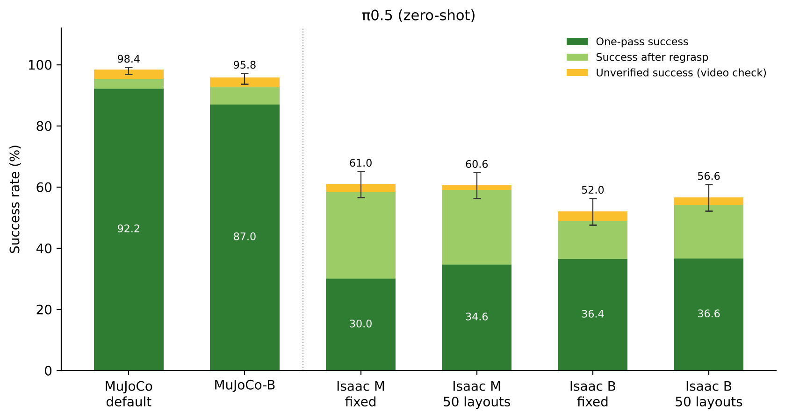
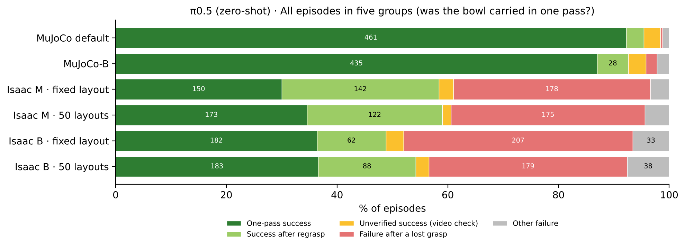
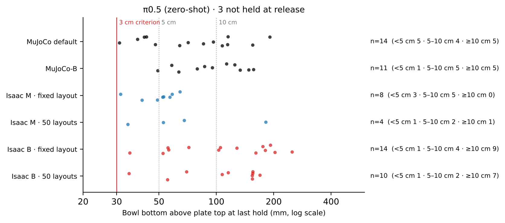
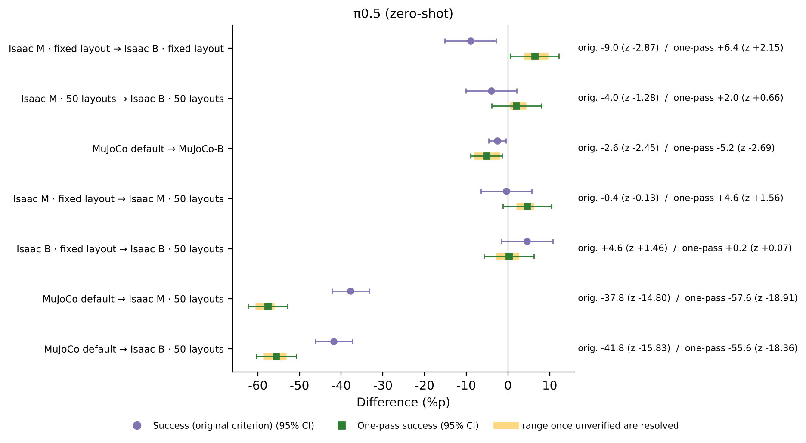
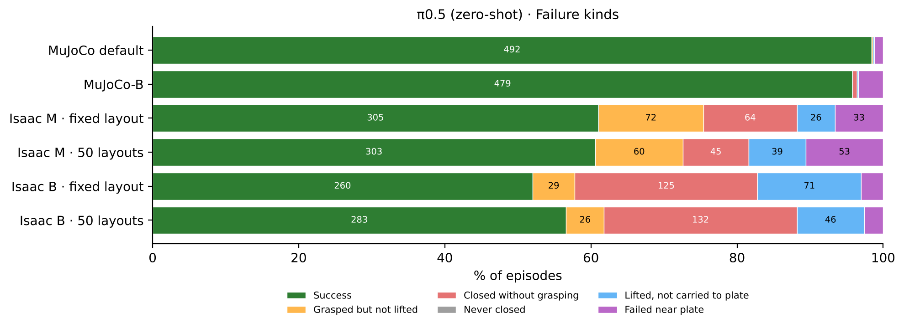
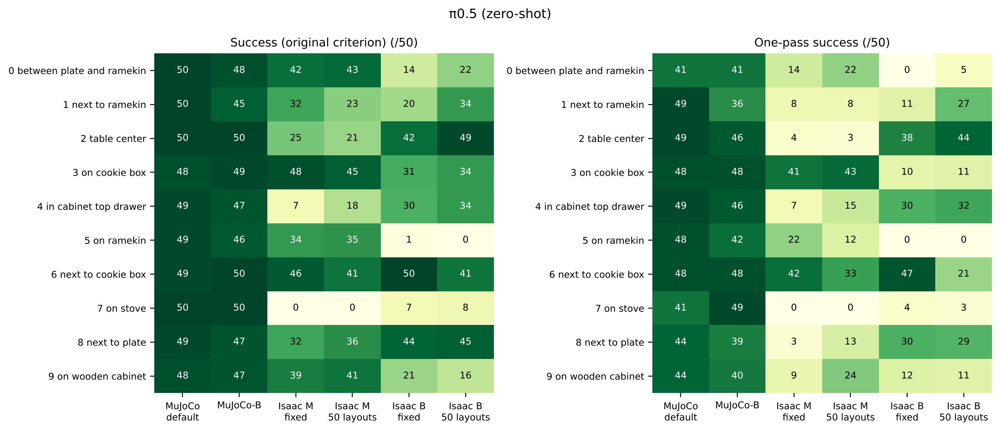
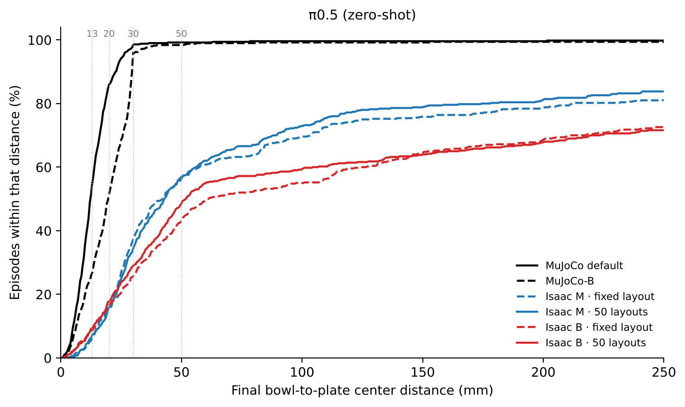

# Report 4. π0.5 zero-shot — from 98.4 % in MuJoCo to 61 % in Isaac Sim, with nearly half of the successes coming from regrasping

Written 2026-10-13 · 한국어 (main): [README.md](README.md) · PDF: [English](report_4_en.pdf) · [한국어](report_4_ko.pdf)

## 0. What this report is about

To see whether a model outside the OpenVLA family also drops in the same way when moved from MuJoCo to Isaac Sim, we measured Physical Intelligence's π0.5 with the same evaluation code and the same criteria. π0.5 looks at the screen once and issues 10 actions. In these tests, as in openpi's LIBERO example, it executes the first 5 and then looks again.

We measured the public model trained on MuJoCo data without additional training (zero-shot), in 6 cells with 500 episodes each. The evaluation setup, test cells and criteria are described in Sections 1–4 of the [README](../../README_en.md).

## Conclusions at a glance

| Question | Answer | Evidence |
| --- | --- | --- |
| What happens when moved to Isaac Sim? | From 98.4 % in MuJoCo to 52.0–61.0 % in Isaac Sim. It is the highest of the three zero-shot models and retains 53–62 % of its MuJoCo performance | Section 2 |
| How were those successes achieved? | Under Isaac M (MuJoCo-matched speed), 40–47 % of successes came **after losing the bowl and grasping it again** (3 % in MuJoCo). Counting only one-pass successes, Isaac M gives 30.0–34.6 % | Section 3 |
| What if each action is executed for longer (B)? | The conclusion depends on the criterion. By the original criterion it drops slightly (−9.0 %p, z = −2.87 · −4.0 %p, z = −1.28). Counting only one-pass successes, it does not drop (+6.4 %p, z = +2.15 · +2.0 %p, z = +0.66). π0.5, executing 5 actions per chunk, is far less sensitive to execution-time differences than OFT with 8 (−33 %p) | Section 4 |
| What if object placement changes? | Overall success does not change (−0.4 · +4.6 %p, z = −0.13 · +1.46) | Section 5 |
| How does it fail? | Under M, failures are spread over all stages, and 17–27 % fail after bringing the bowl to the plate. Under B, more than half of the failures close the gripper outside the bowl | Section 6 |
| Per task? | Tasks that work under M and under B are clearly different. Task 2 (center of the table) succeeds in 42–49 under B (21–25 under M), while task 5 (on the ramekin) succeeds in 34–35 under M and 0–1 under B. Task 7 (on the stove) is 0 under M | Section 7 |

## 1. Model and connection

| Item | Details |
| --- | --- |
| Model | openpi `pi05_libero` (trained on LIBERO human demonstrations, no additional training) |
| Inputs | Front camera, wrist camera, 8 robot-state values (hand position 3 · orientation 3 · fingers 2), task sentence |
| Outputs | 10 actions per observation; the first 5 are executed before the next observation (as in openpi's LIBERO example) |
| Front image | The central area 0.389 is cropped to match the MuJoCo training field of view. π0.5 was trained on uncropped MuJoCo images and does not crop inside the model, so the resulting view is the same as OpenVLA's and OFT's |
| Wrist image | Not cropped |
| Gripper value | π0.5's output (−1 open · +1 close) is converted to the evaluation code's format (0 close · 1 open) |

Because π0.5 executes 5 actions in a row, it moves 5 times longer than OpenVLA before looking at the screen again.

| | MuJoCo default | MuJoCo-B | Isaac M | Isaac B |
| --- | --- | --- | --- | --- |
| Execution time per action | 0.05 s | 0.10 s | 0.05 s | 0.17 s |
| Until the next observation | 0.25 s | 0.50 s | 0.25 s | 0.85 s |

The policy server (`code/pi05/pi05_server.py`) uses the same exchange format as the OFT server, so the Isaac Sim evaluation code uses its OFT-style connection unchanged. At start-up the server runs two dummy predictions. Otherwise the evaluation code would time out while the first prediction is being prepared. In MuJoCo, the gripper value is used as a continuous value, as in the openpi example.

## 2. Results



*Figure 1. Success of π0.5. Dark green: one-pass success; light green: success after regrasp; yellow: unverified success. Lines above the bars: 95 % confidence range of success by the original criterion.*

| Cell | Success (original) | 95 % confidence range | One-pass success | Retained vs MuJoCo default (original / one-pass) |
| --- | --- | --- | --- | --- |
| MuJoCo default | 492 (98.4 %) | 96.9–99.2 | 461 (92.2 %) | — |
| MuJoCo-B | 479 (95.8 %) | 93.7–97.2 | 435 (87.0 %) | 97 % / 94 % |
| Isaac M · fixed layout | 305 (61.0 %) | 56.7–65.2 | 150 (30.0 %) | 62 % / 33 % |
| Isaac M · 50 layouts | 303 (60.6 %) | 56.3–64.8 | 173 (34.6 %) | 62 % / 38 % |
| Isaac B · fixed layout | 260 (52.0 %) | 47.6–56.3 | 182 (36.4 %) | 53 % / 39 % |
| Isaac B · 50 layouts | 283 (56.6 %) | 52.2–60.9 | 183 (36.6 %) | 58 % / 40 % |

Moving from MuJoCo default to Isaac M · 50 layouts costs 37.8 %p (z = −14.80). This is the smallest drop of the three zero-shot models, but even a model at 98 % in MuJoCo is around 60 % in Isaac Sim.

## 3. Successes obtained by grasping again

**What we saw.** In the test videos, π0.5 often lost the bowl or failed to grip it properly, then tried to grasp it again. The original criterion only checks whether the bowl ends up on the plate, so such episodes count as success just like clean one-pass episodes.

**How we checked.** For every episode we judged, from the finger-width and bowl/hand position logs, whether the bowl was carried without being lost (README Section 4).

| Cell | Success (original) | One-pass | After regrasp | Unverified | Failure after a lost grasp | Other failure | Mean gripper closings per episode |
| --- | --- | --- | --- | --- | --- | --- | --- |
| MuJoCo default | 492 | 461 | 16 | 15 | 2 | 6 | 1.06 |
| MuJoCo-B | 479 | 435 | 28 | 16 | 10 | 11 | 1.24 |
| Isaac M · fixed layout | 305 | 150 | 142 | 13 | 178 | 17 | 2.87 |
| Isaac M · 50 layouts | 303 | 173 | 122 | 8 | 175 | 22 | 2.80 |
| Isaac B · fixed layout | 260 | 182 | 62 | 16 | 207 | 33 | 2.88 |
| Isaac B · 50 layouts | 283 | 183 | 88 | 12 | 179 | 38 | 2.77 |



*Figure 2. All 500 episodes in five groups (numbers are episode counts).*

**Results.**

- **Under Isaac M, nearly half of the successes come from grasping again.** That is 142 of 305 (47 %) with the fixed layout and 122 of 303 (40 %) with 50 layouts. In MuJoCo default it is only 16 of 492 (3 %), so this behavior is new in Isaac Sim.
- **Most failed episodes also tried again.** In Isaac Sim, 82–91 % of failures are "failure after a lost grasp", and the gripper closes 2.8–2.9 times per episode on average (1.06 in MuJoCo).
- **Each cell has 8–16 unverified successes.** Under M, most "not held at release" episodes released the bowl 3–7 cm above the plate. That is just over the 3 cm threshold, closer to placing from slightly high than to dropping. Under B, two thirds of them released the bowl more than 10 cm above the plate, which is real dropping. "Never lifted with the hand" occurs in 9 episodes under M. Six of them are in task 8, where the bowl starts next to the plate. The other 3 are in task 9 (on the wooden cabinet), where the bowl starts higher than the plate, so dragging it down while holding it can trip this check even if it was carried properly (a limit of the check, to be confirmed on video).



*Figure 3. Release height of unverified successes marked "not held at release". The red line is the 3 cm threshold.*

**What we can say now.** In Isaac Sim, π0.5 does not give up after a failed attempt; it tries again and raises its success rate that way. Comparing π0.5 with other models by the original criterion alone therefore overstates its ability to succeed in one go. Both criteria should be reported together.

## 4. Changing the execution setting (M → B)

| Comparison | Original criterion | z | One-pass | z | One-pass: possible range once unverified are resolved (z) |
| --- | --- | --- | --- | --- | --- |
| Isaac M → B, fixed layout | 61.0 → 52.0 % (−9.0 %p) | −2.87 | 30.0 → 36.4 % (+6.4 %p) | +2.15 | +3.8 to +9.6 %p (+1.26 to +3.19) |
| Isaac M → B, 50 layouts | 60.6 → 56.6 % (−4.0 %p) | −1.28 | 34.6 → 36.6 % (+2.0 %p) | +0.66 | +0.4 to +4.4 %p (+0.13 to +1.44) |
| MuJoCo default → MuJoCo-B | 98.4 → 95.8 % (−2.6 %p) | −2.45 | 92.2 → 87.0 % (−5.2 %p) | −2.69 | — |



*Figure 4. Differences when one factor is changed for π0.5. Circles: original criterion; squares: one-pass success; yellow band: possible range once unverified successes are resolved.*

- **The order of M and B depends on the criterion.** By the original criterion M is higher, but counting only one-pass successes B is not lower than M. M has more successes because it regrasps more (M 122–142, B 62–88). With the fixed layout, the conclusion "B is higher" (z = +2.15) may become non-significant depending on how unverified successes resolve (z = +1.26). In no case, however, does M become higher than B.
- **Why M regrasps more (hypothesis).** Under M, failures where the bowl is gripped but not lifted are more common than under B (60–72 vs 26–29). This points the same way as the measurement that lifting under M moves 0.63× of MuJoCo (Section 4 of [Report 2](../2_openvla_zero_shot_and_finetune/README_en.md)). We think episodes that lose the bowl while lifting and grasp it again become more common under M. We will check this with a setting that also matches the vertical motion (M2).
- **Effect of chunk length.** When the same change was made in MuJoCo, π0.5 dropped only −2.6 %p, while OFT, with 8-action chunks, dropped −33.4 %p ([Report 3](../3_oft_zero_shot/README_en.md)). The shorter the chunk, the less sensitive the model is to execution-time differences.

## 5. Changing the object placement (fixed layout → 50 layouts)

| Setting | Success (original) | z | One-pass | z |
| --- | --- | --- | --- | --- |
| M | 61.0 → 60.6 % (−0.4 %p) | −0.13 | 30.0 → 34.6 % (+4.6 %p) | +1.56 |
| B | 52.0 → 56.6 % (+4.6 %p) | +1.46 | 36.4 → 36.6 % (+0.2 %p) | +0.07 |

Overall success does not depend on object placement. Per-task changes are also smaller than OFT's. Under M, apart from task 1 (32 → 23) and task 4 (7 → 18), most tasks change by 5 or fewer.

## 6. Failure kinds



*Figure 5. Failure kinds (share of episodes; numbers are episode counts).*

| Cell | Grasped but not lifted | Closed without grasping | Lifted, not carried to plate | Failed near plate |
| --- | --- | --- | --- | --- |
| Isaac M · fixed layout | 72 | 64 | 26 | 33 |
| Isaac M · 50 layouts | 60 | 45 | 39 | 53 |
| Isaac B · fixed layout | 29 | 125 | 71 | 15 |
| Isaac B · 50 layouts | 26 | 132 | 46 | 13 |

"Never closed" is 0 in every cell.

- **Under M, failures are spread evenly across the stages.** Episodes that bring the bowl to the plate and still fail ("failed near plate") are 17–27 % of failures, unlike OFT (0).
- **Under B, failures concentrate in the grasping stage.** Closing outside the bowl accounts for 52–61 %. We think the hand overshoots the grasp position during the 5-action chunk.

## 7. Per task



*Figure 6. Successes per task × cell (out of 50). Left: original criterion; right: one-pass.*

| Task (where the bowl starts) | M · 50 layouts: original (one-pass) | B · 50 layouts: original (one-pass) | B − M (original) |
| --- | --- | --- | --- |
| 0 between plate and ramekin | 43 (22) | 22 (5) | −21 |
| 1 next to ramekin | 23 (8) | 34 (27) | +11 |
| 2 center of the table | 21 (3) | 49 (44) | +28 |
| 3 on the cookie box | 45 (43) | 34 (11) | −11 |
| 4 in the cabinet top drawer | 18 (15) | 34 (32) | +16 |
| 5 on the ramekin | 35 (12) | 0 (0) | −35 |
| 6 next to the cookie box | 41 (33) | 41 (21) | 0 |
| 7 on the stove | 0 (0) | 8 (3) | +8 |
| 8 next to the plate | 36 (13) | 45 (29) | +9 |
| 9 on the wooden cabinet | 41 (24) | 16 (11) | −25 |
| Total | 303 (173) | 283 (183) | −20 |

- **Overall, M → B differs by only 20 episodes, but individual tasks split sharply.** Under B, tasks 2 (+28), 4 (+16) and 1 (+11) rise, while tasks 5 (−35), 9 (−25) and 0 (−21) fall.
- **Under M, task 2 succeeds by regrasping.** Under M only 3 of its 21 successes are one-pass; under B, 44 of 49 are.
- **Task 7 (on the stove) is 0 under M,** against 50 in MuJoCo. All three models trained only in MuJoCo hardly solve this task in Isaac Sim.

## 8. Detailed metrics

| Cell | Grasp | Median placement error | Within 30 mm of plate center | Within 50 mm |
| --- | --- | --- | --- | --- |
| MuJoCo default | 100.0 % | 12.1 mm | 98.4 % | 99.2 % |
| MuJoCo-B | 99.2 % | 19.7 mm | 96.0 % | 98.4 % |
| Isaac M · fixed layout | 86.8 % | 41.9 mm | 37.4 % | 56.4 % |
| Isaac M · 50 layouts | 90.0 % | 42.9 mm | 34.4 % | 57.0 % |
| Isaac B · fixed layout | 74.2 % | 61.0 mm | 25.6 % | 43.2 % |
| Isaac B · 50 layouts | 73.6 % | 51.8 mm | 29.0 % | 48.6 % |

- **The grasp rate is high.** Under Isaac M it is 87–90 %, higher than OFT (66–68 %) or the original OpenVLA (41–44 %) in the same cells.
- **Placement is less accurate.** In MuJoCo almost every success lands within 30 mm of the plate center (success 98.4 %, within 30 mm 98.4 %). Under Isaac M, success is 61 % but only 34–37 % lands within 30 mm, so many successes place the bowl toward the plate edge.
- **Under MuJoCo-B it still places on the plate, but less accurately.** Within 30 mm stays at 96.0 %, but the median placement error grows from 12.1 to 19.7 mm.



*Figure 7. Cumulative distribution of the final bowl-to-plate center distance (including failed episodes).*

## 9. What now appears to be the cause

- **Lifting.** Under M, gripping without lifting and regrasping are common. This points the same way as the measurement that lifting moves 0.63× of MuJoCo (being checked).
- **Where the gripper closes.** Under B, failures that overshoot the grasp position during the 5-action chunk increase.
- **Placement accuracy.** Even after bringing the bowl to the plate, it often places it near the edge or releases it from slightly high.

## 10. Limitations and next experiments

**Limitations.**

- Each cell was run once. Unverified successes have not yet been checked on video.
- In Isaac Sim the original criterion is the evaluation code's check; MuJoCo uses LIBERO's own check. One-pass grouping and failure kinds use the same rules in both simulators.
- The number of actions executed per chunk (5) follows the openpi example; other numbers were not tested.
- π0.5 was not retrained on Isaac Sim data.

**Next experiments.**

1. Video check of unverified successes, starting with the "not held at release" episodes under B and the "never lifted with the hand" episodes in tasks 8 and 9.
2. Measure again under M2, to see whether regrasping drops and one-pass successes rise.
3. Whether executing fewer actions per chunk (e.g. 2–3) reduces the drop under B.

## 11. How to reproduce

Only this section uses the names and values from the code.

| Cell | Result folder |
| --- | --- |
| MuJoCo default | `MJ_Pi05Z_default_layout50` |
| MuJoCo-B | `MJ_Pi05Z_B_layout50` |
| Isaac M · fixed layout | `Pi05Z_M_layout1` |
| Isaac M · 50 layouts | `Pi05Z_M_layout50` |
| Isaac B · fixed layout | `Pi05Z_B_layout1` |
| Isaac B · 50 layouts | `Pi05Z_B_layout50` |

- Policy server: run the following in the openpi Python environment. The checkpoint is openpi `pi05_libero`; change the number of actions executed per chunk with `--chunk`.
  ```
  XLA_PYTHON_CLIENT_PREALLOCATE=false uv run python code/pi05/pi05_server.py --port 8000
  ```
- Isaac Sim evaluation: `code/eval/eval_zs_all_isaac_v6.sh` with `CFGBASE=libero_spatial_environment_oft` (the same connection format as OFT). M uses `EXTRA="--sim-steps-per-action 3 --convergence-gain 0.65"`; the fixed layout uses `FIXED_STATE=00`.
- MuJoCo evaluation: `code/eval/mujoco_eval_chunk.py --model-name pi05_libero`. For MuJoCo-B, set the action interval to 10 per second.
- Criteria, tables and figures: `code/report/make_report_assets_v2.py`. The rules are in `code/analysis/vla_signals.py`, `code/analysis/strict_outcomes.py` and `code/analysis/grasp_rule.json`.

## Appendix A. Full tables

<!-- TABLES:pi05:start -->
*The tables in this appendix are generated by `code/report/make_report_assets_v2.py` from `data/results_2026-10-13/episodes_all.csv` and inserted unchanged. The same numbers are in `data/results_2026-10-13/tables/` as CSV.*

### π0.5 (zero-shot)

#### Success rate

| Cell | Episodes | Success (original) | 95% CI | One-pass | If all unverified are one-pass | Retained vs MuJoCo default (original / one-pass) |
|---|---|---|---|---|---|---|
| MuJoCo default | 500 | 492 (98.4%) | 96.9–99.2 | 461 (92.2%) | 476 (95.2%) | — |
| MuJoCo-B | 500 | 479 (95.8%) | 93.7–97.2 | 435 (87.0%) | 451 (90.2%) | 97 % / 94 % |
| Isaac M · fixed layout | 500 | 305 (61.0%) | 56.7–65.2 | 150 (30.0%) | 163 (32.6%) | 62 % / 33 % |
| Isaac M · 50 layouts | 500 | 303 (60.6%) | 56.3–64.8 | 173 (34.6%) | 181 (36.2%) | 62 % / 38 % |
| Isaac B · fixed layout | 500 | 260 (52.0%) | 47.6–56.3 | 182 (36.4%) | 198 (39.6%) | 53 % / 39 % |
| Isaac B · 50 layouts | 500 | 283 (56.6%) | 52.2–60.9 | 183 (36.6%) | 195 (39.0%) | 58 % / 40 % |

#### One-pass success (bowl carried without being lost)

| Cell | Success (original) | One-pass success | Success after regrasp | Unverified success (video check) | Failure after a lost grasp | Other failure | Mean closings | Mean touching attempts |
|---|---|---|---|---|---|---|---|---|
| MuJoCo default | 492 | 461 (92.2%) | 16 | 15 | 2 | 6 | 1.06 | 1.05 |
| MuJoCo-B | 479 | 435 (87.0%) | 28 | 16 | 10 | 11 | 1.24 | 1.16 |
| Isaac M · fixed layout | 305 | 150 (30.0%) | 142 | 13 | 178 | 17 | 2.87 | 2.46 |
| Isaac M · 50 layouts | 303 | 173 (34.6%) | 122 | 8 | 175 | 22 | 2.80 | 2.41 |
| Isaac B · fixed layout | 260 | 182 (36.4%) | 62 | 16 | 207 | 33 | 2.88 | 2.36 |
| Isaac B · 50 layouts | 283 | 183 (36.6%) | 88 | 12 | 179 | 38 | 2.77 | 2.32 |

#### Unverified successes: reasons and release height

| Cell | Unverified | 1 never lifted with the hand | 2 no on-plate moment | 3 not held at release | 3: <5 cm | 5–10 cm | ≥10 cm | never held | Tasks with reason 1 (task:count) |
|---|---|---|---|---|---|---|---|---|---|
| MuJoCo default | 15 | 0 | 1 | 14 | 5 | 4 | 5 | 0 | — |
| MuJoCo-B | 16 | 0 | 5 | 11 | 1 | 5 | 5 | 0 | — |
| Isaac M · fixed layout | 13 | 5 | 0 | 8 | 3 | 5 | 0 | 0 | 8:3 9:2 |
| Isaac M · 50 layouts | 8 | 4 | 0 | 4 | 1 | 2 | 1 | 0 | 8:3 9:1 |
| Isaac B · fixed layout | 16 | 1 | 1 | 14 | 1 | 4 | 9 | 0 | 3:1 |
| Isaac B · 50 layouts | 12 | 1 | 1 | 10 | 1 | 2 | 7 | 0 | 8:1 |

#### Failure kinds

| Cell | Success | Grasped but not lifted | Closed without grasping | Never closed | Lifted, not carried to plate | Failed near plate |
|---|---|---|---|---|---|---|
| MuJoCo default | 492 | 1 | 0 | 0 | 1 | 6 |
| MuJoCo-B | 479 | 0 | 3 | 0 | 1 | 17 |
| Isaac M · fixed layout | 305 | 72 | 64 | 0 | 26 | 33 |
| Isaac M · 50 layouts | 303 | 60 | 45 | 0 | 39 | 53 |
| Isaac B · fixed layout | 260 | 29 | 125 | 0 | 71 | 15 |
| Isaac B · 50 layouts | 283 | 26 | 132 | 0 | 46 | 13 |

#### Detailed metrics (Table 1 metrics)

| Cell | Gripper close % | Grasp % | Placement % | Undisturbed % | Median error (mm) | ≤13 mm % | ≤20 mm % | ≤30 mm % | ≤50 mm % |
|---|---|---|---|---|---|---|---|---|---|
| MuJoCo default | 100.0 | 100.0 | 98.4 | 91.6 | 12.1 | 54.8 | 86.0 | 98.4 | 99.2 |
| MuJoCo-B | 100.0 | 99.2 | 95.8 | 92.8 | 19.7 | 26.8 | 51.4 | 96.0 | 98.4 |
| Isaac M · fixed layout | 100.0 | 86.8 | 61.0 | — | 41.9 | 6.4 | 15.6 | 37.4 | 56.4 |
| Isaac M · 50 layouts | 100.0 | 90.0 | 60.6 | — | 42.9 | 7.2 | 16.0 | 34.4 | 57.0 |
| Isaac B · fixed layout | 100.0 | 74.2 | 52.0 | — | 61.0 | 8.6 | 16.6 | 25.6 | 43.2 |
| Isaac B · 50 layouts | 100.0 | 73.6 | 56.6 | — | 51.8 | 9.2 | 17.8 | 29.0 | 48.6 |

Undisturbed counts only episodes that log other objects' positions (currently MuJoCo only). Distance metrics include failed episodes.

#### Per-task success (original criterion)

| Task | Bowl location | MuJoCo default | MuJoCo-B | Isaac M · fixed layout | Isaac M · 50 layouts | Isaac B · fixed layout | Isaac B · 50 layouts |
|---|---|---|---|---|---|---|---|
| 0 | between plate and ramekin | 50 | 48 | 42 | 43 | 14 | 22 |
| 1 | next to ramekin | 50 | 45 | 32 | 23 | 20 | 34 |
| 2 | table center | 50 | 50 | 25 | 21 | 42 | 49 |
| 3 | on cookie box | 48 | 49 | 48 | 45 | 31 | 34 |
| 4 | in cabinet top drawer | 49 | 47 | 7 | 18 | 30 | 34 |
| 5 | on ramekin | 49 | 46 | 34 | 35 | 1 | 0 |
| 6 | next to cookie box | 49 | 50 | 46 | 41 | 50 | 41 |
| 7 | on stove | 50 | 50 | 0 | 0 | 7 | 8 |
| 8 | next to plate | 49 | 47 | 32 | 36 | 44 | 45 |
| 9 | on wooden cabinet | 48 | 47 | 39 | 41 | 21 | 16 |
| Total |  | 492 | 479 | 305 | 303 | 260 | 283 |

#### Per-task one-pass successes

| Task | Bowl location | MuJoCo default | MuJoCo-B | Isaac M · fixed layout | Isaac M · 50 layouts | Isaac B · fixed layout | Isaac B · 50 layouts |
|---|---|---|---|---|---|---|---|
| 0 | between plate and ramekin | 41 | 41 | 14 | 22 | 0 | 5 |
| 1 | next to ramekin | 49 | 36 | 8 | 8 | 11 | 27 |
| 2 | table center | 49 | 46 | 4 | 3 | 38 | 44 |
| 3 | on cookie box | 48 | 48 | 41 | 43 | 10 | 11 |
| 4 | in cabinet top drawer | 49 | 46 | 7 | 15 | 30 | 32 |
| 5 | on ramekin | 48 | 42 | 22 | 12 | 0 | 0 |
| 6 | next to cookie box | 48 | 48 | 42 | 33 | 47 | 21 |
| 7 | on stove | 41 | 49 | 0 | 0 | 4 | 3 |
| 8 | next to plate | 44 | 39 | 3 | 13 | 30 | 29 |
| 9 | on wooden cabinet | 44 | 40 | 9 | 24 | 12 | 11 |
| Total |  | 461 | 435 | 150 | 173 | 182 | 183 |

#### One factor changed at a time

| Comparison | Success (original) Difference now (z) | One-pass Difference now (z) | One-pass Possible range after video check (z) |
|---|---|---|---|
| Isaac M · fixed layout → Isaac B · fixed layout | -9.0 (-2.87) | +6.4 (+2.15) | +3.8 ~ +9.6 (+1.26 ~ +3.19) |
| Isaac M · 50 layouts → Isaac B · 50 layouts | -4.0 (-1.28) | +2.0 (+0.66) | +0.4 ~ +4.4 (+0.13 ~ +1.44) |
| MuJoCo default → MuJoCo-B | -2.6 (-2.45) | -5.2 (-2.69) | -8.2 ~ -2.0 (-4.55 ~ -1.12) |
| Isaac M · fixed layout → Isaac M · 50 layouts | -0.4 (-0.13) | +4.6 (+1.56) | +2.0 ~ +6.2 (+0.67 ~ +2.08) |
| Isaac B · fixed layout → Isaac B · 50 layouts | +4.6 (+1.46) | +0.2 (+0.07) | -3.0 ~ +2.6 (-0.98 ~ +0.85) |
| MuJoCo default → Isaac M · 50 layouts | -37.8 (-14.80) | -57.6 (-18.91) | -60.6 ~ -56.0 (-20.08 ~ -18.47) |
| MuJoCo default → Isaac B · 50 layouts | -41.8 (-15.83) | -55.6 (-18.36) | -58.6 ~ -53.2 (-19.55 ~ -17.71) |
<!-- TABLES:pi05:end -->

## Appendix B. Terms

| Term | Meaning |
| --- | --- |
| Episode | One trial. 500 per cell (10 tasks × 50) |
| Action · chunk | An action is a short movement command the model issues. π0.5 issues 10 actions per observation; in these tests the first 5 are executed before it looks again |
| Zero-shot | Testing in the target environment (Isaac Sim) without additional training on its data |
| M / B | Isaac Sim execution settings. M executes each action for 0.05 s with the hand target at 65 % (MuJoCo-matched speed). B executes for 0.17 s at the full commanded distance |
| MuJoCo-B | MuJoCo with the action interval lengthened to 10 per second (0.10 s) |
| Fixed layout / 50 layouts | Objects always at LIBERO's first placement / one of 50 placements per episode |
| One-pass success | The bowl was picked up and placed on the plate without ever being lost or dropped |
| Success after regrasp | The bowl was touched and lost (including gripped but not lifted) or dropped, then grasped again and placed |
| Unverified success | Success by the original criterion, but the logs alone cannot confirm that the bowl was picked up and carried; needs a video check |
| z | Tells whether a difference between two success rates could be chance. Above 1.96 in absolute value means less than 5 % chance |
